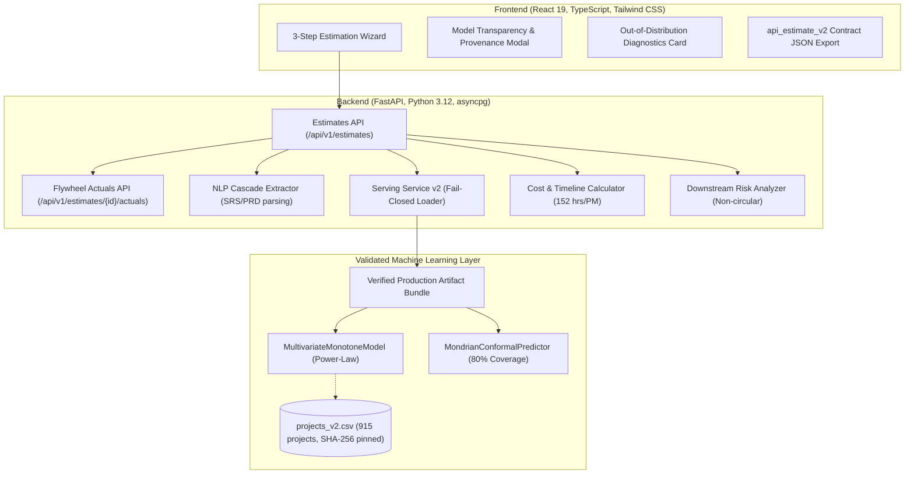

# PredictIQ v2.0 (`2.0.0-rc.1`)

**PredictIQ** is an industrial-grade, scientifically calibrated software project effort and cost estimation platform. It pairs modern web application architecture with honest, monotonic machine learning and conformal uncertainty quantification.

---

## 1. Core Principles & What Changed in v2

PredictIQ v2 completely overhauled the machine learning and estimation foundation:

1. **Honest Machine Learning (Zero Fabricated Features):**
   - In v1, 27 synthetic features ($T01-T15$, $Transactions$, $Entities$, $PointsNonAdjust$, $Adjustment$) and inflated accuracy metrics ($R^2 = 0.8953$) were derived from flawed heuristics and corrupted labels.
   - In v2, all fabricated features and false claims are permanently repudiated and purged.
   - Inference inputs are strictly restricted to legitimate project dimensions: **`size_fp`** (Function Points), **`duration_months`** (target schedule), and **`team_size`** (planned staffing).
2. **Harmonized Empirical Dataset (`projects_v2.csv`):**
   - Harmonized **915 verified software projects** across 6 historical empirical repositories (China, Desharnais, Kitchenham, Maxwell, Albrecht, AT&T).
   - Effort ranges from $0.32$ to $95.14$ person-hours per Function Point (median $9.17$ h/FP).
   - Commercial ISBSG repository expansion is architected and documented as a clean future upgrade track (`docs/data/ISBSG_PLAN.md`).
3. **Validated Monotone Estimation (`MultivariateMonotoneModel`):**
   - Strictly enforces economic reality: larger software systems never predict lower effort ($\frac{\partial \text{Effort}}{\partial \text{Size}} > 0$).
   - Generalizes with state-of-the-art out-of-domain performance: **53.9% Macro MdAPE** ($R^2 = 0.314$, MAE = 5712.7 hrs) across rigorous 6-fold Leave-One-Source-Out (LOSO) cross-validation, outperforming gradient boosted trees.
4. **Calibrated Conformal Uncertainty:**
   - Implements Mondrian size-bucketed split-conformal prediction ($q_{\text{small}} = 1.0016$, $q_{\text{medium}} = 0.9561$, $q_{\text{large}} = 1.1864$).
   - Delivers non-crossing quantile estimates: $1.0 \le p10 \le p50 \le p90$.
   - Target 80% nominal coverage achieved **79.0% pooled empirical coverage** (76.4% macro out-of-domain coverage).
5. **Transparent Trust UX & Data Quality Tiers:**
   - **Tier A (High Quality):** User-verified Function Points within empirical training domain [4.0, 4100.0] FP.
   - **Tier B (Estimated Scope):** NLP-extracted Function Points with explicit $\pm 15\%$ sizing uncertainty interval.
   - **Tier C (Out-of-Distribution):** Extreme sizes ($> 4100$ FP), timeline compression, or low parsing confidence trigger transparent diagnostic warnings without silently clamping predictions.
6. **Standard Conversion Units:**
   - 152 productive working hours per person-month (IEEE/industry standard).
   - Parametric monetary cost distribution: $\text{Cost}_{p} = \text{Effort}_{p} \times \text{Hourly Rate}$.

---

## 2. Architecture



---

## 3. API Contract (`api_estimate_v2.json`)

All estimation endpoints conform strictly to the frozen v2 contract (`docs/contracts/api_estimate_v2.json`):

```json
{
  "estimate_id": "9b1deb4d-3b7d-4bad-9bdd-2b0d7b3dcb6d",
  "project_name": "Healthcare Claims Portal",
  "effort_hours": { "p10": 1150.0, "p50": 1820.0, "p90": 2940.0 },
  "person_months": { "p10": 7.57, "p50": 11.97, "p90": 19.34 },
  "cost": { "p10": 86250.0, "p50": 136500.0, "p90": 220500.0, "currency": "USD", "rate": 75.0 },
  "size": {
    "value": 185.0,
    "source": "nlp",
    "uncertainty": { "p10": 157.2, "p50": 185.0, "p90": 212.8 }
  },
  "data_quality_tier": "B",
  "ood_flags": [],
  "model": {
    "version": "2.0.0-rc.1",
    "sha256": "b05ad3b0111d4ed3ff89b7aa2a0f653e494f81953c701916f27756d1746eede3",
    "trained_on_rows": 915,
    "sources": ["china", "desharnais", "kitchenham", "maxwell", "albrecht", "att"],
    "metrics_ref": "docs/evidence/model_validation_summary.md"
  }
}
```

---

## 4. Local Development & Verification

### Prerequisites
- Python 3.10+ (Python 3.12 recommended)
- Node.js 20+ (Node.js 22 recommended)
- PostgreSQL 15+ (for database persistence)

### Backend
```bash
# Set up Python virtual environment
python -m venv .venv
source .venv/bin/activate  # Or .venv\Scripts\activate on Windows

# Install locked dependencies
pip install -r backend/requirements.lock.txt

# Run backend test suite
pytest backend/tests/test_data_v2.py
pytest backend/tests/test_track1.py
pytest backend/tests/test_calibration.py
pytest backend/tests/test_model_sanity.py
pytest backend/tests/test_ml_service.py
pytest backend/tests/test_nlp_extractor.py
pytest backend/tests/test_serving_integration.py

# Linting & Typecheck
ruff check backend/app --select E,W,F,I --ignore E501
mypy --config-file backend/mypy.ini backend/app
```

### Frontend
```bash
cd frontend
npm ci

# Run test suite
npm test -- --pool=forks --no-file-parallelism --run

# Strict TypeScript check
npm run typecheck

# Production build
npm run build
```

---

## 5. Provenance & Milestones

| Milestone | Tag | Checkpoints | Focus |
|-----------|-----|-------------|-------|
| **M1: Data Foundation** | `dev3-m1-data-foundation` | CP00–CP05 | Source registry, 6 datasets, harmonization (`projects_v2.csv`, 915 rows), leakage gates |
| **M2: Validated ML** | `dev3-m2-validated-ml` | CP06–CP11 | Actuals flywheel, LOSO evaluation harness, Track 1 vs Track 2 decision, Mondrian calibration |
| **M3: Serving & NLP** | `dev3-m3-serving-nlp` | CP12–CP17 | Artifact safety, model sanity suite, honest serving v2, calibrated NLP sizing, cost/risk alignment |
| **M4: QA & Frontend Core**| `dev3-m4-qa-frontend-core` | CP18–CP24 | Dead code removal, CI hardening, high-contrast design system, 3-step estimation wizard, trust UX |
| **M5: Release Candidate** | `dev3-m5-release-candidate` | CP25–CP27 | Truthful docs rewrite, final multi-suite verification, release candidate tagging (`v2.0.0-rc.1`) |

For detailed mathematical formulations, empirical benchmark logs, and audit trails, refer to [docs/evidence/](docs/evidence/).
