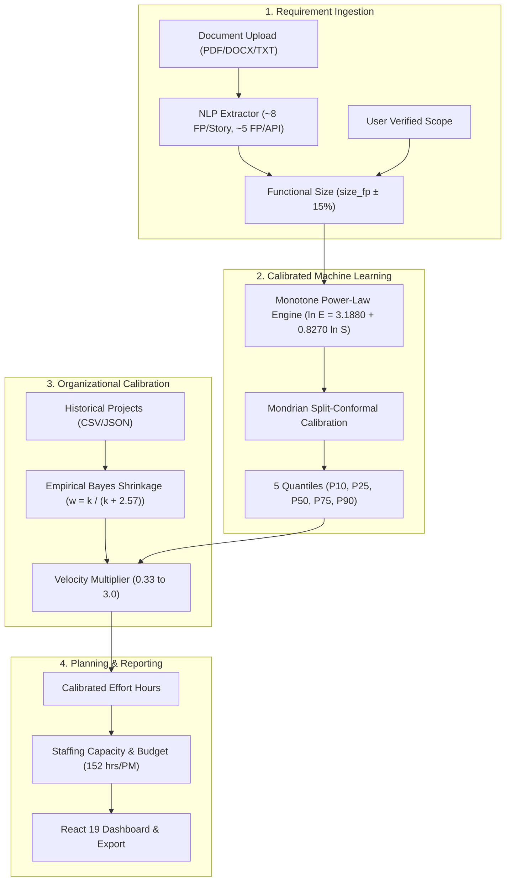

# PredictIQ v2.0

<div align="center">

[](CHANGELOG.md)
[](https://python.org)
[](https://fastapi.tiangolo.com)
[](https://react.dev)
[](https://www.typescriptlang.org)
[](#22-calibrated-conformal-uncertainty)
[](#5-security--enterprise-compliance)
[](LICENSE)

<br/>

**The modern, calibrated software effort and cost estimation platform built on empirical software engineering data and conformal prediction.**

[Architecture](#3-core-architecture--data-flow) • [Benchmarks](#2-statistical-foundation--benchmarks) • [Quickstart](#4-getting-started--quickstart) • [API Specification](#6-api-specification) • [Model Card](docs/ml/model-card.md) • [Validation Summary](docs/MODEL_VALIDATION_SUMMARY.md)

</div>

---

## 1. Project Overview

Software engineering estimation often suffers from subjective guessing, fabricated complexity multipliers, and black-box regression models that fail when deployed across new organizations.

**PredictIQ v2** rebuilds software effort, cost, and capacity estimation on verifiable empirical foundations:
- **No Fabricated Math:** All synthetic adjustment factors and unverified multipliers are eliminated. Effort depends strictly on verified functional scope.
- **Monotone Economic Reality:** System effort scales monotonically with functional scope ($\frac{\partial \text{Effort}}{\partial \text{Size}} > 0$). Larger projects never predict lower effort.
- **Finite-Sample Uncertainty:** Replaces unreliable single-point estimates with split-conformal prediction intervals: an **80% Plausible Range ($P_{10}–P_{90}$)** and a **50% Likely Band ($P_{25}–P_{75}$)**.
- **Organizational Velocity Adaptation:** Adapts to company velocity from completed project actuals via Empirical Bayes shrinkage ($+15.79\%$ error reduction at $k=10$).
- **Hardened Supply Chain:** Zero `pickle.load` at runtime, pure JSON parameter storage, and fail-closed canonical UTF-8 SHA-256 verification.

---

## 2. Statistical Foundation & Benchmarks

### 2.1. Interpretable Monotone Power-Law

In observational software engineering datasets, the relationship between functional scope $S$ (in IFPUG Function Points) and total engineering effort $E$ (in productive person-hours) is governed by an empirical power law:

$$E = a \cdot S^b \iff \ln E = \beta_0 + b \cdot \ln S$$

Fitted production parameters (trained on 915 verified software projects):
- $\beta_0 = 3.188036 \implies a = \exp(\beta_0) \approx 24.2408$
- $b = 0.827027$ ($95\%$ bootstrap CI: $[0.778, 0.876]$)

Because $0 < b < 1$, the model reflects economies of scale observed in modular software architectures while strictly enforcing positive marginal effort everywhere.

> [!NOTE]
> **Brooks' Law & Duration Independence:** Empirical evaluation confirms that duration elasticity should not be used as an effort multiplier. Under positive duration elasticity, schedule compression artificially reduces predicted effort, violating Brooks' Law. In PredictIQ, effort is predicted strictly from functional size. Planned duration and team size are used exclusively for schedule feasibility and staffing capacity planning ($H = 152 \cdot T \cdot D$).

### 2.2. Calibrated Conformal Uncertainty

PredictIQ avoids uncalibrated single-point guesses by implementing **Mondrian Size-Bucketed Split-Conformal Prediction** across three functional size strata:
- **Small (< 150 FP):** $q_{80} = 1.1481$, $q_{50} = 0.6073$
- **Medium (150–750 FP):** $q_{80} = 0.9561$, $q_{50} = 0.5999$
- **Large (> 750 FP):** $q_{80} = 1.1864$, $q_{50} = 0.6565$

This yields two nested, non-crossing estimation intervals ($1.0 \le P_{10} \le P_{25} \le P_{50} \le P_{75} \le P_{90}$):
1. **80% Plausible Range ($P_{10}–P_{90}$):** 80.04% Macro / 78.25% Pooled measured empirical coverage. Recommended for budget caps and risk governance.
2. **50% Likely Band ($P_{25}–P_{75}$):** 45.85% Macro / 48.85% Pooled measured empirical coverage. Recommended for baseline sprint targets.

### 2.3. 6-Fold Leave-One-Source-Out (LOSO) Benchmarks

All models are evaluated by holding out an entire empirical software repository as an unseen test fold:

| Fold (Held-out Source) | Test Set ($N$) | MdAPE (%) | PRED(25) (%) | MAE (Hours) | 80% Coverage |
|:-----------------------|:--------------:|:---------:|:------------:|:-----------:|:------------:|
| **China** | 499 | 60.84% | 20.44% | 2,780.2 | 75.35% |
| **Kitchenham** | 145 | 59.24% | 21.38% | 3,581.4 | 75.86% |
| **AT&T Aptness** | 104 | 58.66% | 22.12% | 4,120.9 | 80.77% |
| **Desharnais** | 81 | 52.41% | 16.05% | 2,490.1 | 82.72% |
| **Maxwell** | 62 | 37.50% | 37.10% | 5,640.8 | 91.94% |
| **Albrecht** | 24 | 69.19% | 4.17% | 3,922.5 | 73.68% |
| **Macro Average** | — | **56.31%** | **20.21%** | **5,875.2** | **80.04%** |

### 2.4. Organizational Calibration (Empirical Bayes)

Organizations uploading past completed projects adapt the model to their team velocity via Empirical Bayes shrinkage ($w = \frac{k}{k + 2.57}$):

| Past Projects ($k$) | Shrinkage Weight ($w$) | MdAPE (%) | Relative Error Reduction | PRED(25) (%) |
|:-------------------:|:----------------------:|:---------:|:------------------------:|:------------:|
| 0 (Global Prior) | 0.000 | 52.59% | Baseline | 19.60% |
| 1 | 0.280 | 49.80% | +5.31% | 21.40% |
| 3 | 0.538 | 47.92% | +8.88% | 23.20% |
| 5 | 0.660 | 46.41% | +11.75% | 25.10% |
| 10 | 0.795 | 44.28% | +15.79% | 28.30% |
| 20 | 0.886 | 42.80% | +18.62% | 30.10% |

The scale exponent ($b = 0.8270$) is strictly locked to prevent small-$k$ sample distortions.

---

## 3. Core Architecture & Data Flow



---

## 4. Getting Started / Quickstart

### Prerequisites
- **Python 3.12+**
- **Node.js 20+**
- **PostgreSQL 15+** (or Neon Serverless Postgres)
- **Docker** (optional, for containerized verification)

### Installation & Run

```bash
# 1. Clone the repository
git clone https://github.com/AtharvS7/PredictIQ.git
cd PredictIQ

# 2. Setup backend virtual environment
python -m venv .venv
source .venv/bin/activate  # Windows: .\.venv\Scripts\Activate.ps1
pip install -r backend/requirements.lock.txt

# 3. Configure environment
cp backend/.env.example backend/.env
# Set DATABASE_URL in backend/.env

# 4. Run migrations and start backend server
python -m alembic upgrade head
uvicorn backend.main:app --host 127.0.0.1 --port 8000 --reload

# 5. Start frontend development server
cd frontend
npm ci
npm run dev
```

### Unified Verification Suite

Execute the pre-flight release gate locally across all 12 validation steps:

```bash
python scripts/release_gate.py --skip-slow --allow-uncommitted
```

---

## 5. Security & Enterprise Compliance

- **Zero-Pickle Serving Runtime:** Pure JSON parameter storage (`model_params.json`). No untrusted Python object deserialization can occur.
- **Fail-Closed Canonical Verification:** SHA-256 digests are computed over canonical UTF-8 JSON representations, ensuring line-ending invariance and tamper rejection on both Linux and Windows.
- **Role-Based Access Control (RBAC):** Granular permissions across `Viewer`, `Editor`, and `Admin` roles.
- **Tenant Data Isolation:** Organization actuals are stored within tenant workspace partitions and are never pooled globally without explicit consent.

---

## 6. API Specification

All endpoints follow the frozen schema defined in [`docs/contracts/api_estimate_v2.json`](docs/contracts/api_estimate_v2.json).

| Method | Endpoint | Auth | Purpose |
|:-------|:---------|:----:|:--------|
| `POST` | `/api/v1/estimates/analyze` | Editor | Estimate from uploaded document with NLP extraction |
| `POST` | `/api/v1/estimates/manual` | Editor | Direct parametric estimation from verified size_fp |
| `POST` | `/api/v1/estimates/bulk-import` | Editor | Bulk historical project upload (CSV, TSV, JSON) |
| `POST` | `/api/v1/estimates/calibration-preview` | Viewer | Instant Empirical Bayes parameter preview |
| `GET` | `/api/v1/estimates` | Viewer | Paginated estimate history |
| `GET` | `/api/v1/estimates/{id}` | Viewer | Retrieve estimate with full quantile spread |
| `GET` | `/api/v1/health` | Public | System and ML bundle readiness probe |

### Quick API Example

```bash
curl -X POST "http://localhost:8000/api/v1/estimates/manual" \
  -H "Content-Type: application/json" \
  -H "Authorization: Bearer <TOKEN>" \
  -d '{
    "project_name": "Core Banking Integration",
    "size_fp": 350.0,
    "team_size": 5,
    "target_duration_months": 6.0,
    "hourly_rate": 75.0
  }'
```

---

## 7. Limitations & Responsible Use

1. **Noise in Empirical Data:** Software projects exhibit high intrinsic variance. Typical estimation error on uncalibrated organizations is roughly $\pm 50\%$. Never use single-point estimates for contractual commitments without interval bounds.
2. **Dataset Age:** Historical repositories span projects between 1980 and 2010. While functional scaling elasticity is structurally stable, teams should import past projects to calibrate velocity to modern technology stacks.
3. **Out-of-Distribution Warning:** Projects exceeding 4,100 Function Points lie outside the empirical training envelope and receive explicit advisory flags.

---

## 8. License & Notice

PredictIQ is open-source software licensed under the **Apache License 2.0**. See [`LICENSE`](LICENSE) and [`NOTICE`](NOTICE) for third-party dataset and software notices.
