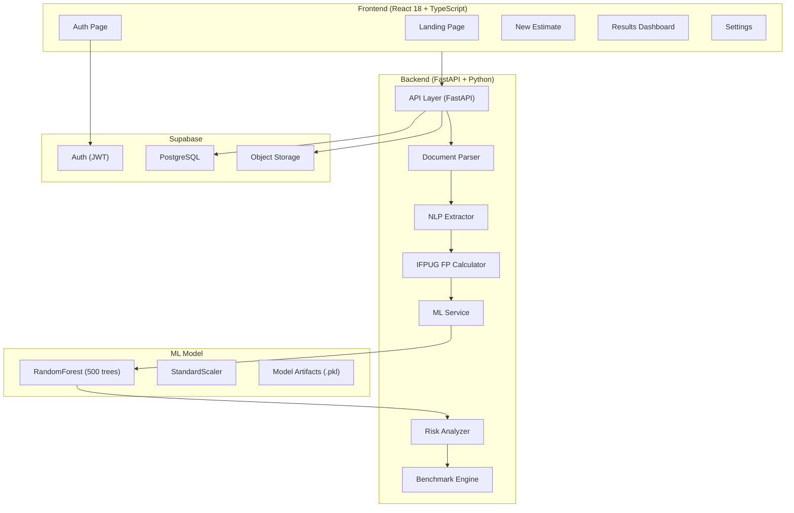

# PredictIQ-dev — Complete Project Structure Map

Generated: 2026-09-08 10:07:52

## 1. Directory Tree

```text
.agents/
.claude/
.github/
backend/
docs/
frontend/
scripts/
supabase/
.gitignore
AGENTS.md
CHANGELOG.md
CLAUDE.md
docker-compose.dev.yml
docker-compose.yml
Dockerfile.backend
Dockerfile.frontend
GEMINI.md
Makefile
MANUAL_SETUP_TASKS.md
nginx.conf
QUICK_START.md
README.md
run.py
Software Requirements Specification.docx
.agents\plugins/
.agents\skills/
.agents\plugins\marketplace.json
.agents\skills\agent-introspection-debugging/
.agents\skills\agent-sort/
.agents\skills\api-design/
.agents\skills\article-writing/
.agents\skills\backend-patterns/
.agents\skills\banner-design/
.agents\skills\benchmark-methodology/
.agents\skills\brainstorming/
.agents\skills\brand/
.agents\skills\brand-discovery/
.agents\skills\brand-voice/
.agents\skills\bun-runtime/
.agents\skills\cinematic-3d-landing/
.agents\skills\coding-standards/
.agents\skills\competitive-platform-analysis/
.agents\skills\competitive-report-structure/
.agents\skills\content-engine/
.agents\skills\crosspost/
.agents\skills\deep-research/
.agents\skills\design/
.agents\skills\design-system/
.agents\skills\dispatching-parallel-agents/
.agents\skills\dmux-workflows/
.agents\skills\documentation-lookup/
.agents\skills\e2e-testing/
.agents\skills\ecc/
.agents\skills\eval-harness/
.agents\skills\everything-claude-code/
.agents\skills\exa-search/
.agents\skills\executing-plans/
.agents\skills\fal-ai-media/
.agents\skills\finishing-a-development-branch/
.agents\skills\frontend-patterns/
.agents\skills\frontend-slides/
.agents\skills\graphify/
.agents\skills\impeccable/
.agents\skills\investor-materials/
.agents\skills\investor-outreach/
.agents\skills\market-research/
.agents\skills\mcp-server-patterns/
.agents\skills\mle-workflow/
.agents\skills\nextjs-turbopack/
.agents\skills\plan-canvas/
.agents\skills\product-capability/
.agents\skills\receiving-code-review/
.agents\skills\remove-ai-marks/
.agents\skills\requesting-code-review/
.agents\skills\security-review/
.agents\skills\slides/
.agents\skills\strategic-compact/
.agents\skills\subagent-driven-development/
.agents\skills\systematic-debugging/
.agents\skills\task-observer/
.agents\skills\tdd-workflow/
.agents\skills\test-driven-development/
.agents\skills\ui-styling/
.agents\skills\ui-ux-pro-max/
.agents\skills\using-git-worktrees/
.agents\skills\verification-before-completion/
.agents\skills\verification-loop/
.agents\skills\video-editing/
.agents\skills\watermarks-remover/
.agents\skills\writing-plans/
.agents\skills\writing-skills/
.agents\skills\x-api/
.agents\skills\a11y-architect.md
.agents\skills\agent-evaluator.md
.agents\skills\architect.md
.agents\skills\build-error-resolver.md
.agents\skills\chief-of-staff.md
.agents\skills\code-architect.md
.agents\skills\code-explorer.md
.agents\skills\code-reviewer.md
.agents\skills\code-simplifier.md
.agents\skills\comment-analyzer.md
.agents\skills\conversation-analyzer.md
.agents\skills\cpp-build-resolver.md
.agents\skills\cpp-reviewer.md
.agents\skills\csharp-reviewer.md
.agents\skills\dart-build-resolver.md
.agents\skills\database-reviewer.md
.agents\skills\django-build-resolver.md
.agents\skills\django-reviewer.md
.agents\skills\doc-updater.md
.agents\skills\docs-lookup.md
.agents\skills\e2e-runner.md
.agents\skills\fastapi-reviewer.md
.agents\skills\flutter-reviewer.md
.agents\skills\fsharp-reviewer.md
.agents\skills\gan-evaluator.md
.agents\skills\gan-generator.md
.agents\skills\gan-planner.md
.agents\skills\go-build-resolver.md
.agents\skills\go-reviewer.md
.agents\skills\harmonyos-app-resolver.md
.agents\skills\harness-optimizer.md
.agents\skills\healthcare-reviewer.md
.agents\skills\homelab-architect.md
.agents\skills\java-build-resolver.md
.agents\skills\java-reviewer.md
.agents\skills\kotlin-build-resolver.md
.agents\skills\kotlin-reviewer.md
.agents\skills\loop-operator.md
.agents\skills\marketing-agent.md
.agents\skills\mle-reviewer.md
.agents\skills\network-architect.md
.agents\skills\network-config-reviewer.md
.agents\skills\network-troubleshooter.md
.agents\skills\opensource-forker.md
.agents\skills\opensource-packager.md
.agents\skills\opensource-sanitizer.md
.agents\skills\performance-optimizer.md
.agents\skills\php-reviewer.md
.agents\skills\planner.md
.agents\skills\pr-test-analyzer.md
.agents\skills\python-reviewer.md
.agents\skills\pytorch-build-resolver.md
.agents\skills\react-build-resolver.md
.agents\skills\react-reviewer.md
.agents\skills\refactor-cleaner.md
.agents\skills\rust-build-resolver.md
.agents\skills\rust-reviewer.md
.agents\skills\security-reviewer.md
.agents\skills\seo-specialist.md
.agents\skills\silent-failure-hunter.md
.agents\skills\spec-miner.md
.agents\skills\swift-build-resolver.md
.agents\skills\swift-reviewer.md
.agents\skills\tdd-guide.md
.agents\skills\type-design-analyzer.md
.agents\skills\typescript-reviewer.md
.agents\skills\vue-reviewer.md
.agents\skills\agent-introspection-debugging\agents/
.agents\skills\agent-introspection-debugging\SKILL.md
.agents\skills\agent-introspection-debugging\agents\openai.yaml
.agents\skills\agent-sort\agents/
.agents\skills\agent-sort\SKILL.md
.agents\skills\agent-sort\agents\openai.yaml
.agents\skills\api-design\agents/
.agents\skills\api-design\SKILL.md
.agents\skills\api-design\agents\openai.yaml
.agents\skills\article-writing\agents/
.agents\skills\article-writing\SKILL.md
.agents\skills\article-writing\agents\openai.yaml
.agents\skills\backend-patterns\agents/
.agents\skills\backend-patterns\SKILL.md
.agents\skills\backend-patterns\agents\openai.yaml
.agents\skills\banner-design\references/
.agents\skills\banner-design\SKILL.md
.agents\skills\banner-design\references\banner-sizes-and-styles.md
.agents\skills\benchmark-methodology\agents/
.agents\skills\benchmark-methodology\SKILL.md
.agents\skills\benchmark-methodology\agents\openai.yaml
.agents\skills\brainstorming\scripts/
.agents\skills\brainstorming\SKILL.md
.agents\skills\brainstorming\spec-document-reviewer-prompt.md
.agents\skills\brainstorming\visual-companion.md
.agents\skills\brainstorming\scripts\frame-template.html
.agents\skills\brainstorming\scripts\helper.js
.agents\skills\brainstorming\scripts\server.cjs
.agents\skills\brainstorming\scripts\start-server.sh
.agents\skills\brainstorming\scripts\stop-server.sh
.agents\skills\brand\references/
.agents\skills\brand\scripts/
.agents\skills\brand\templates/
.agents\skills\brand\SKILL.md
.agents\skills\brand\references\approval-checklist.md
.agents\skills\brand\references\asset-organization.md
.agents\skills\brand\references\brand-guideline-template.md
.agents\skills\brand\references\color-palette-management.md
.agents\skills\brand\references\consistency-checklist.md
.agents\skills\brand\references\logo-usage-rules.md
.agents\skills\brand\references\messaging-framework.md
.agents\skills\brand\references\typography-specifications.md
.agents\skills\brand\references\update.md
.agents\skills\brand\references\visual-identity.md
.agents\skills\brand\references\voice-framework.md
.agents\skills\brand\scripts\tests/
.agents\skills\brand\scripts\extract-colors.cjs
.agents\skills\brand\scripts\inject-brand-context.cjs
.agents\skills\brand\scripts\sync-brand-to-tokens.cjs
.agents\skills\brand\scripts\validate-asset.cjs
.agents\skills\brand\scripts\tests\test_sync_brand_to_tokens.py
.agents\skills\brand\templates\brand-guidelines-starter.md
.agents\skills\brand-discovery\agents/
.agents\skills\brand-discovery\references/
.agents\skills\brand-discovery\SKILL.md
.agents\skills\brand-discovery\agents\openai.yaml
.agents\skills\brand-discovery\references\10_purpose-why.md
.agents\skills\brand-discovery\references\20_positioning.md
.agents\skills\brand-discovery\references\30_audience-niche.md
.agents\skills\brand-discovery\references\40_personality-archetype.md
.agents\skills\brand-discovery\references\50_voice-tone.md
.agents\skills\brand-discovery\references\60_narrative-story.md
.agents\skills\brand-discovery\references\70_founder-tension.md
.agents\skills\brand-discovery\references\90_SYNTHESIS.md
.agents\skills\brand-voice\agents/
.agents\skills\brand-voice\references/
.agents\skills\brand-voice\SKILL.md
.agents\skills\brand-voice\agents\openai.yaml
.agents\skills\brand-voice\references\voice-profile-schema.md
.agents\skills\bun-runtime\agents/
.agents\skills\bun-runtime\SKILL.md
.agents\skills\bun-runtime\agents\openai.yaml
.agents\skills\cinematic-3d-landing\SKILL.md
.agents\skills\coding-standards\agents/
.agents\skills\coding-standards\SKILL.md
.agents\skills\coding-standards\agents\openai.yaml
.agents\skills\competitive-platform-analysis\agents/
.agents\skills\competitive-platform-analysis\SKILL.md
.agents\skills\competitive-platform-analysis\agents\openai.yaml
.agents\skills\competitive-report-structure\agents/
.agents\skills\competitive-report-structure\SKILL.md
.agents\skills\competitive-report-structure\agents\openai.yaml
.agents\skills\content-engine\agents/
.agents\skills\content-engine\SKILL.md
.agents\skills\content-engine\agents\openai.yaml
.agents\skills\crosspost\agents/
.agents\skills\crosspost\SKILL.md
.agents\skills\crosspost\agents\openai.yaml
.agents\skills\deep-research\agents/
.agents\skills\deep-research\SKILL.md
.agents\skills\deep-research\agents\openai.yaml
.agents\skills\design\data/
.agents\skills\design\references/
.agents\skills\design\scripts/
.agents\skills\design\SKILL.md
.agents\skills\design\data\cip/
.agents\skills\design\data\icon/
.agents\skills\design\data\logo/
.agents\skills\design\data\cip\deliverables.csv
.agents\skills\design\data\cip\industries.csv
.agents\skills\design\data\cip\mockup-contexts.csv
.agents\skills\design\data\cip\styles.csv
.agents\skills\design\data\icon\styles.csv
.agents\skills\design\data\logo\colors.csv
.agents\skills\design\data\logo\industries.csv
.agents\skills\design\data\logo\styles.csv
.agents\skills\design\references\banner-sizes-and-styles.md
.agents\skills\design\references\cip-deliverable-guide.md
.agents\skills\design\references\cip-design.md
.agents\skills\design\references\cip-prompt-engineering.md
.agents\skills\design\references\cip-style-guide.md
.agents\skills\design\references\design-routing.md
.agents\skills\design\references\icon-design.md
.agents\skills\design\references\logo-color-psychology.md
.agents\skills\design\references\logo-design.md
.agents\skills\design\references\logo-prompt-engineering.md
.agents\skills\design\references\logo-style-guide.md
.agents\skills\design\references\slides-copywriting-formulas.md
.agents\skills\design\references\slides-create.md
.agents\skills\design\references\slides-html-template.md
.agents\skills\design\references\slides-layout-patterns.md
.agents\skills\design\references\slides-strategies.md
.agents\skills\design\references\slides.md
.agents\skills\design\references\social-photos-design.md
.agents\skills\design\scripts\cip/
.agents\skills\design\scripts\icon/
.agents\skills\design\scripts\logo/
.agents\skills\design\scripts\cip\core.py
.agents\skills\design\scripts\cip\generate.py
.agents\skills\design\scripts\cip\render-html.py
.agents\skills\design\scripts\cip\search.py
.agents\skills\design\scripts\icon\generate.py
.agents\skills\design\scripts\logo\core.py
.agents\skills\design\scripts\logo\generate.py
.agents\skills\design\scripts\logo\search.py
.agents\skills\design-system\data/
.agents\skills\design-system\references/
.agents\skills\design-system\scripts/
.agents\skills\design-system\templates/
.agents\skills\design-system\SKILL.md
.agents\skills\design-system\data\slide-backgrounds.csv
.agents\skills\design-system\data\slide-charts.csv
.agents\skills\design-system\data\slide-color-logic.csv
.agents\skills\design-system\data\slide-copy.csv
.agents\skills\design-system\data\slide-layout-logic.csv
.agents\skills\design-system\data\slide-layouts.csv
.agents\skills\design-system\data\slide-strategies.csv
.agents\skills\design-system\data\slide-typography.csv
.agents\skills\design-system\references\component-specs.md
.agents\skills\design-system\references\component-tokens.md
.agents\skills\design-system\references\primitive-tokens.md
.agents\skills\design-system\references\semantic-tokens.md
.agents\skills\design-system\references\states-and-variants.md
.agents\skills\design-system\references\tailwind-integration.md
.agents\skills\design-system\references\token-architecture.md
.agents\skills\design-system\scripts\tests/
.agents\skills\design-system\scripts\embed-tokens.cjs
.agents\skills\design-system\scripts\fetch-background.py
.agents\skills\design-system\scripts\generate-slide.py
.agents\skills\design-system\scripts\generate-tokens.cjs
.agents\skills\design-system\scripts\html-token-validator.py
.agents\skills\design-system\scripts\search-slides.py
.agents\skills\design-system\scripts\slide-token-validator.py
.agents\skills\design-system\scripts\slide_search_core.py
.agents\skills\design-system\scripts\validate-tokens.cjs
.agents\skills\design-system\scripts\tests\test_validate_tokens.py
.agents\skills\design-system\templates\design-tokens-starter.json
.agents\skills\dispatching-parallel-agents\SKILL.md
.agents\skills\dmux-workflows\agents/
.agents\skills\dmux-workflows\SKILL.md
.agents\skills\dmux-workflows\agents\openai.yaml
.agents\skills\documentation-lookup\agents/
.agents\skills\documentation-lookup\SKILL.md
.agents\skills\documentation-lookup\agents\openai.yaml
.agents\skills\e2e-testing\agents/
.agents\skills\e2e-testing\SKILL.md
.agents\skills\e2e-testing\agents\openai.yaml
.agents\skills\ecc\accessibility/
.agents\skills\ecc\agent-introspection-debugging/
.agents\skills\ecc\agent-self-evaluation/
.agents\skills\ecc\agent-sort/
.agents\skills\ecc\ai-regression-testing/
.agents\skills\ecc\android-clean-architecture/
.agents\skills\ecc\angular-developer/
.agents\skills\ecc\api-design/
.agents\skills\ecc\architecture-decision-records/
.agents\skills\ecc\backend-patterns/
.agents\skills\ecc\browser-qa/
.agents\skills\ecc\bun-runtime/
.agents\skills\ecc\ck/
.agents\skills\ecc\click-path-audit/
.agents\skills\ecc\clickhouse-io/
.agents\skills\ecc\code-tour/
.agents\skills\ecc\codebase-onboarding/
.agents\skills\ecc\codehealth-mcp/
.agents\skills\ecc\coding-standards/
.agents\skills\ecc\compose-multiplatform-patterns/
.agents\skills\ecc\config-gc/
.agents\skills\ecc\configure-ecc/
.agents\skills\ecc\context-budget/
.agents\skills\ecc\continuous-learning/
.agents\skills\ecc\continuous-learning-v2/
.agents\skills\ecc\council/
.agents\skills\ecc\cpp-coding-standards/
.agents\skills\ecc\cpp-testing/
.agents\skills\ecc\csharp-testing/
.agents\skills\ecc\dart-flutter-patterns/
.agents\skills\ecc\database-migrations/
.agents\skills\ecc\delivery-gate/
.agents\skills\ecc\design-system/
.agents\skills\ecc\django-celery/
.agents\skills\ecc\django-patterns/
.agents\skills\ecc\django-tdd/
.agents\skills\ecc\django-verification/
.agents\skills\ecc\dmux-workflows/
.agents\skills\ecc\dotnet-patterns/
.agents\skills\ecc\e2e-testing/
.agents\skills\ecc\ecc-guide/
.agents\skills\ecc\ecc-recipes/
.agents\skills\ecc\error-handling/
.agents\skills\ecc\eval-harness/
.agents\skills\ecc\fastapi-patterns/
.agents\skills\ecc\flutter-dart-code-review/
.agents\skills\ecc\frontend-a11y/
.agents\skills\ecc\frontend-design-direction/
.agents\skills\ecc\frontend-patterns/
.agents\skills\ecc\frontend-slides/
.agents\skills\ecc\fsharp-testing/
.agents\skills\ecc\generating-python-installer/
.agents\skills\ecc\git-workflow/
.agents\skills\ecc\golang-patterns/
.agents\skills\ecc\golang-testing/
.agents\skills\ecc\growth-log/
.agents\skills\ecc\hexagonal-architecture/
.agents\skills\ecc\hookify-rules/
.agents\skills\ecc\inherit-legacy-style/
.agents\skills\ecc\intent-driven-development/
.agents\skills\ecc\iterative-retrieval/
.agents\skills\ecc\java-coding-standards/
.agents\skills\ecc\jpa-patterns/
.agents\skills\ecc\kotlin-coroutines-flows/
.agents\skills\ecc\kotlin-exposed-patterns/
.agents\skills\ecc\kotlin-ktor-patterns/
.agents\skills\ecc\kotlin-patterns/
.agents\skills\ecc\kotlin-testing/
.agents\skills\ecc\laravel-patterns/
.agents\skills\ecc\laravel-plugin-discovery/
.agents\skills\ecc\laravel-tdd/
.agents\skills\ecc\laravel-verification/
.agents\skills\ecc\loop-design-check/
.agents\skills\ecc\make-interfaces-feel-better/
.agents\skills\ecc\mcp-server-patterns/
.agents\skills\ecc\motion-advanced/
.agents\skills\ecc\motion-foundations/
.agents\skills\ecc\motion-patterns/
.agents\skills\ecc\motion-ui/
.agents\skills\ecc\mysql-patterns/
.agents\skills\ecc\nestjs-patterns/
.agents\skills\ecc\nextjs-turbopack/
.agents\skills\ecc\nuxt4-patterns/
.agents\skills\ecc\perl-patterns/
.agents\skills\ecc\perl-testing/
.agents\skills\ecc\plan-canvas/
.agents\skills\ecc\plankton-code-quality/
.agents\skills\ecc\postgres-patterns/
.agents\skills\ecc\prisma-patterns/
.agents\skills\ecc\product-lens/
.agents\skills\ecc\production-audit/
.agents\skills\ecc\python-patterns/
.agents\skills\ecc\python-testing/
.agents\skills\ecc\quarkus-patterns/
.agents\skills\ecc\quarkus-tdd/
.agents\skills\ecc\quarkus-verification/
.agents\skills\ecc\react-native-patterns/
.agents\skills\ecc\react-patterns/
.agents\skills\ecc\react-performance/
.agents\skills\ecc\react-testing/
.agents\skills\ecc\redis-patterns/
.agents\skills\ecc\repo-scan/
.agents\skills\ecc\rules-distill/
.agents\skills\ecc\rust-patterns/
.agents\skills\ecc\rust-testing/
.agents\skills\ecc\santa-method/
.agents\skills\ecc\skill-scout/
.agents\skills\ecc\skill-stocktake/
.agents\skills\ecc\springboot-patterns/
.agents\skills\ecc\springboot-tdd/
.agents\skills\ecc\springboot-verification/
.agents\skills\ecc\strategic-compact/
.agents\skills\ecc\tdd-workflow/
.agents\skills\ecc\tinystruct-patterns/
.agents\skills\ecc\ui-to-vue/
.agents\skills\ecc\verification-loop/
.agents\skills\ecc\vite-patterns/
.agents\skills\ecc\vue-patterns/
.agents\skills\ecc\windows-desktop-e2e/
.agents\skills\ecc\accessibility\SKILL.md
.agents\skills\ecc\agent-introspection-debugging\SKILL.md
.agents\skills\ecc\agent-self-evaluation\examples/
.agents\skills\ecc\agent-self-evaluation\references/
.agents\skills\ecc\agent-self-evaluation\scripts/
.agents\skills\ecc\agent-self-evaluation\templates/
.agents\skills\ecc\agent-self-evaluation\SKILL.md
.agents\skills\ecc\agent-self-evaluation\examples\high-score-example.md
.agents\skills\ecc\agent-self-evaluation\examples\low-score-example.md
.agents\skills\ecc\agent-self-evaluation\references\evaluation-criteria.md
.agents\skills\ecc\agent-self-evaluation\references\hook-integration.md
.agents\skills\ecc\agent-self-evaluation\scripts\evaluate.py
.agents\skills\ecc\agent-self-evaluation\templates\evaluation-report.md
.agents\skills\ecc\agent-sort\SKILL.md
.agents\skills\ecc\ai-regression-testing\SKILL.md
.agents\skills\ecc\android-clean-architecture\SKILL.md
.agents\skills\ecc\angular-developer\references/
.agents\skills\ecc\angular-developer\SKILL.md
.agents\skills\ecc\angular-developer\references\angular-animations.md
.agents\skills\ecc\angular-developer\references\angular-aria.md
.agents\skills\ecc\angular-developer\references\cli.md
.agents\skills\ecc\angular-developer\references\component-harnesses.md
.agents\skills\ecc\angular-developer\references\component-styling.md
.agents\skills\ecc\angular-developer\references\components.md
.agents\skills\ecc\angular-developer\references\creating-services.md
.agents\skills\ecc\angular-developer\references\data-resolvers.md
.agents\skills\ecc\angular-developer\references\define-routes.md
.agents\skills\ecc\angular-developer\references\defining-providers.md
.agents\skills\ecc\angular-developer\references\di-fundamentals.md
.agents\skills\ecc\angular-developer\references\e2e-testing.md
.agents\skills\ecc\angular-developer\references\effects.md
.agents\skills\ecc\angular-developer\references\hierarchical-injectors.md
.agents\skills\ecc\angular-developer\references\host-elements.md
.agents\skills\ecc\angular-developer\references\injection-context.md
.agents\skills\ecc\angular-developer\references\inputs.md
.agents\skills\ecc\angular-developer\references\linked-signal.md
.agents\skills\ecc\angular-developer\references\loading-strategies.md
.agents\skills\ecc\angular-developer\references\mcp.md
.agents\skills\ecc\angular-developer\references\navigate-to-routes.md
.agents\skills\ecc\angular-developer\references\outputs.md
.agents\skills\ecc\angular-developer\references\reactive-forms.md
.agents\skills\ecc\angular-developer\references\rendering-strategies.md
.agents\skills\ecc\angular-developer\references\resource.md
.agents\skills\ecc\angular-developer\references\route-animations.md
.agents\skills\ecc\angular-developer\references\route-guards.md
.agents\skills\ecc\angular-developer\references\router-lifecycle.md
.agents\skills\ecc\angular-developer\references\router-testing.md
.agents\skills\ecc\angular-developer\references\show-routes-with-outlets.md
.agents\skills\ecc\angular-developer\references\signal-forms.md
.agents\skills\ecc\angular-developer\references\signals-overview.md
.agents\skills\ecc\angular-developer\references\tailwind-css.md
.agents\skills\ecc\angular-developer\references\template-driven-forms.md
.agents\skills\ecc\angular-developer\references\testing-fundamentals.md
.agents\skills\ecc\api-design\SKILL.md
.agents\skills\ecc\architecture-decision-records\SKILL.md
.agents\skills\ecc\backend-patterns\SKILL.md
.agents\skills\ecc\browser-qa\SKILL.md
.agents\skills\ecc\bun-runtime\SKILL.md
.agents\skills\ecc\ck\commands/
.agents\skills\ecc\ck\hooks/
.agents\skills\ecc\ck\SKILL.md
.agents\skills\ecc\ck\commands\forget.mjs
.agents\skills\ecc\ck\commands\info.mjs
.agents\skills\ecc\ck\commands\init.mjs
.agents\skills\ecc\ck\commands\list.mjs
.agents\skills\ecc\ck\commands\migrate.mjs
.agents\skills\ecc\ck\commands\resume.mjs
.agents\skills\ecc\ck\commands\save.mjs
.agents\skills\ecc\ck\commands\shared.mjs
.agents\skills\ecc\ck\hooks\session-start.mjs
.agents\skills\ecc\click-path-audit\SKILL.md
.agents\skills\ecc\clickhouse-io\SKILL.md
.agents\skills\ecc\code-tour\SKILL.md
.agents\skills\ecc\codebase-onboarding\SKILL.md
.agents\skills\ecc\codehealth-mcp\SKILL.md
.agents\skills\ecc\coding-standards\SKILL.md
.agents\skills\ecc\compose-multiplatform-patterns\SKILL.md
.agents\skills\ecc\config-gc\SKILL.md
.agents\skills\ecc\configure-ecc\SKILL.md
.agents\skills\ecc\context-budget\SKILL.md
.agents\skills\ecc\continuous-learning\config.json
.agents\skills\ecc\continuous-learning\evaluate-session.sh
.agents\skills\ecc\continuous-learning\SKILL.md
.agents\skills\ecc\continuous-learning-v2\agents/
.agents\skills\ecc\continuous-learning-v2\hooks/
.agents\skills\ecc\continuous-learning-v2\scripts/
.agents\skills\ecc\continuous-learning-v2\config.json
.agents\skills\ecc\continuous-learning-v2\SKILL.md
.agents\skills\ecc\continuous-learning-v2\agents\observer-loop.sh
.agents\skills\ecc\continuous-learning-v2\agents\observer.md
.agents\skills\ecc\continuous-learning-v2\agents\session-guardian.sh
.agents\skills\ecc\continuous-learning-v2\agents\start-observer.sh
.agents\skills\ecc\continuous-learning-v2\hooks\observe.sh
.agents\skills\ecc\continuous-learning-v2\scripts\lib/
.agents\skills\ecc\continuous-learning-v2\scripts\detect-project.sh
.agents\skills\ecc\continuous-learning-v2\scripts\instinct-cli.py
.agents\skills\ecc\continuous-learning-v2\scripts\migrate-homunculus.sh
.agents\skills\ecc\continuous-learning-v2\scripts\test_parse_instinct.py
.agents\skills\ecc\continuous-learning-v2\scripts\lib\homunculus-dir.sh
.agents\skills\ecc\council\SKILL.md
.agents\skills\ecc\cpp-coding-standards\SKILL.md
.agents\skills\ecc\cpp-testing\SKILL.md
.agents\skills\ecc\csharp-testing\SKILL.md
.agents\skills\ecc\dart-flutter-patterns\SKILL.md
.agents\skills\ecc\database-migrations\SKILL.md
.agents\skills\ecc\delivery-gate\hooks/
.agents\skills\ecc\delivery-gate\SKILL.md
.agents\skills\ecc\delivery-gate\hooks\quality-gate.py
.agents\skills\ecc\design-system\SKILL.md
.agents\skills\ecc\django-celery\SKILL.md
.agents\skills\ecc\django-patterns\SKILL.md
.agents\skills\ecc\django-tdd\SKILL.md
.agents\skills\ecc\django-verification\SKILL.md
.agents\skills\ecc\dmux-workflows\SKILL.md
.agents\skills\ecc\dotnet-patterns\SKILL.md
.agents\skills\ecc\e2e-testing\SKILL.md
.agents\skills\ecc\ecc-guide\SKILL.md
.agents\skills\ecc\ecc-recipes\SKILL.md
.agents\skills\ecc\error-handling\SKILL.md
.agents\skills\ecc\eval-harness\SKILL.md
.agents\skills\ecc\fastapi-patterns\SKILL.md
.agents\skills\ecc\flutter-dart-code-review\SKILL.md
.agents\skills\ecc\frontend-a11y\SKILL.md
.agents\skills\ecc\frontend-design-direction\SKILL.md
.agents\skills\ecc\frontend-patterns\SKILL.md
.agents\skills\ecc\frontend-slides\scripts/
.agents\skills\ecc\frontend-slides\animation-patterns.md
.agents\skills\ecc\frontend-slides\html-template.md
.agents\skills\ecc\frontend-slides\SKILL.md
.agents\skills\ecc\frontend-slides\STYLE_PRESETS.md
.agents\skills\ecc\frontend-slides\viewport-base.css
.agents\skills\ecc\frontend-slides\scripts\export-pdf.sh
.agents\skills\ecc\frontend-slides\scripts\extract-pptx.py
.agents\skills\ecc\fsharp-testing\SKILL.md
.agents\skills\ecc\generating-python-installer\SKILL.md
.agents\skills\ecc\git-workflow\SKILL.md
.agents\skills\ecc\golang-patterns\SKILL.md
.agents\skills\ecc\golang-testing\SKILL.md
.agents\skills\ecc\growth-log\SKILL.md
.agents\skills\ecc\hexagonal-architecture\SKILL.md
.agents\skills\ecc\hookify-rules\SKILL.md
.agents\skills\ecc\inherit-legacy-style\SKILL.md
.agents\skills\ecc\intent-driven-development\SKILL.md
.agents\skills\ecc\iterative-retrieval\SKILL.md
.agents\skills\ecc\java-coding-standards\SKILL.md
.agents\skills\ecc\jpa-patterns\SKILL.md
.agents\skills\ecc\kotlin-coroutines-flows\SKILL.md
.agents\skills\ecc\kotlin-exposed-patterns\SKILL.md
.agents\skills\ecc\kotlin-ktor-patterns\SKILL.md
.agents\skills\ecc\kotlin-patterns\SKILL.md
.agents\skills\ecc\kotlin-testing\SKILL.md
.agents\skills\ecc\laravel-patterns\SKILL.md
.agents\skills\ecc\laravel-plugin-discovery\SKILL.md
.agents\skills\ecc\laravel-tdd\SKILL.md
.agents\skills\ecc\laravel-verification\SKILL.md
.agents\skills\ecc\loop-design-check\SKILL.md
.agents\skills\ecc\make-interfaces-feel-better\SKILL.md
.agents\skills\ecc\mcp-server-patterns\SKILL.md
.agents\skills\ecc\motion-advanced\SKILL.md
.agents\skills\ecc\motion-foundations\SKILL.md
.agents\skills\ecc\motion-patterns\SKILL.md
.agents\skills\ecc\motion-ui\SKILL.md
.agents\skills\ecc\mysql-patterns\SKILL.md
.agents\skills\ecc\nestjs-patterns\SKILL.md
.agents\skills\ecc\nextjs-turbopack\SKILL.md
.agents\skills\ecc\nuxt4-patterns\SKILL.md
.agents\skills\ecc\perl-patterns\SKILL.md
.agents\skills\ecc\perl-testing\SKILL.md
.agents\skills\ecc\plan-canvas\SKILL.md
.agents\skills\ecc\plankton-code-quality\SKILL.md
.agents\skills\ecc\postgres-patterns\SKILL.md
.agents\skills\ecc\prisma-patterns\SKILL.md
.agents\skills\ecc\product-lens\SKILL.md
.agents\skills\ecc\production-audit\SKILL.md
.agents\skills\ecc\python-patterns\SKILL.md
.agents\skills\ecc\python-testing\SKILL.md
.agents\skills\ecc\quarkus-patterns\SKILL.md
.agents\skills\ecc\quarkus-tdd\SKILL.md
.agents\skills\ecc\quarkus-verification\SKILL.md
.agents\skills\ecc\react-native-patterns\SKILL.md
.agents\skills\ecc\react-patterns\SKILL.md
.agents\skills\ecc\react-performance\SKILL.md
.agents\skills\ecc\react-testing\SKILL.md
.agents\skills\ecc\redis-patterns\SKILL.md
.agents\skills\ecc\repo-scan\SKILL.md
.agents\skills\ecc\rules-distill\scripts/
.agents\skills\ecc\rules-distill\SKILL.md
.agents\skills\ecc\rules-distill\scripts\scan-rules.sh
.agents\skills\ecc\rules-distill\scripts\scan-skills.sh
.agents\skills\ecc\rust-patterns\SKILL.md
.agents\skills\ecc\rust-testing\SKILL.md
.agents\skills\ecc\santa-method\SKILL.md
.agents\skills\ecc\skill-scout\SKILL.md
.agents\skills\ecc\skill-stocktake\scripts/
.agents\skills\ecc\skill-stocktake\SKILL.md
.agents\skills\ecc\skill-stocktake\scripts\quick-diff.sh
.agents\skills\ecc\skill-stocktake\scripts\save-results.sh
.agents\skills\ecc\skill-stocktake\scripts\scan.sh
.agents\skills\ecc\springboot-patterns\SKILL.md
.agents\skills\ecc\springboot-tdd\SKILL.md
.agents\skills\ecc\springboot-verification\SKILL.md
.agents\skills\ecc\strategic-compact\SKILL.md
.agents\skills\ecc\tdd-workflow\SKILL.md
.agents\skills\ecc\tinystruct-patterns\references/
.agents\skills\ecc\tinystruct-patterns\SKILL.md
.agents\skills\ecc\tinystruct-patterns\references\architecture.md
.agents\skills\ecc\tinystruct-patterns\references\data-handling.md
.agents\skills\ecc\tinystruct-patterns\references\database.md
.agents\skills\ecc\tinystruct-patterns\references\routing.md
.agents\skills\ecc\tinystruct-patterns\references\system-usage.md
.agents\skills\ecc\tinystruct-patterns\references\testing.md
.agents\skills\ecc\ui-to-vue\SKILL.md
.agents\skills\ecc\verification-loop\SKILL.md
.agents\skills\ecc\vite-patterns\SKILL.md
.agents\skills\ecc\vue-patterns\SKILL.md
.agents\skills\ecc\windows-desktop-e2e\SKILL.md
.agents\skills\eval-harness\agents/
.agents\skills\eval-harness\SKILL.md
.agents\skills\eval-harness\agents\openai.yaml
.agents\skills\everything-claude-code\agents/
.agents\skills\everything-claude-code\SKILL.md
.agents\skills\everything-claude-code\agents\openai.yaml
.agents\skills\exa-search\agents/
.agents\skills\exa-search\SKILL.md
.agents\skills\exa-search\agents\openai.yaml
.agents\skills\executing-plans\SKILL.md
.agents\skills\fal-ai-media\agents/
.agents\skills\fal-ai-media\SKILL.md
.agents\skills\fal-ai-media\agents\openai.yaml
.agents\skills\finishing-a-development-branch\SKILL.md
.agents\skills\frontend-patterns\agents/
.agents\skills\frontend-patterns\SKILL.md
.agents\skills\frontend-patterns\agents\openai.yaml
.agents\skills\frontend-slides\agents/
.agents\skills\frontend-slides\SKILL.md
.agents\skills\frontend-slides\STYLE_PRESETS.md
.agents\skills\frontend-slides\agents\openai.yaml
.agents\skills\graphify\references/
.agents\skills\graphify\.graphify_version
.agents\skills\graphify\SKILL.md
.agents\skills\graphify\references\add-watch.md
.agents\skills\graphify\references\exports.md
.agents\skills\graphify\references\extraction-spec.md
.agents\skills\graphify\references\github-and-merge.md
.agents\skills\graphify\references\hooks.md
.agents\skills\graphify\references\query.md
.agents\skills\graphify\references\transcribe.md
.agents\skills\graphify\references\update.md
.agents\skills\impeccable\reference/
.agents\skills\impeccable\scripts/
.agents\skills\impeccable\SKILL.md
.agents\skills\impeccable\reference\adapt.md
.agents\skills\impeccable\reference\animate.md
.agents\skills\impeccable\reference\audit.md
.agents\skills\impeccable\reference\bolder.md
.agents\skills\impeccable\reference\brand.md
.agents\skills\impeccable\reference\clarify.md
.agents\skills\impeccable\reference\codex.md
.agents\skills\impeccable\reference\colorize.md
.agents\skills\impeccable\reference\craft.md
.agents\skills\impeccable\reference\critique.md
.agents\skills\impeccable\reference\delight.md
.agents\skills\impeccable\reference\distill.md
.agents\skills\impeccable\reference\document.md
.agents\skills\impeccable\reference\extract.md
.agents\skills\impeccable\reference\harden.md
.agents\skills\impeccable\reference\hooks.md
.agents\skills\impeccable\reference\init.md
.agents\skills\impeccable\reference\interaction-design.md
.agents\skills\impeccable\reference\layout.md
.agents\skills\impeccable\reference\live.md
.agents\skills\impeccable\reference\onboard.md
.agents\skills\impeccable\reference\optimize.md
.agents\skills\impeccable\reference\overdrive.md
.agents\skills\impeccable\reference\polish.md
.agents\skills\impeccable\reference\product.md
.agents\skills\impeccable\reference\quieter.md
.agents\skills\impeccable\reference\shape.md
.agents\skills\impeccable\reference\typeset.md
.agents\skills\impeccable\scripts\detector/
.agents\skills\impeccable\scripts\lib/
.agents\skills\impeccable\scripts\live/
.agents\skills\impeccable\scripts\command-metadata.json
.agents\skills\impeccable\scripts\context-signals.mjs
.agents\skills\impeccable\scripts\context.mjs
.agents\skills\impeccable\scripts\critique-storage.mjs
.agents\skills\impeccable\scripts\detect-csp.mjs
.agents\skills\impeccable\scripts\detect.mjs
.agents\skills\impeccable\scripts\hook-admin.mjs
.agents\skills\impeccable\scripts\hook-before-edit.mjs
.agents\skills\impeccable\scripts\hook-lib.mjs
.agents\skills\impeccable\scripts\hook.mjs
.agents\skills\impeccable\scripts\live-accept.mjs
.agents\skills\impeccable\scripts\live-browser-dom.js
.agents\skills\impeccable\scripts\live-browser-session.js
.agents\skills\impeccable\scripts\live-browser.js
.agents\skills\impeccable\scripts\live-commit-manual-edits.mjs
.agents\skills\impeccable\scripts\live-complete.mjs
.agents\skills\impeccable\scripts\live-copy-edit-agent.mjs
.agents\skills\impeccable\scripts\live-discard-manual-edits.mjs
.agents\skills\impeccable\scripts\live-inject.mjs
.agents\skills\impeccable\scripts\live-insert.mjs
.agents\skills\impeccable\scripts\live-manual-edit-evidence.mjs
.agents\skills\impeccable\scripts\live-poll.mjs
.agents\skills\impeccable\scripts\live-resume.mjs
.agents\skills\impeccable\scripts\live-server.mjs
.agents\skills\impeccable\scripts\live-status.mjs
.agents\skills\impeccable\scripts\live-target.mjs
.agents\skills\impeccable\scripts\live-wrap.mjs
.agents\skills\impeccable\scripts\live.mjs
.agents\skills\impeccable\scripts\modern-screenshot.umd.js
.agents\skills\impeccable\scripts\palette.mjs
.agents\skills\impeccable\scripts\pin.mjs
.agents\skills\impeccable\scripts\detector\browser/
.agents\skills\impeccable\scripts\detector\cli/
.agents\skills\impeccable\scripts\detector\engines/
.agents\skills\impeccable\scripts\detector\node/
.agents\skills\impeccable\scripts\detector\profile/
.agents\skills\impeccable\scripts\detector\registry/
.agents\skills\impeccable\scripts\detector\rules/
.agents\skills\impeccable\scripts\detector\shared/
.agents\skills\impeccable\scripts\detector\design-system.mjs
.agents\skills\impeccable\scripts\detector\detect-antipatterns-browser.js
.agents\skills\impeccable\scripts\detector\detect-antipatterns.mjs
.agents\skills\impeccable\scripts\detector\findings.mjs
.agents\skills\impeccable\scripts\detector\browser\injected/
.agents\skills\impeccable\scripts\detector\browser\injected\index.mjs
.agents\skills\impeccable\scripts\detector\cli\main.mjs
.agents\skills\impeccable\scripts\detector\engines\browser/
.agents\skills\impeccable\scripts\detector\engines\regex/
.agents\skills\impeccable\scripts\detector\engines\static-html/
.agents\skills\impeccable\scripts\detector\engines\visual/
.agents\skills\impeccable\scripts\detector\engines\browser\detect-url.mjs
.agents\skills\impeccable\scripts\detector\engines\regex\detect-text.mjs
.agents\skills\impeccable\scripts\detector\engines\static-html\css-cascade.mjs
.agents\skills\impeccable\scripts\detector\engines\static-html\detect-html.mjs
.agents\skills\impeccable\scripts\detector\engines\visual\screenshot-contrast.mjs
.agents\skills\impeccable\scripts\detector\node\file-system.mjs
.agents\skills\impeccable\scripts\detector\profile\profiler.mjs
.agents\skills\impeccable\scripts\detector\registry\antipatterns.mjs
.agents\skills\impeccable\scripts\detector\rules\checks.mjs
.agents\skills\impeccable\scripts\detector\shared\color.mjs
.agents\skills\impeccable\scripts\detector\shared\constants.mjs
.agents\skills\impeccable\scripts\detector\shared\inline-ignores.mjs
.agents\skills\impeccable\scripts\detector\shared\page.mjs
.agents\skills\impeccable\scripts\lib\design-parser.mjs
.agents\skills\impeccable\scripts\lib\impeccable-config.mjs
.agents\skills\impeccable\scripts\lib\impeccable-paths.mjs
.agents\skills\impeccable\scripts\lib\is-generated.mjs
.agents\skills\impeccable\scripts\lib\target-args.mjs
.agents\skills\impeccable\scripts\live\browser-script-parts.mjs
.agents\skills\impeccable\scripts\live\completion.mjs
.agents\skills\impeccable\scripts\live\event-validation.mjs
.agents\skills\impeccable\scripts\live\insert-ui.mjs
.agents\skills\impeccable\scripts\live\manual-apply.mjs
.agents\skills\impeccable\scripts\live\manual-edit-routes.mjs
.agents\skills\impeccable\scripts\live\manual-edits-buffer.mjs
.agents\skills\impeccable\scripts\live\session-store.mjs
.agents\skills\impeccable\scripts\live\svelte-component.mjs
.agents\skills\impeccable\scripts\live\sveltekit-adapter.mjs
.agents\skills\impeccable\scripts\live\ui-core.mjs
.agents\skills\impeccable\scripts\live\vocabulary.mjs
.agents\skills\investor-materials\agents/
.agents\skills\investor-materials\SKILL.md
.agents\skills\investor-materials\agents\openai.yaml
.agents\skills\investor-outreach\agents/
.agents\skills\investor-outreach\SKILL.md
.agents\skills\investor-outreach\agents\openai.yaml
.agents\skills\market-research\agents/
.agents\skills\market-research\SKILL.md
.agents\skills\market-research\agents\openai.yaml
.agents\skills\mcp-server-patterns\agents/
.agents\skills\mcp-server-patterns\SKILL.md
.agents\skills\mcp-server-patterns\agents\openai.yaml
.agents\skills\mle-workflow\agents/
.agents\skills\mle-workflow\SKILL.md
.agents\skills\mle-workflow\agents\openai.yaml
.agents\skills\nextjs-turbopack\agents/
.agents\skills\nextjs-turbopack\SKILL.md
.agents\skills\nextjs-turbopack\agents\openai.yaml
.agents\skills\plan-canvas\agents/
.agents\skills\plan-canvas\SKILL.md
.agents\skills\plan-canvas\agents\openai.yaml
.agents\skills\product-capability\agents/
.agents\skills\product-capability\SKILL.md
.agents\skills\product-capability\agents\openai.yaml
.agents\skills\receiving-code-review\SKILL.md
.agents\skills\remove-ai-marks\references/
.agents\skills\remove-ai-marks\SKILL.md
.agents\skills\remove-ai-marks\references\ethics.md
.agents\skills\remove-ai-marks\references\how-claude-marks.md
.agents\skills\remove-ai-marks\references\mark-classes.md
.agents\skills\remove-ai-marks\references\markdiffusion.md
.agents\skills\remove-ai-marks\references\removal-matrix.md
.agents\skills\remove-ai-marks\references\vendor-notes.md
.agents\skills\requesting-code-review\code-reviewer.md
.agents\skills\requesting-code-review\SKILL.md
.agents\skills\security-review\agents/
.agents\skills\security-review\SKILL.md
.agents\skills\security-review\agents\openai.yaml
.agents\skills\slides\references/
.agents\skills\slides\SKILL.md
.agents\skills\slides\references\copywriting-formulas.md
.agents\skills\slides\references\create.md
.agents\skills\slides\references\html-template.md
.agents\skills\slides\references\layout-patterns.md
.agents\skills\slides\references\slide-strategies.md
.agents\skills\strategic-compact\agents/
.agents\skills\strategic-compact\SKILL.md
.agents\skills\strategic-compact\agents\openai.yaml
.agents\skills\subagent-driven-development\scripts/
.agents\skills\subagent-driven-development\implementer-prompt.md
.agents\skills\subagent-driven-development\SKILL.md
.agents\skills\subagent-driven-development\task-reviewer-prompt.md
.agents\skills\subagent-driven-development\scripts\review-package
.agents\skills\subagent-driven-development\scripts\sdd-workspace
.agents\skills\subagent-driven-development\scripts\task-brief
.agents\skills\systematic-debugging\condition-based-waiting-example.ts
.agents\skills\systematic-debugging\condition-based-waiting.md
.agents\skills\systematic-debugging\CREATION-LOG.md
.agents\skills\systematic-debugging\defense-in-depth.md
.agents\skills\systematic-debugging\find-polluter.sh
.agents\skills\systematic-debugging\root-cause-tracing.md
.agents\skills\systematic-debugging\SKILL.md
.agents\skills\systematic-debugging\test-academic.md
.agents\skills\systematic-debugging\test-pressure-1.md
.agents\skills\systematic-debugging\test-pressure-2.md
.agents\skills\systematic-debugging\test-pressure-3.md
.agents\skills\task-observer\SKILL.md
.agents\skills\task-observer\USER-GUIDE.md
.agents\skills\tdd-workflow\agents/
.agents\skills\tdd-workflow\SKILL.md
.agents\skills\tdd-workflow\agents\openai.yaml
.agents\skills\test-driven-development\SKILL.md
.agents\skills\test-driven-development\testing-anti-patterns.md
.agents\skills\ui-styling\references/
.agents\skills\ui-styling\scripts/
.agents\skills\ui-styling\LICENSE.txt
.agents\skills\ui-styling\SKILL.md
.agents\skills\ui-styling\references\canvas-design-system.md
.agents\skills\ui-styling\references\shadcn-accessibility.md
.agents\skills\ui-styling\references\shadcn-components.md
.agents\skills\ui-styling\references\shadcn-theming.md
.agents\skills\ui-styling\references\tailwind-customization.md
.agents\skills\ui-styling\references\tailwind-responsive.md
.agents\skills\ui-styling\references\tailwind-utilities.md
.agents\skills\ui-styling\scripts\tests/
.agents\skills\ui-styling\scripts\requirements.txt
.agents\skills\ui-styling\scripts\shadcn_add.py
.agents\skills\ui-styling\scripts\tailwind_config_gen.py
.agents\skills\ui-styling\scripts\tests\coverage-ui.json
.agents\skills\ui-styling\scripts\tests\requirements.txt
.agents\skills\ui-styling\scripts\tests\test_shadcn_add.py
.agents\skills\ui-styling\scripts\tests\test_tailwind_config_gen.py
.agents\skills\ui-ux-pro-max\data/
.agents\skills\ui-ux-pro-max\scripts/
.agents\skills\ui-ux-pro-max\SKILL.md
.agents\skills\ui-ux-pro-max\data\stacks/
.agents\skills\ui-ux-pro-max\data\app-interface.csv
.agents\skills\ui-ux-pro-max\data\charts.csv
.agents\skills\ui-ux-pro-max\data\colors.csv
.agents\skills\ui-ux-pro-max\data\google-fonts.csv
.agents\skills\ui-ux-pro-max\data\icons.csv
.agents\skills\ui-ux-pro-max\data\landing.csv
.agents\skills\ui-ux-pro-max\data\motion.csv
.agents\skills\ui-ux-pro-max\data\products.csv
.agents\skills\ui-ux-pro-max\data\react-performance.csv
.agents\skills\ui-ux-pro-max\data\styles.csv
.agents\skills\ui-ux-pro-max\data\typography.csv
.agents\skills\ui-ux-pro-max\data\ui-reasoning.csv
.agents\skills\ui-ux-pro-max\data\ux-guidelines.csv
.agents\skills\ui-ux-pro-max\data\stacks\angular.csv
.agents\skills\ui-ux-pro-max\data\stacks\astro.csv
.agents\skills\ui-ux-pro-max\data\stacks\avalonia.csv
.agents\skills\ui-ux-pro-max\data\stacks\flutter.csv
.agents\skills\ui-ux-pro-max\data\stacks\html-tailwind.csv
.agents\skills\ui-ux-pro-max\data\stacks\javafx.csv
.agents\skills\ui-ux-pro-max\data\stacks\jetpack-compose.csv
.agents\skills\ui-ux-pro-max\data\stacks\laravel.csv
.agents\skills\ui-ux-pro-max\data\stacks\nextjs.csv
.agents\skills\ui-ux-pro-max\data\stacks\nuxt-ui.csv
.agents\skills\ui-ux-pro-max\data\stacks\nuxtjs.csv
.agents\skills\ui-ux-pro-max\data\stacks\react-native.csv
.agents\skills\ui-ux-pro-max\data\stacks\react.csv
.agents\skills\ui-ux-pro-max\data\stacks\shadcn.csv
.agents\skills\ui-ux-pro-max\data\stacks\svelte.csv
.agents\skills\ui-ux-pro-max\data\stacks\swiftui.csv
.agents\skills\ui-ux-pro-max\data\stacks\threejs.csv
.agents\skills\ui-ux-pro-max\data\stacks\uno.csv
.agents\skills\ui-ux-pro-max\data\stacks\uwp.csv
.agents\skills\ui-ux-pro-max\data\stacks\vue.csv
.agents\skills\ui-ux-pro-max\data\stacks\winui.csv
.agents\skills\ui-ux-pro-max\data\stacks\wpf.csv
.agents\skills\ui-ux-pro-max\scripts\core.py
.agents\skills\ui-ux-pro-max\scripts\design_system.py
.agents\skills\ui-ux-pro-max\scripts\search.py
.agents\skills\using-git-worktrees\SKILL.md
.agents\skills\verification-before-completion\SKILL.md
.agents\skills\verification-loop\agents/
.agents\skills\verification-loop\SKILL.md
.agents\skills\verification-loop\agents\openai.yaml
.agents\skills\video-editing\agents/
.agents\skills\video-editing\SKILL.md
.agents\skills\video-editing\agents\openai.yaml
.agents\skills\watermarks-remover\.github/
.agents\skills\watermarks-remover\docs/
.agents\skills\watermarks-remover\integrations/
.agents\skills\watermarks-remover\service/
.agents\skills\watermarks-remover\skills/
.agents\skills\watermarks-remover\tests/
.agents\skills\watermarks-remover\.dockerignore
.agents\skills\watermarks-remover\.env.example
.agents\skills\watermarks-remover\.gitignore
.agents\skills\watermarks-remover\CODE_OF_CONDUCT.md
.agents\skills\watermarks-remover\compose-check.sh
.agents\skills\watermarks-remover\compose.yaml
.agents\skills\watermarks-remover\CONTRIBUTING.md
.agents\skills\watermarks-remover\install-skill.sh
.agents\skills\watermarks-remover\install_skill.py
.agents\skills\watermarks-remover\LICENSE
.agents\skills\watermarks-remover\Makefile
.agents\skills\watermarks-remover\pytest.ini
.agents\skills\watermarks-remover\README.md
.agents\skills\watermarks-remover\requirements-dev.txt
.agents\skills\watermarks-remover\ruff.toml
.agents\skills\watermarks-remover\SECURITY.md
.agents\skills\watermarks-remover\.github\ISSUE_TEMPLATE/
.agents\skills\watermarks-remover\.github\workflows/
.agents\skills\watermarks-remover\.github\CODEOWNERS
.agents\skills\watermarks-remover\.github\dependabot.yml
.agents\skills\watermarks-remover\.github\PULL_REQUEST_TEMPLATE.md
.agents\skills\watermarks-remover\.github\ISSUE_TEMPLATE\bug_report.md
.agents\skills\watermarks-remover\.github\ISSUE_TEMPLATE\feature_request.md
.agents\skills\watermarks-remover\.github\ISSUE_TEMPLATE\release_suggestion.md
.agents\skills\watermarks-remover\.github\workflows\ci.yml
.agents\skills\watermarks-remover\.github\workflows\codeql.yml
.agents\skills\watermarks-remover\.github\workflows\release-images.yml
.agents\skills\watermarks-remover\docs\plans/
.agents\skills\watermarks-remover\docs\plans\ideas/
.agents\skills\watermarks-remover\docs\plans\ideas\deployment-docker-cli-api.md
.agents\skills\watermarks-remover\integrations\cursor/
.agents\skills\watermarks-remover\integrations\cursor\clean-user-facing-text.mdc
.agents\skills\watermarks-remover\service\scripts/
.agents\skills\watermarks-remover\service\.dockerignore
.agents\skills\watermarks-remover\service\Dockerfile
.agents\skills\watermarks-remover\service\Dockerfile.ctrlregen
.agents\skills\watermarks-remover\service\Dockerfile.markdiffusion
.agents\skills\watermarks-remover\service\Dockerfile.markllm
.agents\skills\watermarks-remover\service\Dockerfile.synthid
.agents\skills\watermarks-remover\service\scripts\audit_dir.py
.agents\skills\watermarks-remover\service\scripts\audit_lib.py
.agents\skills\watermarks-remover\service\scripts\audit_website.py
.agents\skills\watermarks-remover\service\scripts\clean_ctrlregen.py
.agents\skills\watermarks-remover\service\scripts\clean_file.py
.agents\skills\watermarks-remover\service\scripts\clean_image.py
.agents\skills\watermarks-remover\service\scripts\clean_text.py
.agents\skills\watermarks-remover\service\scripts\common.py
.agents\skills\watermarks-remover\service\scripts\container_meta.py
.agents\skills\watermarks-remover\service\scripts\detect_text_watermark.py
.agents\skills\watermarks-remover\service\scripts\format_dispatch.py
.agents\skills\watermarks-remover\service\scripts\image_meta.py
.agents\skills\watermarks-remover\service\scripts\inspect_file.py
.agents\skills\watermarks-remover\service\scripts\inspect_image.py
.agents\skills\watermarks-remover\service\scripts\inspect_text.py
.agents\skills\watermarks-remover\service\scripts\markdiffusion_harness.py
.agents\skills\watermarks-remover\service\scripts\requirements-ctrlregen.txt
.agents\skills\watermarks-remover\service\scripts\requirements-markdiffusion.txt
.agents\skills\watermarks-remover\service\scripts\requirements-markllm.txt
.agents\skills\watermarks-remover\service\scripts\requirements-synthid-scorer.txt
.agents\skills\watermarks-remover\service\scripts\rewrite_text.py
.agents\skills\watermarks-remover\service\scripts\score_stylometry.py
.agents\skills\watermarks-remover\service\scripts\score_synthid.py
.agents\skills\watermarks-remover\service\scripts\server.py
.agents\skills\watermarks-remover\service\scripts\setup_ctrlregen.ps1
.agents\skills\watermarks-remover\service\scripts\setup_ctrlregen.sh
.agents\skills\watermarks-remover\service\scripts\setup_markdiffusion.sh
.agents\skills\watermarks-remover\service\scripts\setup_markllm.sh
.agents\skills\watermarks-remover\service\scripts\setup_synthid.ps1
.agents\skills\watermarks-remover\service\scripts\setup_synthid.sh
.agents\skills\watermarks-remover\service\scripts\text_unicode.py
.agents\skills\watermarks-remover\skills\clean-user-facing-text/
.agents\skills\watermarks-remover\skills\remove-ai-marks/
.agents\skills\watermarks-remover\skills\clean-user-facing-text\references/
.agents\skills\watermarks-remover\skills\clean-user-facing-text\scripts/
.agents\skills\watermarks-remover\skills\clean-user-facing-text\SKILL.md
.agents\skills\watermarks-remover\skills\clean-user-facing-text\references\responsible-use.md
.agents\skills\watermarks-remover\skills\clean-user-facing-text\references\watermark-notes.md
.agents\skills\watermarks-remover\skills\clean-user-facing-text\scripts\clean_text.py
.agents\skills\watermarks-remover\skills\clean-user-facing-text\scripts\common.py
.agents\skills\watermarks-remover\skills\clean-user-facing-text\scripts\inspect_text.py
.agents\skills\watermarks-remover\skills\clean-user-facing-text\scripts\text_unicode.py
.agents\skills\watermarks-remover\skills\remove-ai-marks\references/
.agents\skills\watermarks-remover\skills\remove-ai-marks\SKILL.md
.agents\skills\watermarks-remover\skills\remove-ai-marks\references\ethics.md
.agents\skills\watermarks-remover\skills\remove-ai-marks\references\how-claude-marks.md
.agents\skills\watermarks-remover\skills\remove-ai-marks\references\mark-classes.md
.agents\skills\watermarks-remover\skills\remove-ai-marks\references\markdiffusion.md
.agents\skills\watermarks-remover\skills\remove-ai-marks\references\removal-matrix.md
.agents\skills\watermarks-remover\skills\remove-ai-marks\references\vendor-notes.md
.agents\skills\watermarks-remover\tests\fixtures/
.agents\skills\watermarks-remover\tests\test_audit.py
.agents\skills\watermarks-remover\tests\test_audit_sarif_and_concurrency.py
.agents\skills\watermarks-remover\tests\test_avif_heic.py
.agents\skills\watermarks-remover\tests\test_binary_guard.py
.agents\skills\watermarks-remover\tests\test_c2patool_report.py
.agents\skills\watermarks-remover\tests\test_clean_image.py
.agents\skills\watermarks-remover\tests\test_clean_text.py
.agents\skills\watermarks-remover\tests\test_container_meta.py
.agents\skills\watermarks-remover\tests\test_ctrlregen_clean.py
.agents\skills\watermarks-remover\tests\test_embedded_data_uris.py
.agents\skills\watermarks-remover\tests\test_epub.py
.agents\skills\watermarks-remover\tests\test_http_server.py
.agents\skills\watermarks-remover\tests\test_image_formats_bmp_gif_tiff.py
.agents\skills\watermarks-remover\tests\test_inspect_file.py
.agents\skills\watermarks-remover\tests\test_json_exit_code.py
.agents\skills\watermarks-remover\tests\test_lightweight_skill.py
.agents\skills\watermarks-remover\tests\test_markdiffusion_harness.py
.agents\skills\watermarks-remover\tests\test_markllm_detect.py
.agents\skills\watermarks-remover\tests\test_ooxml_xlsx_pptx.py
.agents\skills\watermarks-remover\tests\test_pdf_structural_rewrite.py
.agents\skills\watermarks-remover\tests\test_rewrite_text.py
.agents\skills\watermarks-remover\tests\test_security_hardening.py
.agents\skills\watermarks-remover\tests\test_stylometry.py
.agents\skills\watermarks-remover\tests\test_synthid_score.py
.agents\skills\watermarks-remover\tests\test_synthid_stdout_purity.py
.agents\skills\watermarks-remover\tests\fixtures\sample_ai.html
.agents\skills\watermarks-remover\tests\fixtures\sample_ai.md
.agents\skills\watermarks-remover\tests\fixtures\sample_ai.pptx
.agents\skills\watermarks-remover\tests\fixtures\sample_ai.xlsx
.agents\skills\watermarks-remover\tests\fixtures\sample_c2pa.avif
.agents\skills\watermarks-remover\tests\fixtures\sample_c2pa.heic
.agents\skills\watermarks-remover\tests\fixtures\sample_meta.svg
.agents\skills\watermarks-remover\tests\fixtures\sample_watermarked.txt
.agents\skills\watermarks-remover\tests\fixtures\stylometry_ai_sample.txt
.agents\skills\watermarks-remover\tests\fixtures\stylometry_human_sample.txt
.agents\skills\writing-plans\plan-document-reviewer-prompt.md
.agents\skills\writing-plans\SKILL.md
.agents\skills\writing-skills\examples/
.agents\skills\writing-skills\anthropic-best-practices.md
.agents\skills\writing-skills\graphviz-conventions.dot
.agents\skills\writing-skills\persuasion-principles.md
.agents\skills\writing-skills\render-graphs.js
.agents\skills\writing-skills\SKILL.md
.agents\skills\writing-skills\testing-skills-with-subagents.md
.agents\skills\writing-skills\examples\CLAUDE_MD_TESTING.md
.agents\skills\x-api\agents/
.agents\skills\x-api\SKILL.md
.agents\skills\x-api\agents\openai.yaml
.claude\settings.local.json
.github\workflows/
.github\CODEOWNERS
.github\dependabot.yml
.github\workflows\cd-production.yml
.github\workflows\cd-staging.yml
.github\workflows\ci.yml
.github\workflows\codeql.yml
.github\workflows\security-weekly.yml
backend\alembic/
backend\app/
backend\migrations/
backend\ml/
backend\scripts/
backend\tests/
backend\.env
backend\.env.example
backend\alembic.ini
backend\main.py
backend\pytest.ini
backend\requirements.lock.txt
backend\requirements.txt
backend\alembic\versions/
backend\alembic\env.py
backend\alembic\script.py.mako
backend\alembic\versions\2026_04_001_initial_initial_schema.py
backend\alembic\versions\2026_05_002_add_role_add_rbac_role_column.py
backend\app\api/
backend\app\core/
backend\app\middleware/
backend\app\models/
backend\app\services/
backend\app\utils/
backend\app\__init__.py
backend\app\api\v1/
backend\app\api\__init__.py
backend\app\api\v1\admin.py
backend\app\api\v1\auth.py
backend\app\api\v1\currencies.py
backend\app\api\v1\documents.py
backend\app\api\v1\estimates.py
backend\app\api\v1\export.py
backend\app\api\v1\health.py
backend\app\api\v1\profile.py
backend\app\api\v1\__init__.py
backend\app\core\config.py
backend\app\core\database.py
backend\app\core\security.py
backend\app\core\__init__.py
backend\app\middleware\audit_log.py
backend\app\middleware\__init__.py
backend\app\models\document.py
backend\app\models\estimate.py
backend\app\models\user.py
backend\app\models\__init__.py
backend\app\services\background_tasks.py
backend\app\services\benchmark.py
backend\app\services\cost_calculator.py
backend\app\services\currency_service.py
backend\app\services\document_parser.py
backend\app\services\estimate_service.py
backend\app\services\export_service.py
backend\app\services\ml_service.py
backend\app\services\nlp_extractor.py
backend\app\services\risk_analyzer.py
backend\app\services\storage_service.py
backend\app\services\__init__.py
backend\app\utils\formatters.py
backend\app\utils\validators.py
backend\app\utils\__init__.py
backend\migrations\001_initial_schema.sql
backend\migrations\002_add_role_column.sql
backend\ml\evaluate.py
backend\ml\inference.py
backend\ml\predictiq_best_model.pkl
backend\ml\predictiq_features.json
backend\ml\predictiq_merged_dataset.csv
backend\ml\predictiq_model_report.json
backend\ml\predictiq_scaler.pkl
backend\ml\README.md
backend\ml\train.py
backend\ml\training_report.json
backend\ml\__init__.py
backend\scripts\run_migration.py
backend\scripts\test_firebase.py
backend\tests\conftest.py
backend\tests\test_api_integration.py
backend\tests\test_audit_log.py
backend\tests\test_benchmark.py
backend\tests\test_config.py
backend\tests\test_cost_calculator.py
backend\tests\test_currencies.py
backend\tests\test_database.py
backend\tests\test_document_parser.py
backend\tests\test_export_service.py
backend\tests\test_health.py
backend\tests\test_inference.py
backend\tests\test_ml_service.py
backend\tests\test_nlp_extractor.py
backend\tests\test_phase3.py
backend\tests\test_profile.py
backend\tests\test_rbac.py
backend\tests\test_risk_analyzer.py
backend\tests\test_sanitize.py
backend\tests\test_security.py
backend\tests\__init__.py
docs\runbooks/
docs\audit_report.md
docs\AWS_DEPLOYMENT.md
docs\codebase_audit_2026-09-07.md
docs\GITHUB_SECRETS_SETUP.md
docs\RELEASE_CHECKLIST.md
docs\SECRETS_ROTATION.md
docs\walkthrough.md
docs\runbooks\add-team-member.md
docs\runbooks\credential-rotation.md
docs\runbooks\production-deployment.md
frontend\e2e/
frontend\playwright-report/
frontend\public/
frontend\src/
frontend\.env
frontend\.env.example
frontend\.gitignore
frontend\eslint.config.js
frontend\index.html
frontend\package-lock.json
frontend\package.json
frontend\playwright.config.ts
frontend\tsconfig.json
frontend\vite.config.ts
frontend\e2e\smoke.spec.ts
frontend\playwright-report\index.html
frontend\public\favicon.svg
frontend\public\icons.svg
frontend\src\assets/
frontend\src\components/
frontend\src\lib/
frontend\src\pages/
frontend\src\store/
frontend\src\test/
frontend\src\types/
frontend\src\App.tsx
frontend\src\index.css
frontend\src\main.tsx
frontend\src\assets\hero.png
frontend\src\assets\logo.png
frontend\src\assets\typescript.svg
frontend\src\assets\vite.svg
frontend\src\components\shared/
frontend\src\components\__tests__/
frontend\src\components\ErrorBoundary.tsx
frontend\src\components\shared\CurrencySelector.tsx
frontend\src\components\shared\CurrencyToggle.tsx
frontend\src\components\shared\EmptyState.tsx
frontend\src\components\shared\LoadingSkeleton.tsx
frontend\src\components\shared\Navbar.tsx
frontend\src\components\shared\SEOHead.tsx
frontend\src\components\shared\Sidebar.tsx
frontend\src\components\__tests__\EmptyState.test.tsx
frontend\src\components\__tests__\ErrorBoundary.test.tsx
frontend\src\components\__tests__\LoadingSkeleton.test.tsx
frontend\src\components\__tests__\SEOHead.test.tsx
frontend\src\lib\api.ts
frontend\src\lib\firebase.ts
frontend\src\pages\AuthPage.tsx
frontend\src\pages\DashboardPage.tsx
frontend\src\pages\EstimatesPage.tsx
frontend\src\pages\LandingPage.tsx
frontend\src\pages\NewEstimatePage.tsx
frontend\src\pages\ResultsPage.tsx
frontend\src\pages\SettingsPage.tsx
frontend\src\store\__tests__/
frontend\src\store\authStore.ts
frontend\src\store\currencyStore.ts
frontend\src\store\estimateStore.ts
frontend\src\store\__tests__\currencyStore.test.ts
frontend\src\test\setup.ts
frontend\src\types\index.ts
scripts\pre_push_check.py
supabase\migrations/
supabase\migrations\001_initial_schema.sql
supabase\migrations\002_rls_policies.sql
supabase\migrations\003_functions.sql
```

## 2. Files With Size

| File | Size (KB) | Extension |
|---|---:|---|
| .agents\plugins\marketplace.json | 0.36 | .json |
| .agents\skills\a11y-architect.md | 7.18 | .md |
| .agents\skills\agent-evaluator.md | 7.94 | .md |
| .agents\skills\agent-introspection-debugging\agents\openai.yaml | 0.29 | .yaml |
| .agents\skills\agent-introspection-debugging\SKILL.md | 5.39 | .md |
| .agents\skills\agent-sort\agents\openai.yaml | 0.24 | .yaml |
| .agents\skills\agent-sort\SKILL.md | 5.76 | .md |
| .agents\skills\api-design\agents\openai.yaml | 0.26 | .yaml |
| .agents\skills\api-design\SKILL.md | 12.79 | .md |
| .agents\skills\architect.md | 7.11 | .md |
| .agents\skills\article-writing\agents\openai.yaml | 0.27 | .yaml |
| .agents\skills\article-writing\SKILL.md | 2.83 | .md |
| .agents\skills\backend-patterns\agents\openai.yaml | 0.26 | .yaml |
| .agents\skills\backend-patterns\SKILL.md | 13.5 | .md |
| .agents\skills\banner-design\references\banner-sizes-and-styles.md | 4.88 | .md |
| .agents\skills\banner-design\SKILL.md | 8.13 | .md |
| .agents\skills\benchmark-methodology\agents\openai.yaml | 0.27 | .yaml |
| .agents\skills\benchmark-methodology\SKILL.md | 9.57 | .md |
| .agents\skills\brainstorming\scripts\frame-template.html | 8.11 | .html |
| .agents\skills\brainstorming\scripts\helper.js | 5.48 | .js |
| .agents\skills\brainstorming\scripts\server.cjs | 25.8 | .cjs |
| .agents\skills\brainstorming\scripts\start-server.sh | 6.75 | .sh |
| .agents\skills\brainstorming\scripts\stop-server.sh | 3.19 | .sh |
| .agents\skills\brainstorming\SKILL.md | 10.19 | .md |
| .agents\skills\brainstorming\spec-document-reviewer-prompt.md | 1.71 | .md |
| .agents\skills\brainstorming\visual-companion.md | 12.78 | .md |
| .agents\skills\brand\references\approval-checklist.md | 4.15 | .md |
| .agents\skills\brand\references\asset-organization.md | 4.99 | .md |
| .agents\skills\brand\references\brand-guideline-template.md | 3.49 | .md |
| .agents\skills\brand\references\color-palette-management.md | 4.15 | .md |
| .agents\skills\brand\references\consistency-checklist.md | 1.88 | .md |
| .agents\skills\brand\references\logo-usage-rules.md | 5.34 | .md |
| .agents\skills\brand\references\messaging-framework.md | 1.72 | .md |
| .agents\skills\brand\references\typography-specifications.md | 4.92 | .md |
| .agents\skills\brand\references\update.md | 3.29 | .md |
| .agents\skills\brand\references\visual-identity.md | 1.84 | .md |
| .agents\skills\brand\references\voice-framework.md | 1.95 | .md |
| .agents\skills\brand\scripts\extract-colors.cjs | 9.11 | .cjs |
| .agents\skills\brand\scripts\inject-brand-context.cjs | 9.45 | .cjs |
| .agents\skills\brand\scripts\sync-brand-to-tokens.cjs | 9.32 | .cjs |
| .agents\skills\brand\scripts\tests\test_sync_brand_to_tokens.py | 1.92 | .py |
| .agents\skills\brand\scripts\validate-asset.cjs | 9.93 | .cjs |
| .agents\skills\brand\SKILL.md | 2.87 | .md |
| .agents\skills\brand\templates\brand-guidelines-starter.md | 6.48 | .md |
| .agents\skills\brand-discovery\agents\openai.yaml | 0.26 | .yaml |
| .agents\skills\brand-discovery\references\10_purpose-why.md | 1.15 | .md |
| .agents\skills\brand-discovery\references\20_positioning.md | 1.45 | .md |
| .agents\skills\brand-discovery\references\30_audience-niche.md | 1.46 | .md |
| .agents\skills\brand-discovery\references\40_personality-archetype.md | 1.88 | .md |
| .agents\skills\brand-discovery\references\50_voice-tone.md | 1.73 | .md |
| .agents\skills\brand-discovery\references\60_narrative-story.md | 1.52 | .md |
| .agents\skills\brand-discovery\references\70_founder-tension.md | 1.48 | .md |
| .agents\skills\brand-discovery\references\90_SYNTHESIS.md | 2.99 | .md |
| .agents\skills\brand-discovery\SKILL.md | 7.34 | .md |
| .agents\skills\brand-voice\agents\openai.yaml | 0.25 | .yaml |
| .agents\skills\brand-voice\references\voice-profile-schema.md | 1.04 | .md |
| .agents\skills\brand-voice\SKILL.md | 3.54 | .md |
| .agents\skills\build-error-resolver.md | 4.65 | .md |
| .agents\skills\bun-runtime\agents\openai.yaml | 0.25 | .yaml |
| .agents\skills\bun-runtime\SKILL.md | 2.52 | .md |
| .agents\skills\chief-of-staff.md | 6.46 | .md |
| .agents\skills\cinematic-3d-landing\SKILL.md | 3.92 | .md |
| .agents\skills\code-architect.md | 2.47 | .md |
| .agents\skills\code-explorer.md | 2.53 | .md |
| .agents\skills\code-reviewer.md | 13.56 | .md |
| .agents\skills\code-simplifier.md | 2.21 | .md |
| .agents\skills\coding-standards\agents\openai.yaml | 0.26 | .yaml |
| .agents\skills\coding-standards\SKILL.md | 12.45 | .md |
| .agents\skills\comment-analyzer.md | 1.99 | .md |
| .agents\skills\competitive-platform-analysis\agents\openai.yaml | 0.29 | .yaml |
| .agents\skills\competitive-platform-analysis\SKILL.md | 11.71 | .md |
| .agents\skills\competitive-report-structure\agents\openai.yaml | 0.3 | .yaml |
| .agents\skills\competitive-report-structure\SKILL.md | 8.27 | .md |
| .agents\skills\content-engine\agents\openai.yaml | 0.27 | .yaml |
| .agents\skills\content-engine\SKILL.md | 4.24 | .md |
| .agents\skills\conversation-analyzer.md | 2.38 | .md |
| .agents\skills\cpp-build-resolver.md | 4.03 | .md |
| .agents\skills\cpp-reviewer.md | 3.89 | .md |
| .agents\skills\crosspost\agents\openai.yaml | 0.24 | .yaml |
| .agents\skills\crosspost\SKILL.md | 3.34 | .md |
| .agents\skills\csharp-reviewer.md | 5.57 | .md |
| .agents\skills\dart-build-resolver.md | 7.5 | .md |
| .agents\skills\database-reviewer.md | 5.2 | .md |
| .agents\skills\deep-research\agents\openai.yaml | 0.25 | .yaml |
| .agents\skills\deep-research\SKILL.md | 4.46 | .md |
| .agents\skills\design\data\cip\deliverables.csv | 13.07 | .csv |
| .agents\skills\design\data\cip\industries.csv | 4.82 | .csv |
| .agents\skills\design\data\cip\mockup-contexts.csv | 5.08 | .csv |
| .agents\skills\design\data\cip\styles.csv | 5.83 | .csv |
| .agents\skills\design\data\icon\styles.csv | 2.2 | .csv |
| .agents\skills\design\data\logo\colors.csv | 10.42 | .csv |
| .agents\skills\design\data\logo\industries.csv | 12.96 | .csv |
| .agents\skills\design\data\logo\styles.csv | 13.36 | .csv |
| .agents\skills\design\references\banner-sizes-and-styles.md | 4.88 | .md |
| .agents\skills\design\references\cip-deliverable-guide.md | 1.69 | .md |
| .agents\skills\design\references\cip-design.md | 4.48 | .md |
| .agents\skills\design\references\cip-prompt-engineering.md | 2.43 | .md |
| .agents\skills\design\references\cip-style-guide.md | 2.3 | .md |
| .agents\skills\design\references\design-routing.md | 5.69 | .md |
| .agents\skills\design\references\icon-design.md | 4.24 | .md |
| .agents\skills\design\references\logo-color-psychology.md | 3.26 | .md |
| .agents\skills\design\references\logo-design.md | 3.09 | .md |
| .agents\skills\design\references\logo-prompt-engineering.md | 4.21 | .md |
| .agents\skills\design\references\logo-style-guide.md | 3.35 | .md |
| .agents\skills\design\references\slides.md | 1.7 | .md |
| .agents\skills\design\references\slides-copywriting-formulas.md | 2.54 | .md |
| .agents\skills\design\references\slides-create.md | 0.15 | .md |
| .agents\skills\design\references\slides-html-template.md | 8.79 | .md |
| .agents\skills\design\references\slides-layout-patterns.md | 3.6 | .md |
| .agents\skills\design\references\slides-strategies.md | 2.65 | .md |
| .agents\skills\design\references\social-photos-design.md | 10.99 | .md |
| .agents\skills\design\scripts\cip\core.py | 7.87 | .py |
| .agents\skills\design\scripts\cip\generate.py | 18.97 | .py |
| .agents\skills\design\scripts\cip\render-html.py | 13.61 | .py |
| .agents\skills\design\scripts\cip\search.py | 4.42 | .py |
| .agents\skills\design\scripts\icon\generate.py | 16.75 | .py |
| .agents\skills\design\scripts\logo\core.py | 5.88 | .py |
| .agents\skills\design\scripts\logo\generate.py | 14.29 | .py |
| .agents\skills\design\scripts\logo\search.py | 4.63 | .py |
| .agents\skills\design\SKILL.md | 12.03 | .md |
| .agents\skills\design-system\data\slide-backgrounds.csv | 1.01 | .csv |
| .agents\skills\design-system\data\slide-charts.csv | 8.43 | .csv |
| .agents\skills\design-system\data\slide-color-logic.csv | 0.86 | .csv |
| .agents\skills\design-system\data\slide-copy.csv | 6.28 | .csv |
| .agents\skills\design-system\data\slide-layout-logic.csv | 0.96 | .csv |
| .agents\skills\design-system\data\slide-layouts.csv | 8.55 | .csv |
| .agents\skills\design-system\data\slide-strategies.csv | 8.04 | .csv |
| .agents\skills\design-system\data\slide-typography.csv | 0.72 | .csv |
| .agents\skills\design-system\references\component-specs.md | 6.75 | .md |
| .agents\skills\design-system\references\component-tokens.md | 4.87 | .md |
| .agents\skills\design-system\references\primitive-tokens.md | 4.46 | .md |
| .agents\skills\design-system\references\semantic-tokens.md | 4.15 | .md |
| .agents\skills\design-system\references\states-and-variants.md | 4.66 | .md |
| .agents\skills\design-system\references\tailwind-integration.md | 5.5 | .md |
| .agents\skills\design-system\references\token-architecture.md | 5.24 | .md |
| .agents\skills\design-system\scripts\embed-tokens.cjs | 2.5 | .cjs |
| .agents\skills\design-system\scripts\fetch-background.py | 12 | .py |
| .agents\skills\design-system\scripts\generate-slide.py | 27.92 | .py |
| .agents\skills\design-system\scripts\generate-tokens.cjs | 4.85 | .cjs |
| .agents\skills\design-system\scripts\html-token-validator.py | 11.62 | .py |
| .agents\skills\design-system\scripts\search-slides.py | 8.99 | .py |
| .agents\skills\design-system\scripts\slide_search_core.py | 14.41 | .py |
| .agents\skills\design-system\scripts\slide-token-validator.py | 0.95 | .py |
| .agents\skills\design-system\scripts\tests\test_validate_tokens.py | 1.58 | .py |
| .agents\skills\design-system\scripts\validate-tokens.cjs | 5.8 | .cjs |
| .agents\skills\design-system\SKILL.md | 6.71 | .md |
| .agents\skills\design-system\templates\design-tokens-starter.json | 7.02 | .json |
| .agents\skills\dispatching-parallel-agents\SKILL.md | 6.49 | .md |
| .agents\skills\django-build-resolver.md | 9.31 | .md |
| .agents\skills\django-reviewer.md | 7.81 | .md |
| .agents\skills\dmux-workflows\agents\openai.yaml | 0.25 | .yaml |
| .agents\skills\dmux-workflows\SKILL.md | 4.6 | .md |
| .agents\skills\docs-lookup.md | 4.47 | .md |
| .agents\skills\documentation-lookup\agents\openai.yaml | 0.27 | .yaml |
| .agents\skills\documentation-lookup\SKILL.md | 4.77 | .md |
| .agents\skills\doc-updater.md | 4.27 | .md |
| .agents\skills\e2e-runner.md | 4.97 | .md |
| .agents\skills\e2e-testing\agents\openai.yaml | 0.24 | .yaml |
| .agents\skills\e2e-testing\SKILL.md | 7.86 | .md |
| .agents\skills\ecc\accessibility\SKILL.md | 6.27 | .md |
| .agents\skills\ecc\agent-introspection-debugging\SKILL.md | 5.41 | .md |
| .agents\skills\ecc\agent-self-evaluation\examples\high-score-example.md | 3.46 | .md |
| .agents\skills\ecc\agent-self-evaluation\examples\low-score-example.md | 3.62 | .md |
| .agents\skills\ecc\agent-self-evaluation\references\evaluation-criteria.md | 5.68 | .md |
| .agents\skills\ecc\agent-self-evaluation\references\hook-integration.md | 2.44 | .md |
| .agents\skills\ecc\agent-self-evaluation\scripts\evaluate.py | 14.62 | .py |
| .agents\skills\ecc\agent-self-evaluation\SKILL.md | 7.45 | .md |
| .agents\skills\ecc\agent-self-evaluation\templates\evaluation-report.md | 3.4 | .md |
| .agents\skills\ecc\agent-sort\SKILL.md | 5.78 | .md |
| .agents\skills\ecc\ai-regression-testing\SKILL.md | 11.27 | .md |
| .agents\skills\ecc\android-clean-architecture\SKILL.md | 8.6 | .md |
| .agents\skills\ecc\angular-developer\references\angular-animations.md | 3.86 | .md |
| .agents\skills\ecc\angular-developer\references\angular-aria.md | 12.35 | .md |
| .agents\skills\ecc\angular-developer\references\cli.md | 3.63 | .md |
| .agents\skills\ecc\angular-developer\references\component-harnesses.md | 2.83 | .md |
| .agents\skills\ecc\angular-developer\references\components.md | 3.34 | .md |
| .agents\skills\ecc\angular-developer\references\component-styling.md | 2.47 | .md |
| .agents\skills\ecc\angular-developer\references\creating-services.md | 2.64 | .md |
| .agents\skills\ecc\angular-developer\references\data-resolvers.md | 1.55 | .md |
| .agents\skills\ecc\angular-developer\references\define-routes.md | 1.69 | .md |
| .agents\skills\ecc\angular-developer\references\defining-providers.md | 2.2 | .md |
| .agents\skills\ecc\angular-developer\references\di-fundamentals.md | 3.51 | .md |
| .agents\skills\ecc\angular-developer\references\e2e-testing.md | 1.86 | .md |
| .agents\skills\ecc\angular-developer\references\effects.md | 2.69 | .md |
| .agents\skills\ecc\angular-developer\references\hierarchical-injectors.md | 2.04 | .md |
| .agents\skills\ecc\angular-developer\references\host-elements.md | 2.06 | .md |
| .agents\skills\ecc\angular-developer\references\injection-context.md | 1.88 | .md |
| .agents\skills\ecc\angular-developer\references\inputs.md | 2.39 | .md |
| .agents\skills\ecc\angular-developer\references\linked-signal.md | 2.52 | .md |
| .agents\skills\ecc\angular-developer\references\loading-strategies.md | 1.42 | .md |
| .agents\skills\ecc\angular-developer\references\mcp.md | 3.98 | .md |
| .agents\skills\ecc\angular-developer\references\navigate-to-routes.md | 1.6 | .md |
| .agents\skills\ecc\angular-developer\references\outputs.md | 2.54 | .md |
| .agents\skills\ecc\angular-developer\references\reactive-forms.md | 3.48 | .md |
| .agents\skills\ecc\angular-developer\references\rendering-strategies.md | 1.79 | .md |
| .agents\skills\ecc\angular-developer\references\resource.md | 2.65 | .md |
| .agents\skills\ecc\angular-developer\references\route-animations.md | 1.65 | .md |
| .agents\skills\ecc\angular-developer\references\route-guards.md | 1.36 | .md |
| .agents\skills\ecc\angular-developer\references\router-lifecycle.md | 1.5 | .md |
| .agents\skills\ecc\angular-developer\references\router-testing.md | 3.75 | .md |
| .agents\skills\ecc\angular-developer\references\show-routes-with-outlets.md | 1.63 | .md |
| .agents\skills\ecc\angular-developer\references\signal-forms.md | 23.64 | .md |
| .agents\skills\ecc\angular-developer\references\signals-overview.md | 2.77 | .md |
| .agents\skills\ecc\angular-developer\references\tailwind-css.md | 1.82 | .md |
| .agents\skills\ecc\angular-developer\references\template-driven-forms.md | 3.66 | .md |
| .agents\skills\ecc\angular-developer\references\testing-fundamentals.md | 2.58 | .md |
| .agents\skills\ecc\angular-developer\SKILL.md | 10.76 | .md |
| .agents\skills\ecc\api-design\SKILL.md | 12.81 | .md |
| .agents\skills\ecc\architecture-decision-records\SKILL.md | 6.96 | .md |
| .agents\skills\ecc\backend-patterns\SKILL.md | 12.94 | .md |
| .agents\skills\ecc\browser-qa\SKILL.md | 3.64 | .md |
| .agents\skills\ecc\bun-runtime\SKILL.md | 2.55 | .md |
| .agents\skills\ecc\ck\commands\forget.mjs | 1.27 | .mjs |
| .agents\skills\ecc\ck\commands\info.mjs | 0.63 | .mjs |
| .agents\skills\ecc\ck\commands\init.mjs | 6 | .mjs |
| .agents\skills\ecc\ck\commands\list.mjs | 1.07 | .mjs |
| .agents\skills\ecc\ck\commands\migrate.mjs | 7.24 | .mjs |
| .agents\skills\ecc\ck\commands\resume.mjs | 0.93 | .mjs |
| .agents\skills\ecc\ck\commands\save.mjs | 7.4 | .mjs |
| .agents\skills\ecc\ck\commands\shared.mjs | 14.91 | .mjs |
| .agents\skills\ecc\ck\hooks\session-start.mjs | 8.63 | .mjs |
| .agents\skills\ecc\ck\SKILL.md | 4.72 | .md |
| .agents\skills\ecc\clickhouse-io\SKILL.md | 10.39 | .md |
| .agents\skills\ecc\click-path-audit\SKILL.md | 7.79 | .md |
| .agents\skills\ecc\codebase-onboarding\SKILL.md | 8.04 | .md |
| .agents\skills\ecc\codehealth-mcp\SKILL.md | 7.29 | .md |
| .agents\skills\ecc\code-tour\SKILL.md | 7.73 | .md |
| .agents\skills\ecc\coding-standards\SKILL.md | 12.48 | .md |
| .agents\skills\ecc\compose-multiplatform-patterns\SKILL.md | 7.94 | .md |
| .agents\skills\ecc\config-gc\SKILL.md | 7.76 | .md |
| .agents\skills\ecc\configure-ecc\SKILL.md | 16.42 | .md |
| .agents\skills\ecc\context-budget\SKILL.md | 5.57 | .md |
| .agents\skills\ecc\continuous-learning\config.json | 0.38 | .json |
| .agents\skills\ecc\continuous-learning\evaluate-session.sh | 2.33 | .sh |
| .agents\skills\ecc\continuous-learning\SKILL.md | 4.41 | .md |
| .agents\skills\ecc\continuous-learning-v2\agents\observer.md | 6.73 | .md |
| .agents\skills\ecc\continuous-learning-v2\agents\observer-loop.sh | 12.95 | .sh |
| .agents\skills\ecc\continuous-learning-v2\agents\session-guardian.sh | 6.24 | .sh |
| .agents\skills\ecc\continuous-learning-v2\agents\start-observer.sh | 7.93 | .sh |
| .agents\skills\ecc\continuous-learning-v2\config.json | 0.13 | .json |
| .agents\skills\ecc\continuous-learning-v2\hooks\observe.sh | 22.54 | .sh |
| .agents\skills\ecc\continuous-learning-v2\scripts\detect-project.sh | 10.23 | .sh |
| .agents\skills\ecc\continuous-learning-v2\scripts\instinct-cli.py | 76.5 | .py |
| .agents\skills\ecc\continuous-learning-v2\scripts\lib\homunculus-dir.sh | 0.99 | .sh |
| .agents\skills\ecc\continuous-learning-v2\scripts\migrate-homunculus.sh | 2.2 | .sh |
| .agents\skills\ecc\continuous-learning-v2\scripts\test_parse_instinct.py | 50.13 | .py |
| .agents\skills\ecc\continuous-learning-v2\SKILL.md | 12.91 | .md |
| .agents\skills\ecc\council\SKILL.md | 6.21 | .md |
| .agents\skills\ecc\cpp-coding-standards\SKILL.md | 21.77 | .md |
| .agents\skills\ecc\cpp-testing\SKILL.md | 8.96 | .md |
| .agents\skills\ecc\csharp-testing\SKILL.md | 8.43 | .md |
| .agents\skills\ecc\dart-flutter-patterns\SKILL.md | 15.55 | .md |
| .agents\skills\ecc\database-migrations\SKILL.md | 11.57 | .md |
| .agents\skills\ecc\delivery-gate\hooks\quality-gate.py | 7.64 | .py |
| .agents\skills\ecc\delivery-gate\SKILL.md | 4.89 | .md |
| .agents\skills\ecc\design-system\SKILL.md | 2.43 | .md |
| .agents\skills\ecc\django-celery\SKILL.md | 12.83 | .md |
| .agents\skills\ecc\django-patterns\SKILL.md | 20.54 | .md |
| .agents\skills\ecc\django-tdd\SKILL.md | 20.44 | .md |
| .agents\skills\ecc\django-verification\SKILL.md | 11.22 | .md |
| .agents\skills\ecc\dmux-workflows\SKILL.md | 6.19 | .md |
| .agents\skills\ecc\dotnet-patterns\SKILL.md | 9.02 | .md |
| .agents\skills\ecc\e2e-testing\SKILL.md | 7.89 | .md |
| .agents\skills\ecc\ecc-guide\SKILL.md | 5.48 | .md |
| .agents\skills\ecc\ecc-recipes\SKILL.md | 6.4 | .md |
| .agents\skills\ecc\error-handling\SKILL.md | 10.61 | .md |
| .agents\skills\ecc\eval-harness\SKILL.md | 6.35 | .md |
| .agents\skills\ecc\fastapi-patterns\SKILL.md | 15.16 | .md |
| .agents\skills\ecc\flutter-dart-code-review\SKILL.md | 22.56 | .md |
| .agents\skills\ecc\frontend-a11y\SKILL.md | 12.43 | .md |
| .agents\skills\ecc\frontend-design-direction\SKILL.md | 4.26 | .md |
| .agents\skills\ecc\frontend-patterns\SKILL.md | 14.98 | .md |
| .agents\skills\ecc\frontend-slides\animation-patterns.md | 4.13 | .md |
| .agents\skills\ecc\frontend-slides\html-template.md | 12.24 | .md |
| .agents\skills\ecc\frontend-slides\scripts\export-pdf.sh | 11.99 | .sh |
| .agents\skills\ecc\frontend-slides\scripts\extract-pptx.py | 2.85 | .py |
| .agents\skills\ecc\frontend-slides\SKILL.md | 6.41 | .md |
| .agents\skills\ecc\frontend-slides\STYLE_PRESETS.md | 8.93 | .md |
| .agents\skills\ecc\frontend-slides\viewport-base.css | 3.94 | .css |
| .agents\skills\ecc\fsharp-testing\SKILL.md | 7.69 | .md |
| .agents\skills\ecc\generating-python-installer\SKILL.md | 29.61 | .md |
| .agents\skills\ecc\git-workflow\SKILL.md | 14.72 | .md |
| .agents\skills\ecc\golang-patterns\SKILL.md | 13.71 | .md |
| .agents\skills\ecc\golang-testing\SKILL.md | 16.26 | .md |
| .agents\skills\ecc\growth-log\SKILL.md | 6.61 | .md |
| .agents\skills\ecc\hexagonal-architecture\SKILL.md | 11.14 | .md |
| .agents\skills\ecc\hookify-rules\SKILL.md | 3.45 | .md |
| .agents\skills\ecc\inherit-legacy-style\SKILL.md | 8.35 | .md |
| .agents\skills\ecc\intent-driven-development\SKILL.md | 16.8 | .md |
| .agents\skills\ecc\iterative-retrieval\SKILL.md | 6.54 | .md |
| .agents\skills\ecc\java-coding-standards\SKILL.md | 11.21 | .md |
| .agents\skills\ecc\jpa-patterns\SKILL.md | 4.45 | .md |
| .agents\skills\ecc\kotlin-coroutines-flows\SKILL.md | 7.58 | .md |
| .agents\skills\ecc\kotlin-exposed-patterns\SKILL.md | 21.5 | .md |
| .agents\skills\ecc\kotlin-ktor-patterns\SKILL.md | 18.99 | .md |
| .agents\skills\ecc\kotlin-patterns\SKILL.md | 18.41 | .md |
| .agents\skills\ecc\kotlin-testing\SKILL.md | 20.22 | .md |
| .agents\skills\ecc\laravel-patterns\SKILL.md | 10.3 | .md |
| .agents\skills\ecc\laravel-plugin-discovery\SKILL.md | 6.24 | .md |
| .agents\skills\ecc\laravel-tdd\SKILL.md | 17.35 | .md |
| .agents\skills\ecc\laravel-verification\SKILL.md | 4.16 | .md |
| .agents\skills\ecc\loop-design-check\SKILL.md | 12.2 | .md |
| .agents\skills\ecc\make-interfaces-feel-better\SKILL.md | 4.68 | .md |
| .agents\skills\ecc\mcp-server-patterns\SKILL.md | 3.99 | .md |
| .agents\skills\ecc\motion-advanced\SKILL.md | 18.23 | .md |
| .agents\skills\ecc\motion-foundations\SKILL.md | 9.44 | .md |
| .agents\skills\ecc\motion-patterns\SKILL.md | 12.97 | .md |
| .agents\skills\ecc\motion-ui\SKILL.md | 13.54 | .md |
| .agents\skills\ecc\mysql-patterns\SKILL.md | 11.78 | .md |
| .agents\skills\ecc\nestjs-patterns\SKILL.md | 6.27 | .md |
| .agents\skills\ecc\nextjs-turbopack\SKILL.md | 2.82 | .md |
| .agents\skills\ecc\nuxt4-patterns\SKILL.md | 4.54 | .md |
| .agents\skills\ecc\perl-patterns\SKILL.md | 11.27 | .md |
| .agents\skills\ecc\perl-testing\SKILL.md | 10.94 | .md |
| .agents\skills\ecc\plan-canvas\SKILL.md | 6.33 | .md |
| .agents\skills\ecc\plankton-code-quality\SKILL.md | 7.78 | .md |
| .agents\skills\ecc\postgres-patterns\SKILL.md | 3.73 | .md |
| .agents\skills\ecc\prisma-patterns\SKILL.md | 14.81 | .md |
| .agents\skills\ecc\production-audit\SKILL.md | 7.44 | .md |
| .agents\skills\ecc\product-lens\SKILL.md | 3.03 | .md |
| .agents\skills\ecc\python-patterns\SKILL.md | 16.42 | .md |
| .agents\skills\ecc\python-testing\SKILL.md | 18.43 | .md |
| .agents\skills\ecc\quarkus-patterns\SKILL.md | 20.91 | .md |
| .agents\skills\ecc\quarkus-tdd\SKILL.md | 24.93 | .md |
| .agents\skills\ecc\quarkus-verification\SKILL.md | 10.25 | .md |
| .agents\skills\ecc\react-native-patterns\SKILL.md | 11.48 | .md |
| .agents\skills\ecc\react-patterns\SKILL.md | 11.21 | .md |
| .agents\skills\ecc\react-performance\SKILL.md | 17.76 | .md |
| .agents\skills\ecc\react-testing\SKILL.md | 12.87 | .md |
| .agents\skills\ecc\redis-patterns\SKILL.md | 11.58 | .md |
| .agents\skills\ecc\repo-scan\SKILL.md | 3.48 | .md |
| .agents\skills\ecc\rules-distill\scripts\scan-rules.sh | 1.57 | .sh |
| .agents\skills\ecc\rules-distill\scripts\scan-skills.sh | 3.8 | .sh |
| .agents\skills\ecc\rules-distill\SKILL.md | 9.27 | .md |
| .agents\skills\ecc\rust-patterns\SKILL.md | 13.08 | .md |
| .agents\skills\ecc\rust-testing\SKILL.md | 11.44 | .md |
| .agents\skills\ecc\santa-method\SKILL.md | 12.49 | .md |
| .agents\skills\ecc\skill-scout\SKILL.md | 4.39 | .md |
| .agents\skills\ecc\skill-stocktake\scripts\quick-diff.sh | 3.19 | .sh |
| .agents\skills\ecc\skill-stocktake\scripts\save-results.sh | 1.91 | .sh |
| .agents\skills\ecc\skill-stocktake\scripts\scan.sh | 5.54 | .sh |
| .agents\skills\ecc\skill-stocktake\SKILL.md | 7.64 | .md |
| .agents\skills\ecc\springboot-patterns\SKILL.md | 9.7 | .md |
| .agents\skills\ecc\springboot-tdd\SKILL.md | 3.7 | .md |
| .agents\skills\ecc\springboot-verification\SKILL.md | 5.7 | .md |
| .agents\skills\ecc\strategic-compact\SKILL.md | 6.67 | .md |
| .agents\skills\ecc\tdd-workflow\SKILL.md | 20.96 | .md |
| .agents\skills\ecc\tinystruct-patterns\references\architecture.md | 3.96 | .md |
| .agents\skills\ecc\tinystruct-patterns\references\database.md | 2.59 | .md |
| .agents\skills\ecc\tinystruct-patterns\references\data-handling.md | 1.85 | .md |
| .agents\skills\ecc\tinystruct-patterns\references\routing.md | 2.42 | .md |
| .agents\skills\ecc\tinystruct-patterns\references\system-usage.md | 2.81 | .md |
| .agents\skills\ecc\tinystruct-patterns\references\testing.md | 1.94 | .md |
| .agents\skills\ecc\tinystruct-patterns\SKILL.md | 11.6 | .md |
| .agents\skills\ecc\ui-to-vue\SKILL.md | 4.7 | .md |
| .agents\skills\ecc\verification-loop\SKILL.md | 2.44 | .md |
| .agents\skills\ecc\vite-patterns\SKILL.md | 16.71 | .md |
| .agents\skills\ecc\vue-patterns\SKILL.md | 12.76 | .md |
| .agents\skills\ecc\windows-desktop-e2e\SKILL.md | 29.77 | .md |
| .agents\skills\eval-harness\agents\openai.yaml | 0.24 | .yaml |
| .agents\skills\eval-harness\SKILL.md | 5.38 | .md |
| .agents\skills\everything-claude-code\agents\openai.yaml | 0.28 | .yaml |
| .agents\skills\everything-claude-code\SKILL.md | 11.07 | .md |
| .agents\skills\exa-search\agents\openai.yaml | 0.24 | .yaml |
| .agents\skills\exa-search\SKILL.md | 4.69 | .md |
| .agents\skills\executing-plans\SKILL.md | 2.47 | .md |
| .agents\skills\fal-ai-media\agents\openai.yaml | 0.25 | .yaml |
| .agents\skills\fal-ai-media\SKILL.md | 6.68 | .md |
| .agents\skills\fastapi-reviewer.md | 3.44 | .md |
| .agents\skills\finishing-a-development-branch\SKILL.md | 6.67 | .md |
| .agents\skills\flutter-reviewer.md | 14.89 | .md |
| .agents\skills\frontend-patterns\agents\openai.yaml | 0.26 | .yaml |
| .agents\skills\frontend-patterns\SKILL.md | 15.58 | .md |
| .agents\skills\frontend-slides\agents\openai.yaml | 0.26 | .yaml |
| .agents\skills\frontend-slides\SKILL.md | 6.39 | .md |
| .agents\skills\frontend-slides\STYLE_PRESETS.md | 8.93 | .md |
| .agents\skills\fsharp-reviewer.md | 5.5 | .md |
| .agents\skills\gan-evaluator.md | 7.78 | .md |
| .agents\skills\gan-generator.md | 5.77 | .md |
| .agents\skills\gan-planner.md | 4.41 | .md |
| .agents\skills\go-build-resolver.md | 4.16 | .md |
| .agents\skills\go-reviewer.md | 3.69 | .md |
| .agents\skills\graphify\.graphify_version | 0.01 | .graphify_version |
| .agents\skills\graphify\references\add-watch.md | 2.43 | .md |
| .agents\skills\graphify\references\exports.md | 3.28 | .md |
| .agents\skills\graphify\references\extraction-spec.md | 7.77 | .md |
| .agents\skills\graphify\references\github-and-merge.md | 2.13 | .md |
| .agents\skills\graphify\references\hooks.md | 1.24 | .md |
| .agents\skills\graphify\references\query.md | 13.14 | .md |
| .agents\skills\graphify\references\transcribe.md | 3.1 | .md |
| .agents\skills\graphify\references\update.md | 8.93 | .md |
| .agents\skills\graphify\SKILL.md | 38.53 | .md |
| .agents\skills\harmonyos-app-resolver.md | 9.18 | .md |
| .agents\skills\harness-optimizer.md | 1.88 | .md |
| .agents\skills\healthcare-reviewer.md | 4.21 | .md |
| .agents\skills\homelab-architect.md | 4.41 | .md |
| .agents\skills\impeccable\reference\adapt.md | 10.19 | .md |
| .agents\skills\impeccable\reference\animate.md | 10.33 | .md |
| .agents\skills\impeccable\reference\audit.md | 7.24 | .md |
| .agents\skills\impeccable\reference\bolder.md | 6.95 | .md |
| .agents\skills\impeccable\reference\brand.md | 10.34 | .md |
| .agents\skills\impeccable\reference\clarify.md | 10.68 | .md |
| .agents\skills\impeccable\reference\codex.md | 6.94 | .md |
| .agents\skills\impeccable\reference\colorize.md | 13.41 | .md |
| .agents\skills\impeccable\reference\craft.md | 11.78 | .md |
| .agents\skills\impeccable\reference\critique.md | 37.62 | .md |
| .agents\skills\impeccable\reference\delight.md | 9.8 | .md |
| .agents\skills\impeccable\reference\distill.md | 5.62 | .md |
| .agents\skills\impeccable\reference\document.md | 27.64 | .md |
| .agents\skills\impeccable\reference\extract.md | 3.33 | .md |
| .agents\skills\impeccable\reference\harden.md | 8.73 | .md |
| .agents\skills\impeccable\reference\hooks.md | 8.37 | .md |
| .agents\skills\impeccable\reference\init.md | 12.55 | .md |
| .agents\skills\impeccable\reference\interaction-design.md | 6.61 | .md |
| .agents\skills\impeccable\reference\layout.md | 8.63 | .md |
| .agents\skills\impeccable\reference\live.md | 59.21 | .md |
| .agents\skills\impeccable\reference\onboard.md | 7.79 | .md |
| .agents\skills\impeccable\reference\optimize.md | 7.67 | .md |
| .agents\skills\impeccable\reference\overdrive.md | 8.96 | .md |
| .agents\skills\impeccable\reference\polish.md | 12.89 | .md |
| .agents\skills\impeccable\reference\product.md | 3.73 | .md |
| .agents\skills\impeccable\reference\quieter.md | 4.8 | .md |
| .agents\skills\impeccable\reference\shape.md | 11.23 | .md |
| .agents\skills\impeccable\reference\typeset.md | 14.21 | .md |
| .agents\skills\impeccable\scripts\command-metadata.json | 7.91 | .json |
| .agents\skills\impeccable\scripts\context.mjs | 34.65 | .mjs |
| .agents\skills\impeccable\scripts\context-signals.mjs | 8.09 | .mjs |
| .agents\skills\impeccable\scripts\critique-storage.mjs | 9.03 | .mjs |
| .agents\skills\impeccable\scripts\detect.mjs | 0.63 | .mjs |
| .agents\skills\impeccable\scripts\detect-csp.mjs | 6.8 | .mjs |
| .agents\skills\impeccable\scripts\detector\browser\injected\index.mjs | 76.94 | .mjs |
| .agents\skills\impeccable\scripts\detector\cli\main.mjs | 12.34 | .mjs |
| .agents\skills\impeccable\scripts\detector\design-system.mjs | 24.87 | .mjs |
| .agents\skills\impeccable\scripts\detector\detect-antipatterns.mjs | 1.85 | .mjs |
| .agents\skills\impeccable\scripts\detector\detect-antipatterns-browser.js | 219.03 | .js |
| .agents\skills\impeccable\scripts\detector\engines\browser\detect-url.mjs | 10 | .mjs |
| .agents\skills\impeccable\scripts\detector\engines\regex\detect-text.mjs | 24.77 | .mjs |
| .agents\skills\impeccable\scripts\detector\engines\static-html\css-cascade.mjs | 34.58 | .mjs |
| .agents\skills\impeccable\scripts\detector\engines\static-html\detect-html.mjs | 10.35 | .mjs |
| .agents\skills\impeccable\scripts\detector\engines\visual\screenshot-contrast.mjs | 6.56 | .mjs |
| .agents\skills\impeccable\scripts\detector\findings.mjs | 0.37 | .mjs |
| .agents\skills\impeccable\scripts\detector\node\file-system.mjs | 6.89 | .mjs |
| .agents\skills\impeccable\scripts\detector\profile\profiler.mjs | 4.61 | .mjs |
| .agents\skills\impeccable\scripts\detector\registry\antipatterns.mjs | 19.13 | .mjs |
| .agents\skills\impeccable\scripts\detector\rules\checks.mjs | 117.47 | .mjs |
| .agents\skills\impeccable\scripts\detector\shared\color.mjs | 4.53 | .mjs |
| .agents\skills\impeccable\scripts\detector\shared\constants.mjs | 4.16 | .mjs |
| .agents\skills\impeccable\scripts\detector\shared\inline-ignores.mjs | 6.19 | .mjs |
| .agents\skills\impeccable\scripts\detector\shared\page.mjs | 0.25 | .mjs |
| .agents\skills\impeccable\scripts\hook.mjs | 2.01 | .mjs |
| .agents\skills\impeccable\scripts\hook-admin.mjs | 24.35 | .mjs |
| .agents\skills\impeccable\scripts\hook-before-edit.mjs | 16.7 | .mjs |
| .agents\skills\impeccable\scripts\hook-lib.mjs | 61.07 | .mjs |
| .agents\skills\impeccable\scripts\lib\design-parser.mjs | 26.04 | .mjs |
| .agents\skills\impeccable\scripts\lib\impeccable-config.mjs | 21.61 | .mjs |
| .agents\skills\impeccable\scripts\lib\impeccable-paths.mjs | 4.55 | .mjs |
| .agents\skills\impeccable\scripts\lib\is-generated.mjs | 2.28 | .mjs |
| .agents\skills\impeccable\scripts\lib\target-args.mjs | 1.16 | .mjs |
| .agents\skills\impeccable\scripts\live.mjs | 10.61 | .mjs |
| .agents\skills\impeccable\scripts\live\browser-script-parts.mjs | 1.72 | .mjs |
| .agents\skills\impeccable\scripts\live\completion.mjs | 0.96 | .mjs |
| .agents\skills\impeccable\scripts\live\event-validation.mjs | 6.29 | .mjs |
| .agents\skills\impeccable\scripts\live\insert-ui.mjs | 15.74 | .mjs |
| .agents\skills\impeccable\scripts\live\manual-apply.mjs | 35 | .mjs |
| .agents\skills\impeccable\scripts\live\manual-edit-routes.mjs | 14.93 | .mjs |
| .agents\skills\impeccable\scripts\live\manual-edits-buffer.mjs | 5.14 | .mjs |
| .agents\skills\impeccable\scripts\live\session-store.mjs | 10.72 | .mjs |
| .agents\skills\impeccable\scripts\live\svelte-component.mjs | 28.05 | .mjs |
| .agents\skills\impeccable\scripts\live\sveltekit-adapter.mjs | 9.41 | .mjs |
| .agents\skills\impeccable\scripts\live\ui-core.mjs | 5.59 | .mjs |
| .agents\skills\impeccable\scripts\live\vocabulary.mjs | 3.26 | .mjs |
| .agents\skills\impeccable\scripts\live-accept.mjs | 30.38 | .mjs |
| .agents\skills\impeccable\scripts\live-browser.js | 435.73 | .js |
| .agents\skills\impeccable\scripts\live-browser-dom.js | 4.29 | .js |
| .agents\skills\impeccable\scripts\live-browser-session.js | 3.34 | .js |
| .agents\skills\impeccable\scripts\live-commit-manual-edits.mjs | 42.36 | .mjs |
| .agents\skills\impeccable\scripts\live-complete.mjs | 2.95 | .mjs |
| .agents\skills\impeccable\scripts\live-copy-edit-agent.mjs | 28.86 | .mjs |
| .agents\skills\impeccable\scripts\live-discard-manual-edits.mjs | 1.7 | .mjs |
| .agents\skills\impeccable\scripts\live-inject.mjs | 22.64 | .mjs |
| .agents\skills\impeccable\scripts\live-insert.mjs | 9.13 | .mjs |
| .agents\skills\impeccable\scripts\live-manual-edit-evidence.mjs | 11.78 | .mjs |
| .agents\skills\impeccable\scripts\live-poll.mjs | 14.01 | .mjs |
| .agents\skills\impeccable\scripts\live-resume.mjs | 4.45 | .mjs |
| .agents\skills\impeccable\scripts\live-server.mjs | 42.72 | .mjs |
| .agents\skills\impeccable\scripts\live-status.mjs | 2.11 | .mjs |
| .agents\skills\impeccable\scripts\live-target.mjs | 0.94 | .mjs |
| .agents\skills\impeccable\scripts\live-wrap.mjs | 36.03 | .mjs |
| .agents\skills\impeccable\scripts\modern-screenshot.umd.js | 28.62 | .js |
| .agents\skills\impeccable\scripts\palette.mjs | 57.47 | .mjs |
| .agents\skills\impeccable\scripts\pin.mjs | 6.19 | .mjs |
| .agents\skills\impeccable\SKILL.md | 19.68 | .md |
| .agents\skills\investor-materials\agents\openai.yaml | 0.28 | .yaml |
| .agents\skills\investor-materials\SKILL.md | 2.65 | .md |
| .agents\skills\investor-outreach\agents\openai.yaml | 0.27 | .yaml |
| .agents\skills\investor-outreach\SKILL.md | 2.57 | .md |
| .agents\skills\java-build-resolver.md | 11.91 | .md |
| .agents\skills\java-reviewer.md | 13.03 | .md |
| .agents\skills\kotlin-build-resolver.md | 5.09 | .md |
| .agents\skills\kotlin-reviewer.md | 7.51 | .md |
| .agents\skills\loop-operator.md | 1.87 | .md |
| .agents\skills\marketing-agent.md | 7.12 | .md |
| .agents\skills\market-research\agents\openai.yaml | 0.26 | .yaml |
| .agents\skills\market-research\SKILL.md | 2.16 | .md |
| .agents\skills\mcp-server-patterns\agents\openai.yaml | 0.26 | .yaml |
| .agents\skills\mcp-server-patterns\SKILL.md | 3.76 | .md |
| .agents\skills\mle-reviewer.md | 10.02 | .md |
| .agents\skills\mle-workflow\agents\openai.yaml | 0.25 | .yaml |
| .agents\skills\mle-workflow\SKILL.md | 21.94 | .md |
| .agents\skills\network-architect.md | 4.72 | .md |
| .agents\skills\network-config-reviewer.md | 4.25 | .md |
| .agents\skills\network-troubleshooter.md | 4.2 | .md |
| .agents\skills\nextjs-turbopack\agents\openai.yaml | 0.26 | .yaml |
| .agents\skills\nextjs-turbopack\SKILL.md | 2.1 | .md |
| .agents\skills\opensource-forker.md | 7.23 | .md |
| .agents\skills\opensource-packager.md | 7.77 | .md |
| .agents\skills\opensource-sanitizer.md | 7 | .md |
| .agents\skills\performance-optimizer.md | 13.15 | .md |
| .agents\skills\php-reviewer.md | 5.59 | .md |
| .agents\skills\plan-canvas\agents\openai.yaml | 0.28 | .yaml |
| .agents\skills\plan-canvas\SKILL.md | 6.31 | .md |
| .agents\skills\planner.md | 7.87 | .md |
| .agents\skills\product-capability\agents\openai.yaml | 0.27 | .yaml |
| .agents\skills\product-capability\SKILL.md | 4.31 | .md |
| .agents\skills\pr-test-analyzer.md | 1.89 | .md |
| .agents\skills\python-reviewer.md | 4.3 | .md |
| .agents\skills\pytorch-build-resolver.md | 6.36 | .md |
| .agents\skills\react-build-resolver.md | 10.94 | .md |
| .agents\skills\react-reviewer.md | 11.15 | .md |
| .agents\skills\receiving-code-review\SKILL.md | 6.23 | .md |
| .agents\skills\refactor-cleaner.md | 3.61 | .md |
| .agents\skills\remove-ai-marks\references\ethics.md | 1.86 | .md |
| .agents\skills\remove-ai-marks\references\how-claude-marks.md | 1.64 | .md |
| .agents\skills\remove-ai-marks\references\mark-classes.md | 3.5 | .md |
| .agents\skills\remove-ai-marks\references\markdiffusion.md | 3.63 | .md |
| .agents\skills\remove-ai-marks\references\removal-matrix.md | 5.24 | .md |
| .agents\skills\remove-ai-marks\references\vendor-notes.md | 5.25 | .md |
| .agents\skills\remove-ai-marks\SKILL.md | 12.14 | .md |
| .agents\skills\requesting-code-review\code-reviewer.md | 5.09 | .md |
| .agents\skills\requesting-code-review\SKILL.md | 2.76 | .md |
| .agents\skills\rust-build-resolver.md | 6.71 | .md |
| .agents\skills\rust-reviewer.md | 5.53 | .md |
| .agents\skills\security-review\agents\openai.yaml | 0.27 | .yaml |
| .agents\skills\security-review\SKILL.md | 11.94 | .md |
| .agents\skills\security-reviewer.md | 5.33 | .md |
| .agents\skills\seo-specialist.md | 2.79 | .md |
| .agents\skills\silent-failure-hunter.md | 1.94 | .md |
| .agents\skills\slides\references\copywriting-formulas.md | 2.54 | .md |
| .agents\skills\slides\references\create.md | 0.15 | .md |
| .agents\skills\slides\references\html-template.md | 8.79 | .md |
| .agents\skills\slides\references\layout-patterns.md | 3.6 | .md |
| .agents\skills\slides\references\slide-strategies.md | 2.65 | .md |
| .agents\skills\slides\SKILL.md | 1.11 | .md |
| .agents\skills\spec-miner.md | 14.77 | .md |
| .agents\skills\strategic-compact\agents\openai.yaml | 0.27 | .yaml |
| .agents\skills\strategic-compact\SKILL.md | 4.68 | .md |
| .agents\skills\subagent-driven-development\implementer-prompt.md | 5.39 | .md |
| .agents\skills\subagent-driven-development\scripts\review-package | 1.36 |  |
| .agents\skills\subagent-driven-development\scripts\sdd-workspace | 0.89 |  |
| .agents\skills\subagent-driven-development\scripts\task-brief | 1.12 |  |
| .agents\skills\subagent-driven-development\SKILL.md | 21.03 | .md |
| .agents\skills\subagent-driven-development\task-reviewer-prompt.md | 7.73 | .md |
| .agents\skills\swift-build-resolver.md | 7.08 | .md |
| .agents\skills\swift-reviewer.md | 7.16 | .md |
| .agents\skills\systematic-debugging\condition-based-waiting.md | 3.43 | .md |
| .agents\skills\systematic-debugging\condition-based-waiting-example.ts | 4.94 | .ts |
| .agents\skills\systematic-debugging\CREATION-LOG.md | 4.16 | .md |
| .agents\skills\systematic-debugging\defense-in-depth.md | 3.56 | .md |
| .agents\skills\systematic-debugging\find-polluter.sh | 1.49 | .sh |
| .agents\skills\systematic-debugging\root-cause-tracing.md | 5.19 | .md |
| .agents\skills\systematic-debugging\SKILL.md | 9.62 | .md |
| .agents\skills\systematic-debugging\test-academic.md | 0.64 | .md |
| .agents\skills\systematic-debugging\test-pressure-1.md | 1.86 | .md |
| .agents\skills\systematic-debugging\test-pressure-2.md | 2.23 | .md |
| .agents\skills\systematic-debugging\test-pressure-3.md | 2.63 | .md |
| .agents\skills\task-observer\SKILL.md | 73.27 | .md |
| .agents\skills\task-observer\USER-GUIDE.md | 11 | .md |
| .agents\skills\tdd-guide.md | 3.79 | .md |
| .agents\skills\tdd-workflow\agents\openai.yaml | 0.26 | .yaml |
| .agents\skills\tdd-workflow\SKILL.md | 12.88 | .md |
| .agents\skills\test-driven-development\SKILL.md | 9.66 | .md |
| .agents\skills\test-driven-development\testing-anti-patterns.md | 8.06 | .md |
| .agents\skills\type-design-analyzer.md | 1.84 | .md |
| .agents\skills\typescript-reviewer.md | 8.87 | .md |
| .agents\skills\ui-styling\LICENSE.txt | 11.09 | .txt |
| .agents\skills\ui-styling\references\canvas-design-system.md | 7.7 | .md |
| .agents\skills\ui-styling\references\shadcn-accessibility.md | 9.74 | .md |
| .agents\skills\ui-styling\references\shadcn-components.md | 10.89 | .md |
| .agents\skills\ui-styling\references\shadcn-theming.md | 8.47 | .md |
| .agents\skills\ui-styling\references\tailwind-customization.md | 9.93 | .md |
| .agents\skills\ui-styling\references\tailwind-responsive.md | 8.08 | .md |
| .agents\skills\ui-styling\references\tailwind-utilities.md | 9.75 | .md |
| .agents\skills\ui-styling\scripts\requirements.txt | 0.43 | .txt |
| .agents\skills\ui-styling\scripts\shadcn_add.py | 8.59 | .py |
| .agents\skills\ui-styling\scripts\tailwind_config_gen.py | 14.08 | .py |
| .agents\skills\ui-styling\scripts\tests\coverage-ui.json | 34.3 | .json |
| .agents\skills\ui-styling\scripts\tests\requirements.txt | 0.05 | .txt |
| .agents\skills\ui-styling\scripts\tests\test_shadcn_add.py | 9.69 | .py |
| .agents\skills\ui-styling\scripts\tests\test_tailwind_config_gen.py | 14.31 | .py |
| .agents\skills\ui-styling\SKILL.md | 9.81 | .md |
| .agents\skills\ui-ux-pro-max\data\app-interface.csv | 9.51 | .csv |
| .agents\skills\ui-ux-pro-max\data\charts.csv | 18.91 | .csv |
| .agents\skills\ui-ux-pro-max\data\colors.csv | 37.76 | .csv |
| .agents\skills\ui-ux-pro-max\data\google-fonts.csv | 725.85 | .csv |
| .agents\skills\ui-ux-pro-max\data\icons.csv | 20.15 | .csv |
| .agents\skills\ui-ux-pro-max\data\landing.csv | 16.29 | .csv |
| .agents\skills\ui-ux-pro-max\data\motion.csv | 10.25 | .csv |
| .agents\skills\ui-ux-pro-max\data\products.csv | 71.76 | .csv |
| .agents\skills\ui-ux-pro-max\data\react-performance.csv | 14.47 | .csv |
| .agents\skills\ui-ux-pro-max\data\stacks\angular.csv | 17.71 | .csv |
| .agents\skills\ui-ux-pro-max\data\stacks\astro.csv | 11.59 | .csv |
| .agents\skills\ui-ux-pro-max\data\stacks\avalonia.csv | 25.03 | .csv |
| .agents\skills\ui-ux-pro-max\data\stacks\flutter.csv | 10.17 | .csv |
| .agents\skills\ui-ux-pro-max\data\stacks\html-tailwind.csv | 11.04 | .csv |
| .agents\skills\ui-ux-pro-max\data\stacks\javafx.csv | 30.15 | .csv |
| .agents\skills\ui-ux-pro-max\data\stacks\jetpack-compose.csv | 8 | .csv |
| .agents\skills\ui-ux-pro-max\data\stacks\laravel.csv | 18.08 | .csv |
| .agents\skills\ui-ux-pro-max\data\stacks\nextjs.csv | 12.2 | .csv |
| .agents\skills\ui-ux-pro-max\data\stacks\nuxtjs.csv | 16.15 | .csv |
| .agents\skills\ui-ux-pro-max\data\stacks\nuxt-ui.csv | 20.73 | .csv |
| .agents\skills\ui-ux-pro-max\data\stacks\react.csv | 12.66 | .csv |
| .agents\skills\ui-ux-pro-max\data\stacks\react-native.csv | 9.75 | .csv |
| .agents\skills\ui-ux-pro-max\data\stacks\shadcn.csv | 15.55 | .csv |
| .agents\skills\ui-ux-pro-max\data\stacks\svelte.csv | 10.75 | .csv |
| .agents\skills\ui-ux-pro-max\data\stacks\swiftui.csv | 10.57 | .csv |
| .agents\skills\ui-ux-pro-max\data\stacks\threejs.csv | 43.74 | .csv |
| .agents\skills\ui-ux-pro-max\data\stacks\uno.csv | 26.83 | .csv |
| .agents\skills\ui-ux-pro-max\data\stacks\uwp.csv | 22.33 | .csv |
| .agents\skills\ui-ux-pro-max\data\stacks\vue.csv | 10.75 | .csv |
| .agents\skills\ui-ux-pro-max\data\stacks\winui.csv | 24.56 | .csv |
| .agents\skills\ui-ux-pro-max\data\stacks\wpf.csv | 22.01 | .csv |
| .agents\skills\ui-ux-pro-max\data\styles.csv | 139.26 | .csv |
| .agents\skills\ui-ux-pro-max\data\typography.csv | 48.66 | .csv |
| .agents\skills\ui-ux-pro-max\data\ui-reasoning.csv | 51.67 | .csv |
| .agents\skills\ui-ux-pro-max\data\ux-guidelines.csv | 18.23 | .csv |
| .agents\skills\ui-ux-pro-max\scripts\core.py | 12.92 | .py |
| .agents\skills\ui-ux-pro-max\scripts\design_system.py | 56.47 | .py |
| .agents\skills\ui-ux-pro-max\scripts\search.py | 6.52 | .py |
| .agents\skills\ui-ux-pro-max\SKILL.md | 45.83 | .md |
| .agents\skills\using-git-worktrees\SKILL.md | 7.3 | .md |
| .agents\skills\verification-before-completion\SKILL.md | 4.1 | .md |
| .agents\skills\verification-loop\agents\openai.yaml | 0.27 | .yaml |
| .agents\skills\verification-loop\SKILL.md | 2.42 | .md |
| .agents\skills\video-editing\agents\openai.yaml | 0.25 | .yaml |
| .agents\skills\video-editing\SKILL.md | 9.45 | .md |
| .agents\skills\vue-reviewer.md | 14.97 | .md |
| .agents\skills\watermarks-remover\.dockerignore | 0.23 | .dockerignore |
| .agents\skills\watermarks-remover\.env.example | 1.94 | .example |
| .agents\skills\watermarks-remover\.github\CODEOWNERS | 0.34 |  |
| .agents\skills\watermarks-remover\.github\dependabot.yml | 1.49 | .yml |
| .agents\skills\watermarks-remover\.github\ISSUE_TEMPLATE\bug_report.md | 1.14 | .md |
| .agents\skills\watermarks-remover\.github\ISSUE_TEMPLATE\feature_request.md | 0.53 | .md |
| .agents\skills\watermarks-remover\.github\ISSUE_TEMPLATE\release_suggestion.md | 0.54 | .md |
| .agents\skills\watermarks-remover\.github\PULL_REQUEST_TEMPLATE.md | 0.67 | .md |
| .agents\skills\watermarks-remover\.github\workflows\ci.yml | 2.27 | .yml |
| .agents\skills\watermarks-remover\.github\workflows\codeql.yml | 0.73 | .yml |
| .agents\skills\watermarks-remover\.github\workflows\release-images.yml | 2.63 | .yml |
| .agents\skills\watermarks-remover\.gitignore | 0.7 | .gitignore |
| .agents\skills\watermarks-remover\CODE_OF_CONDUCT.md | 5.52 | .md |
| .agents\skills\watermarks-remover\compose.yaml | 3.55 | .yaml |
| .agents\skills\watermarks-remover\compose-check.sh | 0.76 | .sh |
| .agents\skills\watermarks-remover\CONTRIBUTING.md | 3.51 | .md |
| .agents\skills\watermarks-remover\docs\plans\ideas\deployment-docker-cli-api.md | 4.58 | .md |
| .agents\skills\watermarks-remover\install_skill.py | 3.06 | .py |
| .agents\skills\watermarks-remover\install-skill.sh | 0.14 | .sh |
| .agents\skills\watermarks-remover\integrations\cursor\clean-user-facing-text.mdc | 0.85 | .mdc |
| .agents\skills\watermarks-remover\LICENSE | 1.08 |  |
| .agents\skills\watermarks-remover\Makefile | 4.35 |  |
| .agents\skills\watermarks-remover\pytest.ini | 0.07 | .ini |
| .agents\skills\watermarks-remover\README.md | 52.33 | .md |
| .agents\skills\watermarks-remover\requirements-dev.txt | 0.2 | .txt |
| .agents\skills\watermarks-remover\ruff.toml | 1.19 | .toml |
| .agents\skills\watermarks-remover\SECURITY.md | 2.08 | .md |
| .agents\skills\watermarks-remover\service\.dockerignore | 0.26 | .dockerignore |
| .agents\skills\watermarks-remover\service\Dockerfile | 2.45 |  |
| .agents\skills\watermarks-remover\service\Dockerfile.ctrlregen | 2.8 | .ctrlregen |
| .agents\skills\watermarks-remover\service\Dockerfile.markdiffusion | 2.18 | .markdiffusion |
| .agents\skills\watermarks-remover\service\Dockerfile.markllm | 2.86 | .markllm |
| .agents\skills\watermarks-remover\service\Dockerfile.synthid | 2.46 | .synthid |
| .agents\skills\watermarks-remover\service\scripts\audit_dir.py | 4.63 | .py |
| .agents\skills\watermarks-remover\service\scripts\audit_lib.py | 11.24 | .py |
| .agents\skills\watermarks-remover\service\scripts\audit_website.py | 16.75 | .py |
| .agents\skills\watermarks-remover\service\scripts\clean_ctrlregen.py | 6.45 | .py |
| .agents\skills\watermarks-remover\service\scripts\clean_file.py | 5.39 | .py |
| .agents\skills\watermarks-remover\service\scripts\clean_image.py | 6.98 | .py |
| .agents\skills\watermarks-remover\service\scripts\clean_text.py | 3.06 | .py |
| .agents\skills\watermarks-remover\service\scripts\common.py | 14.66 | .py |
| .agents\skills\watermarks-remover\service\scripts\container_meta.py | 65.24 | .py |
| .agents\skills\watermarks-remover\service\scripts\detect_text_watermark.py | 11.84 | .py |
| .agents\skills\watermarks-remover\service\scripts\format_dispatch.py | 2.34 | .py |
| .agents\skills\watermarks-remover\service\scripts\image_meta.py | 67.04 | .py |
| .agents\skills\watermarks-remover\service\scripts\inspect_file.py | 3.51 | .py |
| .agents\skills\watermarks-remover\service\scripts\inspect_image.py | 2.66 | .py |
| .agents\skills\watermarks-remover\service\scripts\inspect_text.py | 2.67 | .py |
| .agents\skills\watermarks-remover\service\scripts\markdiffusion_harness.py | 18.58 | .py |
| .agents\skills\watermarks-remover\service\scripts\requirements-ctrlregen.txt | 0.9 | .txt |
| .agents\skills\watermarks-remover\service\scripts\requirements-markdiffusion.txt | 0.45 | .txt |
| .agents\skills\watermarks-remover\service\scripts\requirements-markllm.txt | 1.47 | .txt |
| .agents\skills\watermarks-remover\service\scripts\requirements-synthid-scorer.txt | 0.75 | .txt |
| .agents\skills\watermarks-remover\service\scripts\rewrite_text.py | 21.77 | .py |
| .agents\skills\watermarks-remover\service\scripts\score_stylometry.py | 14.88 | .py |
| .agents\skills\watermarks-remover\service\scripts\score_synthid.py | 4.72 | .py |
| .agents\skills\watermarks-remover\service\scripts\server.py | 20.88 | .py |
| .agents\skills\watermarks-remover\service\scripts\setup_ctrlregen.ps1 | 6.05 | .ps1 |
| .agents\skills\watermarks-remover\service\scripts\setup_ctrlregen.sh | 3.68 | .sh |
| .agents\skills\watermarks-remover\service\scripts\setup_markdiffusion.sh | 4.48 | .sh |
| .agents\skills\watermarks-remover\service\scripts\setup_markllm.sh | 4.17 | .sh |
| .agents\skills\watermarks-remover\service\scripts\setup_synthid.ps1 | 3.89 | .ps1 |
| .agents\skills\watermarks-remover\service\scripts\setup_synthid.sh | 3.62 | .sh |
| .agents\skills\watermarks-remover\service\scripts\text_unicode.py | 21.23 | .py |
| .agents\skills\watermarks-remover\skills\clean-user-facing-text\references\responsible-use.md | 0.53 | .md |
| .agents\skills\watermarks-remover\skills\clean-user-facing-text\references\watermark-notes.md | 1.26 | .md |
| .agents\skills\watermarks-remover\skills\clean-user-facing-text\scripts\clean_text.py | 2.8 | .py |
| .agents\skills\watermarks-remover\skills\clean-user-facing-text\scripts\common.py | 5.62 | .py |
| .agents\skills\watermarks-remover\skills\clean-user-facing-text\scripts\inspect_text.py | 1.62 | .py |
| .agents\skills\watermarks-remover\skills\clean-user-facing-text\scripts\text_unicode.py | 21.23 | .py |
| .agents\skills\watermarks-remover\skills\clean-user-facing-text\SKILL.md | 4.27 | .md |
| .agents\skills\watermarks-remover\skills\remove-ai-marks\references\ethics.md | 1.86 | .md |
| .agents\skills\watermarks-remover\skills\remove-ai-marks\references\how-claude-marks.md | 1.64 | .md |
| .agents\skills\watermarks-remover\skills\remove-ai-marks\references\mark-classes.md | 3.5 | .md |
| .agents\skills\watermarks-remover\skills\remove-ai-marks\references\markdiffusion.md | 3.63 | .md |
| .agents\skills\watermarks-remover\skills\remove-ai-marks\references\removal-matrix.md | 5.24 | .md |
| .agents\skills\watermarks-remover\skills\remove-ai-marks\references\vendor-notes.md | 5.25 | .md |
| .agents\skills\watermarks-remover\skills\remove-ai-marks\SKILL.md | 12.14 | .md |
| .agents\skills\watermarks-remover\tests\fixtures\sample_ai.html | 0.36 | .html |
| .agents\skills\watermarks-remover\tests\fixtures\sample_ai.md | 0.14 | .md |
| .agents\skills\watermarks-remover\tests\fixtures\sample_ai.pptx | 2.05 | .pptx |
| .agents\skills\watermarks-remover\tests\fixtures\sample_ai.xlsx | 2.73 | .xlsx |
| .agents\skills\watermarks-remover\tests\fixtures\sample_c2pa.avif | 0.49 | .avif |
| .agents\skills\watermarks-remover\tests\fixtures\sample_c2pa.heic | 0.25 | .heic |
| .agents\skills\watermarks-remover\tests\fixtures\sample_meta.svg | 0.22 | .svg |
| .agents\skills\watermarks-remover\tests\fixtures\sample_watermarked.txt | 0.05 | .txt |
| .agents\skills\watermarks-remover\tests\fixtures\stylometry_ai_sample.txt | 0.76 | .txt |
| .agents\skills\watermarks-remover\tests\fixtures\stylometry_human_sample.txt | 0.54 | .txt |
| .agents\skills\watermarks-remover\tests\test_audit.py | 11.61 | .py |
| .agents\skills\watermarks-remover\tests\test_audit_sarif_and_concurrency.py | 4.74 | .py |
| .agents\skills\watermarks-remover\tests\test_avif_heic.py | 5.81 | .py |
| .agents\skills\watermarks-remover\tests\test_binary_guard.py | 8.53 | .py |
| .agents\skills\watermarks-remover\tests\test_c2patool_report.py | 2.92 | .py |
| .agents\skills\watermarks-remover\tests\test_clean_image.py | 5.34 | .py |
| .agents\skills\watermarks-remover\tests\test_clean_text.py | 9.96 | .py |
| .agents\skills\watermarks-remover\tests\test_container_meta.py | 28.2 | .py |
| .agents\skills\watermarks-remover\tests\test_ctrlregen_clean.py | 8.71 | .py |
| .agents\skills\watermarks-remover\tests\test_embedded_data_uris.py | 5.11 | .py |
| .agents\skills\watermarks-remover\tests\test_epub.py | 7.64 | .py |
| .agents\skills\watermarks-remover\tests\test_http_server.py | 7.96 | .py |
| .agents\skills\watermarks-remover\tests\test_image_formats_bmp_gif_tiff.py | 13.97 | .py |
| .agents\skills\watermarks-remover\tests\test_inspect_file.py | 1.01 | .py |
| .agents\skills\watermarks-remover\tests\test_json_exit_code.py | 3.42 | .py |
| .agents\skills\watermarks-remover\tests\test_lightweight_skill.py | 3.44 | .py |
| .agents\skills\watermarks-remover\tests\test_markdiffusion_harness.py | 13.42 | .py |
| .agents\skills\watermarks-remover\tests\test_markllm_detect.py | 15.7 | .py |
| .agents\skills\watermarks-remover\tests\test_ooxml_xlsx_pptx.py | 14.96 | .py |
| .agents\skills\watermarks-remover\tests\test_pdf_structural_rewrite.py | 5.87 | .py |
| .agents\skills\watermarks-remover\tests\test_rewrite_text.py | 8.56 | .py |
| .agents\skills\watermarks-remover\tests\test_security_hardening.py | 6.23 | .py |
| .agents\skills\watermarks-remover\tests\test_stylometry.py | 6.15 | .py |
| .agents\skills\watermarks-remover\tests\test_synthid_score.py | 4.36 | .py |
| .agents\skills\watermarks-remover\tests\test_synthid_stdout_purity.py | 2.77 | .py |
| .agents\skills\writing-plans\plan-document-reviewer-prompt.md | 1.67 | .md |
| .agents\skills\writing-plans\SKILL.md | 6.87 | .md |
| .agents\skills\writing-skills\anthropic-best-practices.md | 45.11 | .md |
| .agents\skills\writing-skills\examples\CLAUDE_MD_TESTING.md | 5.3 | .md |
| .agents\skills\writing-skills\graphviz-conventions.dot | 6 | .dot |
| .agents\skills\writing-skills\persuasion-principles.md | 5.76 | .md |
| .agents\skills\writing-skills\render-graphs.js | 4.74 | .js |
| .agents\skills\writing-skills\SKILL.md | 25.76 | .md |
| .agents\skills\writing-skills\testing-skills-with-subagents.md | 12.25 | .md |
| .agents\skills\x-api\agents\openai.yaml | 0.25 | .yaml |
| .agents\skills\x-api\SKILL.md | 6.29 | .md |
| .claude\settings.local.json | 0.06 | .json |
| .github\CODEOWNERS | 1.99 |  |
| .github\dependabot.yml | 0.78 | .yml |
| .github\workflows\cd-production.yml | 2.66 | .yml |
| .github\workflows\cd-staging.yml | 2.74 | .yml |
| .github\workflows\ci.yml | 6.28 | .yml |
| .github\workflows\codeql.yml | 0.72 | .yml |
| .github\workflows\security-weekly.yml | 2.91 | .yml |
| .gitignore | 1.34 | .gitignore |
| AGENTS.md | 1.71 | .md |
| backend\.env | 1.07 | .env |
| backend\.env.example | 1.52 | .example |
| backend\alembic.ini | 0.86 | .ini |
| backend\alembic\env.py | 1.99 | .py |
| backend\alembic\script.py.mako | 0.59 | .mako |
| backend\alembic\versions\2026_04_001_initial_initial_schema.py | 3.82 | .py |
| backend\alembic\versions\2026_05_002_add_role_add_rbac_role_column.py | 1.17 | .py |
| backend\app\__init__.py | 0.03 | .py |
| backend\app\api\__init__.py | 0.01 | .py |
| backend\app\api\v1\__init__.py | 0.02 | .py |
| backend\app\api\v1\admin.py | 3.38 | .py |
| backend\app\api\v1\auth.py | 1.93 | .py |
| backend\app\api\v1\currencies.py | 2.33 | .py |
| backend\app\api\v1\documents.py | 10.4 | .py |
| backend\app\api\v1\estimates.py | 11.25 | .py |
| backend\app\api\v1\export.py | 3.84 | .py |
| backend\app\api\v1\health.py | 1.9 | .py |
| backend\app\api\v1\profile.py | 3.94 | .py |
| backend\app\core\__init__.py | 0.01 | .py |
| backend\app\core\config.py | 2.16 | .py |
| backend\app\core\database.py | 2.48 | .py |
| backend\app\core\security.py | 6.16 | .py |
| backend\app\middleware\__init__.py | 0.03 | .py |
| backend\app\middleware\audit_log.py | 2.04 | .py |
| backend\app\models\__init__.py | 0.02 | .py |
| backend\app\models\document.py | 0.84 | .py |
| backend\app\models\estimate.py | 3.83 | .py |
| backend\app\models\user.py | 0.88 | .py |
| backend\app\services\__init__.py | 0.02 | .py |
| backend\app\services\background_tasks.py | 2.44 | .py |
| backend\app\services\benchmark.py | 4.87 | .py |
| backend\app\services\cost_calculator.py | 5.73 | .py |
| backend\app\services\currency_service.py | 5.29 | .py |
| backend\app\services\document_parser.py | 6.06 | .py |
| backend\app\services\estimate_service.py | 14.78 | .py |
| backend\app\services\export_service.py | 11.21 | .py |
| backend\app\services\ml_service.py | 6.9 | .py |
| backend\app\services\nlp_extractor.py | 51.78 | .py |
| backend\app\services\risk_analyzer.py | 5.39 | .py |
| backend\app\services\storage_service.py | 7.05 | .py |
| backend\app\utils\__init__.py | 0.39 | .py |
| backend\app\utils\formatters.py | 1.32 | .py |
| backend\app\utils\validators.py | 1.18 | .py |
| backend\main.py | 6.04 | .py |
| backend\migrations\001_initial_schema.sql | 3.23 | .sql |
| backend\migrations\002_add_role_column.sql | 0.77 | .sql |
| backend\ml\__init__.py | 0.01 | .py |
| backend\ml\evaluate.py | 9.28 | .py |
| backend\ml\inference.py | 10.2 | .py |
| backend\ml\predictiq_best_model.pkl | 6546.59 | .pkl |
| backend\ml\predictiq_features.json | 0.34 | .json |
| backend\ml\predictiq_merged_dataset.csv | 126.07 | .csv |
| backend\ml\predictiq_model_report.json | 4.04 | .json |
| backend\ml\predictiq_scaler.pkl | 1.4 | .pkl |
| backend\ml\README.md | 1.23 | .md |
| backend\ml\train.py | 20.83 | .py |
| backend\ml\training_report.json | 4.04 | .json |
| backend\pytest.ini | 0.41 | .ini |
| backend\requirements.lock.txt | 1.25 | .txt |
| backend\requirements.txt | 1.44 | .txt |
| backend\scripts\run_migration.py | 1.35 | .py |
| backend\scripts\test_firebase.py | 1.57 | .py |
| backend\tests\__init__.py | 0.04 | .py |
| backend\tests\conftest.py | 3.9 | .py |
| backend\tests\test_api_integration.py | 25.25 | .py |
| backend\tests\test_audit_log.py | 3.81 | .py |
| backend\tests\test_benchmark.py | 2.26 | .py |
| backend\tests\test_config.py | 3.23 | .py |
| backend\tests\test_cost_calculator.py | 4.74 | .py |
| backend\tests\test_currencies.py | 2.4 | .py |
| backend\tests\test_database.py | 2.45 | .py |
| backend\tests\test_document_parser.py | 4.53 | .py |
| backend\tests\test_export_service.py | 6.39 | .py |
| backend\tests\test_health.py | 1.96 | .py |
| backend\tests\test_inference.py | 3.39 | .py |
| backend\tests\test_ml_service.py | 3.38 | .py |
| backend\tests\test_nlp_extractor.py | 17.92 | .py |
| backend\tests\test_phase3.py | 12.16 | .py |
| backend\tests\test_profile.py | 4.92 | .py |
| backend\tests\test_rbac.py | 14.31 | .py |
| backend\tests\test_risk_analyzer.py | 2.52 | .py |
| backend\tests\test_sanitize.py | 4.43 | .py |
| backend\tests\test_security.py | 2.15 | .py |
| CHANGELOG.md | 3.95 | .md |
| CLAUDE.md | 1.71 | .md |
| docker-compose.dev.yml | 1.19 | .yml |
| docker-compose.yml | 1.57 | .yml |
| Dockerfile.backend | 2.38 | .backend |
| Dockerfile.frontend | 2.97 | .frontend |
| docs\audit_report.md | 20.57 | .md |
| docs\AWS_DEPLOYMENT.md | 15.33 | .md |
| docs\codebase_audit_2026-09-07.md | 49.96 | .md |
| docs\GITHUB_SECRETS_SETUP.md | 1.69 | .md |
| docs\RELEASE_CHECKLIST.md | 1.38 | .md |
| docs\runbooks\add-team-member.md | 2.32 | .md |
| docs\runbooks\credential-rotation.md | 2.15 | .md |
| docs\runbooks\production-deployment.md | 2.4 | .md |
| docs\SECRETS_ROTATION.md | 2.63 | .md |
| docs\walkthrough.md | 91.75 | .md |
| frontend\.env | 0.36 | .env |
| frontend\.env.example | 1.27 | .example |
| frontend\.gitignore | 0.25 | .gitignore |
| frontend\e2e\smoke.spec.ts | 1.78 | .ts |
| frontend\eslint.config.js | 0.71 | .js |
| frontend\index.html | 1.21 | .html |
| frontend\package.json | 1.46 | .json |
| frontend\package-lock.json | 206.67 | .json |
| frontend\playwright.config.ts | 0.82 | .ts |
| frontend\playwright-report\index.html | 512.2 | .html |
| frontend\public\favicon.svg | 9.3 | .svg |
| frontend\public\icons.svg | 4.91 | .svg |
| frontend\src\App.tsx | 7.36 | .tsx |
| frontend\src\assets\hero.png | 43.87 | .png |
| frontend\src\assets\logo.png | 371.18 | .png |
| frontend\src\assets\typescript.svg | 1.27 | .svg |
| frontend\src\assets\vite.svg | 8.5 | .svg |
| frontend\src\components\__tests__\EmptyState.test.tsx | 2.03 | .tsx |
| frontend\src\components\__tests__\ErrorBoundary.test.tsx | 1.56 | .tsx |
| frontend\src\components\__tests__\LoadingSkeleton.test.tsx | 1.79 | .tsx |
| frontend\src\components\__tests__\SEOHead.test.tsx | 1.87 | .tsx |
| frontend\src\components\ErrorBoundary.tsx | 5.12 | .tsx |
| frontend\src\components\shared\CurrencySelector.tsx | 5.32 | .tsx |
| frontend\src\components\shared\CurrencyToggle.tsx | 0.27 | .tsx |
| frontend\src\components\shared\EmptyState.tsx | 2.08 | .tsx |
| frontend\src\components\shared\LoadingSkeleton.tsx | 1.18 | .tsx |
| frontend\src\components\shared\Navbar.tsx | 6.54 | .tsx |
| frontend\src\components\shared\SEOHead.tsx | 1.65 | .tsx |
| frontend\src\components\shared\Sidebar.tsx | 4.42 | .tsx |
| frontend\src\index.css | 15.87 | .css |
| frontend\src\lib\api.ts | 4.23 | .ts |
| frontend\src\lib\firebase.ts | 0.64 | .ts |
| frontend\src\main.tsx | 0.23 | .tsx |
| frontend\src\pages\AuthPage.tsx | 12.97 | .tsx |
| frontend\src\pages\DashboardPage.tsx | 10.93 | .tsx |
| frontend\src\pages\EstimatesPage.tsx | 15.43 | .tsx |
| frontend\src\pages\LandingPage.tsx | 8.15 | .tsx |
| frontend\src\pages\NewEstimatePage.tsx | 31.01 | .tsx |
| frontend\src\pages\ResultsPage.tsx | 23.05 | .tsx |
| frontend\src\pages\SettingsPage.tsx | 7.49 | .tsx |
| frontend\src\store\__tests__\currencyStore.test.ts | 5.46 | .ts |
| frontend\src\store\authStore.ts | 8.48 | .ts |
| frontend\src\store\currencyStore.ts | 5.76 | .ts |
| frontend\src\store\estimateStore.ts | 2.95 | .ts |
| frontend\src\test\setup.ts | 0.77 | .ts |
| frontend\src\types\index.ts | 1.82 | .ts |
| frontend\tsconfig.json | 0.65 | .json |
| frontend\vite.config.ts | 3.23 | .ts |
| GEMINI.md | 1.71 | .md |
| Makefile | 1.71 |  |
| MANUAL_SETUP_TASKS.md | 7.25 | .md |
| nginx.conf | 3.06 | .conf |
| QUICK_START.md | 2.09 | .md |
| README.md | 10.46 | .md |
| run.py | 10.52 | .py |
| scripts\pre_push_check.py | 8.41 | .py |
| Software Requirements Specification.docx | 21.11 | .docx |
| supabase\migrations\001_initial_schema.sql | 5.47 | .sql |
| supabase\migrations\002_rls_policies.sql | 4.62 | .sql |
| supabase\migrations\003_functions.sql | 3.62 | .sql |

## 3. Important Project Files

### package.json
Not present

### README files
#### .agents\skills\watermarks-remover\README.md

```
_ _ _ ____ ___ ____ ____ _  _ ____ ____ _  _ ____    ____ ____ _  _ ____ _  _ ____ ____
| | | |__|  |  |___ |__/ |\/| |__| |__/ |_/  [__  __ |__/ |___ |\/| |  | |  | |___ |__/
|_|_| |  |  |  |___ |  \ |  | |  | |  \ | \_ ___]    |  \ |___ |  | |__|  \/  |___ |  \
```

# watermarks-remover

<!-- logo: figlet -d .figlet -f cybermedium -w 120 "watermarks-remover" -->

[](https://github.com/guillaumemeyer/watermarks-remover/actions/workflows/ci.yml)
[](https://github.com/guillaumemeyer/watermarks-remover/releases)
[](https://github.com/guillaumemeyer/watermarks-remover/stargazers)
[](https://github.com/guillaumemeyer/watermarks-remover/forks)

Agent skill + stdlib Python service to strip **multi-vendor AI provenance marks** from text and files — for privacy and hygiene on content **you own**. The skill is a thin client: it drives the machinery over HTTP, so the agent host needs no Python.

| Layer | Target | How |
| --- | --- | --- |
| **A** | Invisible Unicode, exotic spaces, bidi, tag chars | Deterministic Python scripts |
| **B** | Statistical (token-sampling) text watermarks | Agent rewrite + optional `rewrite_text.py` hook |
| **Files** | C2PA / EXIF / XMP / doc props | PNG, JPEG, WebP, BMP, GIF, TIFF, SVG, PDF, DOCX, EPUB, ODT, HTML, Markdown |

Vendors / ecosystems (class-level): **Claude**, **Gemini / SynthID-Text**, **OpenAI** provenance surfaces, **open-LLM** Kirchenbauer-style marks.

**Latest release:** [v0.5.0](https://github.com/guillaumemeyer/watermarks-remover/releases/tag/v0.5.0)

Skill path: [`skills/remove-ai-marks/`](skills/remove-ai-marks/)  
Service path: [`service/`](service/)  
(migration: formerly `remove-claude-marks`; slash alias `/remove-claude-marks` still documented)

## Install (agent skill)

The skill ships **no code** — it calls the service over HTTP. Install the skill (markdown only) and start the service, then set `WATERMARKS_SERVICE_URL` if it is not `http://127.0.0.1:8765`.

```bash
# Grok Build / project-local
mkdir -p .grok/skills
ln -sfn "$(pwd)/skills/remove-ai-marks" .grok/skills/remove-ai-marks

# User-global Grok
mkdir -p ~/.grok/skills
ln -sfn "$(pwd)/skills/remove-ai-marks" ~/.grok/skills/remove-ai-marks
```

Invoke with `/remove-ai-marks` or ask to “strip AI watermarks / C2PA / Claude marks / SynthID-class text.”

### Optional Cursor text-only skill

[`skills/clean-user-facing-text/`](skills/clean-user-facing-text/) is a
self-contained Cursor skill for authorized manuscripts, documentation, and web
copy. It excludes image, C2PA, service, and external-model tooling.

Install it into `~/.cursor/skills/clean-user-facing-text`:

```bash
python3 install_skill.py
```

On Windows, use `py install_skill.py`. The `install-skill.sh` wrapper is
provided for macOS/Linux shells. Existing installations are preserved unless
you pass `--force`; replacement is staged first and the previous install is
kept as a uniquely named backup.

Skill invocation is model-selected. Projects that explicitly adopt this
workflow can also copy the optional rule:

```bash
mkdir -p /path/to/project/.cursor/rules
cp integrations/cursor/clean-user-facing-text.mdc \
  /path/to/project/.cursor/rules/clean-user-facing-text.mdc
```

For all projects, put the same instruction in Cursor **User Rules** instead.
Rules improve consistency but remain model instructions; Cursor does not expose
a deterministic pre-send filter for final chat responses.

### Start the service

The fastest path is a local HTTP server (Python 3.10+ stdlib only — no deps, no Docker):

```bash
make serve                 # http://127.0.0.1:8765
# or directly:
python3 service/scripts/server.py --host 127.0.0.1 --port 8765
```

For the whole infra (core + optional harness/heavy backends), see [Docker / compose](#docker--compose) below.

Optional system tools (auto-used when present — preinstalled in the core Docker image):

| Tool | Role |
| --- | --- |
| [`c2patool`](https://github.com/contentauth/c2pa-rs/tree/main/cli) | Inspect C2PA manifests |
| [`exiftool`](https://exiftool.org/) | Residual metadata strip (esp. **PDF**) |
| [`qpdf`](https://qpdf.sourceforge.io/) | Structural PDF rebuild — **required** for a real PDF strip (see below) |

Core scripts need **Python 3.10+** stdlib only. Layer B model calls are optional.

## Quick use (scripts)

```bash
SCRIPTS=service/scripts

# Unified inspect / clean
python3 "$SCRIPTS/inspect_file.py" draft.md
python3 "$SCRIPTS/clean_file.py" draft.md -o draft.cleaned.md
python3 "$SCRIPTS/clean_file.py" photo.png -o photo.cleaned.png
python3 "$SCRIPTS/clean_file.py" notes.docx -o notes.cleaned.docx

# Text Layer A
python3 "$SCRIPTS/inspect_text.py" draft.md
python3 "$SCRIPTS/clean_text.py" draft.md -o draft.cleaned.md --stats

# Layer B rewrite hook (default: print prompt only — no model required)
python3 "$SCRIPTS/rewrite_text.py" draft.md --backend print-prompt --strength paraphrase
# Optional local Ollama (loopback only by default — remote endpoints require
# WATERMARKS_REWRITE_ALLOW_REMOTE=1 or --allow-remote):
# WATERMARKS_REWRITE_BACKEND=ollama WATERMARKS_REWRITE_MODEL=llama3.2 \
#   python3 "$SCRIPTS/rewrite_text.py" draft.md -o draft.rewritten.md
# API keys are read from WATERMARKS_REWRITE_API_KEY only (never argv).

# Images
python3 "$SCRIPTS/inspect_image.py" shot.png
python3 "$SCRIPTS/clean_image.py" shot.png -o shot.cleaned.png
```

### Text tools refuse binary input

`inspect_text.py`, `clean_text.py` and `rewrite_text.py` operate on text. Pointed
at a `.docx`, `.pdf` or image they used to decode the compressed bytes and report
whatever codepoints fell out — noise that tracks the compression, not the
content — and `clean_text.py` then wrote those mangled bytes back, destroying the
file. They now refuse binary input and name the tool that handles it:

```bash
python3 "$SCRIPTS/inspect_text.py" report.docx
# refusing to treat report.docx as text: it looks like a ZIP container (DOCX, ODT, …).
# Use inspect_file.py / clean_file.py, which route by format,
# or pass --force-text to scan the raw bytes anyway.
```

Detection is by magic number plus a control-byte ratio, so text in encodings
other than UTF-8 keeps working. `--force-text` overrides it everywhere.

## HTTP service

The same machinery runs as a stdlib HTTP service (`service/scripts/server.py`) — the interface the skill uses and the way any web app can integrate without vendoring:

| Method | Path | Body | Returns |
| --- | --- | --- | --- |
| GET | `/health` | — | `{"ok": true, "version": ...}` |
| GET | `/capabilities` | — | optional tools / backends present |
| GET | `/openapi.json` | — | dynamically generated OpenAPI 3.0.3 spec |
| POST | `/inspect` | `{"file": "<base64>", "name": "notes.md"}` | `{"ok", "kind", "suspicious", "report"}` |
| POST | `/clean` | `{"file": "<base64>", "name": "notes.md", "options": {...}}` | `{"ok", "kind", "cleaned": "<base64>", "report"}` |

```bash
WM="http://127.0.0.1:8765"
curl -s "$WM/health"                       # {"ok": true, "version": "..."}
curl -s "$WM/openapi.json"                 # machine-readable OpenAPI 3.0.3 contract
curl -s -X POST "$WM/clean" -H 'Content-Type: application/json' \
  -d "{\"file\": \"$(base64 -w0 notes.md)\", \"name\": \"notes.md\"}"
```

The service routes by filename extension then magic bytes, so text / image / container are auto-detected. Set `WATERMARKS_SERVER_API_KEY` to require `Authorization: Bearer <key>` on every request. Loopback-only bind by default (`--host` to override); intended for a trusted network.

## Docker / compose

Published images (GHCR):

| Image tag | Contents | Published? |
| --- | --- | --- |
| `ghcr.io/guillaumemeyer/watermarks-remover:<tag>` / `:latest` | Core HTTP service + all cleaners + exiftool / qpdf / c2patool | Yes |
| `…:markllm-<tag>` / `:markllm-latest` | MarkLLM text-watermark harness (Apache-2.0 upstream) | Yes |
| `…:markdiffusion-<tag>` / `:markdiffusion-latest` | MarkDiffusion image harness (Apache-2.0 upstream) | Yes |
| `watermarks-remover-ctrlregen:local` | CtrlRegen pixel removal — **never published** (`noai-watermark` ships no LICENSE) | Local build only |
| `watermarks-remover-synthid-scorer:local` | reverse-SynthID scorer — **never published** (non-commercial Research License) | Local build only |

Build and run the core service:

```bash
make docker-core-build
docker run --rm -p 127.0.0.1:8765:8765 --read-only --tmpfs /tmp watermarks-remover
# any CLI stays runnable by overriding the command:
docker run --rm -v "$(pwd):/data" watermarks-remover \
  /app/scripts/clean_file.py /data/notes.md -o /data/notes.cleaned.md
```

Whole-infra bring-up:

```bash
docker compose up -d                         # core HTTP service only
docker compose --profile harness up -d       # + markllm / markdiffusion
docker compose --profile heavy up -d         # + ctrlregen / synthid (local builds)
docker compose --profile harness --profile heavy up -d   # all services
```

The compose stack maps the core service to `127.0.0.1:8765`. The harness/heavy services are one-shot CLIs — invoke with `docker compose run --rm <service> …` when you need verification or pixel work.

Validate the running stack (exit code only, no output on success):

```bash
make compose-check        # or: ./compose-check.sh
```

Checks `wr-core` via `GET /health` and runs each harness/heavy service with `--help`, requiring exit `0`.

### Configuration (env vars for docker compose)

**Nothing is required to clean arbitrary text** — the core service works out of the box:

```bash
echo "Hello\u200bWorld\u00ad!" > /tmp/sample.txt
curl -s -X POST http://127.0.0.1:8765/clean -H 'Content-Type: application/json' \
  -d "{\"file\": \"$(base64 -w0 /tmp/sample.txt)\", \"name\": \"sample.txt\"}"
```

Everything else is optional and lives in a `.env` file at the repo root. `docker compose` **auto-loads `.env`** and interpolates the `${VAR}` references in `compose.yaml` from it (shell exports win over `.env` if both are set).

```bash
cp .env.example .env       # then edit
docker compose up -d       # picks up .env automatically
```

`.env` is **gitignored** (deny-by-default) — never commit it. For host-side CLI runs (`rewrite_text.py`, the skill), export the same file into the environment:

```bash
set -a; . ./.env; set +a; python3 service/scripts/rewrite_text.py /tmp/x.txt -o /tmp/x.rewritten.txt
```

| Var | Reaches | Purpose |
| --- | --- | --- |
| `WATERMARKS_SERVER_API_KEY` | `wr-core` (via compose `environment`) | Require `Authorization: Bearer <key>` on the HTTP API |
| `HF_TOKEN` | harness/heavy services | Hugging Face token for gated models |
| `WATERMARKS_SERVICE_URL` | client only (skill / curl) | Where to reach the service; default `http://127.0.0.1:8765` |
| `WATERMARKS_REWRITE_BACKEND` | `rewrite_text.py` hook | `print-prompt` (default) / `ollama` / `openai-compatible` |
| `WATERMARKS_REWRITE_MODEL` | `rewrite_text.py` hook | Model name (e.g. `deepseek-v4-flash`) |
| `WATERMARKS_REWRITE_BASE_URL` | `rewrite_text.py` hook | API base (e.g. `https://api.deepseek.com`) |
| `WATERMARKS_REWRITE_API_KEY` | `rewrite_text.py` hook | API key — env only, never on argv |
| `WATERMARKS_REWRITE_ALLOW_REMOTE` | `rewrite_text.py` hook | `1` to allow non-loopback endpoints |
| `WATERMARKS_REWRITE_REASONING_EFFORT` | `rewrite_text.py` hook | `none` (default) / `low` / `medium` / `high` / `off` |

Layer B is agent-orchestrated in the skill (it rewrites with its own model), so the `WATERMARKS_REWRITE_*` vars are only needed when driving `rewrite_text.py` directly.

Images publish automatically on `v*` tags via [`.github/workflows/release-images.yml`](.github/workflows/release-images.yml).

## Optional SynthID pixel scoring

`inspect_image.py` and `clean_image.py` can report a pixel-domain SynthID
confidence score when an external checkout of
[`aloshdenny/reverse-SynthID`](https://github.com/aloshdenny/reverse-SynthID)
is available. The scorer is **not bundled**: it is loaded at runtime from your
checkout, and its code remains under the upstream project's non-commercial
Research License.

### Option 1: one-command bootstrap (no Docker)

```bash
SCRIPTS=service/scripts

# Clones upstream, creates a venv, and installs scorer-only dependencies.
"$SCRIPTS/setup_synthid.sh"

# Score an image (default checkout: ~/reverse-SynthID).
REVERSE_SYNTHID_DIR=~/reverse-SynthID \
~/reverse-SynthID/.venv/bin/python "$SCRIPTS/score_synthid.py" shot.png

# Or surface the score from inspect / clean (same venv Python).
REVERSE_SYNTHID_DIR=~/reverse-SynthID \
~/reverse-SynthID/.venv/bin/python "$SCRIPTS/inspect_image.py" shot.png
```

`setup_synthid.sh` accepts `--dir PATH`, `--ref REF`, and `--full` (install the
full upstream `requirements.txt`, which adds `torch`/`diffusers` for the
upstream VAE bypass this project does not use).

On Windows use `setup_synthid.ps1` (`-Dir`, `-Ref`, `-Full`), which creates the
venv at `.venv\Scripts\` — the layout `image_meta.py` already looks for on
`os.name == "nt"`.

### Option 2: local Docker build

```bash
make docker-synthid-build
# Run unprivileged and with a read-only rootfs; the scorer only needs to read
# /data and write to stdout/tmp.
docker run --rm \
  --user "$(id -u):$(id -g)" \
  --read-only --tmpfs /tmp \
  -v "$(pwd):/data" \
  watermarks-remover-synthid-scorer /data/shot.png
```

The image is built locally from the upstream source at build time. It is not
published, so it does not redistribute the upstream code.

V4 scoring uses `artifacts/spectral_codebook_v4.npz` from the upstream checkout
(~220 MB). This is **detection/scoring only** — it does not remove pixel
watermarks.

## Optional CtrlRegen pixel removal

For **pixel-domain** image watermarks (SynthID-class, StegaStamp, Tree-Ring,
StableSignature), an optional external backend runs the CtrlRegen pipeline
(ControlNet + DINOv2 IP-Adapter controllable regeneration). The backend is
[`mertizci/noai-watermark`](https://github.com/mertizci/noai-watermark), a
maintained reimplementation of the ICLR 2025
[CtrlRegen](https://arxiv.org/abs/2410.05470) method with automatic tiling.

The backend is **not bundled** and ships no LICENSE file, so it is treated as
all-rights-reserved: it is cloned at a pinned commit and loaded at runtime.

### Bootstrap

```bash
SCRIPTS=service/scripts

# Clones upstream (pinned commit), creates a venv, installs torch + deps.
"$SCRIPTS/setup_ctrlregen.sh"

# Standalone removal (default checkout: ~/noai-watermark).
NOAI_WATERMARK_DIR=~/noai-watermark \
~/noai-watermark/.venv/bin/python "$SCRIPTS/clean_ctrlregen.py" shot.png -o shot.ctrlregen.png
```

On Windows use `setup_ctrlregen.ps1` (same flags as `-Dir`, `-Ref`, `-Python`);
the venv lands in `.venv\Scripts\`, which `clean_image.py` already resolves.
It picks the torch wheel index from the GPU's **compute capability** rather
than the CUDA version `nvidia-smi` prints — that number is the maximum the
*driver* supports, and drivers are backward compatible, so deriving the wheel
tag from it installs `cu130` on a Pascal card whose kernels were dropped in
`cu128`. The script forces `cu126` below compute capability 7.5 and then
verifies the result with `torch.cuda.get_arch_list()`.

### From `clean_image.py`

```bash
NOAI_WATERMARK_DIR=~/noai-watermark \
~/noai-watermark/.venv/bin/python "$SCRIPTS/clean_image.py" shot.png \
  -o shot.cleaned.png --remove-pixel ctrlregen
```

Order of operations: metadata strip first, then CtrlRegen pixel removal, then
an optional reverse-SynthID before/after score (when `REVERSE_SYNTHID_DIR` is
also set).

**Strength is conservative by default** (`--ctrlregen-strength 0.25`), because
higher strength removes more watermark but regenerates more of the image.
Documented presets: `0.15` minimal / `0.25` default / `0.35` balanced /
`0.5` aggressive / `0.7` max (backend default is 0.5). `--ctrlregen-steps`
defaults to 50 (effective denoising steps ≈ steps × strength).

### Image size (512×512 native limit)

CtrlRegen is a 512×512 Stable Diffusion 1.5 ControlNet. The backend resolves
this for arbitrary inputs, so no extra tiling is exposed here:

- **≤512 px:** single pass — center-crop/resize to 512, regenerate, resize back.
- **>512 px:** automatic overlapping tiling (512 px tiles, 192 px overlap),
  width/height aligned to multiples of 8, then cosine-blended seams.
- **Either path:** output is resized to the original size and color-matched to
  the original image.

Very large images (e.g. 4K) produce many tiles, so runs scale with tile count
(slower and higher VRAM). Pre-downscale large inputs when practical; tile size
and overlap are hardcoded upstream and are not exposed as flags.

### Compute, gated models, and verification

Expect ~10 GB of model downloads; a GPU is strongly recommended and CPU runs
are slow. Some upstream models are gated, so export `HF_TOKEN` (env only —
never argv). `clean_ctrlregen.py` refuses to auto-install dependencies; run
`setup_ctrlregen.sh` first.

There is no local detector for StegaStamp/Tree-Ring/StableSignature, so the
only local signal is the reverse-SynthID score (a surrogate). When available,
`clean_image.py --remove-pixel ctrlregen` reports that score before/after; the
official Google SynthID check remains the final authority.

### Docker

```bash
make docker-ctrlregen-build
docker run --rm -e HF_TOKEN="$HF_TOKEN" \
  --user "$(id -u):$(id -g)" \
  -v "$(pwd):/data" \
  watermarks-remover-ctrlregen /data/shot.png -o /data/shot.ctrlregen.png
```

## Optional MarkLLM text-watermark verification

For **controlled experiments**, an optional external harness wraps
[`THU-BPM/MarkLLM`](https://github.com/THU-BPM/MarkLLM) (Apache-2.0) to
watermark test text and re-detect it after a Layer B rewrite — e.g. prove that
a KGW (Kirchenbauer, your "open-LLM" row) or SynthID-Text (Gemini row) mark
disappears under your rewrite. It is a **verification harness, not an oracle**:
MarkLLM detection is only valid against the *same* scheme config + keys used at
generation, and it cannot certify a vendor detector will fail.

The backend is **not bundled**. `setup_markllm.sh` clones upstream at a pinned
commit, creates a venv, and installs pinned deps (torch + transformers); the
scoring model (default `facebook/opt-1.3b`, Apache-2.0) downloads from Hugging
Face on first run.

```bash
SCRIPTS=service/scripts

# Bootstrap (clones upstream, creates ~/MarkLLM/.venv, installs deps).
"$SCRIPTS/setup_markllm.sh"

# Generate watermarked + unwatermarked sample text under the KGW scheme.
MARKLLM_DIR=~/MarkLLM \
  ~/MarkLLM/.venv/bin/python "$SCRIPTS/detect_text_watermark.py" watermark prompt.txt \
    --scheme kgw -o wm.txt -o2 plain.txt

# Detect the scheme mark in a text file.
MARKLLM_DIR=~/MarkLLM \
  ~/MarkLLM/.venv/bin/python "$SCRIPTS/detect_text_watermark.py" detect wm.txt --scheme kgw --json
```

**Verification around a Layer B rewrite:** pass `--markllm-scheme` to
`rewrite_text.py` (with `--markllm-dir`), and it records the MarkLLM detection
before/after plus a `cleared` flag:

```bash
export WATERMARKS_REWRITE_BACKEND=ollama WATERMARKS_REWRITE_MODEL=llama3.2
MARKLLM_DIR=~/MarkLLM \
  python3 "$SCRIPTS/rewrite_text.py" wm.txt -o wm.rewritten.txt \
    --markllm-scheme kgw --markllm-dir "$HOME/MarkLLM" --json-stats
```

If the backend is unconfigured or its deps are missing, the rewrite proceeds
and the report notes verification was unavailable. A GPU is recommended; CPU
runs work but are slow, and the model download is a few GB.

Hardening knobs:

- `--offline` on the adapter (or any MarkLLM run) loads the scoring model from
  the Hugging Face cache only — zero network egress; fails fast if not cached.
  Custom remote code is never executed (transformers `trust_remote_code` is
  never enabled).
- `WATERMARKS_MARKLLM_RLIMIT_AS=<bytes>` (env, POSIX) applies an address-space
  limit to the MarkLLM subprocess spawned by `rewrite_text.py`. Off by default
  because torch/CUDA usually needs large address spaces.
- Config files are capped at 1 MiB; the upstream checkout and the base image
  are pinned by SHA/digest.

### Docker

```bash
make docker-markllm-build
docker run --rm --user "$(id -u):$(id -g)" -v "$(pwd):/data" \
  watermarks-remover-markllm detect /data/wm.txt --scheme kgw --json
```

## Optional MarkDiffusion image-watermark harness

For **controlled experiments on images**, an optional external harness wraps
[`THU-BPM/MarkDiffusion`](https://github.com/THU-BPM/MarkDiffusion) (Apache-2.0),
a *generative watermarking* toolkit for latent diffusion models (it embeds marks
— it does not remove them). We use it for three things:

1. **Verification harness** (like MarkLLM, but for images): watermark a test
   image with a scheme, run removal, and re-detect with the *same* scheme config
   — e.g. prove a Tree-Ring-class mark clears under your pipeline. It is a
   **verification harness, not an oracle**: detection requires the generating
   model (and keys for key-based schemes), so it cannot certify a vendor
   detector will fail on an arbitrary image.
2. **Optional pixel-removal engine**: its `DiffusionPurification` regeneration
   attack is exposed as `clean_image.py --remove-pixel diffusion`, an
   alternative to CtrlRegen. It is **blind** regeneration (no ControlNet
   conditioning), so it drifts image content more than CtrlRegen — conservative
   strength default (`0.3`), treated as a fallback/comparison, never a
   guarantee.
3. **Local same-scheme detector** for Tree-Ring-class marks, partially filling
   the "no local detector for StegaStamp/Tree-Ring/StableSignature" gap (it
   covers Tree-Ring/Ring-ID/Gaussian-Shading etc., not StegaStamp /
   StableSignature / SynthID-media).

The backend is **not bundled**. `setup_markdiffusion.sh` creates a venv and
installs `markdiffusion==1.0.2` from PyPI (pinned), with torch installed from
the right platform index; `--checkout` installs an editable clone at a pinned
commit instead. The Stable Diffusion model (default
`huanzi05/stable-diffusion-2-1-base`) downloads from Hugging Face on first run.

```bash
SCRIPTS=service/scripts

# Bootstrap (PyPI pin default; creates ~/markdiffusion/.venv, installs deps).
"$SCRIPTS/setup_markdiffusion.sh"

# 1. Generate a Tree-Ring watermarked image (+ unwatermarked control).
echo "a red fox in snow" > /tmp/prompt.txt
MARKDIFFUSION_DIR=~/markdiffusion \
  ~/markdiffusion/.venv/bin/python "$SCRIPTS/markdiffusion_harness.py" watermark \
    /tmp/prompt.txt -o wm.png -o2 plain.png --scheme tr --json

# 2. Remove with the DiffusionPurification regeneration attack.
MARKDIFFUSION_DIR=~/markdiffusion \
  ~/markdiffusion/.venv/bin/python "$SCRIPTS/markdiffusion_harness.py" purify \
    wm.png -o wm.purified.png --purification-strength 0.3 --json

# 3. Re-detect with the SAME scheme config.
MARKDIFFUSION_DIR=~/markdiffusion \
  ~/markdiffusion/.venv/bin/python "$SCRIPTS/markdiffusion_harness.py" detect \
    wm.purified.png --scheme tr --detector-type l1_distance --json
```

Or run purification as part of the normal image pipeline:

```bash
MARKDIFFUSION_DIR=~/markdiffusion \
  ~/markdiffusion/.venv/bin/python "$SCRIPTS/clean_image.py" shot.png \
    -o shot.cleaned.png --remove-pixel diffusion
```

Hardening knobs mirror the MarkLLM harness: `--offline` loads the model from
the Hugging Face cache only (zero network egress, no remote code), `HF_TOKEN`
is env-only (never argv), algorithm configs are capped at 1 MiB, and the
subprocess gets the same higher resource caps as CtrlRegen.

### Docker

```bash
make docker-markdiffusion-build
docker run --rm --user "$(id -u):$(id -g)" -v "$(pwd):/data" \
  watermarks-remover-markdiffusion detect /data/wm.png --scheme tr --json
```

The image installs a CPU torch; CUDA users should run `setup_markdiffusion.sh`
on the host instead. Model downloads still hit the HF hub on first run.

## Coverage matrix

| Channel | Claude | Gemini/SynthID | OpenAI | Open-LLM |
| --- | --- | --- | --- | --- |
| Unicode / edit-based text | Layer A | Layer A | Layer A | Layer A |
| Statistical sampling text | Layer B best-effort | Layer B best-effort | Layer B if present | Layer B best-effort |
| C2PA / file metadata | Yes (listed formats) | Yes when present | Yes when present | Yes when present |
| Pixel image marks | Out of scope | Optional SynthID score + CtrlRegen removal (external); optional MarkDiffusion same-scheme detect + DiffusionPurification removal (external) | Out of scope | Optional CtrlRegen / MarkDiffusion removal (external) |
| Training backdoors | Out of scope | Out of scope | Out of scope | Out of scope |

Details: [`skills/remove-ai-marks/references/vendor-notes.md`](skills/remove-ai-marks/references/vendor-notes.md), [`mark-classes.md`](skills/remove-ai-marks/references/mark-classes.md).

---

## How text marking works (short)

Modern LLM watermarks often hide a signal in **which tokens are chosen** (generative / sampling bias), not only in invisible characters. Edit-based schemes inject Unicode or synonym rules. File schemes attach **C2PA** or generator metadata.

- **Layer A** removes edit-based Unicode carriers (testable).
- **Layer B** attacks sampling watermarks via heavy rewrite (best-effort; literature-standard attacks such as paraphrase / back-translation).
- **File cleaners** strip C2PA/XMP/props from supported containers.

Until vendors ship public detectors and keys, **no tool can honestly certify** “this fails the official check.” Reports must separate verifiable vs best-effort work.

Prefer a **non-origin** model for Layer B (do not rewrite Claude text with Claude if you are trying to avoid re-stamping).

---

## Disclaimer: what removing a text watermark costs

Text watermarks live in **the wording itself**: the signal is spread across token choices, so nearly every sentence carries a little of it. Two consequences follow, and they are why Layer B is honestly described as *best-effort* rather than a magic eraser.

1. **Removal means rewording, not restructuring.** Shuffling paragraphs, changing headings, or light touch-ups barely move the signal. Stripping a statistical mark requires rewriting a substantial fraction of the text — sentence by sentence, not section by section.

2. **Rewording degrades the copy.** Any rewrite replaces the original word choices with the rewriting model's, which flattens tone, voice, and precision. On production copy (SEO, marketing, client work) that degradation is real and often visible to the people who care most about the writing. It is like taking text from a top-tier model and asking a less capable model to rewrite it from scratch: the result cannot exceed the rewrite model's ceiling.

Which leads to the honest full-circle question:

> If the plan is to rewrite the text with a cheaper model anyway, why pay for a premium model in the first place? Generating directly with the cheaper model is simpler, cheaper, and produces the same — or better — end result.

Layer B makes sense when you specifically want the premium model's **thinking and drafting** and accept a rewrite pass to satisfy a hygiene or privacy requirement — not as a cheap route to mark-free text.

**When to skip Layer B:**

- **Quality matters more than hygiene:** use the lossless path — Layer A Unicode scrub plus the file metadata cleaners — and keep the original prose.
- **Rewriting anyway:** use a **non-origin** model (rewriting with the origin model can re-stamp the text), and remember residual risk remains — no tool can certify a vendor detector will fail.

---

## File formats

| Format | Inspect | Clean |
| --- | --- | --- |
| PNG / JPEG / WebP | C2PA chunks / APP11 / RIFF `C2PA`, AI XMP hints | Drop metadata segments |
| AVIF / HEIC | ISOBMFF `jumb` / XMP `uuid` boxes | Drop boxes |
| BMP | Trailing non-image bytes (no standardized channel) | Truncate trailing metadata, fix file-size field |
| GIF | Comment / XMP application extensions | Drop comment & XMP, keep `NETSCAPE2.0` loop |
| TIFF (classic + BigTIFF) | IFD tags: XMP, EXIF, GPS, IPTC, MakerNote | Drop tags, zero payloads, keep strips |
| SVG | `<metadata>`, XMP | Strip blocks |
| PDF | Byte/XMP + optional tools | **exiftool** then **qpdf**; degraded without either |
| DOCX | docProps / customXml | Scrub props, drop customXml |
| EPUB | OPF metadata, XHTML meta/JSON-LD, embedded media | Scrub OPF, strip XHTML meta, clean media + Layer A (skips encrypted parts) |
| ODT | meta.xml | Drop generator / AI-ish meta |
| HTML | meta, JSON-LD, data-ai* | Strip tags/attrs |
| Markdown | YAML frontmatter AI keys | Drop keys + Layer A body |

#### Why PDF needs qpdf, not just exiftool

ExifTool writes PDFs **incrementally**. `exiftool -all=` appends a
`%BeginExifToolUpdate` block that frees the Info object and drops `/Info` from
the trailer — but the original metadata bytes stay in the file verbatim, and
exiftool itself can undo the edit with `-PDF-update:all=`. The command exits
`0`, viewers show no metadata, and the file gets *larger*, which is the tell.

For a provenance-stripping tool that is a silent leak, so `clean_pdf` follows
the exiftool pass with `qpdf --linearize`, which re-serializes the document
from its object graph and drops the now-unreferenced objects. Without `qpdf`
installed the clean still runs, but it says so:

```
warning: exiftool PDF edits are incremental — the original metadata bytes
remain recoverable; install qpdf for a structural rewrite
```

Pixel-domain watermark **removal** is now available as an optional external CtrlRegen backend (see above); it is a regenerating remover, not a guarantee. **C2PA soft binding** (in-content watermark that can re-link a remote Content Credentials manifest after metadata is stripped) remains **out of scope**. Stripping hard-bound C2PA does **not** clear those channels.

### Residual risk after a clean

This tool reports **verifiable** removals (Unicode counts, metadata actions) and **best-effort** Layer B rewrites. It cannot certify that vendor detectors will fail.

To check residual signals yourself (optional, external):

| Channel | What we remove | What may remain | External check (examples) |
| --- | --- | --- | --- |
| Hard-bound C2PA / EXIF / XMP | Yes | Soft-bound / pixel marks | [c2patool](https://github.com/contentauth/c2pa-rs/tree/main/cli), [Content Credentials verify](https://contentcredentials.org/verify) |
| SynthID-class media | Optional pixel removal (external CtrlRegen); local score otherwise | Audio/video watermark; residual pixel watermark after removal | Provider tools (e.g. [Google SynthID](https://deepmind.google/science/synthid/) / Vertex detector where offered); optional local [reverse-SynthID](https://github.com/aloshdenny/reverse-SynthID) scorer |
| Statistical text | Best-effort rewrite | Strong marks after light edit | No public universal detector; vendor tools when available |

Industry two-layer context (C2PA + imperceptible watermark): [Institute of AI PM guide](https://www.institutepm.com/knowledge-hub/ai-content-provenance-watermarking).

---

## Removal options (summary)

| Option | Removes | Notes |
| --- | --- | --- |
| Unicode scrub (Layer A) | ZWSP, bidi, tags, exotic spaces, … | Safe default for text |
| Rewrite (Layer B) | Statistical token marks (best-effort) | Always offered by skill; costs style — see [Disclaimer](#disclaimer-what-removing-a-text-watermark-costs) |
| Container/metadata strip | File provenance | See format table |
| CtrlRegen pixel removal (optional) | Pixel-domain image marks (SynthID-class, StegaStamp, Tree-Ring, StableSignature) | External backend; heavy compute; conservative strength default |
| DiffusionPurification pixel removal (optional) | Pixel-domain image marks (Tree-Ring-class) | MarkDiffusion backend; blind regeneration (more drift than CtrlRegen); conservative strength default |
| Open-weight local models | Avoid re-stamping with origin model | Operational alternative |

Matrix: [`skills/remove-ai-marks/references/removal-matrix.md`](skills/remove-ai-marks/references/removal-matrix.md).

## Ethics and disclaimer

See [`skills/remove-ai-marks/references/ethics.md`](skills/remove-ai-marks/references/ethics.md). For privacy and research on **your** content — not academic fraud or false “human-written” claims.

**Responsible use:** This project is for content you own or are authorized to process. Users must adhere to local regulations and use it responsibly. The developers disclaim any liability for potential misuse by users.

## Ecosystem

Third-party projects that wrap or complement this repository, listed for discoverability only. **They are not maintained, endorsed, or supported by this project.** This project does not review their code, vouch for their behavior or guarantees, or take responsibility for anything you install or run from this list. Each project is governed by its own license, maintainers, and documentation — read those before using it.

### MetaClean — desktop GUI

[MetaClean](https://github.com/Moresyl/metaclean) is an independent MIT-licensed Rust/Tauri desktop application (Windows, macOS, Linux) providing a packaged native GUI for drag-and-drop metadata cleaning, with a system tray and Explorer integration. It is a separate codebase: it does not call this repository's Python service, and its supported formats and cleaning guarantees differ from this project's. See its README for details.

### unmark-web — browser web UI

[unmark-web](https://github.com/ivanusto/unmark-web) is an independent, MIT-licensed static web client. It removes invisible Unicode marks from text and strips provenance metadata from images entirely in the browser, and can optionally call this repository's HTTP service for the formats it does not handle locally. It is a separate codebase and is not affiliated with this project; see its README for scope and limits.

### Adding a project

To register a project here, open a PR adding a short entry — project name, what it wraps or adds, and a link to its own repository. Keep entries brief and factual; do not claim compatibility with, or endorsement by, this project. Please avoid names that start with or closely resemble `watermarks-remover` — look-alike names make it hard to tell which project is which.

## Tests

```bash
python3 -m venv .venv && .venv/bin/pip install pytest
.venv/bin/python -m pytest          # or: make test
make smoke                          # quick CLI smoke on fixtures
```

## Changelog

### [v0.5.0](https://github.com/guillaumemeyer/watermarks-remover/releases/tag/v0.5.0) — service & Docker distribution, HTTP API, and verification harnesses

**Service / Docker distribution**

- **Skill/service split**: the skill (`skills/remove-ai-marks/`) is now a code-free remote client over HTTP; all implementation moved to `service/scripts/` and runs behind `server.py`, a stdlib HTTP entrypoint (`/health`, `/inspect`, `/clean`, `/capabilities`)
- **HTTP service**: `service/scripts/server.py` exposes the cleaning pipeline over JSON/base64; hardening mirrors the CLIs (size caps, binary guard, atomic writes, loopback default, optional `WATERMARKS_SERVER_API_KEY` bearer auth)
- **OpenAPI**: `GET /openapi.json` serves a dynamically generated OpenAPI 3.0.3 spec (built from the route table + live config, so it never drifts from the real endpoints); CI validates it with `openapi-spec-validator`
- **Core Docker image** (`service/Dockerfile`): full cleaning service with exiftool / qpdf / c2patool preinstalled; any CLI stays runnable by overriding the command
- **Docker / compose**: `compose.yaml` brings up the whole infra (`core` always; `markllm` / `markdiffusion` behind `profile: harness`; `ctrlregen` / `synthid` behind `profile: heavy` as local-only builds); services are prefixed `wr-`; harness/heavy services default to `command: ["--help"]` so `docker compose up --profile harness --profile heavy` exits cleanly (one-shot CLIs are run with `docker compose run`); new `make compose-check` / `compose-check.sh` validates the running stack (exit code only)
- **GHCR publishing**: `.github/workflows/release-images.yml` publishes `core`, `markllm`, `markdiffusion` images on `v*` tags; `ctrlregen` / `synthid` are never published (upstream licensing)
- **Env configuration**: `.env.example` + service configuration guide; `docker compose` auto-loads `.env`; `.env` is gitignored (deny-by-default)
- **Repo hygiene**: `.gitignore` and `service/.dockerignore` are now deny-by-default — only explicitly allowed paths can be committed or sent in a build context (image contexts only ship `service/scripts/`, which is all the Dockerfiles COPY)
- Tests: `tests/test_http_server.py` (13 cases) for the HTTP service; all suites re-pointed at `service/scripts/`

**MarkDiffusion image-watermark harness (optional)**

- New optional harness (external `THU-BPM/MarkDiffusion`, Apache-2.0): `markdiffusion_harness.py` with `watermark` / `detect` / `purify` subcommands for nine image schemes (Tree-Ring, Ring-ID, ROBIN, WIND, SFW, Gaussian-Shading, GaussMarker, PRC, SEAL)
- `clean_image.py --remove-pixel diffusion` runs the MarkDiffusion `DiffusionPurification` regeneration attack as an alternative pixel-removal engine (conservative strength 0.3 default)
- `setup_markdiffusion.sh` bootstrap (PyPI pin `1.0.2`; `--checkout` editable clone at pinned commit) + `requirements-markdiffusion.txt` + `Dockerfile.markdiffusion` and Makefile `bootstrap-markdiffusion` / `smoke-markdiffusion` / `docker-markdiffusion-build` / `docker-markdiffusion-help`
- Mock-based tests (`tests/test_markdiffusion_harness.py`) — no torch in CI; `references/markdiffusion.md` reference doc
- Docs: same-scheme-only verification caveat (not a vendor-detector oracle) and blind-regeneration drift caveat in README, SKILL.md, `removal-matrix.md`, `markdiffusion.md`

**MarkLLM text-watermark harness (optional)**

- New optional harness (external `THU-BPM/MarkLLM` checkout, Apache-2.0): `detect_text_watermark.py` with `detect` / `watermark` subcommands for KGW and SynthID schemes
- `rewrite_text.py --markllm-scheme` runs before/after detection around a Layer B rewrite (env-gated; reports `cleared`)
- `setup_markllm.sh` bootstrap + `requirements-markllm.txt` (pinned deps) + `Dockerfile.markllm` and Makefile `bootstrap-markllm` / `smoke-markllm` / `docker-markllm-build` / `docker-markllm-help`
- Hardening: `--offline` cache-only model loading (no HF egress, no remote code), 1 MiB config cap, optional `WATERMARKS_MARKLLM_RLIMIT_AS` on the rewrite subprocess, pinned torch in the Dockerfile, and clone-SHA verification in `Dockerfile.markllm`
- Mock-based tests (`tests/test_markllm_detect.py`, 21 cases) — no torch in CI; verification-harness caveat (same-config-only, not a vendor-detector oracle) documented in README, SKILL.md, `removal-matrix.md`, `vendor-notes.md`

**Fixes and polish**

- **Layer B**: `rewrite_text.py` now sends `reasoning_effort: "none"` by default for `openai-compatible` backends (`--reasoning-effort` / `WATERMARKS_REWRITE_REASONING_EFFORT`; `off` omits it). Reasoning models like `deepseek-v4-flash` otherwise burn ~100s of chain-of-thought on a one-line rewrite (9,894 vs 12 completion tokens)
- **Fix markllm image build**: `requirements-markllm.txt` pinned `tokenizers==0.23.1`, which conflicts with `transformers==5.15.0` (caps `tokenizers<=0.23.0`; no 0.23.0 release exists) — now pinned `tokenizers==0.22.2`; torch moved to the CPU wheel index (`torch==2.13.0.*`) so the image is CPU-only like `Dockerfile.markdiffusion`
- **Fix ctrlregen image build**: the 2023-era research pins (`safetensors==0.4.3`, `transformers==4.37.2` → `tokenizers<0.19`) ship no Python 3.14 wheels, so the base image is now `python:3.11-slim` (digest-pinned, multi-arch)
- **Fix harness images at runtime**: `Dockerfile.markllm` and `Dockerfile.markdiffusion` never copied `common.py` into `/app` (pre-existing bug) — added
- **WebP**: stdlib-only inspection and metadata cleaning for RIFF `C2PA`, XMP, EXIF, and ICC profile chunks (#37)
- **BMP / GIF / TIFF**: stdlib-only detection, inspection, and metadata cleaning — GIF comment/XMP extensions are dropped while `NETSCAPE2.0` looping is preserved; TIFF IFD metadata (XMP/EXIF/GPS/IPTC/MakerNote) is dropped with payloads zeroed and strip offsets kept, for both classic and BigTIFF; BMP trailing metadata is truncated with the file-size field rewritten
- **EPUB**: stdlib-only container cleaning — OPF metadata and XHTML meta/JSON-LD scrubbed, embedded raster/SVG media stripped, Layer A applied to XHTML body text, marker-carrying metadata parts dropped, and OCF-encrypted parts passed through untouched
- **Filename sanitization**: HTTP service refuses unsafe client-supplied output names
- **Fix markdown frontmatter cleaner** crashing on and leaking nested AI keys (#25)
- **Text tools refuse binary input**; `--force-text` overrides (#24)
- **`--json` no longer suppresses the residual-signal exit code** (#30)
- **`inspect_file` prints the filename** in its output (#50)
- **Preserve mixed-case CMS generator meta tags** (#42)
- **Preserve load-bearing script invisibles, strip PUA** in Layer A (#38, #52)
- **Preserve script joiners, flag emoji, and Arabic Cf marks** in Layer A (#28)
- **Harden website audit against SSRF and gzip bombs** (#49)
- **SECURITY.md** only references the private advisories channel (#51)
- **Windows**: PowerShell ports of the setup bootstraps (#40)
- **Docs**: add stars/forks shields and drop star-history chart; add MarkLLM to README references; pull request template; plan for Docker CLI + API deployment

### [v0.4.0](https://github.com/guillaumemeyer/watermarks-remover/releases/tag/v0.4.0) — pixel removal, finding confidence, Windows & false-positive fixes

**Optional CtrlRegen pixel removal (external backend)**

- Optional pixel-domain watermark removal via an external `mertizci/noai-watermark` checkout: `clean_ctrlregen.py` adapter + `setup_ctrlregen.sh` bootstrap (pinned commit, sparse checkout, venv, SHA verification), plus `Dockerfile.ctrlregen` and `make bootstrap-ctrlregen` / `docker-ctrlregen-build` / `smoke-ctrlregen`
- `clean_image.py --remove-pixel ctrlregen` runs metadata strip → CtrlRegen removal → optional reverse-SynthID before/after score; `inspect_image.py` hints at the flag on a high SynthID score
- Conservative default strength `0.25` (presets 0.15/0.25/0.35/0.5/0.7); the 512×512-native pipeline is auto-tiled by the backend for larger images; the torch subprocess gets higher env-overridable resource caps
- Backend is never bundled: `noai-watermark` ships no LICENSE file (treated as all-rights-reserved), and its auto-install/restart code paths are bypassed by using `CtrlRegenEngine` directly

**Finding confidence and aggregate audits**

- Findings are now classified `confirmed` / `probable` / `informational` / `likely_false_positive`, exposed in text/image/container JSON and human reports
- New `audit_dir.py` (recursive tree) and `audit_website.py` (sitemap discovery + crawl) aggregate reports; documented in SKILL.md

**False-positive fixes**

- DOCX: scan only `docProps`/`customXml`, not the visible body (#14)
- Text Layer A: preserve emoji `VS16`/`ZWJ` after an emoji base; new `--strip-emoji-glue` paranoid flag (#22)
- HTML: treat CMS generator tags as informational, not AI metadata (#13)
- PDF: exclude stream payloads from the AI-marker byte scan (#13)
- Inspect reports note unsupported/best-effort paths

**Windows support**

- Gate POSIX-only `preexec_fn` and `os.fchmod` so writes and optional tools run on Windows (#15, #23)
- Reconfigure stdio to UTF-8 so redirected Windows streams no longer raise on invisible Unicode; Windows CI leg + CLI smoke run (#23)

**Docs and supply chain**

- README CtrlRegen section + research references (CtrlRegen, UnMarker, forensic-stealth caveat), responsible-use disclaimer; SKILL/matrix/vendor-notes/ethics updates
- Dependabot config + security-path CODEOWNERS; bump scipy/numpy/opencv-python/scikit-learn/pywavelets and the base image to Python 3.14-slim
- Mock-based CtrlRegen tests (no torch in CI)

### [v0.3.2](https://github.com/guillaumemeyer/watermarks-remover/releases/tag/v0.3.2) — security hardening (safe writes, HTTP client, CI supply chain)

- **Safe, atomic output writes**: every cleaner now writes via temp-file + atomic rename (`safe_write_bytes` / `safe_write_text`), refuses symlinked destinations, and creates `.bak` backups through the same safe path — pre-placed symlinks (e.g. in `/tmp` or download dirs) can no longer redirect a clean write onto an arbitrary file
- **`rewrite_text.py` HTTP client hardening**: redirects are refused outright, so an API key in the `Authorization` header can never be re-sent to an unvalidated host; non-loopback endpoints are **denied by default** (opt in with `--allow-remote` or `WATERMARKS_REWRITE_ALLOW_REMOTE=1`); only http(s) schemes are accepted; `--api-key` was removed — keys are env-only via `WATERMARKS_REWRITE_API_KEY`
- **Resource caps**: default max input 1 GiB → 256 MiB, new 64 MiB stdin cap, DOCX/ODT zip budget 512 MiB → 128 MiB, and `RLIMIT_AS`/`RLIMIT_FSIZE` applied to exiftool/c2patool/SynthID subprocesses (all caps env-overridable)
- **Supply chain**: CI actions SHA-pinned with `permissions: contents: read`, pinned dev deps (`requirements-dev.txt`), a `pip-audit` step, and a new CodeQL workflow; the Docker image now runs as an unprivileged user with pip pinned
- **Scorer deps**: Pillow bumped 10.4.0 → 12.3.0 (24 known CVEs); API usage verified against the pinned upstream commit
- Tests: 18 new security regression tests (60 total, all passing)

### [v0.3.1](https://github.com/guillaumemeyer/watermarks-remover/releases/tag/v0.3.1) — stronger Layer B statistical-watermark rewrite

- `rewrite_text.py` default paraphrase now performs an explicit **word-choice + syntax** attack (clause order, connectors, transition words, sentence boundaries, function words) rather than a generic rewrite
- New `--strength humanize`: zero-shot "write like a human" pass targeting formulaic AI-style phrasing
- New `--strength code`: rewrites comments, docstrings, and string literals, and renames local identifiers while preserving behavior and public API names
- Structural pass now emits "natural, varied human prose" instead of AI-typical "clear professional style"
- New `--temperature` (default `0.9`) for both Ollama and OpenAI-compatible backends
- New `--candidates N`: generates N rewrites and selects the most lexically diverged (bigram Jaccard distance) with a length-drift guard
- Stronger model hygiene: prefer local open-weight models and avoid any known-watermarked vendor, not just the suspected origin
- Residual-risk reporting now distinguishes short/highly predictable text (lower risk) from long, high-entropy prose (higher risk)
- Docs updated in `SKILL.md`, `removal-matrix.md`, and `vendor-notes.md`; tests cover new prompts, divergence scoring, and candidate selection

### [v0.3.0](https://github.com/guillaumemeyer/watermarks-remover/releases/tag/v0.3.0) — optional SynthID pixel scoring

- Optional pixel-domain SynthID scorer via an external [`aloshdenny/reverse-SynthID`](https://github.com/aloshdenny/reverse-SynthID) checkout (`score_synthid.py`); surfaced in `inspect_image.py` / `clean_image.py` with `REVERSE_SYNTHID_DIR` or `--synthid-dir`
- `setup_synthid.sh` bootstrap (scorer-only dependencies; `--full` installs upstream requirements); `Dockerfile.synthid` plus `make docker-synthid-build` / `docker-synthid-help`
- Makefile `smoke-synthid` and `bootstrap-synthid` targets
- Tests for the scorer adapter, CLI unavailable path, JSON parsing, and runtime errors
- Docs: detection/scoring only (no pixel removal); upstream code is not bundled and remains under its non-commercial Research License

### [v0.2.0](https://github.com/guillaumemeyer/watermarks-remover/releases/tag/v0.2.0) — c2patool false-positive fix

- `image_meta.py`: `has_manifest` no longer flags `Error: No claim found` / `No JUMBF data found` as a manifest (operator-precedence bug: the negative markers now veto every positive branch)
- New `tests/test_c2patool_report.py` (4 cases: no claim, no JUMBF, genuine manifest, tool absent)
- Docs: fixed `c2patool` links (repo moved to `contentauth/c2pa-rs`); added a disclaimer on the quality cost of text-watermark removal

### [v0.1.0](https://github.com/guillaumemeyer/watermarks-remover/releases/tag/v0.1.0) — packaging polish + provenance honesty

- `Makefile` (`test` / `smoke` / `install-skill`) and `pytest.ini`
- Fixture samples for Markdown, HTML, SVG; PDF degraded-clean test
- Docs: industry **two-layer** model (hard-bound C2PA vs soft binding / SynthID-media)
- README residual-risk table + links to external verify tools
- Reference: Institute of AI PM C2PA/SynthID guide
- Soft-binding and pixel/audio/video watermarks explicitly out of scope in skill/matrix/ethics

### [v0.0.1](https://github.com/guillaumemeyer/watermarks-remover/releases/tag/v0.0.1) — initial multi-vendor release

- Agent skill `remove-ai-marks` (replaces Claude-only `remove-claude-marks`)
- **Layer A:** invisible Unicode / bidi / tag chars / space homoglyphs (`inspect_text` / `clean_text`)
- **Layer B:** rewrite guidance + optional `rewrite_text.py` (print-prompt, Ollama, OpenAI-compatible)
- **Files:** C2PA/AI metadata strip for PNG, JPEG, SVG, PDF, DOCX, ODT, HTML, Markdown
- Unified `inspect_file.py` / `clean_file.py`
- Multi-vendor docs (Claude, Gemini/SynthID-class, OpenAI, open-LLM)
- Stdlib-first scripts; optional `c2patool` / `exiftool`

## License

MIT — see [LICENSE](LICENSE).

## References

- [How Claude marks AI-generated content](https://support.claude.com/en/articles/16266773-how-claude-marks-ai-generated-content) (Anthropic)
- Dathathri et al., [*Scalable watermarking for identifying large language model outputs*](https://www.nature.com/articles/s41586-024-08025-4) (SynthID-Text, Nature 2024)
- Google AI for Developers, [*SynthID safeguards*](https://ai.google.dev/responsible/docs/safeguards/synthid) (Gemini API docs)
- [C2PA](https://c2pa.org/) / [c2patool](https://github.com/contentauth/c2pa-rs/tree/main/cli)
- Kirchenbauer et al., [*A Watermark for Large Language Models*](https://arxiv.org/abs/2301.10226)
- [THU-BPM/MarkLLM](https://github.com/THU-BPM/MarkLLM) (unified toolkit for evaluating LLM watermarking algorithms)
- Pan et al., [*MarkDiffusion: An Open-Source Toolkit for Generative Watermarking of Latent Diffusion Models*](https://arxiv.org/abs/2509.10569) (JMLR) — the embedding toolkit this repo's optional image-watermark harness wraps — [code](https://github.com/THU-BPM/MarkDiffusion), [docs](https://markdiffusion.readthedocs.io)
- Zhang et al., [*Watermarks in the Sand: Impossibility of Strong Watermarking for Generative Models*](https://arxiv.org/abs/2311.04378) (ICML 2024)
- [google-deepmind/synthid-text](https://github.com/google-deepmind/synthid-text) (research reference; not used for detection here)
- [aloshdenny/reverse-SynthID](https://github.com/aloshdenny/reverse-SynthID) (research reference)
- Liu et al., [*Image Watermarks are Removable Using Controllable Regeneration from Clean Noise*](https://arxiv.org/abs/2410.05470) (ICLR 2025) — the pixel-regeneration method the optional CtrlRegen backend implements — [code](https://github.com/yepengliu/CtrlRegen)
- Kassis & Hengartner, [*UnMarker: A Universal Attack on Defensive Image Watermarking*](https://arxiv.org/abs/2405.08363) (arXiv:2405.08363; IEEE S&P 2025) — a universal watermark attack compared on a different metric than CtrlRegen
- Goonatilake & Ateniese, [*Removing the Watermark Is Not Enough: Forensic Stealth in Generative-AI Watermark Removal*](https://arxiv.org/abs/2605.09203) (arXiv:2605.09203) — motivates the conservative-strength default: removal can still leave forensic traces
- [mertizci/noai-watermark](https://github.com/mertizci/noai-watermark) (CLI/Python toolkit for SynthID/StableSignature/TreeRing removal and AI metadata stripping)
- [0xROOTPLS/DeSynth](https://github.com/0xROOTPLS/DeSynth) (SynthID removal for OpenAI/Google images)
- Institute of AI PM, [*AI Content Provenance and Watermarking: The PM's Guide to C2PA and SynthID*](https://www.institutepm.com/knowledge-hub/ai-content-provenance-watermarking) (two-layer industry model: C2PA + imperceptible watermark / soft binding; SB 942 / EU AI Act Art. 50 context)
#### backend\ml\README.md

# Predictify ML Artifacts

This directory contains the trained ML model and supporting files for effort prediction.

## Files

| File | Description | Git-tracked? |
|------|-------------|:---:|
| `Predictify_best_model.pkl` | Trained XGBoost regressor (≈6.4 MB) | ❌ `.gitignore` |
| `Predictify_scaler.pkl` | StandardScaler fitted on training data | ❌ `.gitignore` |
| `Predictify_features.json` | Ordered list of 27 model features | ✅ |
| `Predictify_merged_dataset.csv` | 740-row training dataset | ✅ |
| `Predictify_model_report.json` | Training metrics (R², MAE, MAPE) | ✅ |
| `train.py` | Training pipeline script | ✅ |
| `evaluate.py` | Model evaluation & visualization | ✅ |
| `inference.py` | Prediction engine used at runtime | ✅ |

## Regenerating Models

If `.pkl` files are missing (e.g., fresh clone), run:

```bash
cd backend
python -m ml.train
```

This reads `Predictify_merged_dataset.csv`, trains the XGBoost model, and writes the `.pkl` artifacts.

## Model Architecture

- **Algorithm**: XGBoost Regressor
- **Features**: 27 numeric features (T-factors, function points, team metrics)
- **Target**: `effort_hours` (log-transformed during training)
- **Dataset**: 740 rows merged from ISBSG, COCOMO, and Desharnais benchmarks
#### README.md

# Predictify — AI-Powered Software Project Cost & Timeline Predictor


## What is Predictify?

Predictify is a full-stack SaaS application that predicts software project **cost**, **timeline**, and **effort** from uploaded project documentation. Users upload a PDF, DOCX, or plain-text requirements specification, and Predictify uses NLP-based feature extraction combined with a machine learning model trained on **740 real-world software projects** from 4 countries to generate data-driven estimates with confidence intervals, risk scores, phase breakdowns, and benchmark comparisons against historical projects.

---

## How It Works

1. **Upload** — User uploads a project specification document (PDF, DOCX, or TXT)
2. **Extract** — NLP engine (regex + 60+ keyword library) extracts 8 parameters: project type, team size, duration, complexity, methodology, tech stack, features, and scope
3. **Size** — IFPUG Function Point Analysis computes Adjusted Function Points (size_fp) using 14 technical complexity factors
4. **Predict** — ML model (RandomForestRegressor, 500 trees) predicts `log(effort+1)` from a 27-feature vector, converts back to hours
5. **Report** — Risk analyzer scores 10 weighted factors, benchmark engine compares against the 740-project corpus, phase breakdown divides effort into 6 SDLC stages

---

## Architecture



---

## ML Model Performance

| Metric | Value | Benchmark | Status |
|--------|-------|-----------|--------|
| **R² (Test Set)** | 0.8953 | 0.50–0.85 (typical) | ✅ Above |
| **PRED(25%)** | 57.4% | 30–50% (typical) | ✅ Above |
| **MMRE** | 37.2% | 30–50% (typical) | ✅ Within |
| **CV R² (10-fold)** | 0.9878 ± 0.0085 | — | ✅ Stable |

**What these mean in plain English:**
- **R² = 0.8953**: The model explains ~90% of the variance in software project effort. Higher is better (max 1.0).
- **PRED(25%) = 57.4%**: 57% of the model's predictions are within 25% of the actual effort. The higher this number, the more practically useful the model.
- **MMRE = 37.2%**: On average, predictions differ from actual by 37%. Lower is better.
- **CV R² = 0.9878 ± 0.0085**: The model is extremely stable across all data splits — the ± value measures consistency.

---

## Training Dataset

| Dataset | Source | Rows | Country | Era |
|---------|--------|------|---------|-----|
| Desharnais + Maxwell | PROMISE Repository | 143 | Canada + Finland | 1988–2002 |
| China (Li Zheng) | Zenodo / PROMISE | 481 | China | 2009 |
| NASA93 | Zenodo / PROMISE | 92 | USA | 1993 |
| Albrecht & Gaffney | Zenodo / PROMISE | 24 | USA | 1983 |
| **Total** | **4 sources** | **740** | **4 countries** | **1983–2009** |

---

## Tech Stack

| Layer | Technology | Version | Purpose |
|-------|-----------|---------|---------|
| **Frontend** | React | 18.x | UI framework |
| | TypeScript | 5.x | Type safety |
| | Vite | 5.x | Build tool |
| | Zustand | latest | State management |
| | Axios | latest | HTTP client |
| | Recharts | latest | Data visualization |
| **Backend** | FastAPI | 0.135 | API framework |
| | Uvicorn | latest | ASGI server |
| | Pydantic v2 | latest | Data validation |
| | structlog | latest | Structured logging |
| **ML** | scikit-learn | 1.8.0 | RandomForestRegressor |
| | XGBoost | latest | Training comparison |
| | pandas / numpy | latest | Data processing |
| **Database** | Supabase | — | Auth + PostgreSQL + Storage |
| **DevOps** | Docker | — | Containerization |
| | Nginx | alpine | Reverse proxy |
| | GitHub Actions | — | CI pipeline |

---

## Project Structure

```
Predictify/
├── backend/
│   ├── main.py                  # FastAPI app entry point
│   ├── requirements.txt         # Python dependencies
│   ├── .env.example             # Environment variable template
│   ├── app/
│   │   ├── api/v1/              # API route handlers
│   │   │   ├── health.py        # GET /api/v1/health
│   │   │   ├── documents.py     # POST /api/v1/documents/upload
│   │   │   ├── estimates.py     # POST /api/v1/estimates/analyze
│   │   │   └── export.py        # GET /api/v1/export/{id}/pdf
│   │   ├── core/config.py       # Pydantic settings
│   │   ├── models/              # Pydantic request/response schemas
│   │   ├── services/            # Business logic layer
│   │   │   ├── document_parser.py
│   │   │   ├── nlp_extractor.py
│   │   │   ├── ml_service.py
│   │   │   ├── cost_calculator.py
│   │   │   ├── risk_analyzer.py
│   │   │   ├── benchmark.py
│   │   │   └── export_service.py
│   │   └── utils/               # Validators, formatters
│   ├── ml/
│   │   ├── train.py             # Model training pipeline
│   │   ├── inference.py         # Singleton inference engine
│   │   ├── Predictify_best_model.pkl
│   │   ├── Predictify_scaler.pkl
│   │   └── Predictify_features.json
│   └── tests/                   # Pytest test suite (8 modules)
├── frontend/
│   ├── src/
│   │   ├── App.tsx              # Root component + routing
│   │   ├── pages/               # 7 page components
│   │   ├── components/          # Shared UI components
│   │   ├── store/               # Zustand state stores
│   │   ├── services/            # API client (Axios)
│   │   └── lib/                 # Supabase client
│   └── .env.example
├── supabase/
│   └── migrations/              # PostgreSQL DDL + RLS policies
├── Dockerfile.backend
├── Dockerfile.frontend
├── docker-compose.yml
├── nginx.conf
├── .github/workflows/ci.yml
├── .gitignore
└── README.md                    ← You are here
```

---

## Quick Start — Local Development

### Prerequisites
- Python 3.11+
- Node.js 20+
- Git

### 1. Clone the repository
```powershell
git clone https://github.com/your-org/Predictify.git
cd Predictify
```

### 2. Backend setup
```powershell
python -m venv venv
.\venv\Scripts\Activate.ps1
pip install -r backend\requirements.txt
copy backend\.env.example backend\.env
# Edit backend/.env with your Supabase credentials
cd backend
python -m uvicorn main:app --reload --port 8000
```

### 3. Frontend setup (separate terminal)
```powershell
cd frontend
npm ci
copy .env.example .env
# Edit .env with VITE_SUPABASE_URL and VITE_SUPABASE_ANON_KEY
npm run dev
```

### 4. Verify
- Frontend: http://localhost:5173
- Backend API: http://localhost:8000/docs
- Health check: http://localhost:8000/api/v1/health

---

## Quick Start — Docker

```bash
docker-compose up --build
```

Access: http://localhost:3000

---

## Environment Variables

See [backend/.env.example](backend/.env.example) and [frontend/.env.example](frontend/.env.example) for full documentation.

| Variable | Required | Source |
|----------|----------|--------|
| `SUPABASE_URL` | ✅ | Supabase Dashboard → Settings → API |
| `SUPABASE_ANON_KEY` | ✅ | Supabase Dashboard → Settings → API |
| `SUPABASE_SERVICE_ROLE_KEY` | ✅ | Supabase Dashboard → Settings → API |
| `JWT_SECRET` | ✅ | Supabase Dashboard → Settings → API |
| `VITE_SUPABASE_URL` | ✅ | Same as SUPABASE_URL |
| `VITE_SUPABASE_ANON_KEY` | ✅ | Same as SUPABASE_ANON_KEY |

---

## Running Tests

```powershell
cd backend
.\venv\Scripts\Activate.ps1
pip install pytest pytest-asyncio httpx
python -m pytest tests/ -v --tb=short
```

---

## API Reference

| Method | Path | Auth | Description |
|--------|------|------|-------------|
| `GET` | `/api/v1/health` | No | System health + model status |
| `POST` | `/api/v1/documents/upload` | Yes | Upload project document |
| `POST` | `/api/v1/estimates/analyze` | Yes | Generate estimate from document |
| `POST` | `/api/v1/estimates/manual` | Yes | Generate estimate from manual input |
| `GET` | `/api/v1/estimates` | Yes | List user's estimates |
| `GET` | `/api/v1/estimates/{id}` | Yes | Get single estimate details |
| `DELETE` | `/api/v1/estimates/{id}` | Yes | Soft-delete an estimate |
| `POST` | `/api/v1/estimates/{id}/share` | Yes | Generate shareable link |
| `GET` | `/api/v1/estimates/shared/{token}` | No | View shared estimate |
| `GET` | `/api/v1/export/{id}/pdf` | Yes | Export estimate as PDF |
| `GET` | `/api/v1/export/{id}/csv` | Yes | Export estimate as CSV |
| `GET` | `/` | No | API root info |

---

## ML Retraining

```powershell
.\venv\Scripts\Activate.ps1
python backend/ml/train.py
```

GPU auto-detected (CUDA). Falls back to CPU if no GPU available.
Outputs: `Predictify_best_model.pkl`, `Predictify_scaler.pkl`, `training_report.json`

---

## Citation

If using the training datasets in academic work, cite:

```
Desharnais, J.-M. (1988). Analyse statistique de la productivite des projets informatique.
Maxwell, K. (2002). Applied Statistics for Software Managers.
Li, Z., Jing, X.-Y., & Zhu, X. (2009). China software industry data.
NASA (1993). NASA93 software project dataset. PROMISE Repository.
Albrecht, A.J. & Gaffney, J.E. (1983). Software function, source lines of code, and development effort prediction.
```

---

## License

MIT License — see [LICENSE](LICENSE) for details.
