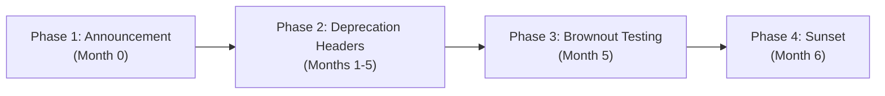

Status: Approved | Applies to: 2.0.0-rc.3 | Verified against commit: cdca041 | Date: 2026-11-08

# PredictIQ API Versioning & Deprecation Policy

This document defines the versioning conventions, backward compatibility guarantees, and formal deprecation lifecycle for the PredictIQ REST API and its associated ML model contracts.

---

## 1. Versioning Architecture

PredictIQ adheres strictly to [Semantic Versioning 2.0.0](https://semver.org/) (`MAJOR.MINOR.PATCH`) across three distinct layers:

1. **API Protocol & Routing (`/api/v1`)**:
   - Exposed in URI paths. Changes to the `MAJOR` version (e.g. `/api/v2`) indicate breaking contractual changes requiring client modifications.
2. **Canonical Contract Schemas (`api_estimate_v2.json`)**:
   - Versioned JSON Schema specifications governing payload structure, required keys, and mathematical quantile definitions.
3. **Machine Learning Model Artifacts (`2.0.0-rc.1`)**:
   - Model versions represent specific trained weights, hyperparameter states, dataset checksums, and conformal calibration intervals.

```
       ┌────────────────────────┐
       │   API Gateway URI      │   --> /api/v1
       └───────────┬────────────┘
                   │
       ┌───────────▼────────────┐
       │   Contract Schema      │   --> api_estimate_v2.json
       └───────────┬────────────┘
                   │
       ┌───────────▼────────────┐
       │   Model Artifacts      │   --> model_version: 2.0.0-rc.1
       └────────────────────────┘
```

---

## 2. Backward Compatibility Guarantees

PredictIQ guarantees that within a `MAJOR` API version (e.g., `/api/v1`):

### Permitted Non-Breaking Changes (Minor / Patch Releases)
- Adding new optional request query parameters or request body fields.
- Adding new properties to response JSON payloads.
- Adding new API routes.
- Refining ML model accuracy or shrinkage multipliers that adhere to the existing quantile envelope ($P_{10} \le P_{25} \le P_{50} \le P_{75} \le P_{90}$).
- Modifying the ordering of dictionary keys in JSON responses.

### Breaking Changes (Requiring New Major Version `/api/v2`)
- Removing or renaming existing response keys.
- Changing data types or format constraints of existing fields (e.g., changing string to integer).
- Introducing new mandatory request headers, query parameters, or body properties.
- Changing the fundamental definition or calculation of core metrics (e.g., altering the 152 hours/PM conversion baseline).
- Modifying authentication mechanisms or altering error payload shapes.

---

## 3. Deprecation & Sunset Lifecycle

When an API version, endpoint, or contract format is marked for replacement, PredictIQ executes a four-phase lifecycle ensuring a minimum **6-month transition period** before service termination.



### Phase 1: Formal Announcement (Month 0)
- The upcoming deprecation is announced in release notes, official documentation, and email notices to registered administrators.
- Migration guides are published providing step-by-step guidance on mapping old parameters to new endpoints.
- Endpoints remain 100% operational with zero behavioral modifications.

### Phase 2: HTTP Deprecation Headers (Months 1–5)
Endpoints flagged as deprecated return standard RFC 8594 HTTP deprecation and sunset headers:

```http
HTTP/1.1 200 OK
Content-Type: application/json
Deprecation: @1794096000
Sunset: Wed, 06 May 2027 00:00:00 GMT
Link: <https://docs.predictiq.io/api/v2/migration>; rel="successor-version"
```

- **`Deprecation`**: Unix timestamp (or date) when the endpoint was officially marked deprecated.
- **`Sunset`**: Exact UTC date and time after which the endpoint will be decommissioned.
- **`Link`**: URI pointing directly to the migration documentation.

### Phase 3: Brownout Testing (Month 5)
- During the final month prior to decommissioning, PredictIQ conducts brief, pre-announced brownouts (e.g., 15-minute windows during off-peak hours) where deprecated endpoints return `410 Gone` with migration links.
- Brownouts ensure that unmonitored legacy clients are identified and alerted prior to permanent shutdown.

### Phase 4: Final Sunset & Decommissioning (Month 6)
- The deprecated endpoint is permanently removed from routing tables.
- Subsequent calls to the sunset endpoint return `410 Gone`:

```http
HTTP/1.1 410 Gone
Content-Type: application/json

{
  "detail": "Endpoint has been sunset. Please migrate to /api/v2. See https://docs.predictiq.io/api/v2/migration"
}
```

---

## 4. ML Model Lifecycle & Artifact Versioning

PredictIQ models undergo continuous evaluation against our 6-fold Leave-One-Source-Out (LOSO) cross-validation suite:

1. **Pre-Registration**: Any proposed model replacement must be registered with a frozen evaluation protocol (e.g., `docs/contracts/evaluation_protocol_rc3.md`) before validation runs.
2. **Cryptographic Checksum Pinning**: Every model artifact is pinned by its SHA-256 hash in `manifest.json`. Serving nodes fail closed if the artifact hash diverges from the manifest.
3. **Zero In-Place Mutability**: Retrained models are published under incremented versions (`2.0.0-rc.1` &rarr; `2.0.0-rc.2`). Existing model artifacts are never mutated in place.
4. **Model Revocation**: If a data leakage or label corruption issue is identified in an existing model, its hash is immediately added to `REVOKED_MODEL_SHA256` in `backend/ml/artifact_safety.py`. Serving engines will instantly reject and fail-close if instructed to load a revoked model.
