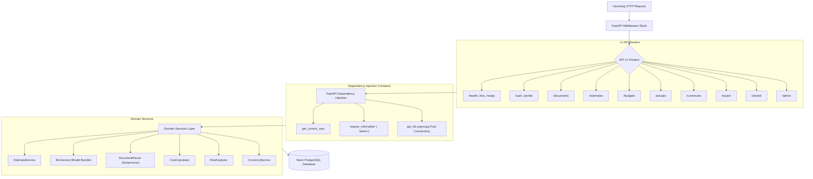

# PredictIQ Backend Architecture Specification

Status: Approved | Applies to: 2.0.0-rc.3 | Verified against commit: cdca041 | Date: 2026-11-08

---

## 1. Overview & Framework Foundation

The PredictIQ backend is an asynchronous, high-throughput REST API service built on **FastAPI 0.115+** and **Python 3.12**. It enforces strict Pydantic v2 schemas across all request and response boundaries, integrates asynchronous database pooling via **asyncpg**, and executes domain logic across clean service modules.



---

## 2. Middleware Pipeline

Incoming HTTP requests traverse an ordered middleware stack prior to reaching router endpoints:

1. **SlowAPI Rate Limiter:** `SlowAPIMiddleware` intercepts requests to enforce IP- and user-based request limits, returning HTTP 429 Too Many Requests upon limit exhaustion.
2. **CORS Middleware:** `CORSMiddleware` limits cross-origin access strictly to configured origins in `settings.cors_origins`, permitting explicit HTTP verbs (`GET`, `POST`, `PUT`, `PATCH`, `DELETE`, `OPTIONS`) and allowed headers.
3. **Body Limit Middleware:** `BodyLimitMiddleware` measures incoming request payload size, preventing Denial of Service attacks by blocking oversized bodies before memory allocation.
4. **Security Headers Middleware:** Injects standard OWASP defense headers:
   - `X-Frame-Options: DENY` (clickjacking mitigation)
   - `X-Content-Type-Options: nosniff` (MIME sniffing prevention)
   - `Referrer-Policy: no-referrer`
   - `Permissions-Policy: camera=(), microphone=(), geolocation=()`
   - `Cache-Control: no-store` on sensitive share endpoints (`/api/v1/shared/*`)
5. **Request ID Middleware:** Generates a unique UUID4 `request_id`, attaches it to `request.state.request_id`, and adds the `X-Request-ID` header to the HTTP response.
6. **Audit Log Middleware:** `AuditLogMiddleware` intercepts transaction lifecycles, emitting structured JSON logs capturing user IDs, HTTP paths, response codes, and latency figures.

---

## 3. Dependency Injection Architecture

FastAPI dependencies provide decoupled, testable access control and resource management:

### 3.1. Authentication Dependency (`get_current_user`)
Located in `backend/app/core/security.py`:
- Extracts the HTTP Bearer token from the `Authorization` header.
- Dispatches token verification to the Firebase Admin SDK on a worker threadpool via `starlette.concurrency.run_in_threadpool` to prevent blocking the async event loop.
- Decodes cryptographic signatures against Google's public JSON Web Keys (JWKS), checking project audience, issuer, and expiration.
- Resolves user roles from custom claims or durable database profile records.
- Injects a validated `CurrentUser` Pydantic model (`id`, `email`, `role`).

### 3.2. Role Authorization Factory (`require_role`)
Enforces hierarchical Role-Based Access Control (RBAC):
```python
def require_role(min_role: str):
    async def _role_checker(user: CurrentUser = Depends(get_current_user)) -> CurrentUser:
        if ROLE_HIERARCHY.get(user.role, 0) < ROLE_HIERARCHY.get(min_role, 0):
            raise HTTPException(status_code=403, detail="Insufficient permissions")
        return user
    return _role_checker
```
- Hierarchy: `viewer` (1) < `editor` (2) < `admin` (3).
- Secures write endpoints (`POST /api/v1/estimates`, `POST /api/v1/actuals`) to `editor` or higher.
- Secures administrative functions (`/api/v1/admin/*`) strictly to `admin`.

### 3.3. Database Connection Dependency (`get_db`)
Located in `backend/app/core/database.py`:
- Acts as an asynchronous context manager acquiring a connection from the global `asyncpg` pool.
- Automatically releases the connection back to the pool upon route completion, ensuring zero connection leaks even when exceptions are raised:
```python
async def get_db() -> AsyncGenerator[asyncpg.Connection, None]:
    async with _pool.acquire() as conn:
        yield conn
```

---

## 4. Asynchronous Database Layer (asyncpg Pool)

Database connectivity is managed through an asynchronous `asyncpg` pool connecting to Neon PostgreSQL:

### 4.1. Resilience & Exponential Backoff Retry
Database startup in `init_db_pool()` implements exponential backoff to handle transient network delays or cold-start database resumes:
- Retries: Up to 5 consecutive attempts.
- Delays: Doubles geometrically ($1\text{s}, 2\text{s}, 4\text{s}, 8\text{s}, 16\text{s}$).
- Pool Configuration:
  - `min_size`: `settings.DB_POOL_MIN_SIZE` (default 2)
  - `max_size`: `settings.DB_POOL_MAX_SIZE` (default 10)
  - `command_timeout`: `settings.DB_COMMAND_TIMEOUT` (default 30 seconds)

### 4.2. Graceful Lifecycle
Managed via FastAPI's `lifespan` handler in `backend/main.py`:
- **Startup:** Initializes the Firebase SDK, connects the `asyncpg` pool, verifies ML model readiness, loads benchmark registries, and spawns the background role reconciliation worker.
- **Shutdown:** Cancels background tasks, waits for in-flight tasks to terminate gracefully, closes all active database pool connections, and flushes log buffers.

---

## 5. Domain Services Decomposition

| Service | Module | Core Responsibilities |
|---|---|---|
| `EstimateService` | `app/services/estimate_service.py` | Orchestrates end-to-end estimation flow: retrieves input documents, executes ML model inference, calls cost and risk analyzers, and commits records to PostgreSQL. |
| `MLService` | `app/services/ml_service.py` | Manages model bundle execution, validates feature constraints, computes Mondrian conformal intervals, and applies empirical Bayes shrinkage. |
| `DocumentParser` | `app/services/document_parser.py` | Validates file signatures, enforces archive decompression limits, and invokes text extraction parsers. |
| `IsolatedParser` | `app/services/isolated_parser.py` | Executes text extraction in a restricted subprocess with timeouts to prevent memory exhaustion from malformed files. |
| `CostCalculator` | `app/services/cost_calculator.py` | Calculates labor costs across hourly rates, synthesizes phase breakdowns, and handles currency precision. |
| `RiskAnalyzer` | `app/services/risk_analyzer.py` | Evaluates project risk scores from technical volatility, team experience, and integration count. |
| `CurrencyService` | `app/services/currency_service.py` | Maintains exchange rates across USD, EUR, GBP, CAD, AUD, and INR with automated TTL caching. |
| `RoleSyncService` | `app/services/role_sync.py` | Background worker reconciling Firebase custom claims with durable database user profiles. |
