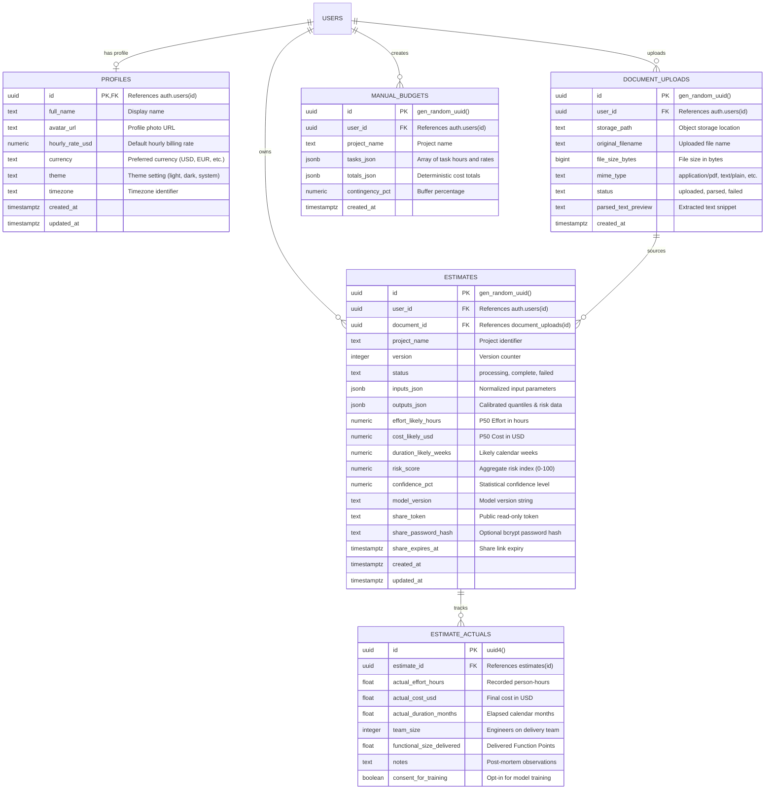

# PredictIQ Data Model & Database Schema Specification

Status: Approved | Applies to: 2.0.0-rc.3 | Verified against commit: cdca041 | Date: 2026-11-08

---

## 1. Relational Database Overview

PredictIQ utilizes PostgreSQL 16 (hosted on Neon) for persistent relational storage. The database schema manages user profiles, document uploads, estimation runs, organizational actuals, and manual task budgets.

All database interactions leverage **asyncpg** connection pooling in FastAPI and follow strict relational integrity constraints (foreign keys, cascading deletions, and typed JSONB fields).



---

## 2. Table Specifications & Column Definitions

### 2.1. `public.profiles`
Stores user-specific preferences and organizational billing defaults. Linked 1:1 with authenticated users.
- `id` (UUID, Primary Key): Foreign key referencing the authentication user identifier (`auth.users.id`). Deletion cascades on user removal.
- `full_name` (TEXT): User's legal or professional display name.
- `avatar_url` (TEXT): HTTPS URL to profile avatar image.
- `hourly_rate_usd` (NUMERIC(10, 2), Default: 75.00): Default hourly labor rate used to prefill new estimates.
- `currency` (TEXT, Default: 'USD'): ISO 4217 code for currency formatting (`USD`, `EUR`, `GBP`, `CAD`, `AUD`, `INR`).
- `theme` (TEXT, Default: 'system'): UI appearance preference (`light`, `dark`, `system`).
- `timezone` (TEXT, Default: 'UTC'): Timezone string for timestamp formatting.
- `created_at`, `updated_at` (TIMESTAMPTZ): Standard audit timestamps.

### 2.2. `public.document_uploads`
Tracks specification files uploaded during document-driven estimation journeys.
- `id` (UUID, Primary Key): Unique record identifier generated via `gen_random_uuid()`.
- `user_id` (UUID, Foreign Key): Identifier of the uploader. Cascades on user deletion.
- `storage_path` (TEXT): Path to raw file content in secure storage.
- `original_filename` (TEXT): Original filename uploaded by the client.
- `file_size_bytes` (BIGINT): Raw file size in bytes (max 10 MB).
- `mime_type` (TEXT): Verified MIME type (`application/pdf`, `.docx`, `text/plain`).
- `status` (TEXT): Current lifecycle state (`uploaded`, `parsed`, `failed`).
- `parsed_text_preview` (TEXT): Cleaned initial excerpt from text extraction.
- `created_at` (TIMESTAMPTZ): Upload timestamp.

### 2.3. `public.estimates`
The core transactional ledger of generated estimation dossiers.
- `id` (UUID, Primary Key): Unique estimate identifier.
- `user_id` (UUID, Foreign Key): Owner of the estimate.
- `document_id` (UUID, Foreign Key, Nullable): Associated source document, set to NULL if document is removed.
- `project_name` (TEXT): Name of the estimated software project.
- `version` (INTEGER, Default: 1): Revision version of the project estimate.
- `status` (TEXT): Current state (`processing`, `complete`, `failed`, `deleted`).
- `inputs_json` (JSONB): Fully captured input dictionary (project type, tech stack, team size, duration, size FP, volatility, integrations).
- `outputs_json` (JSONB): Detailed estimation output object containing full quantile distributions ($P_{10}, P_{25}, P_{50}, P_{75}, P_{90}$), phase breakdowns, top risks, OOD flags, and model explanation strings.
- `effort_likely_hours` (NUMERIC(12, 2)): Median ($P_{50}$) effort in person-hours.
- `cost_likely_usd` (NUMERIC(14, 2)): Median ($P_{50}$) cost in US Dollars.
- `duration_likely_weeks` (NUMERIC(8, 2)): Estimated timeline in calendar weeks.
- `risk_score` (NUMERIC(5, 2)): Aggregate numerical risk index ($0.0$ to $100.0$).
- `confidence_pct` (NUMERIC(5, 2)): Statistical confidence level ($80.0\%$ nominal).
- `model_version` (TEXT): Model version string used for inference.
- `share_token` (TEXT, Unique, Nullable): Cryptographic URL slug for public sharing.
- `share_password_hash` (TEXT, Nullable): Optional bcrypt hash for protected links.
- `share_expires_at` (TIMESTAMPTZ, Nullable): Expiry timestamp for shared URL.

### 2.4. `public.estimate_actuals`
The empirical repository feeding the Actuals Flywheel and empirical Bayes calibration.
- `id` (UUID, Primary Key): Unique actuals record ID.
- `estimate_id` (UUID, Foreign Key): Reference to the original estimate dossier. Cascades on estimate deletion.
- `actual_effort_hours` (FLOAT): Total observed engineering effort in person-hours.
- `actual_cost_usd` (FLOAT, Nullable): Final invoiced expenditure in USD.
- `actual_duration_months` (FLOAT, Nullable): Real elapsed calendar duration.
- `team_size` (INTEGER, Nullable): Peak engineering headcount deployed.
- `functional_size_delivered` (FLOAT, Nullable): Delivered functional size in FP.
- `notes` (TEXT, Nullable): Retrospective observations and variance explanations.
- `consent_for_training` (BOOLEAN): Explicit opt-in flag permitting anonymized use in benchmark training.

### 2.5. `public.manual_budgets`
Stores deterministic task-based project budgets separate from ML statistical models.
- `id` (UUID, Primary Key): Unique budget identifier.
- `user_id` (UUID, Foreign Key): Owner of the budget plan.
- `project_name` (TEXT): Project title.
- `tasks_json` (JSONB): Array of tasks containing task name, low hours, likely hours, high hours, and hourly rate.
- `totals_json` (JSONB): Calculated totals (low, likely, high hours and costs).
- `contingency_pct` (NUMERIC(5, 2)): Percentage contingency added to total costs.
- `created_at` (TIMESTAMPTZ): Timestamp of budget creation.

---

## 3. Database Triggers & Integrity Rules

### 3.1. User Profile Creation Trigger
To prevent orphan accounts and ensure immediate profile availability upon registration, a PostgreSQL trigger automatically instantiates a `profiles` row upon new user creation:
```sql
CREATE OR REPLACE FUNCTION public.handle_new_user()
RETURNS TRIGGER AS $$
BEGIN
    INSERT INTO public.profiles (id, full_name, avatar_url)
    VALUES (
        NEW.id,
        NEW.raw_user_meta_data ->> 'full_name',
        NEW.raw_user_meta_data ->> 'avatar_url'
    );
    RETURN NEW;
END;
$$ LANGUAGE plpgsql SECURITY DEFINER;
```

### 3.2. Performance Indexes
To maintain sub-50ms response times on paginated queries and user lookups, the schema defines the following indexing strategy:
- `idx_estimates_user_id`: B-Tree index on `estimates(user_id)` for user history queries.
- `idx_estimates_created_at`: Descending index on `estimates(created_at DESC)` for chronological sorting.
- `idx_estimates_share_token`: Partial B-Tree index on `estimates(share_token)` where token is not null.
- `idx_estimate_actuals_estimate_id`: Foreign key lookup index on `estimate_actuals(estimate_id)`.
- `idx_document_uploads_user_id`: B-Tree index on `document_uploads(user_id)`.
