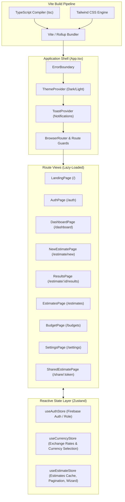

# PredictIQ Frontend Architecture Specification

Status: Approved | Applies to: 2.0.0-rc.3 | Verified against commit: cdca041 | Date: 2026-11-08

---

## 1. Technology Stack & Build Pipeline

The PredictIQ frontend is a responsive single-page application built with modern web technologies:

- **Core Library:** **React 18** with TypeScript for strong type safety across interfaces and API payloads.
- **Build Tooling:** **Vite** providing rapid hot-module replacement (HMR), tree-shaking, and optimized production rollups.
- **Routing:** **React Router DOM v7** configured with code-splitting via `React.lazy` and `Suspense` for asynchronous route loading.
- **Styling Architecture:** **Tailwind CSS** integrated with custom CSS variables (design tokens) in `frontend/src/index.css`.
- **State Management:** **Zustand** stores providing lightweight, decoupled state synchronization without the boilerplate of Redux.
- **Data Visualization:** **Chart.js** and **React-Chartjs-2** for uncertainty distribution plots and phase allocation donuts.



---

## 2. State Management Architecture (Zustand Stores)

PredictIQ relies on three dedicated Zustand stores located in `frontend/src/store/`:

### 2.1. Authentication Store (`authStore.ts`)
- **Responsibilities:** Bridges the Firebase Client SDK with React component state.
- **State Fields:**
  - `user`: Authenticated Firebase user object or null.
  - `role`: Current user role (`viewer`, `editor`, `admin`).
  - `initialized`: Boolean flag indicating whether the initial auth token resolution has completed.
- **Key Methods:**
  - `initialize()`: Registers `onAuthStateChanged` listeners, resolves token claims, and sets initialization state.
  - `login()`, `logout()`, `register()`: Wraps Firebase auth actions.

### 2.2. Currency Store (`currencyStore.ts`)
- **Responsibilities:** Manages multi-currency financial localization across all rendered figures.
- **State Fields:**
  - `currency`: Active ISO code (`USD`, `EUR`, `GBP`, `CAD`, `AUD`, `INR`).
  - `rates`: Cached exchange rates relative to USD.
  - `lastFetched`: Millisecond timestamp of exchange rate retrieval.
- **Key Methods:**
  - `setCurrency(currency)`: Updates active currency and triggers UI re-renders.
  - `refreshRatesIfStale()`: Checks cache TTL (24 hours) and updates rates via `GET /api/v1/currencies`.
  - `convert(amountInUSD)`: Helper function calculating converted cost values in active currency.
  - `format(amountInUSD)`: Generates culturally localized currency strings (e.g., `$12,500` or `€11,200`).

### 2.3. Estimate Store (`estimateStore.ts`)
- **Responsibilities:** Manages list pagination, filtering, and the current active estimate dossier.
- **State Fields:**
  - `estimates`: Array of `EstimateSummary` records for list display.
  - `currentEstimate`: Full `EstimateResult` data model for results exploration.
  - `loading`: Async operation indicator.
  - `page`, `perPage`, `sort`, `filterType`: Query pagination state.
- **Key Methods:**
  - `fetchEstimates()`: Queries `GET /api/v1/estimates` with active filters and sorting.
  - `fetchEstimate(id)`: Queries `GET /api/v1/estimates/:id` to hydrate results views.
  - `removeEstimate(id)`: Deletes an estimate and updates local store cache.

---

## 3. Component Architecture & Design Patterns

The frontend component hierarchy is divided into two structural categories:

```text
frontend/src/components/
├── shared/                       # Reusable UI Primitives
│   ├── Badge.tsx                 # Status, Tier, and Risk Badges
│   ├── Card.tsx                  # Elevated, Interactive, and Glass Containers
│   ├── ConfidenceInterval.tsx    # Visual Dual Prediction Interval Bar
│   ├── CurrencySelector.tsx      # Dropdown Currency Picker
│   ├── CurrencyToggle.tsx        # Compact In-Row Currency Switcher
│   ├── EmptyState.tsx            # Zero-State Placeholder Graphics
│   ├── LoadingSkeleton.tsx       # Placeholder Shimmer Elements
│   ├── Navbar.tsx                # Header Navigation & Identity Controls
│   ├── SEOHead.tsx               # Document Meta & Title Injector
│   ├── Sidebar.tsx               # Collapsible Workspace Navigation Rail
│   └── Typography.tsx            # Standard Heading & Body Elements
└── estimate/                     # Domain-Specific Estimation Views
    ├── EstimationResultView.tsx  # Central Results Layout Coordinator
    ├── FunctionalSizeCard.tsx    # Sizing Metrics & Function Point Table
    ├── ModelTransparencyModal.tsx# Cryptographic Manifest & Audit Dialog
    ├── OODDiagnosticsCard.tsx    # Out-of-Distribution Warning & Mechanics
    ├── PlanningCapacityCard.tsx  # Staffing & Duration Matrix
    ├── estimateUtils.ts          # Formatting & Math Helpers
    └── exportContractUtils.ts    # JSON Schema Validation & Mapping
```

### 3.1. Responsive Clamping & Fluid Layouts
To ensure layout stability across screen sizes without abrupt media query shifts, PredictIQ uses fluid CSS `clamp()` expressions:
- **Workspace Navigation:** Desktop sidebar collapses to an accessible bottom tab rail on mobile screens ($<768\text{px}$).
- **Fluid Typography:** Headings scale gracefully (e.g., `font-size: clamp(1.75rem, 3vw, 2.5rem)`).
- **Responsive Padding:** Container gutters scale from mobile touch buffers to wide desktop layouts (`padding: clamp(1rem, 3vw, 2rem)`).

### 3.2. Uncertainty Visualization (`ConfidenceInterval.tsx`)
The confidence interval visualizer renders two distinct empirical bands on an SVG / flexbox track:
1. **Outer 80% Plausible Range ($P_{10}$ to $P_{90}$):** Soft colored backdrop representing contractual extremes.
2. **Inner 50% Likely Band ($P_{25}$ to $P_{75}$):** Prominent high-contrast core representing the operational planning target.
3. **P50 Median Marker:** Centered vertical marker with tabular numeric callout.

---

## 4. Accessibility & Theming Integration

- **Theme Provider:** Toggles `data-theme="dark"` or `data-theme="light"` on the document root, altering CSS custom property variables without style recomputation.
- **Focus Rings:** Employs `:focus-visible` with a 3px high-contrast outline (`var(--color-primary)`) and 3px offset, fully keyboard navigable.
- **Reduced Motion:** Adheres to `@media (prefers-reduced-motion: reduce)`, disabling CSS transforms and animations for sensitive users.
- **Semantic HTML & ARIA:** Tables utilize proper `<th>` scoping, modal dialogs implement `aria-modal="true"`, and toasts declare `role="alert"` with `aria-live="polite"`.
