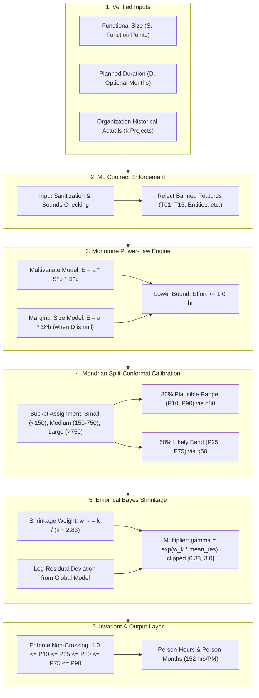

# PredictIQ Machine Learning Pipeline & Statistical Estimation Engine

Status: Approved | Applies to: 2.0.0-rc.3 | Verified against commit: cdca041 | Date: 2026-11-08

---

## 1. Architectural Overview & Design Philosophy

PredictIQ's estimation subsystem is constructed on empirical software engineering principles and conformal prediction theory. Rather than employing black-box models or subjective adjustment factors, PredictIQ enforces four foundational constraints:

1. **Strict Monotonicity:** Development effort must scale monotonically with functional scope ($\frac{\partial E}{\partial S} > 0$).
2. **Standardized Sizing:** Grounded entirely in audited IFPUG Function Points and real recorded person-hours.
3. **Calibrated Uncertainty:** Output distributions provide statistically valid coverage intervals via Mondrian split-conformal calibration.
4. **Adaptive Organizational Learning:** Empirical Bayes shrinkage continuously refines predictions toward an enterprise's logged project actuals.

---

## 2. Monotone Power-Law Mechanics

Software engineering economics demonstrates that effort scales non-linearly with software size due to combinatorial coordination overhead and architectural complexity.

### 2.1. Mathematical Formulation
When planned calendar duration ($D$) is specified:
$$E = a \cdot S^b \cdot D^c$$
In log-transformed linear space:
$$\ln(E) = \beta_0 + b \cdot \ln(S) + c \cdot \ln(D)$$
where:
- $S$: Functional size in Function Points ($S \ge 1.0$).
- $D$: Calendar duration in months ($D \ge 1.0$).
- $b$: Size scaling elasticity ($b > 0$, typically $0.55 \le b \le 0.85$).
- $c$: Duration elasticity, bounded strictly within $[0.20, 0.80]$ in log space.
- $a = \exp(\beta_0)$: Base productivity constant.

### 2.2. Handling Missing Duration Without Synthetic Imputation
When duration is omitted by the user, PredictIQ refuses to manufacture synthetic duration numbers. Instead, it evaluates the marginal power-law model calibrated strictly on size:
$$E = a_{\text{base}} \cdot S^{b_{\text{base}}}$$
This structure preserves mathematical integrity and avoids train/serve skew caused by arbitrary imputation.

### 2.3. Bounded Elasticity & Brooks' Law
In classical software economics, compressing schedule duration requires disproportionate staffing increases, yet schedule compression beyond empirical limits triggers team communication saturation. By bounding duration elasticity $c$, the model reflects schedule constraints while preventing irrational predictions where doubling duration yields infinite or zero effort.

---

## 3. Mondrian Split-Conformal Calibration

Point estimates in software development are inherently misleading because identical functional requirements can vary substantially across different organizational contexts. PredictIQ employs **Mondrian (group-conditional) split-conformal prediction** to quantify uncertainty.

### 3.1. Theoretical Coverage Property
Under the assumption of exchangeability between calibration projects and new queries, split-conformal prediction ensures that true development effort falls within the calibrated interval with coverage probability at least $1 - \alpha$:
$$P\left(y \in [\hat{E}_{\text{lower}}, \hat{E}_{\text{upper}}]\right) \ge 1 - \alpha$$

### 3.2. Sizing Buckets & Stratification
Software projects exhibit heteroscedastic error distributions: percentage variance on a 50-FP utility differs markedly from an 8,000-FP enterprise ERP platform. PredictIQ segments the calibration space into three discrete Mondrian size buckets:
- **Small:** $S < 150$ FP
- **Medium:** $150 \le S \le 750$ FP
- **Large:** $S > 750$ FP

### 3.3. Dual Prediction Intervals
For every estimate, the calibration engine evaluates non-conformity residuals $| \ln(y) - \ln(\hat{y}) |$ to extract empirical quantile multipliers:
1. **Outer 80% Plausible Range ($P_{10}$ to $P_{90}$, $\alpha = 0.20$):**
   $$P_{10} = \hat{E}_{50} \cdot \exp(-q_{80}), \quad P_{90} = \hat{E}_{50} \cdot \exp(q_{80})$$
2. **Inner 50% Likely Band ($P_{25}$ to $P_{75}$, $\alpha = 0.50$):**
   $$P_{25} = \hat{E}_{50} \cdot \exp(-q_{50}), \quad P_{75} = \hat{E}_{50} \cdot \exp(q_{50})$$

### 3.4. Non-Crossing Invariant
To prevent mathematical violations where an inner quantile crosses an outer quantile, PredictIQ enforces strict monotonicity:
$$1.0 \le P_{10} \le P_{25} \le P_{50} \le P_{75} \le P_{90}$$

---

## 4. Empirical Bayes Shrinkage (Organizational Calibration)

While global benchmarks establish an empirical foundation, an individual organization may consistently deliver faster or slower than global averages. PredictIQ bridges this gap using empirical Bayes shrinkage:

### 4.1. Shrinkage Formulation
When an organization logs $k$ verified project actuals ($s_i, e_i$), the system computes the log-residuals against the baseline model:
$$r_i = \ln(e_i) - \ln(\hat{e}_i)$$
$$\bar{r} = \frac{1}{k} \sum_{i=1}^k r_i$$

The shrinkage weight $w_k$ is governed by the variance ratio between within-organization variance $\sigma^2$ and across-organization variance $\tau^2$ (empirically derived as $\frac{\sigma^2}{\tau^2} \approx 2.83$):
$$w_k = \frac{k}{k + 2.83}$$

### 4.2. Organizational Multiplier
The calibrated multiplier $\gamma_{\text{org}}$ shifts all quantiles:
$$\gamma_{\text{org}} = \text{clip}\left(\exp(w_k \cdot \bar{r}), 0.33, 3.0\right)$$
- If $k = 0$, $w_k = 0$, and $\gamma_{\text{org}} = 1.0$ (pure global benchmark).
- If $k = 3$, $w_k \approx 0.51$ (balanced blend of global priors and internal evidence).
- If $k = 10$, $w_k \approx 0.78$ (strongly calibrated to internal team velocity).

Clipping within $[0.33, 3.0]$ prevents runaway distortion from anomalous or improperly recorded actuals.

---

## 5. Empirical Dataset Registry Foundation

The machine learning pipeline is calibrated against 915 verified software engineering projects harmonized in `backend/ml/data/projects_v2.csv`:

| Repository Source | Verified Projects | Sizing Metric | Effort Metric | Historical Span |
|---|---:|---|---|---|
| **China** | 499 | IFPUG AFP | Person-Hours | 2000–2008 |
| **Kitchenham** | 145 | Adjusted FP | Person-Hours | 1994–1998 |
| **Desharnais** | 81 | Adjusted FP | Person-Hours | 1988–1989 |
| **Maxwell** | 62 | Function Points | Person-Hours | 1990–1996 |
| **Albrecht** | 24 | Function Points | Person-Hours | 1979–1983 |
| **AT&T Aptness** | 104 | Adjusted FP | Person-Hours | 1986–1991 |
| **Total Cohort** | **915** | Standard FP | Audited Person-Hours | Clean Licensing |

Every project in this foundation has undergone identity deduplication, verifying zero duplicate records and confirming proper unit conversions.
