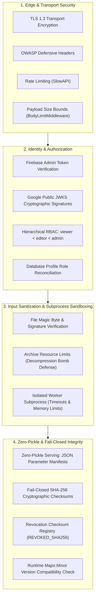

# PredictIQ Security Architecture & Verification Specification

Status: Approved | Applies to: 2.0.0-rc.3 | Verified against commit: cdca041 | Date: 2026-11-08

---

## 1. Security Architecture Principles

PredictIQ operates under defense-in-depth security principles. Because the platform analyzes proprietary software specification documents and informs financial commitments, security controls are implemented across every architectural boundary:

---

## 2. Zero-Pickle Serving & Cryptographic Artifact Verification

Python's native `pickle` serialization format presents severe remote code execution (RCE) hazards if an artifact is tampered with or intercepted. PredictIQ eliminates deserialization vulnerabilities through a strict **zero-pickle** architecture.

### 2.1. JSON Parameter Serving
Production model serving loads estimator weights and calibration quantiles exclusively from human-readable, schema-validated JSON:
- File: `backend/ml/artifacts/production_v2/model_params.json`
- Schema Structure:
  - `parameters.base_marginal`: Float intercept ($\beta_0$) and size elasticity ($b$).
  - `parameters.multivariate`: Float intercept ($\beta_0$), size elasticity ($b$), and duration elasticity ($c$).
  - `calibration.conformal_80`: Float global quantile and dictionary of bucket quantiles for the 80% plausible range.
  - `calibration.conformal_50`: Float global quantile and dictionary of bucket quantiles for the 50% likely band.

The loader instantiates clean in-memory `MultivariateMonotoneModel` and `MondrianConformalPredictor` objects directly from these numbers, executing zero deserialization routines.

### 2.2. Fail-Closed SHA-256 Verification
During application initialization, the artifact loader (`backend/ml/artifacts/loader.py`) conducts an automated cryptographic preflight:
1. **Manifest Integrity:** Verifies `manifest.json` exists and validates against required schema keys (`model_version`, `dataset_sha256`, `dataset_records`, `file_hashes`, `allowed_inputs`, `banned_features`, `environment`).
2. **Dataset Hash Verification:** Confirms that the training dataset SHA-256 matches the expected digest (`b05ad3b0111d4ed3ff89b7aa2a0f653e494f81953c701916f27756d1746eede3`) and confirms exactly 915 records.
3. **Artifact File Hashes:** Computes SHA-256 digests for all referenced artifact files and verifies they match the manifest's `file_hashes` dictionary.
4. **Revocation Registry:** Evaluates artifact hashes against `REVOKED_MODEL_SHA256` and `REVOKED_DATA_SHA256`. If an artifact matches a revoked signature, startup fails immediately.
5. **Runtime Environment Matching:** Confirms that Python major.minor version matches supported runtime specifications.

If any check fails, the loader raises `RuntimeError` immediately, halting server startup and preventing execution in a compromised state.

---

## 3. Authentication & Role-Based Access Control (RBAC)

Identity verification is decoupled from internal database credentials by leveraging Firebase Authentication as an external identity provider.

### 3.1. Cryptographic Token Verification
Every protected request transmits a JWT bearer token in the `Authorization` HTTP header:
- Validated via the Firebase Admin SDK using Google's public rotating certificates.
- Checks token signature, audience (`aud` matches Firebase Project ID), issuer (`iss`), and expiration timestamp (`exp`).
- Operates asynchronously in a threadpool (`run_in_threadpool`) to prevent blocking FastAPI's async event loop.

### 3.2. Role Hierarchy & Enforcement
The system supports three hierarchical roles:
- **`viewer` (Level 1):** Read-only access to existing estimates and shared reports.
- **`editor` (Level 2):** Full permissions to upload documents, run estimation models, log project actuals, and manage personal profile settings.
- **`admin` (Level 3):** System governance, user role modification, and organizational telemetry access.

The `require_role(min_role)` dependency factory enforces permissions at the route definition level. A background reconciliation worker (`backend/app/services/role_sync.py`) continuously synchronizes Firebase custom claims with the durable database user profile.

---

## 4. Input Sanitization & Sandboxed Document Processing

File upload endpoints represent a common vector for buffer overflows, XML entity attacks, and decompression bombs. PredictIQ enforces multi-layer sanitization:

### 4.1. File Signature & Resource Bounds
The `DocumentParser` service in `backend/app/services/document_parser.py` validates incoming payloads before invoking extraction libraries:
- **Payload Size Limits:** Max 10 MB per file.
- **Magic Byte Verification:**
  - PDF files must start with the `%PDF-` signature.
  - DOCX files must be valid ZIP archives containing required internal markers (`[Content_Types].xml` and `word/document.xml`).
  - Text files are checked for illegal binary NUL bytes.
- **Decompression Bomb Protection:**
  - Max 2,000 ZIP archive entries.
  - Max 20 MB total uncompressed extraction size.
  - Compression ratio limit ($< 1,000:1$) to mitigate malicious recursive zip archives.

### 4.2. Isolated Subprocess Sandboxing
Document text extraction is executed inside an isolated worker process (`backend/app/services/isolated_parser.py`):
- Communicates with the parent FastAPI application via standard input/output (IPC).
- Enforces an execution timeout (15 seconds).
- Confines memory allocation to prevent resource exhaustion from affecting the main API server.
- Traps and converts unhandled parser errors into structured failure statuses without exposing internal stack traces.

---

## 5. Network & Transport Hardening

- **CORS Defense:** Explicit origin whitelisting (`settings.cors_origins`) preventing unauthorized cross-origin browser requests.
- **Rate Limiting:** `SlowAPI` enforces IP and user-level throttling on computationally intensive endpoints (document parsing, estimation runs).
- **OWASP Response Headers:** Injects defense-in-depth headers on all responses (`X-Frame-Options: DENY`, `X-Content-Type-Options: nosniff`, `Referrer-Policy: no-referrer`, `Cache-Control: no-store` on shared tokens).
- **Audit Logging:** Every authenticated transaction logs client identity, IP address, request ID, target endpoint, and HTTP response code for compliance auditing.
