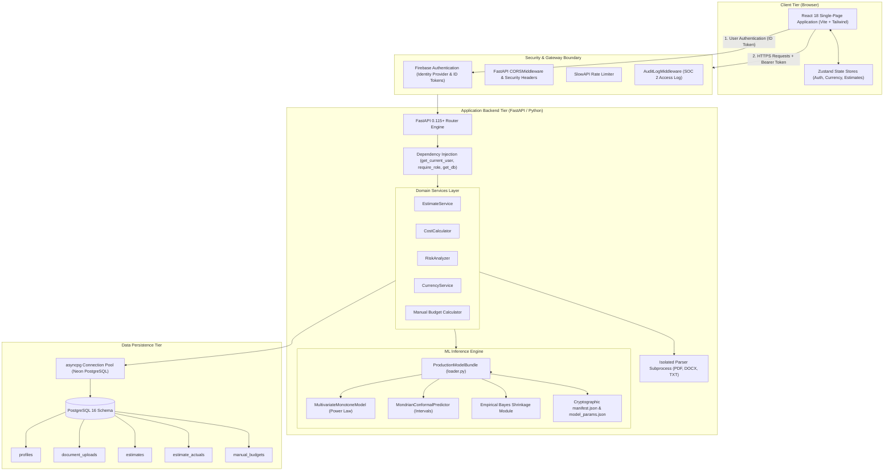

# PredictIQ System Architecture Overview

Status: Approved | Applies to: 2.0.0-rc.3 | Verified against commit: cdca041 | Date: 2026-11-08

---

## 1. High-Level Architectural Topology

PredictIQ is structured as a decoupled, modern multi-tier web application consisting of a single-page frontend application, a high-performance asynchronous REST API backend, an empirical machine learning inference service, and a managed PostgreSQL relational database.



---

## 2. Component Boundaries & Responsibilities

### 2.1. Client Presentation Tier (`frontend/`)
- Built with **React 18**, **TypeScript**, and bundled via **Vite**.
- Styled using **Tailwind CSS** with design token integration in `frontend/src/index.css`.
- Utilizes **Zustand** for lightweight, predictable reactive state management across authentication (`authStore.ts`), currency conversions (`currencyStore.ts`), and estimation caching (`estimateStore.ts`).
- Features responsive clamping and high-contrast color theming supporting both light mode and obsidian dark mode.
- Direct integration with Firebase Client SDK for user sign-in, token refresh, and identity lifecycle.

### 2.2. Security & Gateway Middleware (`backend/main.py`)
- **Rate Limiting:** Managed via `SlowAPI` to prevent denial-of-service and abuse on estimation and parsing endpoints.
- **Payload Sanitization:** `BodyLimitMiddleware` rejects oversized request bodies prior to JSON parsing.
- **Cryptographic Security Headers:** Injects standard OWASP security headers on all responses (`X-Frame-Options: DENY`, `X-Content-Type-Options: nosniff`, `Referrer-Policy: no-referrer`, `Cache-Control: no-store` on shared tokens).
- **Request Tracing:** Assigns a unique UUID `X-Request-ID` to every HTTP transaction, threaded through logs via `structlog`.
- **Audit Logging:** `AuditLogMiddleware` emits structured JSON access logs capturing client identities, roles, and HTTP outcomes for SOC 2 compliance.

### 2.3. Application Backend Tier (`backend/app/`)
- Built on **FastAPI** running on ASGI (`uvicorn`).
- Enforces strict contract schemas using **Pydantic v2** validation.
- Employs FastAPI dependency injection for session pooling (`get_db`) and role-based access control (`require_role`).
- Executes document parsing inside sandboxed worker subprocesses (`isolated_parser.py`) to isolate third-party library memory vulnerabilities.
- Maintains dual planning capabilities:
  1. Statistical ML inference for functional size, effort, and duration uncertainty.
  2. Deterministic task-based manual budgeting (`backend/app/models/budget.py`).

### 2.4. Machine Learning & Inference Subsystem (`backend/ml/`)
- Pure zero-pickle serving model: parameters and calibration boundaries deserialize from validated JSON files (`model_params.json`).
- Startup preflight cryptographically validates SHA-256 hashes against `manifest.json`.
- Enforces monotone power-law mechanics: effort increases monotonically with functional size.
- Produces stratified prediction intervals using Mondrian split-conformal prediction across Small, Medium, and Large size buckets.
- Dynamically applies empirical Bayes shrinkage to blend organization actuals with global empirical priors.

### 2.5. Persistence Layer (`supabase/migrations/`)
- **Neon PostgreSQL** accessed via an asynchronous connection pool managed by **asyncpg**.
- Features automated connection retries with exponential backoff to handle transient network hiccups and cold-start database delays.
- Stores user profiles, uploaded document metadata, estimation inputs/outputs, logged project actuals, and task budgets.

---

## 3. Communication Protocols & Security Boundaries

```text
[Browser Client]
       │
       ▼  HTTPS / TLS 1.3
[FastAPI Gateway]
   ├── Authorization: Bearer <Firebase ID Token>
   ├── X-Request-ID: <UUID4>
   ▼
[Dependency Layer: Security / Database]
   ├── Firebase Admin SDK: Token Signature & Claims Verification
   ├── asyncpg Pool: TLS-encrypted TCP connection to PostgreSQL
   ▼
[Sandboxed Workers & ML Bundle]
   ├── Subprocess: Stdio IPC (Document Text Extraction)
   └── Zero-Pickle Serving: Local in-memory JSON weights + Conformal arrays
```
