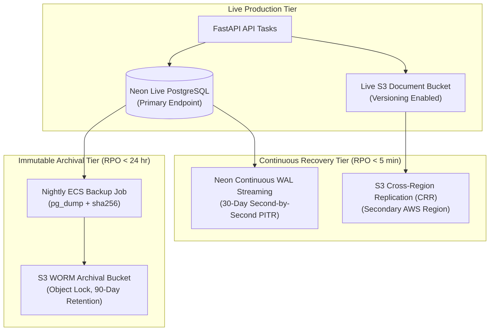

Status: Approved | Applies to: 2.0.0-rc.3 | Verified against commit: cdca041 | Date: 2026-11-08

# PostgreSQL & Document Storage Backup and Disaster Recovery Strategy

This document outlines the backup architecture, automated retention policies, disaster recovery runbooks, and recovery objectives (RTO/RPO) for PredictIQ production systems.

---

## 1. Disaster Recovery Objectives

PredictIQ establishes formal recovery objectives for all production customer data:

| Metric | Target Objective | Definition | Architecture Mechanism |
|--------|------------------|------------|------------------------|
| **RPO (Recovery Point Objective)** | **< 5 Minutes** | Maximum allowable data loss window in the event of catastrophic failure. | Continuous Write-Ahead Log (WAL) streaming via Neon Point-in-Time Recovery (PITR). |
| **RTO (Recovery Time Objective)** | **< 15 Minutes** | Maximum allowable downtime to restore full operational service. | Instant Neon branch creation + Automated ECS task reconfiguration. |

---

## 2. Multi-Tiered Backup Architecture

PredictIQ combines continuous cloud storage streaming with automated immutable logical dumps:



### Layer 1: Continuous Point-in-Time Recovery (PITR)
- **Engine**: Managed continuous Write-Ahead Log (WAL) archiving provided by Neon.
- **Granularity**: Any discrete second within the preceding 30 days.
- **Branching Mechanic**: A new database branch can be created in seconds from any historical timestamp without impacting live database operations or requiring full physical restores.

### Layer 2: Nightly Logical Dumps (`pg_dump`)
- **Schedule**: Every day at 02:00 UTC.
- **Process**: An isolated ECS task executes `pg_dump` targeting all application tables (`estimates`, `estimate_actuals`, `budgets`, `profiles`, `document_uploads`, `alembic_version`).
- **Encryption & Immutability**: Compressed dumps are encrypted using AWS KMS (`aws:kms`) and uploaded to an S3 bucket configured with **S3 Object Lock** in Compliance Mode (Write Once, Read Many).

### Layer 3: Object Storage Versioning & Replication
- The `predictiq-prod-documents` bucket enforces S3 Versioning.
- Delete operations place delete markers rather than permanently purging objects.
- All uploads are automatically replicated to a secondary AWS region via Cross-Region Replication (CRR).

---

## 3. Disaster Recovery Execution Runbook

### Scenario A: Accidental Data Corruption or Erroneous Migration

When an erroneous SQL statement, corrupt migration, or unintended truncation impacts production data:

1. **Identify Corruption Point**: Determine the exact UTC timestamp ($T_{\text{corrupt}}$) immediately preceding the incident.
2. **Create Point-in-Time Branch**:
   ```bash
   # Using Neon CLI or Management Console
   neon branches create \
     --project-id ep-cool-rain-12345 \
     --name restore-recovery-point \
     --parent main \
     --timestamp "2026-11-08T11:45:00Z"
   ```
3. **Verify Restored Data Integrity**: Connect to the newly branched connection URI and execute parity verification:
   ```bash
   psql "$RESTORE_DATABASE_URL" -c "SELECT count(*) FROM estimates;"
   ```
4. **Promote Restored Branch**:
   - Update `DATABASE_URL` in AWS Secrets Manager to point to the restored branch endpoint.
   - Restart backend tasks:
     ```bash
     aws ecs update-service \
       --cluster predictiq-prod \
       --service predictiq-backend \
       --force-new-deployment
     ```
5. **Verify Endpoint Readiness**: Confirm `/api/v1/ready` returns HTTP 200.

---

### Scenario B: Complete Regional Outage (Cloud Failover)

When an entire AWS region experiences service disruption:

1. **Activate Secondary S3 Bucket**: Switch application storage configuration to the secondary replicated region bucket.
2. **Point Database Connections**: Neon endpoints are globally distributed with automated multi-zone failover; verify database connectivity from the secondary region.
3. **Deploy Secondary ECS Tasks**: Launch ECS task definitions in the recovery region pointing to the secondary configuration.
4. **Update Route 53 DNS**: Shift traffic to the secondary Application Load Balancer via Route 53 DNS failover records.

---

## 4. Rehearsal & Verification Tooling

PredictIQ maintains automated recovery verification scripts in the repository:
- **`scripts/rehearse_recovery.py`**: Creates two temporary local databases, applies canonical migrations, inserts synthetic related records, dumps and restores the database and document objects, and performs byte-by-byte comparison across all tables.
- **`scripts/rehearse_live_recovery.py`**: Executes non-destructive recovery testing against read-only cloud database snapshots.

Recovery rehearsals are executed before every major release to verify backup integrity.
