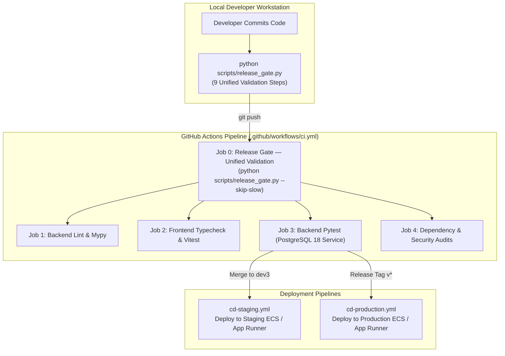

Status: Approved | Applies to: 2.0.0-rc.3 | Verified against commit: cdca041 | Date: 2026-11-08

# CI/CD Architecture & Unified Release Gate Integration

This document specifies the Continuous Integration and Continuous Deployment (CI/CD) pipeline for PredictIQ, detailing GitHub Actions workflows, automated security scanning, and the unified release gate.

---

## 1. Pipeline Architecture Overview

PredictIQ employs a strict, fail-closed CI/CD pipeline ensuring that every push, pull request, and deployment candidate undergoes identical verification steps locally and in CI.



---

## 2. The Unified Release Gate (`scripts/release_gate.py`)

To eliminate the "works on my machine" discrepancy, PredictIQ maintains a single canonical validation gate script executed both locally and as Job 0 in `.github/workflows/ci.yml`.

### The 9 Release Gate Checks

| Step | Validation Domain | Command / Operation | Pass Criteria |
|------|-------------------|---------------------|---------------|
| **1** | **Python Linting** | `ruff check backend/app backend/ml --select E,W,F,I --ignore E501,E402` | Zero errors or style violations. |
| **2** | **Python Static Typing** | `mypy app/` (with `backend/mypy.ini`) | Zero type errors across all backend source files. |
| **3** | **Backend Test Suite** | `pytest backend/tests -q` | All 660+ unit and integration tests passing. |
| **4** | **Scripts Test Suite** | `pytest scripts/tests -q` | All release gate and tooling regression tests passing. |
| **5** | **Frontend Typecheck** | `npm --prefix frontend run typecheck` | Zero TypeScript compiler (`tsc`) errors. |
| **6** | **Frontend Unit Tests** | `npx --prefix frontend vitest run --root frontend --pool=forks` | All 132 component tests passing across 24 test suites. |
| **7** | **Frontend Production Build** | `npm --prefix frontend run build` | Clean Vite production asset bundling in `frontend/dist/`. |
| **8** | **Security & Hygiene Audit** | File tree and git inspection | Zero uncommitted tracked modifications, zero secrets (`.env`, `*.pem`, `serviceAccount*.json`), zero files > 50MB. |
| **9** | **Branch Protection Verification** | `git ls-remote origin` | Confirms protected baselines `origin/main` (`894c3da...`) and `origin/dev2` (`d7a66b4...`) remain untouched. |

### CLI Options for Local Execution

```bash
# Run full comprehensive release gate
python scripts/release_gate.py

# Skip slow test and build steps for rapid pre-commit validation
python scripts/release_gate.py --skip-slow

# Run backend-only or frontend-only validation
python scripts/release_gate.py --backend-only
python scripts/release_gate.py --frontend-only

# Allow uncommitted changes (emits warning rather than error)
python scripts/release_gate.py --allow-uncommitted

# Generate machine-readable JSON summary
python scripts/release_gate.py --json
```

---

## 3. GitHub Actions Workflows

### `ci.yml` (Main CI Pipeline)
- **Triggers**: Pushes to any branch and pull requests targeting `main`, `dev`, `dev2`, or `dev3`.
- **Concurrency**: Cancels in-progress runs on identical branches (`concurrency.cancel-in-progress: true`).
- **PostgreSQL Service**: Spawns an isolated `postgres:18` container for backend integration tests, running database migrations automatically.

### `cd-staging.yml` (Staging Continuous Delivery)
- **Triggers**: Automatic upon push/merge to `dev3`.
- **Actions**:
  1. Executes unified release gate.
  2. Builds multi-arch backend container image tagged with commit SHA.
  3. Pushes image to ECR staging repository.
  4. Triggers ECS Fargate task deployment and runs database migration task.
  5. Deploys frontend build to staging S3 bucket and invalidates CloudFront.
  6. Executes `scripts/check_operations.py` health probe.

### `cd-production.yml` (Production Release Gate)
- **Triggers**: Tag creation matching `v*.*.*`.
- **Approval Gate**: Requires manual confirmation from designated production release managers via GitHub Environments.
- **Actions**:
  1. Performs full release checklist verification.
  2. Tags production image with semantic version and pushes to production ECR.
  3. Updates production ECS task definition.
  4. Executes zero-downtime rolling service update.
  5. Executes post-deployment smoke tests.

---

## 4. Branch Protection Invariants

PredictIQ maintains strict branch protection invariants:
- **`origin/main`**: Permanently locked at canonical commit `894c3dabfc5aa71cdaf4c6071b94f1c5f7e56b43`.
- **`origin/dev2`**: Permanently locked at canonical baseline `d7a66b4095b8ae84f818900c2199c243f9d46b5f`.
- **`origin/dev3`**: Active development branch. Direct pushes to protected branches are rejected by pre-receive hooks and GitHub branch protection rules.
