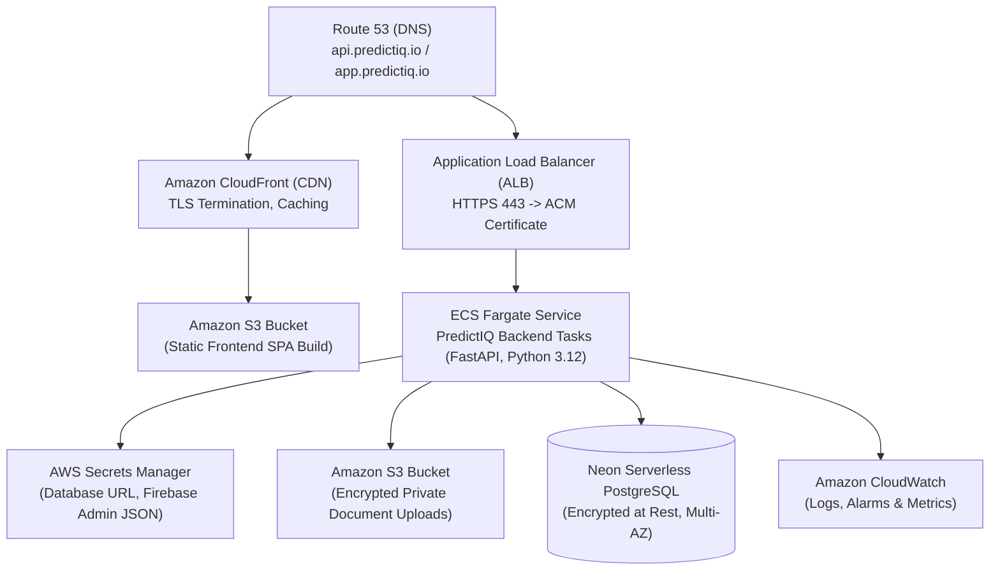

Status: Approved | Applies to: 2.0.0-rc.3 | Verified against commit: cdca041 | Date: 2026-11-08

# AWS Production Deployment Guide (ECS Fargate & App Runner)

This guide documents the production deployment of PredictIQ on Amazon Web Services (AWS) using serverless container architectures (AWS ECS Fargate or AWS App Runner), Neon PostgreSQL, and Amazon CloudFront with S3.

---

## 1. High-Level AWS Architecture



---

## 2. Prerequisites & Tooling

Before provisioning infrastructure, verify that the following CLI utilities are installed:
- **AWS CLI v2** configured with production administrator privileges (`aws sts get-caller-identity`).
- **Docker Engine v26+** running locally.
- **Python 3.12+** and **Node.js 22+**.

Set target environment variables in your terminal:
```bash
export AWS_REGION="us-east-1"
export AWS_ACCOUNT_ID="$(aws sts get-caller-identity --query Account --output text)"
export IMAGE_TAG="2.0.0-rc.3"
```

---

## 3. Container Registry (AWS ECR) Setup

Create isolated ECR repositories for the PredictIQ backend and frontend services:

```bash
# Create backend ECR repository
aws ecr create-repository \
  --repository-name predictiq/backend \
  --image-scanning-configuration scanOnPush=true \
  --encryption-configuration encryptionType=AES256 \
  --region $AWS_REGION

# Authenticate local Docker daemon to ECR
aws ecr get-login-password --region $AWS_REGION | \
  docker login --username AWS --password-stdin ${AWS_ACCOUNT_ID}.dkr.ecr.${AWS_REGION}.amazonaws.com
```

### Build & Push Production Backend Image

PredictIQ backend containers run on Python 3.12:

```bash
# Build backend container from repository root
docker build \
  --platform linux/amd64 \
  -f backend/Dockerfile \
  -t predictiq/backend:${IMAGE_TAG} \
  -t ${AWS_ACCOUNT_ID}.dkr.ecr.${AWS_REGION}.amazonaws.com/predictiq/backend:${IMAGE_TAG} \
  -t ${AWS_ACCOUNT_ID}.dkr.ecr.${AWS_REGION}.amazonaws.com/predictiq/backend:latest .

# Push image to ECR
docker push ${AWS_ACCOUNT_ID}.dkr.ecr.${AWS_REGION}.amazonaws.com/predictiq/backend:${IMAGE_TAG}
docker push ${AWS_ACCOUNT_ID}.dkr.ecr.${AWS_REGION}.amazonaws.com/predictiq/backend:latest
```

---

## 4. Secret Configuration in AWS Secrets Manager

Store sensitive production secrets in AWS Secrets Manager:

```bash
# Database connection string
aws secretsmanager create-secret \
  --name "predictiq/production/database-url" \
  --description "Neon PostgreSQL connection string for PredictIQ production" \
  --secret-string "<NEON_DATABASE_URL_WITH_SSLMODE_REQUIRE>" \
  --region $AWS_REGION

# Firebase Admin SDK Credentials
aws secretsmanager create-secret \
  --name "predictiq/production/firebase-credentials" \
  --description "Firebase Service Account JSON" \
  --secret-string file://firebase-service-account.json \
  --region $AWS_REGION
```

---

## 5. ECS Fargate Deployment (Primary Route)

ECS Fargate provides serverless container management with automated horizontal scaling and isolated VPC networking.

### Step 1: Create IAM Execution Role

```bash
# Create execution role policy document
cat <<EOF > ecs-trust-policy.json
{
  "Version": "2012-10-17",
  "Statement": [
    {
      "Effect": "Allow",
      "Principal": { "Service": "ecs-tasks.amazonaws.com" },
      "Action": "sts:AssumeRole"
    }
  ]
}
EOF

aws iam create-role \
  --role-name PredictIQEcsTaskExecutionRole \
  --assume-role-policy-document file://ecs-trust-policy.json

aws iam attach-role-policy \
  --role-name PredictIQEcsTaskExecutionRole \
  --policy-arn arn:aws:iam::aws:policy/service-role/AmazonECSTaskExecutionRolePolicy
```

### Step 2: Register ECS Task Definition

```json
{
  "family": "predictiq-backend",
  "networkMode": "awsvpc",
  "requiresCompatibilities": ["FARGATE"],
  "cpu": "1024",
  "memory": "2048",
  "executionRoleArn": "arn:aws:iam::<ACCOUNT_ID>:role/PredictIQEcsTaskExecutionRole",
  "taskRoleArn": "arn:aws:iam::<ACCOUNT_ID>:role/PredictIQEcsTaskExecutionRole",
  "containerDefinitions": [
    {
      "name": "api",
      "image": "<ACCOUNT_ID>.dkr.ecr.us-east-1.amazonaws.com/predictiq/backend:2.0.0-rc.3",
      "essential": true,
      "portMappings": [
        {
          "containerPort": 8000,
          "protocol": "tcp"
        }
      ],
      "environment": [
        { "name": "APP_ENV", "value": "production" },
        { "name": "APP_VERSION", "value": "2.0.0-rc.3" },
        { "name": "RELEASE_MODE", "value": "prediction" },
        { "name": "STORAGE_BACKEND", "value": "s3" },
        { "name": "S3_BUCKET_NAME", "value": "predictiq-prod-documents" },
        { "name": "S3_REGION", "value": "us-east-1" },
        { "name": "ALLOWED_ORIGINS", "value": "https://app.predictiq.io" }
      ],
      "secrets": [
        {
          "name": "DATABASE_URL",
          "valueFrom": "arn:aws:secretsmanager:us-east-1:<ACCOUNT_ID>:secret:predictiq/production/database-url"
        },
        {
          "name": "FIREBASE_CREDENTIALS_JSON",
          "valueFrom": "arn:aws:secretsmanager:us-east-1:<ACCOUNT_ID>:secret:predictiq/production/firebase-credentials"
        }
      ],
      "healthCheck": {
        "command": ["CMD-SHELL", "curl -f http://localhost:8000/api/v1/live || exit 1"],
        "interval": 15,
        "timeout": 5,
        "retries": 3,
        "startPeriod": 10
      },
      "logConfiguration": {
        "logDriver": "awslogs",
        "options": {
          "awslogs-group": "/ecs/predictiq-backend",
          "awslogs-region": "us-east-1",
          "awslogs-stream-prefix": "ecs"
        }
      }
    }
  ]
}
```

### Step 3: Application Load Balancer Health Check Configuration

Configure the ALB target group to probe the readiness endpoint:
- **Health Check Protocol**: `HTTP`
- **Health Check Path**: `/api/v1/ready`
- **Healthy Threshold**: `2`
- **Unhealthy Threshold**: `3`
- **Timeout**: `5 seconds`
- **Interval**: `15 seconds`
- **Success Codes**: `200`

---

## 6. AWS App Runner Deployment (Managed Alternative)

For teams seeking simplified fully-managed container operations without managing ALBs or VPCs directly, AWS App Runner deploys directly from ECR:

```bash
aws apprunner create-service \
  --service-name predictiq-api-prod \
  --source-configuration '{
    "ImageRepository": {
      "ImageIdentifier": "'${AWS_ACCOUNT_ID}'.dkr.ecr.'${AWS_REGION}'.amazonaws.com/predictiq/backend:'${IMAGE_TAG}'",
      "ImageConfiguration": {
        "Port": "8000",
        "RuntimeEnvironmentVariables": {
          "APP_ENV": "production",
          "RELEASE_MODE": "prediction",
          "STORAGE_BACKEND": "s3",
          "S3_BUCKET_NAME": "predictiq-prod-documents",
          "ALLOWED_ORIGINS": "https://app.predictiq.io"
        }
      },
      "ImageRepositoryType": "ECR"
    },
    "AutoDeploymentsEnabled": false
  }' \
  --instance-configuration '{
    "Cpu": "1 vCPU",
    "Memory": "2 GB"
  }' \
  --health-check-configuration '{
    "Protocol": "HTTP",
    "Path": "/api/v1/ready",
    "Interval": 10,
    "Timeout": 5,
    "HealthyThreshold": 1,
    "UnhealthyThreshold": 3
  }' \
  --region $AWS_REGION
```

---

## 7. Frontend Deployment (Amazon CloudFront + S3)

The React 19 Single Page Application (SPA) is built to static assets and served globally via CloudFront CDN:

```bash
# 1. Build optimized frontend assets
cd frontend
npm ci
npm run build
cd ..

# 2. Sync to S3 static bucket
aws s3 sync frontend/dist s3://predictiq-prod-frontend-assets/ \
  --delete \
  --cache-control "max-age=31536000,immutable" \
  --exclude "index.html"

# 3. Upload index.html with no-cache policy
aws s3 cp frontend/dist/index.html s3://predictiq-prod-frontend-assets/index.html \
  --cache-control "no-cache, no-store, must-revalidate"

# 4. Invalidate CloudFront edge cache
aws cloudfront create-invalidation \
  --distribution-id E1234567890ABC \
  --paths "/*"
```

---

## 8. Verification & Post-Deployment Testing

Execute the operations verification script to validate endpoint health and latency:

```bash
python scripts/check_operations.py \
  --base-url https://api.predictiq.io \
  --requests 50 \
  --concurrency 5
```

Verify that `/api/v1/ready` returns HTTP 200 with all capabilities reporting `true`:
```bash
curl -i https://api.predictiq.io/api/v1/ready
```
