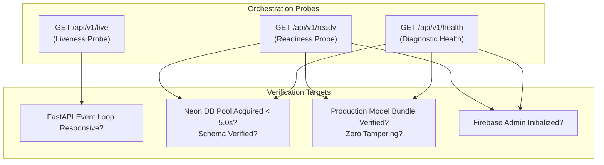

Status: Approved | Applies to: 2.0.0-rc.3 | Verified against commit: cdca041 | Date: 2026-11-08

# Health Checks, Monitoring & Production Alerting Architecture

PredictIQ provides multi-tiered health endpoints, structured observability metrics, and automated alerting rules designed for Kubernetes, AWS ECS, and cloud-native load balancers.

---

## 1. Health Probe Endpoints Reference

The API exposes three distinct endpoints with differentiated operational semantics:



---

### 1.1. Liveness Probe (`GET /api/v1/live`)
- **Purpose**: Verifies that the Python process is alive and the ASGI event loop is processing requests.
- **Dependency Isolation**: Independent of database, S3, or model state.
- **Orchestration Usage**: Container restart trigger (Kubernetes `livenessProbe` / ECS container healthcheck). If this fails, the container is deadlocked and must be restarted.
- **Status Code**: Always `HTTP 200 OK`.

#### Response Payload (Real Captured)
```json
{
  "status": "alive"
}
```

---

### 1.2. Readiness Probe (`GET /api/v1/ready`)
- **Purpose**: Verifies whether the container instance is fully capable of serving live customer traffic.
- **Checks Executed**:
  1. Acquires a connection from the Neon PostgreSQL pool within a strict 5.0s timeout (`READINESS_TIMEOUT_SECONDS`).
  2. Executes schema validation queries against `profiles` and `budgets` tables.
  3. Verifies that the production ML model bundle is verified and operational (`ml_service.is_ready()`).
  4. Confirms Firebase Admin SDK is initialized.
- **Orchestration Usage**: Ingress load balancer target health check (ALB / Cloudflare). If this returns 503, traffic is drained away from the instance without terminating the container.
- **Status Code**: `HTTP 200 OK` (if healthy) or `HTTP 503 Service Unavailable` (if degraded).

#### Response Payload (Real Captured)
```json
{
  "status": "healthy",
  "release_mode": "prediction",
  "capabilities": {
    "manual_budget": true,
    "automatic_prediction": true
  },
  "version": "2.0.0-rc.3",
  "uptime_seconds": 1420,
  "services": {
    "database": "connected",
    "ml_model": "ready",
    "firebase": "initialized"
  },
  "model_loaded": true,
  "model_mode": "production_v2_monotone",
  "model_version": "2.0.0-rc.1",
  "best_model": "MultivariateMonotoneModel + MondrianConformalPredictor",
  "training_samples": 915,
  "n_features": 3,
  "r2_score": 0.314,
  "mdape": 0.539,
  "dataset_sources": [
    "china",
    "desharnais",
    "kitchenham",
    "maxwell",
    "albrecht",
    "att_aptness"
  ],
  "confidence_method": "mondrian_split_conformal_80pct",
  "interval_method": "inductive_conformal_p10_p50_p90",
  "nominal_interval_coverage": 0.8,
  "dataset_sha256": "b05ad3b0111d4ed3ff89b7aa2a0f653e494f81953c701916f27756d1746eede3",
  "manifest_sha256": "690da0cd5bc462cb021cbbec2f2199fc816cff39a02a55e3753cf72f432b69c3"
}
```

---

### 1.3. Diagnostic Health Check (`GET /api/v1/health`)
- **Purpose**: Provides detailed operational metrics, model provenance, and subsystem status for administrative dashboards and operations monitoring.
- **Status Code**: `HTTP 200 OK` (when all subsystems operational) or `HTTP 503 Service Unavailable` (when degraded).

---

## 2. Key Observability Metrics

The application emits structured operational metrics via `structlog` and CloudWatch / Prometheus adapters:

| Metric Name | Type | Unit | Description | Target / SLA |
|-------------|------|------|-------------|--------------|
| `http_requests_total` | Counter | Count | Total requests partitioned by `method`, `endpoint`, and `status_code`. | N/A |
| `http_request_duration_seconds` | Histogram | Seconds | End-to-end HTTP request latency. | P95 < 250ms, P99 < 800ms |
| `db_pool_active_connections` | Gauge | Count | Connections currently in active use. | < 80% pool capacity |
| `db_pool_available_connections` | Gauge | Count | Idle connections available in pool. | > 1 connection |
| `ml_inference_duration_seconds` | Histogram | Seconds | Time spent evaluating ML power laws and conformal bounds. | P95 < 15ms |
| `ml_predictions_total` | Counter | Count | Total ML predictions executed partitioned by `tier` (A, B, C). | N/A |
| `ml_ood_detections_total` | Counter | Count | Predictions flagged as Out-of-Distribution. | < 5% of requests |

---

## 3. Production Alerting Thresholds

PredictIQ defines 5 primary CloudWatch / Datadog alerting rules:

### Alert 1: High API Error Rate (P1)
- **Expression**: $\frac{\sum \text{5xx responses}}{\sum \text{all requests}} > 0.01$ (1% error rate) over a 5-minute evaluation window.
- **Action**: PagerDuty notification to on-call engineering team; triggers incident triage playbook.

### Alert 2: Readiness Failure / Unhealthy Hosts (P1)
- **Expression**: `/api/v1/ready` returning 503 or failing health checks for $\ge 2$ consecutive evaluations.
- **Action**: Immediate on-call escalation; ALB automatically drains traffic from failing task.

### Alert 3: Database Connection Pool Saturated (P2)
- **Expression**: `db_pool_active_connections / DB_POOL_MAX_SIZE > 0.85` for $\ge 3$ consecutive minutes.
- **Action**: Alert to Slack `#ops-alerts`; evaluate pool expansion or slow queries.

### Alert 4: ML Artifact Tampering or Load Failure (P1)
- **Expression**: Occurrence of `ml_service_load_failed` log event or checksum failure.
- **Action**: Critical P1 incident page; verify artifact provenance and deploy approved model.

### Alert 5: P95 Latency Degradation (P3)
- **Expression**: P95 latency on `/estimates/analyze` or `/estimates/manual` $> 1500\text{ms}$ over a 10-minute window.
- **Action**: Warning notification to `#ops-monitoring` to investigate database index or cold-start issues.
