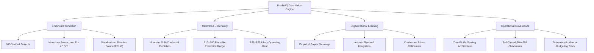

# PredictIQ Product Overview

Status: Approved | Applies to: 2.0.0-rc.3 | Verified against commit: cdca041 | Date: 2026-11-08

---

## 1. Executive Summary & Vision

PredictIQ is an empirical software effort, cost, and schedule estimation platform built to replace ungrounded heuristics, black-box calculators, and wishful thinking with statistically calibrated estimation science. 

Traditional software project estimation frequently fails because estimators either rely on subjective guesswork or employ opaque models that project false precision. PredictIQ grounds software sizing in standardized functional metrics and empirical observations from 915 verified software engineering projects across global domains. 

By pairing a monotone power-law estimation engine with Mondrian split-conformal prediction and empirical Bayes shrinkage, PredictIQ provides engineering organizations with transparent, mathematically bounded prediction intervals that quantify uncertainty honestly.

---

## 2. Target Personas

PredictIQ serves cross-functional technical and executive roles involved in software planning, budgeting, and delivery:

### 2.1. Chief Technology Officers (CTOs) & VPs of Engineering
- **Core Objectives:** Establish defensible, data-backed engineering budgets, forecast team capacity over quarterly cycles, and communicate software delivery timelines accurately to executive boards.
- **Key Pain Points:** Unrealistic commitments driven by optimistic sales estimates, lack of standardized sizing across multiple squads, and unexplained cost overruns.
- **PredictIQ Value:** Defensible median effort benchmarks, bounded cost intervals with configurable hourly rates, and organizational calibration that improves accuracy as company delivery records accumulate.

### 2.2. Technical Project Managers (TPMs) & Delivery Leads
- **Core Objectives:** Construct realistic milestones, account for integration complexity, identify early risk factors, and mitigate delivery bottlenecks before engineering kicks off.
- **Key Pain Points:** Single-point deadlines that ignore statistical variance, unseen architectural volatility, and difficulty communicating project uncertainty to non-technical stakeholders.
- **PredictIQ Value:** Calibrated P25–P75 Likely Bands and P10–P90 Plausible Ranges, Brooks' Law-aware duration modeling, and automated risk scoring across team experience, integration density, and requirements volatility.

### 2.3. Product Managers (PMs) & Solution Architects
- **Core Objectives:** Rapidly assess feature feasibility, size technical specifications (SRS / PRDs), and evaluate architectural trade-offs during project discovery.
- **Key Pain Points:** Manual estimation workshops that stall sprint planning, subjective sizing metrics (e.g., arbitrary story points) that do not translate to hours or dollars, and shifting requirement baselines.
- **PredictIQ Value:** Automated document analysis for PDF, DOCX, and text specifications with functional sizing (Function Points), out-of-distribution (OOD) diagnostic alerts, and instant recalculation upon scope adjustments.

### 2.4. Software Procurement & Finance Executives
- **Core Objectives:** Audit vendor proposals, validate statement-of-work (SOW) quotes, and maintain financial governance across internal and contractor engagements.
- **Key Pain Points:** Opaque vendor markups, unverified staffing estimates, and currency exposure across international contractors.
- **PredictIQ Value:** Multi-currency rate conversion, transparent phase-by-phase cost breakdowns (Requirements, Design, Implementation, Testing, Deployment), and audit-ready estimation exports.

---

## 3. Core Value Propositions

PredictIQ is structured around four architectural and functional pillars:

### 3.1. Scientific Empirical Foundation
- **Verified Benchmark Cohort:** Models train strictly on 915 cleaned, deduplicated, whole-project records from established academic and industrial repositories (China, Kitchenham, Desharnais, Maxwell, Albrecht, AT&T Aptness).
- **Strict Monotonicity Invariant:** Uses monotone power-law formulation ($E = a \cdot S^b$ with bounded $b > 0$), mathematically enforcing that software effort increases monotonically with functional size ($\frac{\partial E}{\partial S} > 0$).
- **No Fabricated Factors:** Prohibits artificial adjustment metrics, unverified complexity multipliers, or synthetic data points.

### 3.2. Calibrated Uncertainty Communication
- **Dual Confidence Intervals:** Replaces deceptive single-point numbers with two distinct, calibrated bands:
  - **P25–P75 Likely Band (50% Coverage):** Practical operational target for sprint and quarterly staffing.
  - **P10–P90 Plausible Range (80% Coverage):** Formal risk envelope for contractual and financial commitments.
- **Mondrian Bucket Calibration:** Error quantiles are conditioned by functional size (Small: $<150$ FP, Medium: $150$–$750$ FP, Large: $>750$ FP) to prevent small systems from inheriting excessive variance from massive enterprise deployments.
- **Out-of-Distribution (OOD) Diagnostics:** Explicitly detects and flags projects with anomalous sizes, extreme durations, or atypical team configurations, explaining why intervals widen without false clamping.

### 3.3. Organizational Learning via Actuals Flywheel
- **Empirical Bayes Shrinkage:** As engineering teams complete projects and submit audited actuals, PredictIQ blends global empirical priors with company-specific velocity through empirical Bayes shrinkage ($w_k = \frac{k}{k + 2.83}$).
- **Continuous Calibration:** Allows teams with few logged projects to borrow strength from global empirical research while automatically transitioning toward internal actuals as their dataset matures.

### 3.4. Operational Integrity and Security
- **Independent Operational Tracks:** Provides both ML-driven empirical estimation for sizing uncertainty and a deterministic task-based manual budgeting tool for immediate operational planning.
- **Zero-Pickle Deserialization:** Production serving consumes JSON parameter manifests, preventing arbitrary code execution vulnerabilities during inference.
- **Fail-Closed Execution:** The platform validates file hashes, runtime environments, and schema contracts upon startup, immediately halting execution if any component fails cryptographic verification.
