# PredictIQ Product Roadmap

Status: Approved | Applies to: 2.0.0-rc.3 | Verified against commit: cdca041 | Date: 2026-11-08

---

## 1. Roadmap Overview & Strategic Priorities

The PredictIQ product roadmap extends the platform's empirical foundation across three strategic phases:
1. **Phase 1 (v2.1):** Workflow Automation, Issue Tracker Integration, and Multi-Tenant Workspaces.
2. **Phase 2 (v2.2):** Large-Scale Enterprise Benchmarks and Advanced Local Conformal Inference.
3. **Phase 3 (v3.0):** Automated Architecture Sizing and Continuous Codebase Calibration.

```mermaid
flowchart LR
    subgraph P1["v2.1: Workflow Automation"]
        A1["COSMIC Functional Sizing"]
        A2["Jira / GitHub Actuals Sync"]
        A3["Multi-Tenant Workspaces"]
    end

    subgraph P2["v2.2: Enterprise Foundation"]
        B1["Commercial ISBSG Expansion"]
        B2["Local Conformal Inference"]
        B3["Monte Carlo Risk Simulation"]
    end

    subgraph P3["v3.0: Continuous Calibration"]
        C1["OpenAPI / Codebase Mining"]
        C2["Multi-Modal Architecture Parsing"]
        C3["Real-Time Delivery Forecasting"]
    end

    P1 --> P2 --> P3
```

---

## 2. Phase 1: Near-Term Enhancements (v2.1)

### 2.1. COSMIC Functional Sizing Track
- **Context:** While IFPUG is standard for data-intensive business applications, real-time, event-driven, and embedded systems are sized more effectively using COSMIC Functional Size Units (CFP, ISO/IEC 19761).
- **Deliverables:**
  - Dedicated COSMIC parameter inputs and document parser heuristics.
  - Separate calibration track trained on the 337-project COSMIC benchmark dataset.
  - Dual-mode sizing toggle allowing users to choose IFPUG or COSMIC sizing paradigms.

### 2.2. Automated Issue Tracker Sync (Jira & GitHub)
- **Context:** Manually recording completed project actuals introduces friction. Direct integration with issue tracking systems automates the Actuals Flywheel.
- **Deliverables:**
  - OAuth connectors for Jira Software, GitHub Issues, and GitLab.
  - Automated extraction of completed sprint hours, story points, and cycle times.
  - Ingestion filter mapping completed work packages into project actuals with developer verification.

### 2.3. Multi-Tenant Organizational Workspaces
- **Context:** Mid-market and enterprise organizations require departmental isolation, team-specific hourly rate structures, and centralized billing.
- **Deliverables:**
  - Workspace management with invite codes and domain-based auto-join.
  - Team-level custom hourly rates and currency presets.
  - Workspace-scoped actuals calibration pools ensuring private organizational shrinkage.

---

## 3. Phase 2: Mid-Term Milestones (v2.2)

### 3.1. Enterprise ISBSG Cohort Expansion
- **Context:** The International Software Benchmarking Standards Group (ISBSG) maintains a repository of over 13,000 audited enterprise projects. Incorporating this dataset broadens empirical coverage across specialized domains (e.g., core banking, telecommunications, healthcare).
- **Deliverables:**
  - Licensing ingestion and automated verification scripts per `docs/data/ISBSG_PLAN.md`.
  - Expansion of Mondrian strata to include fine-grained industry vertical sub-buckets.
  - Preflight validation confirming zero feature leakage and clean target definitions.

### 3.2. Localized Conformal Prediction
- **Context:** Mondrian buckets currently segment projects into three size tiers (Small, Medium, Large). Localized conformal inference estimates error density as a continuous function of size and complexity.
- **Deliverables:**
  - Kernel-weighted local non-conformity scoring.
  - Narrower prediction intervals in high-density regions of the training distribution without sacrificing nominal coverage.
  - Interactive interval breakdown visualizing local calibration density.

### 3.3. Monte Carlo Parameter & Risk Simulation
- **Context:** Project managers frequently encounter multi-variable uncertainty where team experience, scope volatility, and external dependencies fluctuate simultaneously.
- **Deliverables:**
  - Parametric simulation running 10,000 randomized iterations across user-defined parameter distributions.
  - Tornado diagrams illustrating sensitivity of project cost to individual risk factors.
  - Exportable risk distribution curves for executive risk committees.

---

## 4. Phase 3: Long-Term Horizon (v3.0)

### 4.1. Automated Codebase & API Specification Mining
- **Context:** During software modernization and ongoing development, written SRS documents quickly become outdated. Real systems are best sized from active code and interface specifications.
- **Deliverables:**
  - Direct ingestion of OpenAPI (Swagger), GraphQL schemas, and Protobuf definitions to calculate functional interface size.
  - Git repository static analysis measuring data entity complexity and integration density.
  - Continuous background sizing tracking scope expansion across development releases.

### 4.2. Multi-Modal Architectural Diagram Understanding
- **Context:** Early software architectures are frequently documented via whiteboard diagrams, C4 model schematics, and entity-relationship diagrams rather than extensive text.
- **Deliverables:**
  - Vision-model parsing of architectural diagrams into functional components, databases, and external interfaces.
  - Visual diagram review interface allowing architects to confirm identified boundary elements.
  - Direct translation of visual architectures into calibrated functional size estimates.
