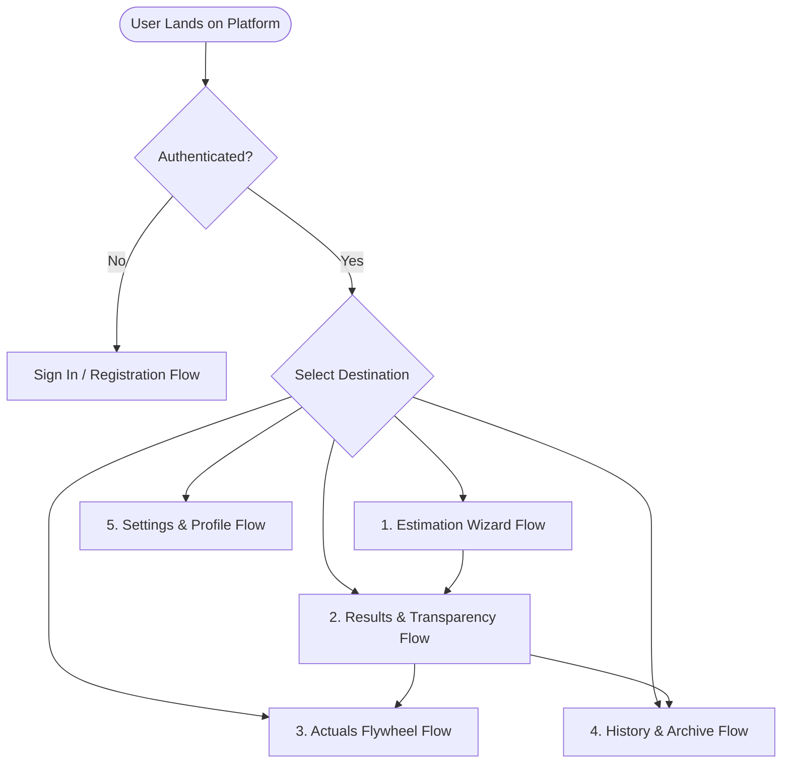
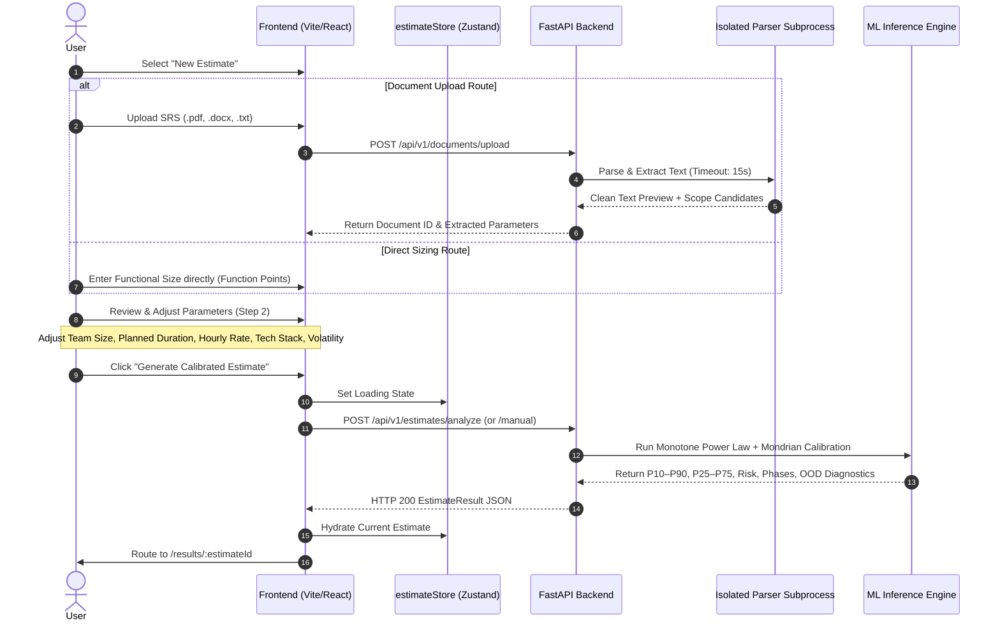
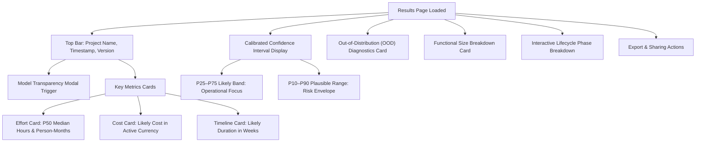
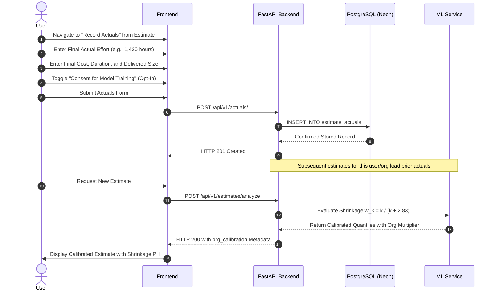
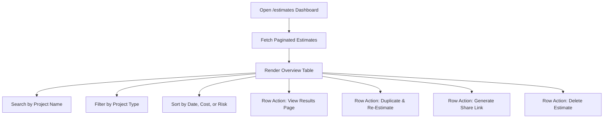
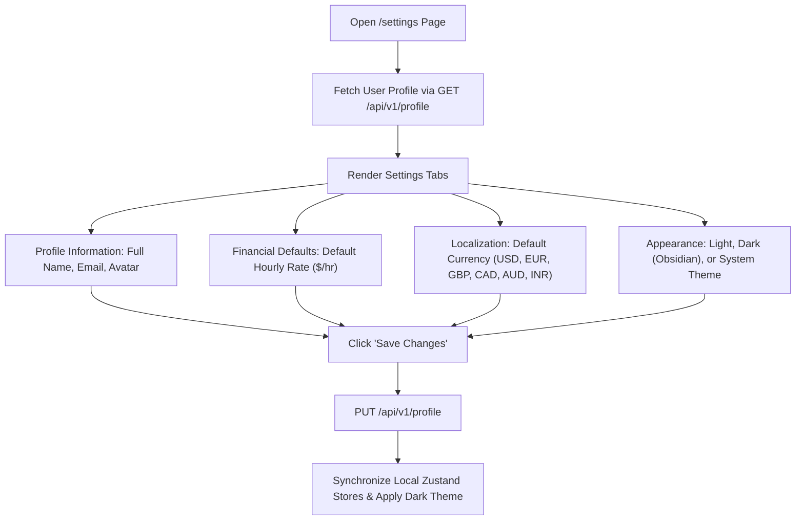

# PredictIQ User Flows & Journeys

Status: Approved | Applies to: 2.0.0-rc.3 | Verified against commit: cdca041 | Date: 2026-11-08

---

## 1. Overview of Core User Journeys

PredictIQ provides structured, accessible workflows for engineering leaders, project managers, and finance officers. This document details the five primary user journeys through the application:

---

## 2. Journey 1: Estimation Wizard Flow

The Estimation Wizard guides users through project scoping and parameter configuration in three structured stages:

### Detailed Steps:
1. **Scope Intake (Step 1):**
   - The user selects either document-driven analysis or direct manual entry.
   - For document intake, the user drops a specification file (max 10 MB). The client validates file extensions and mime types before dispatching to `/api/v1/documents/upload`.
   - The backend validates magic bytes, verifies archive safety, and extracts text in an isolated worker subprocess.
2. **Parameter Refinement (Step 2):**
   - The user reviews extracted attributes and overrides values where necessary:
     - **Project Type:** Web App, Mobile App, API / Backend, Enterprise System, Data Platform, IoT / Embedded.
     - **Functional Size:** Function Points (FP) derived from document analysis or manually entered.
     - **Team & Schedule:** Team size (1–100 engineers) and optional target duration (1–60 months).
     - **Complexity & Risk Factors:** Integration count (0–15), requirements volatility (1–5), team experience level (1.0–4.0), and methodology (Agile, Waterfall, Hybrid).
     - **Financial Parameters:** Hourly labor rate (USD 10–500/hr) defaulted from user profile.
3. **Execution & Routing (Step 3):**
   - Clicking "Generate Estimate" sends an immutable payload to `/api/v1/estimates/analyze`.
   - The backend computes calibrated quantiles, phase breakdowns, and risk flags, persists the record to PostgreSQL, and redirects to the Results view.

---

## 3. Journey 2: Results Exploration & Analysis

The Results view serves as the comprehensive decision center for a generated estimate:

### Key Interactive Elements:
- **Model Transparency Modal:** Clicking the info badge reveals the cryptographic model lineage, training dataset SHA-256 (`b05ad3...`), manifest hash, sample count (915 projects), and Mondrian bucket cutoff points.
- **Calibrated Intervals:** The `ConfidenceInterval` visualizer displays the relationship between median effort ($P_{50}$), the inner 50% likely operating band ($P_{25}$–$P_{75}$), and the outer 80% plausible range ($P_{10}$–$P_{90}$).
- **OOD Diagnostics:** If project parameters fall outside empirical training envelopes, warning badges explain that intervals widen naturally to reflect epistemic uncertainty.
- **Export & Share Controls:**
  - **Generate Share Link:** Creates an expirable, password-protected public URL (`/shared/:token`).
  - **Download JSON:** Emits the full contract-compliant JSON payload for automated toolchains.
  - **Download Executive PDF:** Produces an audit-ready summary for client and executive presentations.

---

## 4. Journey 3: Actuals Flywheel Flow

The Actuals Flywheel enables continuous organizational learning by capturing real-world project outcomes:

### Flow Details:
1. **Entry Point:** Users access the actuals form from any completed estimate in their history.
2. **Data Logging:** The form captures total verified person-hours, final invoice cost, actual elapsed calendar months, and delivered functional size.
3. **Training Consent:** Users can optionally opt in to anonymous model retraining.
4. **Bayesian Shrinkage Trigger:** Once logged, subsequent estimates for the organization query historical actuals, calculating an empirical Bayes adjustment factor that calibrates global baseline predictions toward internal delivery speed.

---

## 5. Journey 4: Estimates History & Archive

The Estimates archive provides central management, filtering, and comparison across all historic estimates:

### Table Columns and Actions:
- **Project Name & Version:** Identifies the project and iteration count.
- **Type & Tech Stack:** Displays categorized stack pills.
- **Likely Cost & Effort:** Formatted in the currently active currency and hours.
- **Risk Badge:** Color-coded indicator (Green: Low, Blue: Medium, Amber: High, Red: Critical).
- **Date Created & Updated:** Formatted timestamps with relative display.
- **Batch Operations:** Export selected estimates to CSV or JSON summary formats.

---

## 6. Journey 5: Settings & Profile Flow

The Settings page enables users to tailor organizational defaults, display parameters, and localization:

### Profile Attributes Configured:
- **Hourly Billing Rate:** Used as the initial pre-filled rate for all new estimates.
- **Base Currency:** Controls the primary currency used for cost calculations and reports.
- **Theme Selection:** Toggles between High-Contrast Light Mode and Obsidian Dark Mode instantly via the CSS theme provider.
- **Timezone:** Standardizes timestamp presentation across shared links and export documents.
