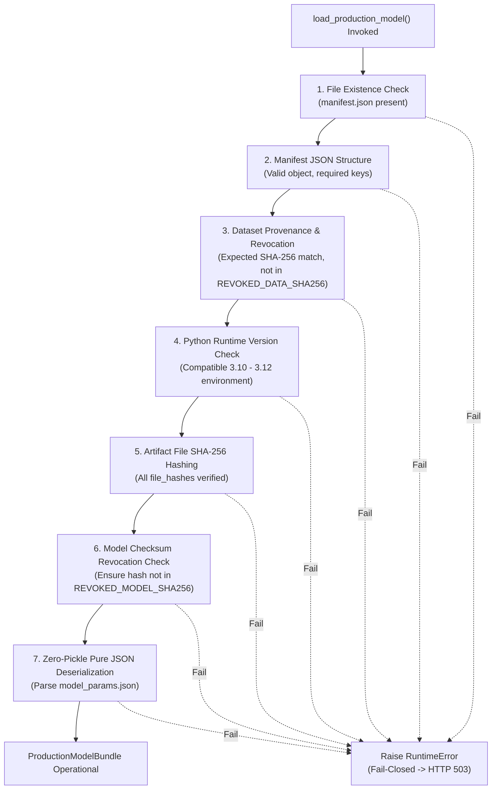

Status: Approved | Applies to: 2.0.0-rc.3 | Verified against commit: cdca041 | Date: 2026-11-08

# Machine Learning Artifact Integrity & Zero-Pickle Serving Architecture

PredictIQ enforces a fail-closed, cryptographic verification boundary on all production machine learning artifacts, guaranteeing tamper detection, model provenance, and immunity against deserialization vulnerabilities.

---

## 1. Threat Context: The Serialization Vulnerability

Traditional Python machine learning deployments rely heavily on `pickle` or `joblib` formats to persist trained estimators. However, Python's `pickle` format is fundamentally unsafe:
- Pickled objects can execute arbitrary Python bytecode during deserialization via `__reduce__` methods.
- Checksums alone do not guarantee safety if an attacker can tamper with both the file and its expected hash.
- Deserializing untrusted pickle files exposes the host system to Remote Code Execution (RCE).

To permanently resolve this vulnerability, PredictIQ establishes a **Zero-Pickle Serving Guarantee**: production inference engines deserialize model parameters exclusively from structured JSON files (`model_params.json`), completely bypassing binary pickle execution.

---

## 2. Cryptographic Verification Pipeline

When the PredictIQ application starts up or initializes the `MLService`, `backend/ml/artifacts/loader.py` executes a strict, 7-step fail-closed verification pipeline:



### Verification Steps in Detail

1. **Manifest File Verification**: Ensures `manifest.json` exists in `backend/ml/artifacts/production_v2/` and is a valid JSON dictionary containing all `REQUIRED_MANIFEST_KEYS`:
   `["model_version", "dataset_sha256", "dataset_records", "architecture", "file_hashes", "allowed_inputs", "banned_features", "environment"]`.
2. **Dataset Integrity Verification**:
   - Confirms `dataset_records == 915`.
   - Confirms `dataset_sha256 == "b05ad3b0111d4ed3ff89b7aa2a0f653e494f81953c701916f27756d1746eede3"`.
   - Validates that `dataset_sha256` is not present in `REVOKED_DATA_SHA256`.
3. **Runtime Environment Matching**: Verifies that the host Python major/minor version matches the manifest specification (supports validated 3.10, 3.11, and 3.12 interpreters).
4. **Per-Artifact SHA-256 Checksums**:
   - Reads every artifact file in 64 KB streaming blocks.
   - Computes SHA-256 digest and verifies exact equality against `file_hashes` in the manifest.
5. **Model Revocation Blacklist**:
   - Checks the computed checksum against `REVOKED_MODEL_SHA256` in `backend/ml/artifact_safety.py`.
   - Any previously revoked or compromised model is immediately rejected.
6. **Zero-Pickle Pure JSON Loading**:
   - Reads `model_params.json` via Python `json.load`.
   - Reconstructs `MultivariateMonotoneModel` and `MondrianConformalPredictor` directly from numeric coefficients without invoking `pickle.load`.

---

## 3. Pure JSON Parameter Deserialization

The production model artifact `model_params.json` stores fitted coefficients as standard JSON numbers:

```json
{
  "format_version": "2.0.0",
  "architecture": "MultivariateMonotoneModel + MondrianConformalPredictor",
  "parameters": {
    "base_marginal": {
      "beta0": 3.188036,
      "a": 24.240751,
      "b": 0.827027
    },
    "multivariate": {
      "beta0": 3.318083,
      "a": 27.607548,
      "b": 0.592956,
      "c": 0.528897
    },
    "has_duration": true,
    "n_valid_duration_train": 450
  },
  "calibration": {
    "conformal_80": {
      "global_quantile": 1.005319,
      "bucket_quantiles": {
        "small": 1.053214,
        "medium": 0.991204,
        "large": 0.974512
      }
    },
    "conformal_50": {
      "global_quantile": 0.526201,
      "bucket_quantiles": {
        "small": 0.548219,
        "medium": 0.519084,
        "large": 0.510341
      }
    }
  }
}
```

The model loader extracts these floats directly into instance attributes (`model.beta0_base_`, `model.a_base_`, `model.b_base_`, `conformal.bucket_quantiles_`).

---

## 4. Fail-Closed Error Handling

If any verification condition fails, the loader raises a `RuntimeError` immediately:
- The exception is logged with structured error parameters.
- `ml_service.is_ready()` evaluates to `False`.
- The readiness probe (`/api/v1/ready`) returns `HTTP 503 Service Unavailable`.
- Application Load Balancers drop the failing container from the active target group, preventing corrupt or compromised instances from serving live traffic.
