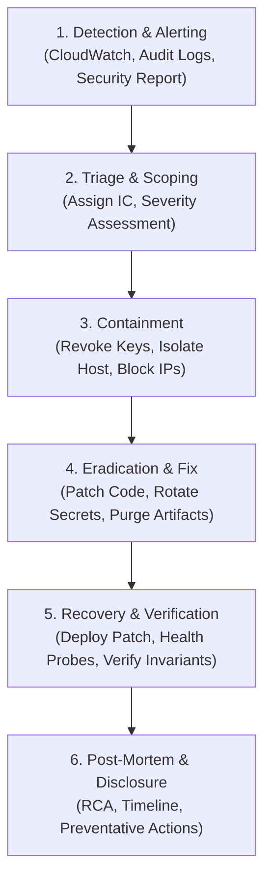

Status: Approved | Applies to: 2.0.0-rc.3 | Verified against commit: cdca041 | Date: 2026-11-08

# Security Incident Response & Vulnerability Disclosure Playbook

This document defines PredictIQ's Coordinated Vulnerability Disclosure policy and the operational Incident Response Playbook for detecting, triaging, containing, and recovering from security incidents.

---

## 1. Coordinated Vulnerability Disclosure Policy

PredictIQ welcomes responsible security research. If you discover a vulnerability in PredictIQ software or infrastructure, report it according to this protocol:

- **Primary Contact**: `security@predictiq.io`
- **PGP Encryption**: Security reports may be encrypted using our official PGP key (Key ID: `0x9D4E72B1`, fingerprint published on `/.well-known/security.txt`).
- **Required Details**:
  - Detailed description of the vulnerability and attack vector.
  - Reproducible steps or proof-of-concept (PoC) code.
  - Affected components, endpoints, or commit hashes.
  - Estimated impact and potential data exposure.

### Service Level Agreements (SLAs)

| Severity | Initial Response | Triage Completed | Remediation / Patch Released |
|----------|------------------|------------------|------------------------------|
| **P1 — Critical** | < 4 hours | < 12 hours | < 24 hours |
| **P2 — High** | < 12 hours | < 24 hours | < 72 hours |
| **P3 — Medium** | < 24 hours | < 48 hours | < 7 business days |
| **P4 — Low** | < 48 hours | < 5 business days | Next scheduled release |

We commit to not pursuing legal action against researchers who adhere to coordinated disclosure principles, avoid accessing customer data, and do not disrupt system availability.

---

## 2. Severity Classification Matrix

| Severity Level | Criteria | Example Scenarios in PredictIQ |
|----------------|----------|--------------------------------|
| **P1: Critical** | Remote Code Execution, unauthorized admin access across all tenants, unencrypted mass database leakage, active model poisoning. | Zero-pickle bypass resulting in RCE, exposure of root database credentials, arbitrary role escalation to admin. |
| **P2: High** | Direct cross-tenant data access, bypassed rate limiting allowing brute force, unauthenticated document downloads. | IDOR allowing User A to read User B's estimate without share token, authorization bypass on profile updates. |
| **P3: Medium** | CSRF on non-critical endpoints, stored XSS in project notes restricted to owner, verbose internal error trace disclosure. | XSS triggered only by estimator themselves in delivery notes, leaking internal stack traces via 500 error responses. |
| **P4: Low** | Minor information leakage, missing non-critical security headers, rate limiting inconsistencies on public assets. | Timing discrepancies on health probes, missing referrer policies on static documentation pages. |

---

## 3. Incident Response Lifecycle



---

## 4. Emergency Action Playbooks

### Playbook A: Exposed Database or Firebase Credentials

**Trigger**: A connection string, service account JSON, or API key is committed to Git, leaked in logs, or exposed to unauthorized parties.

1. **Immediate Invalidation**:
   - *Neon Database*: Generate a new password in the Neon Console for the `predictiq` role. Update connection pooling endpoints.
   - *Firebase Admin*: In Firebase Console &rarr; Project Settings &rarr; Service Accounts, revoke the exposed private key and generate a replacement.
2. **Configuration Update**:
   - Update `DATABASE_URL` or `FIREBASE_CREDENTIALS_JSON` in AWS Secrets Manager / environment variables.
   - Restart all backend container tasks to pick up new credentials.
3. **Audit Log Inspection**:
   - Query `AuditLogMiddleware` events and Neon access logs for connection attempts originating from unknown IP addresses during the exposure window.
4. **Git Cleansing**:
   - If committed to repository history, use `git-filter-repo` to excise the secret from all branches and tags. Force-push to all remotes.

---

### Playbook B: Detected Model Artifact Tampering

**Trigger**: An artifact loader raises a checksum violation, or a model SHA-256 matches `REVOKED_MODEL_SHA256`.

1. **Fail-Closed Verification**:
   - Confirm that `/api/v1/ready` has transitioned to HTTP 503 and the load balancer has removed failing instances from service.
2. **Forensic Snapshot**:
   - Take an immutable filesystem snapshot of the affected container's `backend/ml/artifacts/production_v2/` directory for forensic analysis.
3. **Artifact Restoral**:
   - Re-deploy approved model artifacts directly from the immutable release build:
     ```bash
     python -m backend.ml.artifacts.loader
     ```
   - Confirm SHA-256 matches expected production manifest:
     `b05ad3b0111d4ed3ff89b7aa2a0f653e494f81953c701916f27756d1746eede3` (dataset)
4. **Investigation**:
   - Audit CI/CD deployment logs and container registry pull events to determine where the unauthorized artifact originated.

---

### Playbook C: Cross-Tenant Data Access

**Trigger**: Evidence that an authorized user gained access to another user's estimates, documents, or budgets.

1. **Containment**:
   - Suspend the offending user's account immediately via Firebase Admin SDK:
     ```python
     firebase_auth.update_user(uid, disabled=True)
     ```
2. **Scope Assessment**:
   - Query audit logs for all requests executed by the user session across the last 30 days.
   - Identify every `estimate_id`, `document_id`, or `budget_id` returned in responses to that user.
3. **Remediation**:
   - Verify that all database queries in `backend/app/api/v1/` enforce ownership matching (`WHERE user_id = $2`).
   - If an endpoint omitted tenant filtering, deploy an emergency patch immediately.
4. **Notification**:
   - In compliance with GDPR Art. 33/34, notify affected tenants within 72 hours of confirming personal or proprietary data exposure.
