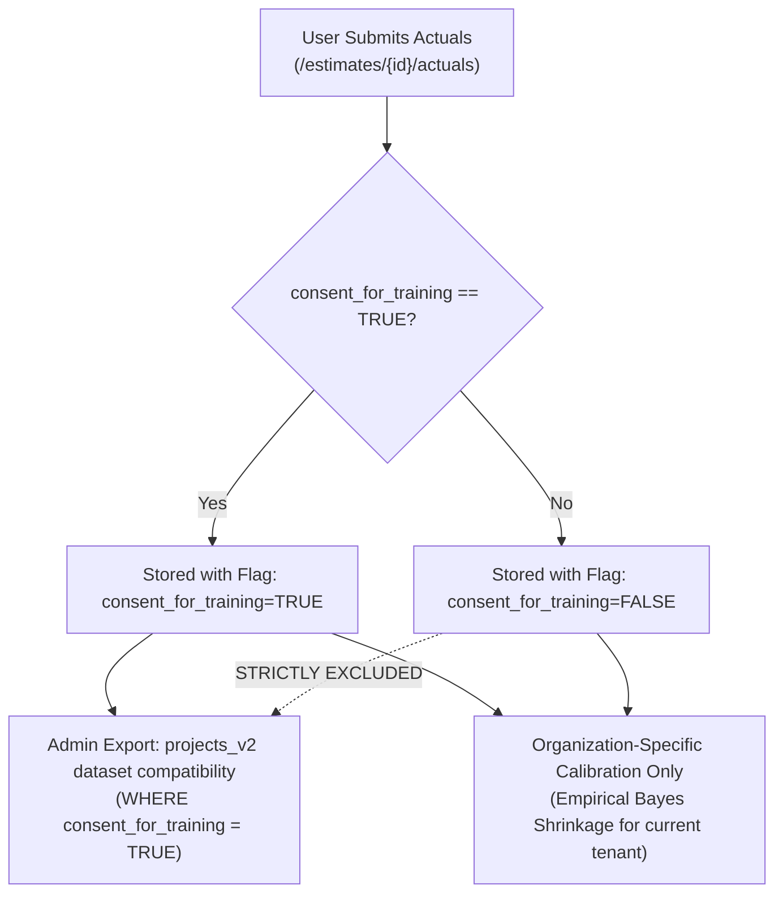

Status: Approved | Applies to: 2.0.0-rc.3 | Verified against commit: cdca041 | Date: 2026-11-08

# Privacy, Data Handling & Compliance Architecture

PredictIQ is architected with privacy-by-design principles, ensuring strict tenant data isolation, granular training consent controls, and operational compliance with global privacy regulations including GDPR and CCPA.

---

## 1. Machine Learning Training Consent Architecture

Customer intellectual property and project metrics are never incorporated into machine learning models without explicit, affirmative consent.



### The Actuals Consent Mechanism
1. **Explicit Opt-In**: When submitting completed project outcomes via `POST /api/v1/estimates/{id}/actuals`, the client must explicitly submit the `consent_for_training` boolean field.
2. **Database Isolation**: The consent status is durably recorded in the `estimate_actuals` PostgreSQL table.
3. **Restricted Export Pipeline**: The administrative training export endpoint (`/api/v1/admin/actuals/export`) queries strictly:
   ```sql
   SELECT ea.*, e.inputs_json
   FROM estimate_actuals ea
   LEFT JOIN estimates e ON ea.estimate_id = e.id
   WHERE ea.consent_for_training = TRUE
   ORDER BY ea.created_at ASC
   ```
   Records with `consent_for_training = FALSE` are completely invisible to the training export query.
4. **Intra-Tenant Use**: An organization's actuals (regardless of public training consent) may be used locally to power Empirical Bayes organization shrinkage calibration for that organization's estimates only.

---

## 2. Multi-Tenant Data Isolation

PredictIQ enforces tenant boundaries at both the database layer and object storage layer:

### Database Row-Level Tenancy
- Every estimate, document upload, and budget record is tagged with the creating user's unique identifier (`user_id`).
- All queries in `estimate_service.py`, `documents.py`, and `budgets.py` enforce ownership matching:
  ```sql
  SELECT * FROM estimates WHERE id = $1 AND user_id = $2 AND status != 'deleted'
  ```
- Cross-tenant requests fail immediately with `404 Not Found`, denying the existence of other tenants' records.

### Object Storage Isolation
- Uploaded requirements documents (.pdf, .docx, .txt) are stored in AWS S3 or Cloudflare R2 under randomly generated UUID keys.
- Storage buckets prohibit all public/anonymous read access.
- Object retrieval is mediated through `StorageService`, which only executes download requests after validating database ownership.

---

## 3. GDPR & CCPA Compliance Framework

PredictIQ implements automated capabilities supporting data subject rights:

### 1. Right to Access & Data Portability (GDPR Art. 15 & 20 / CCPA § 1798.100)
Users can export all estimation data and historical inputs in standardized, vendor-neutral formats:
- **Raw Contract Export (`GET /api/v1/estimates/{id}/export/json`)**: Streams the complete machine-readable estimation object including all captured parameters, quantile bounds, and model provenance metadata conforming to `api_estimate_v2.json`.
- **Branded Report Export (`GET /api/v1/estimates/{id}/export/pdf`)**: Generates a self-contained PDF summary suitable for executive review.
- **Profile Data (`GET /api/v1/profile`)**: Fetches all stored user profile details.

### 2. Right to Erasure / Deletion (GDPR Art. 17 / CCPA § 1798.105)
PredictIQ provides two levels of data deletion:
- **Operational Soft-Deletion (`DELETE /api/v1/estimates/{id}`)**: Marks the record with `status = 'deleted'`. Soft-deleted records are immediately excluded from list views, calculations, and exports.
- **Storage Purge**: Document files stored in S3/R2 are deleted via `StorageService.delete(key)` upon request.
- **Account Purge Request**: Upon receiving an account erasure request (via `privacy@predictiq.io`), an automated script cascades deletion across:
  - `document_uploads` metadata and corresponding S3 storage objects.
  - `estimates` and related `estimate_actuals`.
  - `budgets` and `profiles` records.
  - Firebase Authentication user account.

### 3. Data Minimization & PII Sanitization
- PredictIQ does not require or process personal identity data for software project estimation. Sizing is computed strictly from functional requirements and system scope.
- All freeform user text (project names, delivery notes, tech stack descriptions) passes through `_sanitize_text` and `_sanitize_notes`:
  - Strips `<script>` and HTML markup.
  - Converts HTML entities.
  - Enforces strict character length caps (max 200 chars for names, 5,000 chars for delivery notes).
