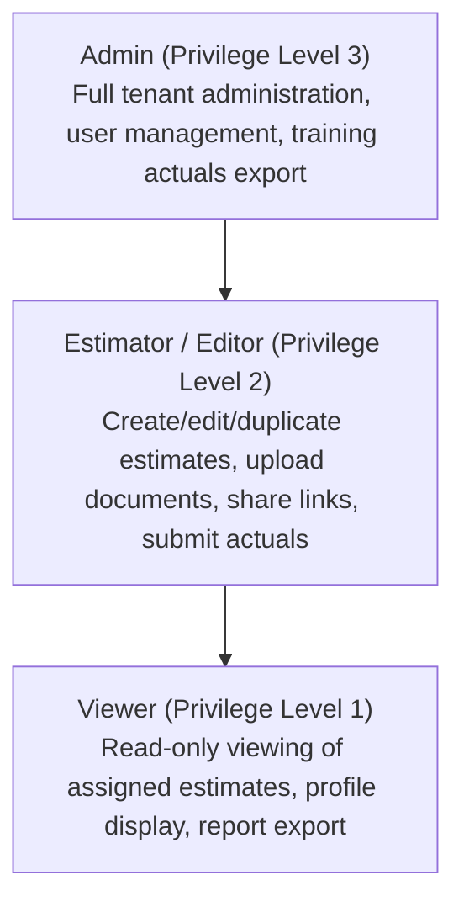
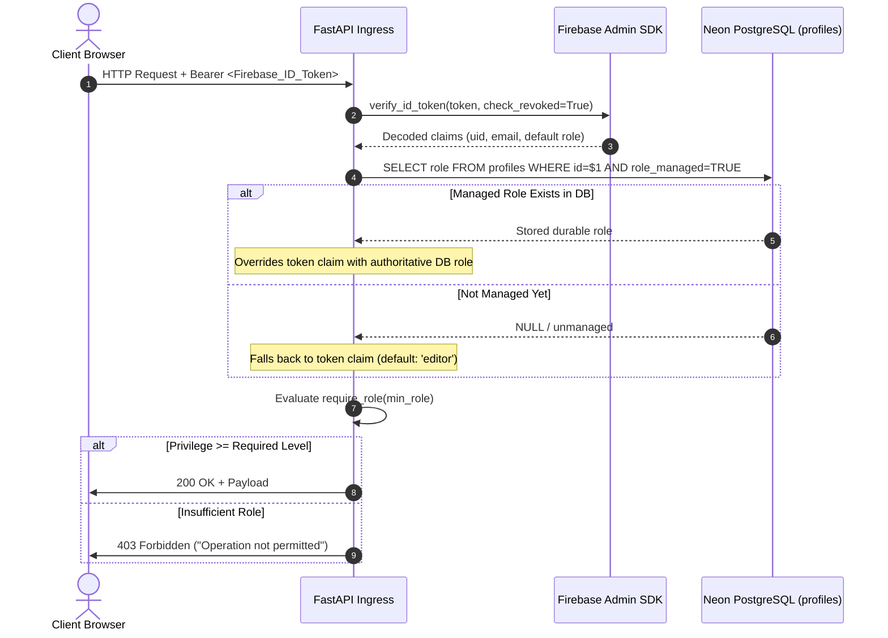

Status: Approved | Applies to: 2.0.0-rc.3 | Verified against commit: cdca041 | Date: 2026-11-08

# Role-Based Access Control (RBAC) & Authorization Architecture

PredictIQ implements a hierarchical Role-Based Access Control (RBAC) model combined with tenant-level ownership checks, ensuring that users can only access features and resources commensurate with their organizational authority.

---

## 1. Role Hierarchy

Roles are ordered hierarchically by integer privilege level. Any user holding a higher-tier role inherently satisfies the permission requirements of all lower tiers:



| Role | Hierarchy Level | Primary Persona | System Scope |
|------|-----------------|-----------------|--------------|
| **`admin`** | 3 | Engineering VP, Operations Lead | Global tenant administration, audit review, flywheel data export, role assignment. |
| **`editor`** *(Estimator)* | 2 | Solution Architect, Technical PM, Tech Lead | Full project estimation, document parsing, manual budgets, actuals submission. |
| **`viewer`** | 1 | Client, Executive Stakeholder, Finance Auditor | Read-only inspection of estimates, PDF/JSON export, profile viewing. |

---

## 2. Authorization Flow & Token Verification



### Authoritative Role Resolution
To guarantee that revoked or downgraded privileges take effect immediately without waiting for client token expiration:
1. The backend inspects the `profiles` table in Neon PostgreSQL.
2. If `role_managed = TRUE`, the role recorded in the database is authoritative and instantly supersedes any role claim embedded in the JWT.
3. A background reconciliation worker (`role_sync.py`) synchronizes database role changes back to Firebase custom claims asynchronously.

---

## 3. RBAC Permission Matrix

| API Route | HTTP Method | Minimum Required Role | Tenant Isolation Rule | Description |
|-----------|-------------|-----------------------|-----------------------|-------------|
| `/api/v1/estimates/analyze` | `POST` | `editor` | Document must belong to caller | Run full NLP + ML estimation pipeline on uploaded document |
| `/api/v1/estimates/manual` | `POST` | `editor` | Created under caller `user_id` | Run parametric estimation without document |
| `/api/v1/estimates` | `GET` | `viewer` | Filtered strictly by `user_id` | List paginated estimates owned by caller |
| `/api/v1/estimates/{id}` | `GET` | `viewer` | Owner match or `admin` role | Retrieve complete estimate details |
| `/api/v1/estimates/{id}/duplicate` | `POST` | `editor` | Owner match or `admin` role | Duplicate estimate as new version |
| `/api/v1/estimates/{id}` | `DELETE` | `editor` | Owner match or `admin` role | Soft-delete estimate (`status = 'deleted'`) |
| `/api/v1/estimates/{id}/share` | `POST` | `editor` | Owner match or `admin` role | Generate temporary public share link |
| `/api/v1/estimates/{id}/export/pdf` | `GET` | `viewer` | Owner match or `admin` role | Download multi-currency PDF report |
| `/api/v1/estimates/{id}/export/json`| `GET` | `viewer` | Owner match or `admin` role | Export raw canonical JSON contract |
| `/api/v1/estimates/{id}/actuals` | `POST` | `editor` | Owner match or `admin` role | Submit project delivery actuals & consent |
| `/api/v1/documents/upload-file` | `POST` | `editor` | Stored under caller `user_id` | Upload requirements document (.pdf, .docx, etc.) |
| `/api/v1/documents/{id}/extract` | `POST` | `editor` | Document must belong to caller | Trigger text parsing and entity extraction |
| `/api/v1/budgets` | `POST` | `editor` | Created under caller `user_id` | Save manual budget plan |
| `/api/v1/budgets` | `GET` | `viewer` | Filtered strictly by `user_id` | List user saved budgets |
| `/api/v1/profile` | `GET` | `viewer` | Resolved to caller `user_id` | View current user profile |
| `/api/v1/profile` | `PATCH`/`POST` | `editor` | Resolved to caller `user_id` | Update profile settings (allowlisted columns only) |
| `/api/v1/admin/actuals/export` | `GET` | `admin` | Global scope (consented only) | Export consented actuals dataset for retraining |
| `/api/v1/shared/{token}` | `POST`/`GET` | Public (Unauthenticated)| Scoped strictly to shared token | View shared estimate with optional password |

---

## 4. Tenant Data Isolation

Even within the same role tier, users cannot access or mutate resources belonging to another user. Tenant boundaries are enforced in the database tier via parameterized SQL filters:

```python
# Enforcement pattern in EstimateService
row = await pool.fetchrow(
    "SELECT * FROM estimates WHERE id = $1 AND user_id = $2 AND status != 'deleted'",
    estimate_id,
    user.id,
)
if not row and user.role != "admin":
    raise HTTPException(status_code=404, detail="Estimate not found")
```

- When an unprivileged user queries an existing ID that belongs to another tenant, the API returns `404 Not Found` rather than `403 Forbidden` to prevent object existence enumeration.
- Administrators possess delegated authority to inspect and manage tenant resources for support and compliance purposes.
