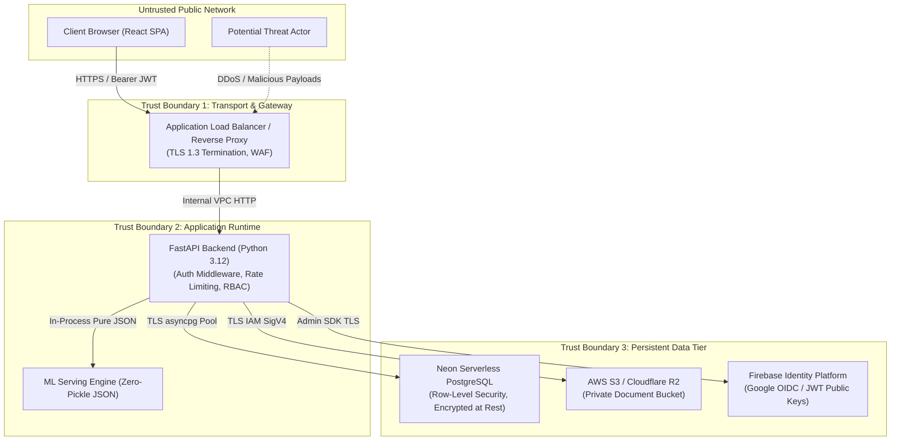

Status: Approved | Applies to: 2.0.0-rc.3 | Verified against commit: cdca041 | Date: 2026-11-08

# PredictIQ Security Threat Model (STRIDE Analysis)

This document provides a comprehensive security threat model for PredictIQ using Microsoft's **STRIDE** methodology (Spoofing, Tampering, Repudiation, Information Disclosure, Denial of Service, Elevation of Privilege), detailing attack surfaces, trust boundaries, and engineered mitigation controls.

---

## 1. System Architecture & Trust Boundaries

### Trust Boundary Definitions
1. **TB1 (Client to Ingress)**: Untrusted client browser crossing into managed infrastructure. Requires TLS 1.3, CSP, HSTS, and WAF rules.
2. **TB2 (Ingress to Application Engine)**: Authenticated HTTP requests evaluated by FastAPI middleware stack (rate limiting, audit logging, request ID injection, body size capping).
3. **TB3 (Application to Persistent Services)**: Internal database, cloud object storage, and Firebase identity services communicating over encrypted private networks or authenticated TLS APIs.

---

## 2. STRIDE Threat Analysis Matrix

| Threat Category | Target / Component | Threat Description | Engineered Mitigation in PredictIQ | Residual Risk |
|-----------------|--------------------|--------------------|-----------------------------------|---------------|
| **Spoofing** | User Identity | Attacker generates fabricated JWTs to impersonate enterprise estimators or administrators. | Firebase Admin SDK cryptographically verifies token signatures against Google's rotating public certificate sets (`verify_id_token`), enforces project ID matching, and checks token expiration and revocation. | Low |
| **Spoofing** | Model Provenance | Attacker substitutes an arbitrary pickle or poisoned model file into production. | Production bundle loader (`backend/ml/artifacts/loader.py`) validates SHA-256 against `manifest.json`, cross-checks against `REVOKED_MODEL_SHA256`, and enforces pure JSON deserialization (`model_params.json`). | Very Low |
| **Tampering** | User Input Data | Attacker injects malicious script tags, SQL payloads, or oversized strings via project fields. | `_sanitize_text` strips HTML/scripts and escapes entities. Pydantic validates types, ranges, and string bounds. All database queries use parameterized SQL via `asyncpg`. | Very Low |
| **Tampering** | Stored Documents | Attacker modifies another tenant's uploaded requirements documents. | S3 storage keys are isolated under UUIDs. Document access checks enforce tenant ownership (`WHERE id = $1 AND user_id = $2`) in PostgreSQL before fetching storage objects. | Very Low |
| **Repudiation** | Estimate Operations | Disgruntled user denies creating, modifying, sharing, or deleting an estimate. | `AuditLogMiddleware` records structured JSON audit events for every mutating call, including user ID, IP address, timestamp, request path, method, and unique `X-Request-ID`. | Low |
| **Information Disclosure** | Cross-Tenant Leakage | Attacker accesses private estimate calculations or actuals belonging to another organization. | All estimate queries enforce strict `user_id` equality. Shared links use high-entropy random tokens with optional bcrypt password hashing and automatic expiration. | Low |
| **Information Disclosure** | Model Parameter Leakage | Attacker attempts to extract private training data through estimation inversion. | Incumbent model is a parametric monotone power law ($a \cdot S^b$) with Mondrian conformal bounds. No individual training record features or identifiers are exposed in serving responses. | Very Low |
| **Information Disclosure** | Error Traces | Stack traces or database credentials leaked in HTTP 500 error responses. | FastAPI global exception handlers catch uncaught exceptions and return generic `"Estimation failed"` or `"Estimate operation failed"` payloads, while logging detailed diagnostic traces internally via `structlog`. | Very Low |
| **Denial of Service** | Document Parser Bomb | Uploading a deeply nested ZIP bomb, large PDF, or hostile regex document to exhaust memory/CPU. | `BodyLimitMiddleware` rejects payloads exceeding 10MB (`413 Request Entity Too Large`). Document parsing runs in isolated child processes with memory caps and strict execution deadlines. | Low |
| **Denial of Service** | API Request Flooding | Flooding estimation endpoints with concurrent requests to exhaust DB pools or CPU. | `SlowAPI` enforces IP and user-based rate limits (60 req/min for estimates, 10 req/hr for share links). Connection pools enforce acquisition timeouts (`asyncio.timeout(5.0)`). | Low |
| **Elevation of Privilege** | Privilege Escalation | User tampers with role claims in JWT or database to gain `admin` privileges. | Roles stored in Neon `profiles` table override unmanaged token claims (`role_managed`). Modifying roles requires an authenticated user with `admin` role via protected endpoints. | Low |

---

## 3. Defense-in-Depth Implementation

### 1. Zero-Pickle Serving
Python `pickle` deserialization presents critical Remote Code Execution (RCE) vectors. In PredictIQ:
- Production serving loads exclusively from `model_params.json` via standard library `json.load`.
- The serving loader (`load_production_model`) verifies that `model_params.json` exists and matches the SHA-256 recorded in `manifest.json`.
- Binary pickle loading is completely bypassed in production serving mode.

### 2. Multi-Layer Input Sanitization
- **Layer 1: Network Ingress**: ALB / Cloudflare WAF terminates TLS and blocks common injection vectors.
- **Layer 2: Gateway Middleware**: `BodyLimitMiddleware` enforces maximum payload limits.
- **Layer 3: Controller Schemas**: Pydantic v2 schemas validate data types, string length bounds (e.g. `ProjectName` max 200 chars), and numerical ranges (e.g. `hourly_rate_usd` [10, 500]).
- **Layer 4: Storage & Database**: Pure parameterized queries (`asyncpg`) prevent SQL injection; HTML entity escaping neutralizes stored XSS.

### 3. Fail-Closed Health Probes
The `/api/v1/ready` probe verifies end-to-end service readiness:
- Verifies Neon PostgreSQL connection and schema availability within a 5.0-second deadline.
- Confirms ML model bundle verification status.
- Validates Firebase Admin SDK initialization.
If any critical subsystem degrades or if artifacts have been tampered with, the endpoint immediately returns HTTP 503, preventing traffic routing to an unhealthy instance.
