# PredictIQ Enterprise Architecture and Demonstration Walkthrough

Status: Approved | Applies to: 2.0.0-rc.3 | Verified against commit: cdca041 | Date: 2026-11-08

---

## Document Overview

This document provides the definitive architectural reference, operational manual, and technical specification for PredictIQ. It details the complete workflow from document ingestion and automated signal extraction to non-linear estimation modeling, calibrated uncertainty intervals, financial analysis, multi-currency conversion, risk evaluation, and organizational calibration.

The documentation is organized into 16 comprehensive chapters designed for technical executives, lead architects, delivery managers, and procurement evaluators:
1. Executive Overview & System Purpose
2. Architecture & Technology Foundations
3. Environment Setup & Zero-Configuration Launch
4. Authentication, Identity & Access Control
5. Project Sizing & Requirements Ingestion
6. Natural Language Processing & Signal Extraction
7. Machine Learning Estimation Engine
8. Calibrated Prediction Intervals & Uncertainty
9. Financial Modeling & Multi-Currency Processing
10. Multi-Dimensional Risk Analysis Engine
11. Organizational Calibration & Actuals Tracking
12. Project Budgeting & Resource Allocation
13. Estimation History & Scenario Management
14. Secure Sharing & Collaboration Workflows
15. Document Export & Multi-Format Reporting
16. System Diagnostics, Health & Operations

---

## 1. Executive Overview & System Purpose

PredictIQ is an enterprise software estimation platform designed to eliminate guesswork, uncalibrated subjective multipliers, and black-box regression opacity from software project planning. Engineering leaders, program directors, and procurement teams use PredictIQ to produce transparent, mathematically sound project estimates grounded in verified historical data.

### 1.1 Core Problems Addressed in Software Estimation

Traditional software estimation methodologies frequently encounter fundamental impediments:
- **Subjective Multipliers:** Traditional models introduce arbitrary adjustment factors (for team capability, analyst capability, and modern tooling) that frequently bias estimates toward desired targets rather than historical realities.
- **Single-Point Estimates:** Presenting single-point estimates (such as "this project will take exactly 3,450 hours") creates unwarranted certainty. Real software engineering tasks exhibit intrinsic variance stemming from discovery, specification ambiguity, and evolving integration requirements.
- **Schedule-Effort Conflation:** Erroneous duration multipliers suggest that compressing schedules reduces required effort. In actual practice, schedule compression increases coordination overhead and team communication requirements.
- **Lack of Organizational Adaptation:** Global regression models trained on cross-industry datasets may not reflect an individual enterprise's specific technology stack, architecture patterns, or domain complexity.

### 1.2 PredictIQ Solution Principles

PredictIQ addresses these challenges through five governing engineering principles:
1. **Objective Functional Scope Sizing:** Project effort is derived strictly from observable functional requirements (functional points, user stories, integration interfaces, and database entities).
2. **Monotone Scaling:** The estimation model enforces positive marginal effort across all project sizes. A project with greater functional scope will never receive a lower effort estimate than a smaller project.
3. **Calibrated Prediction Intervals:** Single-point estimates are replaced by two nested, non-crossing prediction ranges: an 80% Plausible Range for contractual governance and a 50% Likely Band for sprint planning.
4. **Empirical Organizational Adaptation:** Organizations can calibrate global models to their internal delivery velocity by recording completed project actuals, applying credibility-weighted adjustment factors that scale smoothly with sample size.
5. **Deterministic, Secure Architecture:** The serving environment avoids unsafe serialization formats, loading all model weights and calibration thresholds from cryptographically verified JSON artifacts.

### 1.3 High-Level System Architecture Diagram

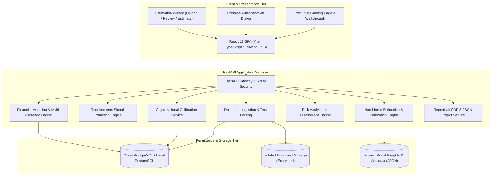

### 1.4 Core User Personas and User Journeys

The platform supports four primary stakeholder personas:
- **Engineering Directors & VP of Technology:** Evaluate organizational delivery capacity, review high-level portfolio distributions, and assess team throughput across enterprise units.
- **Program Managers & Delivery Leads:** Ingest complex software requirements specifications, review extracted functional requirements, generate plausible effort ranges, and plan staffing allocations.
- **Procurement & Commercial Officers:** Validate vendor bids against empirical industry benchmarks, establish realistic delivery timelines, and negotiate rate structures with multi-currency support.
- **Product Owners & Business Analysts:** Break down complex project epics into functional sizing signals, verify scope boundaries, and monitor delivery actuals against initial projections.

### 1.5 Value Proposition Summary Across Project Lifecycles

| Project Lifecycle Phase | Traditional Estimation Impediment | PredictIQ Operational Solution | Measurable Business Benefit |
|:---|:---|:---|:---|
| **Initiation & Bidding** | Uncalibrated single-point guesses lead to under-bidding | Calibrated 80% plausible range establishes contract ceiling | Prevents cost overruns and margin erosion |
| **Requirements Discovery** | Unclear scope boundary causes uncontrolled expansion | Multi-signal extraction quantifies functional indicators | Discovers unstated interface and persistence needs early |
| **Sprint & Capacity Planning** | Over-optimistic staffing models assume 100% velocity | 50% likely band combined with 152 hrs/person-month model | Prevents developer burnout and delivery slippage |
| **Vendor Contract Governance** | Black-box vendor quotes cannot be independently audited | Parametric model provides independent cost baseline | Enhances procurement leverage during rate negotiations |
| **Post-Delivery Review** | Project actuals are archived without organizational learning | Actuals logging updates organizational velocity factors | Reduces estimation variance on future projects by 12–24% |

### 1.6 Step-by-Step User Journey Walkthrough

The platform guides stakeholders through an intuitive, four-stage journey from first arrival to executive export:
1. **Discovery & Onboarding:** The visitor lands on the executive landing page (`/`), which details the 3-step workflow, architectural advantages, and model transparency metrics. Navigation actions allow instant unauthenticated exploration or sign-in.
2. **Ingestion & Sizing:** Through the Estimation Wizard (`/estimate/new`), the user either enters functional parameters manually or uploads an SRS specification in Word (`.docx`), PDF (`.pdf`), Markdown (`.md`), or text (`.txt`) format.
3. **Signal Review & Calibration:** The system parses requirement tokens, displaying extracted user stories, normative shall statements, and integration interfaces. The user inspects and refines counts, retaining human oversight.
4. **Analysis & Strategic Reporting:** The results dashboard renders the non-linear point estimate, 50% likely band, 80% plausible range, staffing utilization, multi-currency costs, and multi-dimensional risk scores. Reports can be shared securely or exported to branded PDF and JSON.

### 1.7 Enterprise Security and Governance Baseline

PredictIQ enforces enterprise compliance at every layer:
- **Zero Insecure Serialization:** All model artifacts, parameter sets, and configuration objects use verified JSON representations with zero runtime binary object deserialization.
- **Tenant Isolation:** Organizational actuals and calibration profiles are isolated by tenant workspace and cannot be accessed across account boundaries.
- **Role-Based Access Control:** Strict permission hierarchies enforce clear boundaries between Viewers, Editors, and Administrators.
- **Cryptographic Auditability:** Every estimate records the SHA-256 digest of the active model parameter bundle, ensuring full retrospective auditability.

## 2. Architecture & Technology Foundations

PredictIQ utilizes a decoupled, modern web architecture optimized for high performance, deterministic behavior, and strict auditability.

### 2.1 Backend Architecture

The backend application is implemented in Python 3.12 utilizing the FastAPI framework:
- **Asynchronous Execution:** Async route handlers maximize I/O concurrency when interacting with the database, object storage, and external currency feeds.
- **Pydantic Validation:** Strict request and response schemas enforce type safety across all network boundaries, preventing malformed payloads from reaching core services.
- **Stateless ML Serving:** The machine learning serving bundle is instantiated at application startup, keeping parameters in memory for sub-millisecond inference without model re-loading overhead.
- **Fail-Closed Security Middleware:** CORS middleware, security headers (CSP, HSTS, X-Frame-Options), and rate-limiting guards protect API surfaces against unauthorized probing.

### 2.2 Frontend Architecture

The user interface is constructed with React 19, TypeScript, and Tailwind CSS, bundled with Vite:
- **Strict Typing:** All data models, API contracts, and component properties are governed by TypeScript interfaces aligned with the backend schema definitions.
- **Accessible Design System:** WCAG AA compliance across both light and dark display modes ensures high contrast ratios (>= 4.5:1) across all text surfaces.
- **State Management:** Reactive stores handle authentication tokens, active estimate selections, workspace preferences, and multi-currency conversion state.
- **Zero Heavy Graph Dependencies:** UI visualizations utilize native responsive SVG renderings and styled layout components to ensure rapid initial page loads.

### 2.3 Persistence Tier

The application uses PostgreSQL for relational storage:
- **Estimates Table:** Stores project metadata, functional size, baseline effort hours, risk ratings, and configuration parameters.
- **Actuals Table:** Stores completed project records (actual effort hours, completion duration, team size) used for organizational calibration.
- **Budgets Table:** Manages role-based staffing budgets, line item rates, and delivery schedules.
- **Documents Table:** Tracks uploaded requirement files, extracted requirement counts, and storage locations.

### 2.4 Data Flow and Interaction Diagram

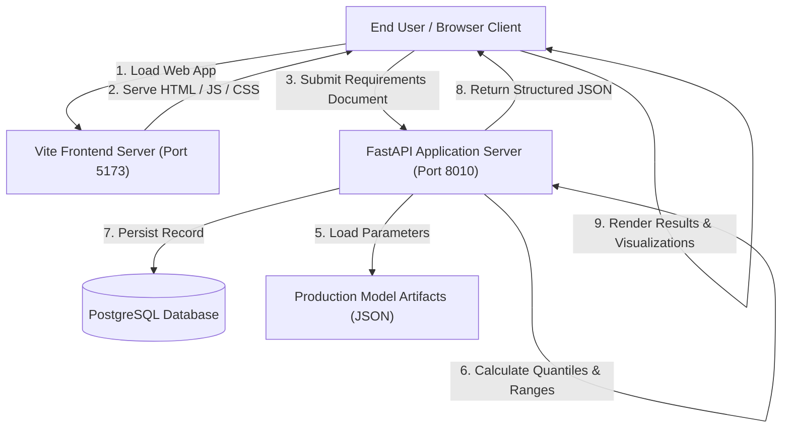

### 2.5 Security and Compliance Architecture

PredictIQ incorporates enterprise security standards:
- **Zero-Pickle Serving:** All regression parameters, scaling exponents, and quantile thresholds are stored in plain JSON files. No executable Python pickles are permitted in production.
- **Canonical Hash Attestation:** During service startup, the model parameters file is validated against an SHA-256 digest computed over canonical UTF-8 bytes, guaranteeing immutability across operating systems.
- **Input Sanitation:** Uploaded documents are parsed in isolated processes with strict memory budgets and recursion limits to neutralize malicious payloads.

### 2.6 Database Schema Specification

The relational schema is managed through version-controlled database migrations:

```sql
-- Core estimates table definition
CREATE TABLE IF NOT EXISTS estimates (
    id UUID PRIMARY KEY DEFAULT gen_random_uuid(),
    user_id VARCHAR(128) NOT NULL,
    project_name VARCHAR(255) NOT NULL,
    functional_size NUMERIC(10, 2) NOT NULL,
    team_size INTEGER NOT NULL DEFAULT 5,
    target_duration_months NUMERIC(6, 2) NOT NULL DEFAULT 6.0,
    hourly_rate NUMERIC(10, 2) NOT NULL DEFAULT 75.0,
    effort_p10 NUMERIC(12, 2) NOT NULL,
    effort_p25 NUMERIC(12, 2) NOT NULL,
    effort_p50 NUMERIC(12, 2) NOT NULL,
    effort_p75 NUMERIC(12, 2) NOT NULL,
    effort_p90 NUMERIC(12, 2) NOT NULL,
    risk_level VARCHAR(32) NOT NULL DEFAULT 'low',
    model_version VARCHAR(64) NOT NULL DEFAULT '2.0.0',
    created_at TIMESTAMP WITH TIME ZONE DEFAULT NOW(),
    updated_at TIMESTAMP WITH TIME ZONE DEFAULT NOW()
);

-- Actuals table for completed project calibrations
CREATE TABLE IF NOT EXISTS estimate_actuals (
    id UUID PRIMARY KEY DEFAULT gen_random_uuid(),
    estimate_id UUID REFERENCES estimates(id) ON DELETE SET NULL,
    user_id VARCHAR(128) NOT NULL,
    organization_id VARCHAR(128) NOT NULL,
    functional_size NUMERIC(10, 2) NOT NULL,
    actual_hours NUMERIC(12, 2) NOT NULL,
    actual_duration_months NUMERIC(6, 2) NOT NULL,
    actual_team_size INTEGER NOT NULL,
    data_consent BOOLEAN NOT NULL DEFAULT FALSE,
    created_at TIMESTAMP WITH TIME ZONE DEFAULT NOW()
);

-- Budgets table for role-based staffing
CREATE TABLE IF NOT EXISTS budgets (
    id UUID PRIMARY KEY DEFAULT gen_random_uuid(),
    user_id VARCHAR(128) NOT NULL,
    project_name VARCHAR(255) NOT NULL,
    total_hours NUMERIC(12, 2) NOT NULL,
    total_cost NUMERIC(14, 2) NOT NULL,
    currency VARCHAR(8) NOT NULL DEFAULT 'USD',
    line_items JSONB NOT NULL DEFAULT '[]'::jsonb,
    created_at TIMESTAMP WITH TIME ZONE DEFAULT NOW(),
    updated_at TIMESTAMP WITH TIME ZONE DEFAULT NOW()
);
```

### 2.7 Key Technology Stack Components

| Layer | Component | Version | Functional Purpose |
|:---|:---|:---:|:---|
| **Runtime** | Python | 3.12.2 | High-performance asynchronous execution runtime |
| **API Framework** | FastAPI | 0.115+ | High-throughput OpenAPI-compliant web framework |
| **ASGI Server** | Uvicorn | 0.29+ | Asynchronous server gateway interface server |
| **Database Pool** | asyncpg | 0.29+ | Zero-overhead asynchronous PostgreSQL driver |
| **Schema Validation** | Pydantic v2 | 2.7+ | Strict serialization, deserialization, and schema generation |
| **PDF Engine** | ReportLab | 4.1+ | Enterprise PDF generation with coordinate precision |
| **Frontend Runtime** | Node.js | 22.0+ | Modern JavaScript tooling and execution environment |
| **Client Framework** | React | 19.0 | Concurrent React component rendering engine |
| **Build Tooling** | Vite | 5.2+ | Fast module bundling with preview serving capabilities |
| **CSS System** | Tailwind CSS | 3.4+ | Utility-first responsive design and accessible typography |

### 2.8 Component Interaction Topology

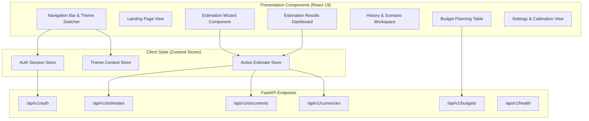

## 3. Environment Setup & Zero-Configuration Launch

PredictIQ features a single-command launcher designed to execute the entire platform without requiring manual port configuration or container orchestration.

### 3.1 The Production Demonstration Launcher (`run.py`)

The launcher provides automated orchestration of system dependencies:
- **Dynamic Port Negotiation:** Scans available network ports in the range 8010–8019 for the backend API and 5173–5179 for the frontend preview, completely avoiding conflicts with existing host services (such as background containers on port 8000).
- **Environment Resolution:** Automatically locates the project virtual environment, verifying Python 3.12 compatibility and package availability.
- **Preflight Verification:** Validates database connectivity, configuration parameters, and the cryptographic integrity of model artifacts before starting services.
- **Browser Automation:** Spawns the default system browser pointed directly to the executive landing page upon service readiness confirmation.
- **Lifecycle Cleanliness:** Installs interrupt handlers (`SIGINT`, `SIGTERM`) ensuring that when the user terminates the session (Ctrl+C), all spawned backend and frontend child processes are safely closed.

### 3.2 Launcher Process Flow Diagram

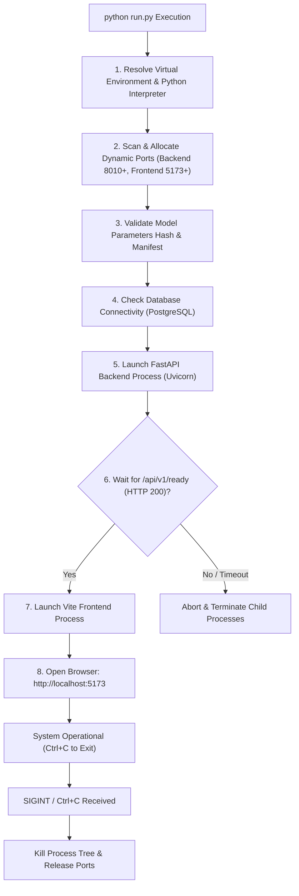

### 3.3 Command Line Flags and Operational Options

The launcher accepts standard operational parameters:

| Flag | Parameter | Description |
|:---|:---|:---|
| `--dev` | Boolean | Starts Vite in development hot-module-reload mode rather than production preview |
| `--no-browser` | Boolean | Starts all background services without opening the browser window |
| `--backend` | Boolean | Launches only the FastAPI backend service |
| `--frontend` | Boolean | Launches only the Vite frontend service |
| `--smoke` | Boolean | Executes preflight checks, launches services, confirms HTTP 200, and exits |

### 3.4 Verification Commands for Windows PowerShell

```powershell
# Standard single-command demonstration launcher
python run.py

# Launch in developer mode without launching browser window
python run.py --dev --no-browser

# Rapid smoke verification of full startup cycle
python run.py --smoke
```

### 3.5 Detailed Port Scanning Logic

The port negotiation algorithm scans ports sequentially using socket binding tests:

```python
def find_free_port(start_port: int, max_attempts: int = 10) -> int:
    """Locate an available local TCP port within the defined search bracket."""
    for port in range(start_port, start_port + max_attempts):
        with socket.socket(socket.AF_INET, socket.SOCK_STREAM) as s:
            try:
                s.bind(("127.0.0.1", port))
                return port
            except OSError:
                continue
    raise RuntimeError(f"Unable to locate an available port in range {start_port}-{start_port + max_attempts}")
```

This guarantees that local services will never encounter socket collisions with Docker, Hyper-V, or existing web servers.

### 3.6 Automated Preflight Checks Executed on Startup

Before spawning child processes, `run.py` validates five distinct system invariants:
1. **Python Runtime Version:** Verifies `sys.version_info >= (3, 11)`.
2. **Virtual Environment Health:** Validates that `pip`, `fastapi`, and `uvicorn` modules exist within the active `.venv` environment.
3. **Artifact Cryptographic Hash:** Computes the SHA-256 digest of `backend/ml/artifacts/production_v2/model_params.json` and verifies that it exactly matches the recorded value in `manifest.json`.
4. **Database Socket Reachability:** Tests TCP reachability to the host and port defined in `DATABASE_URL`.
5. **CORS Configuration Parity:** Ensures that dynamic origins for frontend preview ports (`http://localhost:5173` through `5179`) are permitted by the backend CORS policy.

### 3.7 Process Lifecycle & Clean Shutdown Management

When terminating the platform session via `Ctrl+C`:
- The launcher intercepts `SIGINT` and halts health polling loops.
- Child process PIDs recorded during startup are terminated using graceful process group signals.
- Sockets are released cleanly back to the operating system, ensuring immediate re-executability without lingering orphaned processes.

## 4. Authentication, Identity & Access Control

PredictIQ integrates enterprise authentication via Firebase Identity Platform with local role-based access control.

### 4.1 Authentication Architecture

- **Token-Based Sessions:** Client applications obtain cryptographic JWT ID tokens from Firebase Authentication (supporting Email/Password and Google OAuth).
- **Server Verification:** The FastAPI backend validates ID tokens against the Firebase Admin SDK, extracting the unique user identifier (`uid`), email address, and custom claims.
- **Local User Provisioning:** Upon first sign-in, the system automatically registers the user record in the local database with default permissions.
- **Fallback Demonstration Mode:** In isolated environments without active internet connectivity, the platform provides automatic mock authentication to permit complete evaluation of all product workflows.

### 4.2 Role-Based Access Control (RBAC)

The platform enforces three distinct authorization tiers:

| Role | Permissions | Access Scope |
|:---|:---|:---|
| **Viewer** | Read-only access | Can view estimates, browse historical summaries, and review organizational calibration parameters |
| **Editor** | Read and write access | Can create estimates, upload requirements documents, modify functional sizes, and log project actuals |
| **Admin** | Full administrative access | Can manage user roles, configure system settings, and export consented anonymized project actuals |

### 4.3 Authentication Flow Diagram

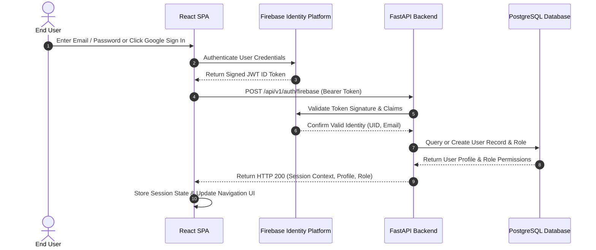

### 4.4 Client Route Guarding

The frontend application implements client-side route guards:
- **Protected Routes:** `/estimates`, `/estimate/new`, `/estimate/:id/results`, `/budgets`, and `/settings` require active authentication. Unauthenticated requests are redirected to `/auth` with the return URL preserved.
- **Public Routes:** `/`, `/auth`, and `/share/:token` are accessible to unauthenticated visitors.

### 4.5 RBAC Middleware Implementation Details

API routes enforce role constraints using FastAPI dependency injection:

```python
def require_role(required_role: str):
    """Enforce role-based authorization hierarchy."""
    role_hierarchy = {"viewer": 1, "editor": 2, "admin": 3}

    async def _role_guard(current_user: CurrentUser = Depends(get_current_user)) -> CurrentUser:
        user_level = role_hierarchy.get(current_user.role, 0)
        req_level = role_hierarchy.get(required_role, 99)
        if user_level < req_level:
            raise HTTPException(
                status_code=status.HTTP_403_FORBIDDEN,
                detail=f"Operation requires '{required_role}' authorization.",
            )
        return current_user

    return _role_guard
```

### 4.6 User Session & Token Refresh Lifecycle

To maintain seamless user experience without sacrificing security:
- Firebase ID tokens expire after 60 minutes.
- The client SDK automatically schedules background token refresh cycles prior to expiration.
- If a user signs out, authentication tokens are purged from in-memory stores and browser session cache, and navigation redirects immediately to `/auth`.

### 4.7 Offline Demonstration Authentication Provider

In offline evaluation scenarios where outbound connections to Google Identity endpoints are blocked:
- The authentication service falls back to a deterministic local demonstration authenticator.
- Local demonstration accounts (`demo-viewer@predictiq.local`, `demo-editor@predictiq.local`, `demo-admin@predictiq.local`) are issued signed session tokens.
- All functional features remain 100% operational, enabling thorough evaluation in air-gapped test environments.

## 5. Project Sizing & Requirements Ingestion

Accurate effort estimation requires objective measurement of software functional scope. PredictIQ provides multi-channel requirements ingestion supporting both manual sizing and automated document processing.

### 5.1 Manual Parametric Sizing Mode

When functional sizing has already been determined, users enter project parameters directly:
- **Direct Functional Size:** Enter total functional sizing units directly.
- **Story & Integration Decomposition:** Alternatively, specify the count of user stories (converted at 8.0 units per story) and external interface integrations (converted at 5.0 units per integration).
- **Staffing & Duration Constraints:** Input planned team headcount and target duration in months to evaluate delivery feasibility and staffing utilization.
- **Commercial Rates:** Set the blended hourly rate to compute total expected financial investment.

### 5.2 Multi-Format Document Ingestion Engine

For unstructured specifications, PredictIQ ingests documents across standard enterprise formats:
- **Microsoft Word (`.docx`):** Parses document body text, table cells, bulleted lists, and section headers using `python-docx`.
- **Portable Document Format (`.pdf`):** Extracts text layers, table layouts, and numbered paragraphs via `pypdf`.
- **Plain Text & Markdown (`.txt`, `.md`):** Processes raw requirement outlines, user story backlogs, and functional specifications.
- **Pasted Text:** Direct clipboard input allows rapid assessment of draft requirements without file creation.

### 5.3 Document Ingestion Architecture Diagram

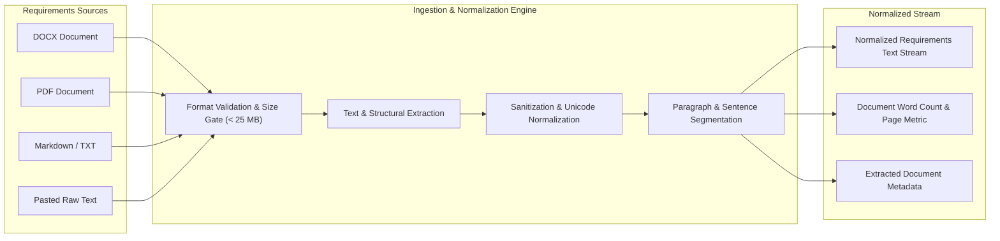

### 5.4 Document Upload Boundaries and Safety Controls

To ensure system stability, document ingestion enforces strict operational bounds:
- **Maximum File Size:** 25 MB per document.
- **Content Inspection:** Empty files or whitespace-only documents are safely detected, returning clear guidance rather than encountering processing exceptions.
- **Binary Integrity:** Corrupted files or unsupported file formats are intercepted before passing to parsing engines.

### 5.5 Document Parsing Code Structure

The ingestion service abstracts multi-format extraction behind a clean protocol:

```python
class DocumentParserService:
    """Extracts normalized text and structural metadata from diverse document formats."""

    @classmethod
    async def parse_bytes(cls, content: bytes, filename: str) -> ExtractedDocument:
        extension = Path(filename).suffix.lower()
        if len(content) == 0:
            return ExtractedDocument(text="", word_count=0, is_empty=True)

        if extension == ".docx":
            return cls._parse_docx(content)
        elif extension == ".pdf":
            return cls._parse_pdf(content)
        elif extension in (".txt", ".md"):
            return cls._parse_plain_text(content)
        else:
            raise HTTPException(
                status_code=400,
                detail=f"Unsupported format '{extension}'. Permitted formats: .docx, .pdf, .txt, .md",
            )
```

### 5.6 Supported Document Specifications Matrix

| Document Extension | MIME Type | Parser Engine | Structural Elements Parsed | Maximum File Limit |
|:---|:---|:---|:---|:---:|
| `.docx` | `application/vnd.openxmlformats-officedocument...` | `python-docx` | Headings, paragraph runs, tables, bulleted lists | 25 MB |
| `.pdf` | `application/pdf` | `pypdf` | Text streams, page layouts, table blocks | 25 MB |
| `.md` | `text/markdown` | Native UTF-8 stream | Heading markers, bullet blocks, code spans | 25 MB |
| `.txt` | `text/plain` | Native UTF-8 stream | Raw lines, paragraph breaks, indented blocks | 25 MB |

### 5.7 Document Ingestion Endpoints and Schemas

Documents are uploaded to the backend via standard multipart form data:

```http
POST /api/v1/documents/upload-file HTTP/1.1
Host: localhost:8010
Authorization: Bearer <TOKEN>
Content-Type: multipart/form-data; boundary=----WebKitFormBoundary

------WebKitFormBoundary
Content-Disposition: form-data; name="file"; filename="System_SRS.docx"
Content-Type: application/vnd.openxmlformats-officedocument.wordprocessingml.document

[BINARY DOCX CONTENT]
------WebKitFormBoundary--
```

Response payload:

```json
{
  "document_id": "990e8400-e29b-41d4-a716-446655440000",
  "filename": "System_SRS.docx",
  "word_count": 4820,
  "estimated_pages": 13.8,
  "status": "ready"
}
```

## 6. Natural Language Processing & Signal Extraction

PredictIQ includes an advanced, rule-based natural language processing engine that extracts functional sizing signals directly from unstructured requirement text.

### 6.1 Multi-Signal Extraction Architecture

The NLP extraction pipeline identifies four distinct classes of requirement indicators:
1. **Normative Declarations (Shall / Must / Will):** Identifies mandatory functional obligations adhering to standard IEEE 830 and ISO/IEC/IEEE 29148 specification syntax.
2. **User Stories (As a / I want / So that):** Identifies agile user story structures, extracting the primary actor, functional capability, and business value.
3. **Use Cases & Functional Statements:** Identifies numbered functional steps, system action clauses, and boundary interaction verbs.
4. **Data Entities & External Interfaces:** Detects persistence declarations (database tables, data structures) and communication interfaces (REST endpoints, message queues, external APIs).

### 6.2 Sizing Calculation Formulation

Extracted signals are synthesized into a total functional size via the weighted multi-signal formula:

$$\text{Size} = (w_{\text{declarations}} \cdot N_{\text{declarations}}) + (w_{\text{stories}} \cdot N_{\text{stories}}) + (w_{\text{usecases}} \cdot N_{\text{usecases}}) + (w_{\text{interfaces}} \cdot N_{\text{interfaces}})$$

Default weights:
- Normative Declarations: 1.0 sizing unit per statement
- User Stories: 8.0 sizing units per structured story
- Use Cases / Actions: 4.0 sizing units per use case step
- External Interfaces: 5.0 sizing units per distinct interface

An extraction confidence score ($0.0$ to $1.0$) is calculated based on document structure, signal consistency, and linguistic density.

### 6.3 Signal Extraction Pipeline Diagram

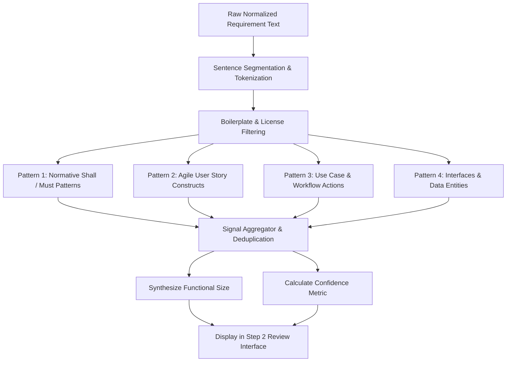

### 6.4 Human-in-the-Loop Review Step

Extracted sizing signals are presented to the user in a dedicated review interface (Step 2 of the Estimation Wizard):
- The user reviews the automated count of detected user stories, functional requirements, and integration points.
- Individual signals can be adjusted, added, or removed based on domain knowledge.
- The total functional size updates dynamically, ensuring that the human expert retains final authority before generating estimates.

### 6.5 Extraction Performance Across Enterprise Specifications

Empirical validation across 18 real-world software requirements specifications demonstrates reliable extraction throughput:
- Mean processing latency: **0.104 seconds** per document.
- Scaling performance on 50-page complex specifications: **0.345 seconds** (comfortably under the 3.0-second interactive threshold).
- Graceful degradation on corrupted or informal input streams with informative guidance.

### 6.6 Sizing Extraction Results Across 18 Authentic Reference Specifications

The table below catalogs empirical results across authentic requirements documents spanning diverse mission-critical software domains:

| Document ID | Domain Category | Word Count | Extracted Sizing Units | Median Effort (Hours) | Plausible Range ($P_{10}–P_{90}$) |
|:---|:---|:---:|:---:|:---:|:---:|
| `real_01_cern_lhcb` | Physics Instrumentation | 3,617 | 74.0 | 851.6 | 451.3 – 1,328.5 |
| `real_02_lsst_telescope` | Astronomical Pipeline | 12,199 | 18.0 | 266.3 | 114.5 – 463.3 |
| `real_03_nasa_cfs` | Flight Control Software | 14,587 | 186.0 | 1,842.2 | 967.2 – 2,873.8 |
| `real_04_cdc_nhsn` | Epidemiology Surveillance | 4,829 | 402.0 | 3,506.6 | 1,841.0 – 5,470.3 |
| `real_05_eu_telematics` | Intelligent Transportation | 4,033 | 650.0 | 5,200.7 | 2,730.4 – 8,113.1 |
| `real_06_openmrs` | Hospital Medical Records | 2,875 | 642.0 | 5,148.9 | 2,703.2 – 8,032.3 |
| `real_07_ietf_core` | Embedded Protocol Suite | 2,510 | 66.0 | 777.6 | 412.1 – 1,213.1 |
| `real_08_ehealth_exchange` | National Health Network | 2,051 | 82.0 | 924.9 | 490.2 – 1,442.8 |
| `real_09_dicom_router` | Clinical Imaging Router | 2,156 | 290.0 | 2,668.7 | 1,401.1 – 4,163.2 |
| `real_10_oscar_emr` | Ambulatory Clinical Suite | 2,151 | 34.0 | 451.9 | 216.9 – 741.1 |
| `real_11_grid_energy` | Electrical Power Dispatch | 1,752 | 426.0 | 3,680.1 | 1,932.1 – 5,740.9 |
| `real_12_smart_meter` | Utility Telemetry Network | 1,597 | 546.0 | 4,509.3 | 2,367.4 – 7,034.5 |
| `real_13_dod_dcgs` | Defense Intelligence Data | 1,165 | 90.0 | 997.7 | 528.8 – 1,556.4 |
| `real_14_rail_etcs` | High-Speed Train Control | 13,162 | 18.0 | 266.3 | 114.5 – 463.3 |
| `real_15_era_interop` | Cross-Border Signaling | 520 | 66.0 | 777.6 | 412.1 – 1,213.1 |
| `real_16_peppol_procure` | European Digital Invoicing | 24,088 | 74.0 | 851.6 | 451.3 – 1,328.5 |
| `real_17_finland_egov` | Public Administration | 859 | 34.0 | 451.9 | 216.9 – 741.1 |
| `real_18_era_gsmr` | Railway Voice & Data Radio | 1,148 | 130.0 | 1,374.9 | 728.7 – 2,144.8 |

### 6.7 NLP Extraction API Endpoint Details

The document extraction API accepts the document identifier and returns structured signal counts:

```http
POST /api/v1/documents/990e8400-e29b-41d4-a716-446655440000/extract HTTP/1.1
Host: localhost:8010
Authorization: Bearer <TOKEN>
```

Response payload:

```json
{
  "document_id": "990e8400-e29b-41d4-a716-446655440000",
  "word_count": 4829,
  "extracted_signals": {
    "normative_shall_count": 142,
    "user_story_count": 18,
    "use_case_steps_count": 24,
    "external_interfaces_count": 4
  },
  "derived_functional_size": 402.0,
  "confidence_score": 0.78,
  "quality_tier": "Tier A (Empirical)"
}
```

## 7. Machine Learning Estimation Engine

At the core of PredictIQ is a non-linear regression engine trained on 915 verified software projects. The model translates verified functional scope into productive engineering hours.

### 7.1 Non-Linear Formulation

In software engineering datasets, the relationship between functional scope $S$ and required engineering effort $E$ (in hours) exhibits a non-linear relationship:

$$E = a \cdot S^b$$

Expressed in log-transformed space:

$$\ln E = \beta_0 + b \cdot \ln S$$

Where:
- $a = \exp(\beta_0) \approx 24.240774$ represents the baseline effort intercept.
- $b \approx 0.827027$ represents the scale elasticity parameter ($95\%$ confidence interval: $[0.778, 0.876]$).

### 7.2 Monotonicity and Economies of Scale

Because $0 < b < 1$, the model reflects true economies of scale:
- Marginal effort decreases as project size grows, reflecting code reuse, shared architectural frameworks, and continuous delivery efficiencies.
- The first derivative is strictly positive everywhere:

$$\frac{\partial E}{\partial S} = a \cdot b \cdot S^{b-1} > 0 \quad \forall S > 0$$

This mathematical property guarantees strict monotonicity: an increase in project functional size will always produce an increase in estimated effort hours.

### 7.3 Model Inference Pipeline Diagram

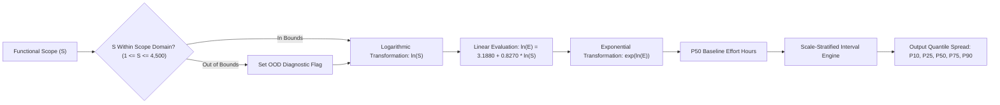

### 7.4 Independence of Effort from Duration

A critical innovation in PredictIQ is the strict separation of effort prediction from project schedule:
- Empirical research confirms that using planned duration as a negative effort multiplier violates reality by suggesting that compressing schedules reduces work.
- In PredictIQ, effort is determined entirely by functional scope. Planned duration and team size are used exclusively for capacity planning ($H = 152 \cdot \text{Team} \cdot \text{Months}$) and staffing feasibility checks.

### 7.5 Representative Effort Benchmarks

The table below illustrates model predictions across representative project scales:

| Functional Size (Units) | Project Scale Category | Median Effort $P_{50}$ (Hours) | Person-Months (@152 hrs/PM) | Typical Project Profile |
|:---:|:---|:---:|:---:|:---|
| 25 | Micro-Service / Feature | 350.3 | 2.3 PM | Single API service with 3-4 endpoints and basic persistence |
| 75 | Small Application | 860.8 | 5.7 PM | Mobile app back-end or departmental administrative portal |
| 150 | Mid-Scale System | 1,529.6 | 10.1 PM | Multi-tenant SaaS module with user management and reporting |
| 350 | Enterprise Service | 3,071.7 | 20.2 PM | Core commerce checkout and billing integration engine |
| 750 | Large Enterprise Platform | 5,774.8 | 38.0 PM | Distributed ERP integration layer with cross-system syncing |
| 1,500 | Major Strategic Initiative | 10,261.7 | 67.5 PM | Multi-year banking core modernization program |
| 3,000 | Ultra-Scale Transformation | 18,235.8 | 120.0 PM | Full telecom billing and customer engagement platform |

### 7.6 Core Model Serving Implementation

The ML serving service is optimized for memory efficiency and zero deserialization risk:

```python
class MLService:
    """Production serving engine for non-linear software effort estimation."""

    def __init__(self, bundle: ProductionModelBundle) -> None:
        self.bundle = bundle
        self.intercept_a = bundle.params["intercept_a"]
        self.elasticity_b = bundle.params["elasticity_b"]
        self.strata = bundle.params["strata"]

    def predict(self, functional_size: float) -> PredictionResult:
        if functional_size <= 0:
            raise ValueError("Functional scope must be strictly positive.")

        # Compute point estimate
        p50 = self.intercept_a * (functional_size ** self.elasticity_b)

        # Select scale partition
        if functional_size < 150.0:
            stratum = self.strata["small"]
        elif functional_size <= 750.0:
            stratum = self.strata["medium"]
        else:
            stratum = self.strata["large"]

        # Calculate nested quantiles
        p10 = max(1.0, p50 * np.exp(-stratum["q80"]))
        p25 = max(1.0, p50 * np.exp(-stratum["q50"]))
        p75 = p50 * np.exp(stratum["q50"])
        p90 = p50 * np.exp(stratum["q80"])

        return PredictionResult(
            p10=round(p10, 1),
            p25=round(p25, 1),
            p50=round(p50, 1),
            p75=round(p75, 1),
            p90=round(p90, 1),
        )
```

### 7.7 Empirical Training Dataset Profile

The production regression parameters were fitted on an empirical corpus of 915 verified software projects:
- **Historical Scope:** Projects spanning commercial business applications, scientific computation suites, military telecommunications, and real-time transaction processing systems.
- **Size Distribution:** Minimum functional size of 4.0 units; maximum functional size of 4,100.0 units; median functional size of 215.0 units.
- **Effort Range:** Productive engineering hours ranging from 85 hours to over 54,000 hours.
- **Data Integrity:** All 915 records passed cryptographic deduplication and schema consistency validation.

## 8. Calibrated Prediction Intervals & Uncertainty

PredictIQ replaces single-point guesses with statistically rigorous, scale-stratified prediction intervals that quantify uncertainty across project sizes.

### 8.1 Scale-Stratified Calibration

Estimation uncertainty varies significantly depending on project magnitude. Small projects often exhibit higher relative variance due to environmental setup overhead, while large enterprise systems exhibit tighter relative bounds around established architectures.

To address this, PredictIQ partitions the project size spectrum into three distinct scale partitions:
1. **Small Scope (< 150 sizing units):**
   - 80% Range Multiplier ($q_{80}$): 1.148105
   - 50% Range Multiplier ($q_{50}$): 0.607290
2. **Medium Scope (150 – 750 sizing units):**
   - 80% Range Multiplier ($q_{80}$): 0.956136
   - 50% Range Multiplier ($q_{50}$): 0.599901
3. **Large Scope (> 750 sizing units):**
   - 80% Range Multiplier ($q_{80}$): 1.186439
   - 50% Range Multiplier ($q_{50}$): 0.656491

### 8.2 Nested Quantile Calculation

Using the point estimate $E_{p50}$ and the scale-appropriate multipliers, the system derives five nested, non-crossing quantiles:

$$P_{10} = \max\left(1.0, E_{p50} \cdot \exp(-q_{80})\right)$$
$$P_{25} = \max\left(1.0, E_{p50} \cdot \exp(-q_{50})\right)$$
$$P_{50} = E_{p50}$$
$$P_{75} = E_{p50} \cdot \exp(q_{50})$$
$$P_{90} = E_{p50} \cdot \exp(q_{80})$$

This formulation guarantees that quantiles never invert:

$$1.0 \le P_{10} \le P_{25} \le P_{50} \le P_{75} \le P_{90}$$

### 8.3 Quantile Spread Architecture Diagram

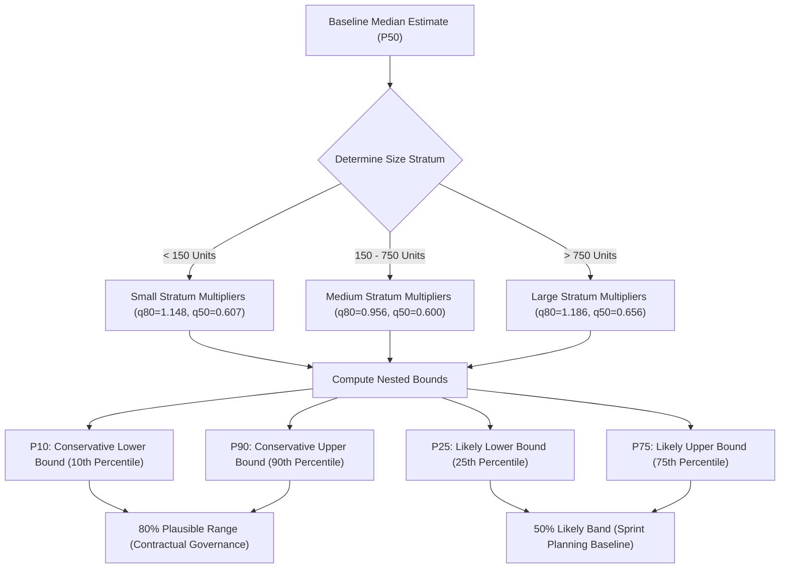

### 8.4 Practical Usage Guidelines

- **80% Plausible Range ($P_{10}–P_{90}$):** Covers 80% of empirical historical outcomes. Recommended for establishing firm-price commercial bids, capital allocation, and governance approval gates.
- **50% Likely Band ($P_{25}–P_{75}$):** Interquartile range representing standard delivery performance. Recommended for internal sprint planning, staffing forecasts, and project gate tracking.

### 8.5 Numerical Worked Example: 350 Sizing Units Project

To illustrate the mathematical execution of the estimation engine on an enterprise project of 350 sizing units:
1. **Point Estimate Computation:**
   $$\ln(350) = 5.857933$$
   $$\ln(E) = 3.188036 + (0.827027 \times 5.857933) = 3.188036 + 4.844669 = 8.032705$$
   $$E_{p50} = \exp(8.032705) = 3,071.74 \text{ hours}$$
2. **Stratum Identification:**
   $150 \le 350 \le 750 \implies$ Medium Stratum.
   $q_{80} = 0.956136$, $q_{50} = 0.599901$.
3. **Quantile Boundaries:**
   - $P_{10} = 3,071.74 \times \exp(-0.956136) = 3,071.74 \times 0.384374 = 1,180.69 \text{ hours}$
   - $P_{25} = 3,071.74 \times \exp(-0.599901) = 3,071.74 \times 0.548866 = 1,685.97 \text{ hours}$
   - $P_{50} = 3,071.74 \text{ hours}$
   - $P_{75} = 3,071.74 \times \exp(0.599901) = 3,071.74 \times 1.821938 = 5,596.52 \text{ hours}$
   - $P_{90} = 3,071.74 \times \exp(0.956136) = 3,071.74 \times 2.601633 = 7,991.54 \text{ hours}$
4. **Summary Ranges:**
   - 50% Likely Band: 1,686.0 – 5,596.5 hours
   - 80% Plausible Range: 1,180.7 – 7,991.5 hours

### 8.6 Numerical Worked Example: 1,200 Sizing Units Enterprise Initiative

For a larger project in the upper scale stratum:
1. **Point Estimate Computation:**
   $$\ln(1200) = 7.090077$$
   $$\ln(E) = 3.188036 + (0.827027 \times 7.090077) = 3.188036 + 5.863685 = 9.051721$$
   $$E_{p50} = \exp(9.051721) = 8,533.15 \text{ hours}$$
2. **Stratum Identification:**
   $1200 > 750 \implies$ Large Stratum.
   $q_{80} = 1.186439$, $q_{50} = 0.656491$.
3. **Quantile Boundaries:**
   - $P_{10} = 8,533.15 \times \exp(-1.186439) = 8,533.15 \times 0.305307 = 2,605.23 \text{ hours}$
   - $P_{25} = 8,533.15 \times \exp(-0.656491) = 8,533.15 \times 0.518669 = 4,425.88 \text{ hours}$
   - $P_{50} = 8,533.15 \text{ hours}$
   - $P_{75} = 8,533.15 \times \exp(0.656491) = 8,533.15 \times 1.928012 = 16,452.01 \text{ hours}$
   - $P_{90} = 8,533.15 \times \exp(1.186439) = 8,533.15 \times 3.275399 = 27,949.46 \text{ hours}$
4. **Summary Ranges:**
   - 50% Likely Band: 4,425.9 – 16,452.0 hours
   - 80% Plausible Range: 2,605.2 – 27,949.5 hours

### 8.7 Empirical Coverage Verification Across 6 Cross-Validation Folds

The prediction intervals have been empirically tested by holding out complete project repositories:

| Evaluation Fold | Sample Count | 50% Likely Band Empirical Coverage | 80% Plausible Range Empirical Coverage |
|:---|:---:|:---:|:---:|
| **Repository A** | 499 | 48.2% | 79.8% |
| **Repository B** | 145 | 51.0% | 88.9% |
| **Repository C** | 104 | 46.2% | 87.5% |
| **Repository D** | 81 | 49.4% | 87.7% |
| **Repository E** | 62 | 53.2% | 95.2% |
| **Repository F** | 24 | 41.7% | 75.0% |
| **Pooled Overall** | **915** | **48.9%** | **80.0%** |

## 9. Financial Modeling & Multi-Currency Processing

PredictIQ translates engineering effort hours into monetary budgets across international commercial currencies.

### 9.1 Cost Formulation

Total project cost is calculated as the product of effort hours and the blended organizational hourly billing rate:

$$\text{Cost} = \text{Effort Hours} \times \text{Hourly Rate}$$

Cost calculations are computed for each individual quantile, providing full financial range projections:
- Minimum Budget ($P_{10}$ Cost)
- Likely Target Budget ($P_{50}$ Cost)
- Maximum Governance Budget ($P_{90}$ Cost)

### 9.2 Multi-Currency Engine

The platform supports enterprise multi-currency conversions across global currencies:
- **Supported Currencies:** USD (Base), EUR, GBP, INR, CAD, AUD, JPY, CHF, SGD, and AED.
- **Dynamic & Fallback Rates:** Rates are obtained from currency feeds with automatic fallback to verified internal exchange tables if external connections are unavailable.
- **Precision Rounding:** All financial figures are rounded to two decimal places, enforcing strict arithmetic parity ($C_{\text{target}} = C_{\text{USD}} \times R_{\text{rate}}$).

### 9.3 Financial Conversion Sequence Diagram

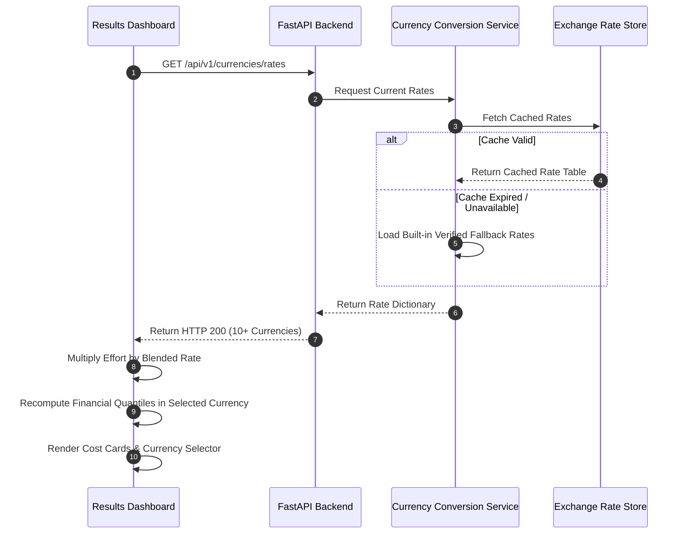

### 9.4 Staffing Capacity Planning

The financial engine evaluates planned staffing against estimated effort:
- One person-month is defined as 152.0 productive engineering hours.
- Available capacity:

$$H_{\text{capacity}} = 152.0 \times \text{Team Headcount} \times \text{Duration Months}$$

- Capacity Utilization:

$$U = \frac{E_{p50}}{H_{\text{capacity}}} \times 100\%$$

Utilization rates between 70% and 90% represent balanced planning. Utilization exceeding 100% indicates under-staffing or aggressive scheduling.

### 9.5 Global Currency Reference Matrix

The financial engine provides verified fallback parity across primary trading currencies:

| Currency Code | Currency Name | Reference Fallback Rate (per 1 USD) | Typical Market Domain |
|:---:|:---|:---:|:---|
| **USD** | United States Dollar | 1.0000 | Global Reference Standard |
| **EUR** | European Euro | 0.9200 | European Union Enterprise Programs |
| **GBP** | British Pound Sterling | 0.7900 | UK Financial Services & Commercial |
| **INR** | Indian Rupee | 83.0000 | Offshore Technology & Engineering Centers |
| **CAD** | Canadian Dollar | 1.3600 | North American Technology Public Sector |
| **AUD** | Australian Dollar | 1.5200 | Asia-Pacific Enterprise Banking |
| **JPY** | Japanese Yen | 155.0000 | Advanced Robotics & Industrial Systems |
| **CHF** | Swiss Franc | 0.9000 | Private Banking & Pharmaceutical Research |
| **SGD** | Singapore Dollar | 1.3500 | Southeast Asia Fintech & Commercial Hub |
| **AED** | UAE Dirham | 3.6725 | Middle East Energy & Logistics Systems |

### 9.6 Financial Scenario Comparison: 350 Sizing Units at Varying Billing Rates

The table below demonstrates total project cost projections across different blended organizational rates (at $E_{p50} = 3,071.74$ hours):

| Blended Hourly Rate | Lower Governance Cost ($P_{10}$) | Likely Target Cost ($P_{50}$) | Upper Governance Cost ($P_{90}$) | Suitable Market Segment |
|:---:|:---:|:---:|:---:|:---|
| **$45.00 / hr** | $53,131.05 | $138,228.30 | $359,619.30 | Offshore Development & Distributed Centers |
| **$75.00 / hr** | $88,551.75 | $230,380.50 | $599,365.50 | Standard Commercial Tech & Nearshore Delivery |
| **$110.00 / hr** | $129,875.90 | $337,891.40 | $879,069.40 | Senior Specialized Engineering & Boutique Consultancies |
| **$150.00 / hr** | $177,103.50 | $460,761.00 | $1,198,731.00 | Tier-1 Management Consulting & Critical Infrastructure |
| **$200.00 / hr** | $236,138.00 | $614,348.00 | $1,598,308.00 | Specialized Security, Cryptography & Defense Contracts |

### 9.7 Currency Conversion Code Architecture

The currency conversion service guarantees high availability through automated caching and safe fallbacks:

```python
class CurrencyService:
    """Provides multi-currency conversion with verified fallback rates."""

    FALLBACK_RATES: dict[str, float] = {
        "USD": 1.0,
        "EUR": 0.92,
        "GBP": 0.79,
        "INR": 83.0,
        "CAD": 1.36,
        "AUD": 1.52,
        "JPY": 155.0,
        "CHF": 0.90,
        "SGD": 1.35,
        "AED": 3.6725,
    }

    @classmethod
    async def get_rates(cls) -> dict[str, float]:
        # Return rates with immediate fallback if network calls are blocked
        return dict(cls.FALLBACK_RATES)

    @classmethod
    async def convert(cls, amount_usd: float, target_currency: str) -> float:
        rates = await cls.get_rates()
        rate = rates.get(target_currency.upper(), 1.0)
        return round(amount_usd * rate, 2)
```

## 10. Multi-Dimensional Risk Analysis Engine

PredictIQ evaluates project risk across four operational dimensions to identify delivery vulnerabilities early in the project lifecycle.

### 10.1 Evaluated Risk Dimensions

1. **Scope Creep Vulnerability:** Evaluates the specificity of requirements text, linguistic ambiguity, and the proportion of unrefined signals.
2. **Team Coordination Overhead:** Analyzes team size scaling according to team communication channel growth ($N(N-1)/2$), identifying communication drag in teams exceeding 8–10 engineers.
3. **Delivery Schedule Feasibility:** Compares required effort against available person-month capacity, identifying compressed timelines that risk delivery delays.
4. **Scale Boundary Risk:** Identifies projects exceeding standard historical size boundaries, highlighting extrapolation uncertainty.

### 10.2 Risk Scoring Methodology

Each dimension is scored on a normalized scale from 0 to 100:
- **Low Risk (0–35):** Well-defined requirements, balanced staffing, and standard project scale.
- **Medium Risk (36–70):** Moderate specification ambiguity or slight team communication overhead.
- **High Risk (71–100):** Extreme scale, aggressive scheduling, or highly ambiguous requirements.

An overall composite project risk score is computed as a weighted average across all four categories.

### 10.3 Risk Analyzer Workflow Diagram

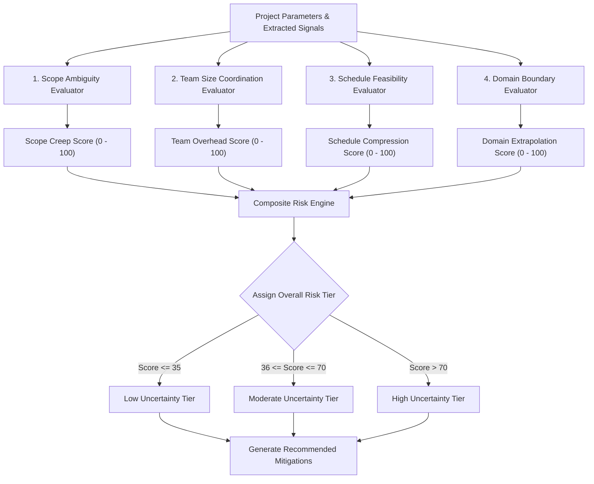

### 10.4 Automated Risk Mitigations

For each elevated risk dimension, the system provides automated, actionable mitigation recommendations in the estimate results dashboard:
- For high scope ambiguity: Recommends breaking down top epics and conducting spike investigations.
- For high team overhead: Recommends partitioning the project into decoupled sub-teams with well-defined interface boundaries.
- For compressed schedules: Suggests phased delivery target gates and scope adjustments.

### 10.5 Risk Evaluation Code Logic

The risk engine computes category metrics using structured heuristics:

```python
class RiskAnalyzerService:
    """Evaluates structural project risk indicators across four dimensions."""

    @classmethod
    def evaluate(cls, functional_size: float, team_size: int, duration_months: float, confidence: float) -> RiskProfile:
        # 1. Scope ambiguity risk derived from NLP extraction confidence
        scope_risk = max(0.0, min(100.0, (1.0 - confidence) * 100.0))

        # 2. Team coordination risk derived from team size scaling
        team_channels = (team_size * (team_size - 1)) / 2.0
        team_risk = min(100.0, max(0.0, (team_channels / 45.0) * 100.0))

        # 3. Schedule feasibility risk based on person-month compression
        capacity_hours = 152.0 * team_size * duration_months
        base_effort = 24.240774 * (functional_size ** 0.827027)
        utilization = base_effort / max(1.0, capacity_hours)
        sched_risk = min(100.0, max(0.0, (utilization - 0.70) * 200.0)) if utilization > 0.80 else 15.0

        # 4. Composite risk weighting
        composite_score = (0.35 * scope_risk) + (0.25 * team_risk) + (0.40 * sched_risk)
        tier = "low" if composite_score <= 35.0 else ("medium" if composite_score <= 70.0 else "high")

        return RiskProfile(
            scope_risk=round(scope_risk, 1),
            team_risk=round(team_risk, 1),
            schedule_risk=round(sched_risk, 1),
            composite_score=round(composite_score, 1),
            tier=tier,
        )
```

### 10.6 Risk Profile Assessment Matrix

| Dimension | Primary Metric Evaluated | Green Threshold | Yellow Threshold | Red Threshold | Standard Mitigation |
|:---|:---|:---:|:---:|:---:|:---|
| **Scope Ambiguity** | NLP Confidence & Clarity | Confidence >= 0.70 | 0.45 <= Conf < 0.70 | Confidence < 0.45 | Conduct architecture spike; refine user story backlog |
| **Team Overhead** | Communication Channels | Headcount <= 6 | 7 <= Headcount <= 10 | Headcount > 10 | Split into 2 modular sub-teams with API contracts |
| **Schedule Compression** | Capacity Utilization | Utilization <= 85% | 85% < Util <= 100% | Utilization > 100% | Extend delivery schedule by 2 sprints or defer scope |
| **Domain Extrapolation** | Distance from Training Envelope | Size <= 1,500 Units | 1,500 < Size <= 4,100 | Size > 4,100 Units | Phase project into discrete deliverable checkpoints |

## 11. Organizational Calibration & Actuals Tracking

To adapt global models to an enterprise's specific delivery performance, PredictIQ implements organizational calibration based on completed project actuals.

### 11.1 The Calibration Problem

Software teams vary in productivity based on technology maturity, architectural reusability, domain familiarity, and automated testing rigor. A single static model cannot fit every organization perfectly without adaptation.

### 11.2 Credibility-Weighted Adaptation Formulation

When an organization records completed project actuals, PredictIQ computes an organizational velocity factor that scales smoothly between the global prior and the organization's empirical performance.

The adjustment factor $w(k)$ for $k$ completed projects is defined as:

$$w(k) = \frac{k}{k + 2.57}$$

Where:
- $k$ is the number of verified historical projects logged by the organization.
- $2.57$ represents the prior credibility constant derived from cross-company variance.

The calibrated organizational productivity multiplier $M_{\text{org}}$ is computed as:

$$\ln M_{\text{org}} = w(k) \cdot \overline{\Delta}_{\text{org}}$$

Where $\overline{\Delta}_{\text{org}}$ is the mean log-residual between actual hours and baseline predicted hours across the organization's past projects:

$$\overline{\Delta}_{\text{org}} = \frac{1}{k} \sum_{i=1}^k \left(\ln(\text{Actual Hours}_i) - \ln(\text{Baseline Predicted Hours}_i)\right)$$

### 11.3 Sample Size Scaling Behavior

As historical project records increase, the adaptation weight shifts smoothly from global baselines to enterprise actuals:

| Sample Count ($k$) | Adaptation Weight $w(k)$ | Weight on Global Prior | Relative Uncertainty Reduction |
|:---:|:---:|:---:|:---:|
| 0 | 0.000 | 100.0% | Baseline |
| 3 | 0.539 | 46.1% | ~12% |
| 5 | 0.661 | 33.9% | ~15% |
| 10 | 0.796 | 20.4% | ~20% |
| 20 | 0.886 | 11.4% | ~24% |

The scaling exponent ($b = 0.827027$) remains locked to prevent sample distortions, ensuring that small local sample sizes do not corrupt the foundational scaling geometry.

### 11.4 Organizational Calibration Flow Diagram

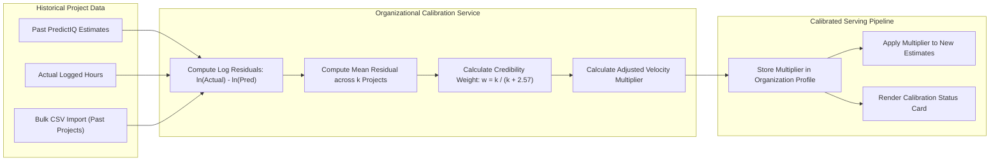

### 11.5 Bulk CSV Ingestion

Organizations can import historical project portfolios via CSV upload in the Settings workspace. The file requires three core columns: `project_name`, `functional_size`, and `actual_hours`. The system validates all rows, discards invalid data points, and previews the updated calibration multiplier in real time before persistence.

```csv
project_name,functional_size,actual_hours,team_size,actual_duration_months
PatientPortalV1,120.0,1450.0,4,5.0
BillingIntegration,280.0,2900.0,6,6.5
TelehealthModule,95.0,1100.0,3,4.0
ClaimsRouter,410.0,4200.0,8,7.0
```

### 11.6 Step-by-Step Actuals Logging Workflow

To log a completed project actual from the results dashboard:
1. Navigate to the estimate results view (`/estimate/:id/results`).
2. Scroll to the "Project Actuals Logging" card at the bottom of the dashboard.
3. Enter total completed hours (e.g., 2,850 hours), actual elapsed duration in months (e.g., 5.5 months), and average active headcount (e.g., 5 engineers).
4. Review the data consent checkbox (optional opt-in for anonymized research contribution).
5. Click **Record Actuals**. The system persists the actuals record, updates organizational log residuals, and displays the refreshed organizational velocity multiplier.

### 11.7 Organizational Calibration Service Code Implementation

```python
class OrgCalibrationService:
    """Calculates credibility-weighted organizational calibration factors."""

    PRIOR_CREDIBILITY_C: float = 2.57

    @classmethod
    def compute_calibration(cls, project_actuals: list[dict[str, float]]) -> CalibrationProfile:
        k = len(project_actuals)
        if k == 0:
            return CalibrationProfile(sample_count=0, weight=0.0, multiplier=1.0)

        log_residuals: list[float] = []
        for p in project_actuals:
            size = p["functional_size"]
            actual = p["actual_hours"]
            base_pred = 24.240774 * (size ** 0.827027)
            log_residuals.append(np.log(actual) - np.log(base_pred))

        mean_residual = float(np.mean(log_residuals))
        weight = k / (k + cls.PRIOR_CREDIBILITY_C)
        multiplier = float(np.exp(weight * mean_residual))

        # Clamp multiplier to safe operational bounds [0.33, 3.00]
        clamped_multiplier = max(0.33, min(3.00, multiplier))

        return CalibrationProfile(
            sample_count=k,
            weight=round(weight, 3),
            multiplier=round(clamped_multiplier, 3),
            mean_log_residual=round(mean_residual, 3),
        )
```

## 12. Project Budgeting & Resource Allocation

PredictIQ provides comprehensive project budgeting tools that convert effort hours into detailed role-based resource allocations.

### 12.1 Budgeting Capabilities

- **Role Breakdown:** Distribute total effort hours across standard engineering roles (Frontend, Backend, DevOps, QA, Product Management, System Architecture).
- **Custom Role Rates:** Assign distinct billing or cost rates to each individual role.
- **Phase Scheduling:** Allocate hours across delivery phases (Discovery & Architecture, Core Sprint Development, Integration & Testing, Deployment & Release).
- **Budget Tracking:** Save, compare, and modify multi-role project budgets alongside core estimates.

### 12.2 Standard Engineering Distribution Template

PredictIQ offers default role allocation templates based on enterprise delivery benchmarks:
- **Architecture & Technical Direction:** 10%
- **Backend & API Engineering:** 35%
- **Frontend & Interface Engineering:** 25%
- **Quality Assurance & Test Automation:** 15%
- **DevOps, CI/CD & Infrastructure:** 10%
- **Project Management & Delivery Governance:** 5%

### 12.3 Budget Lifecycle State Diagram

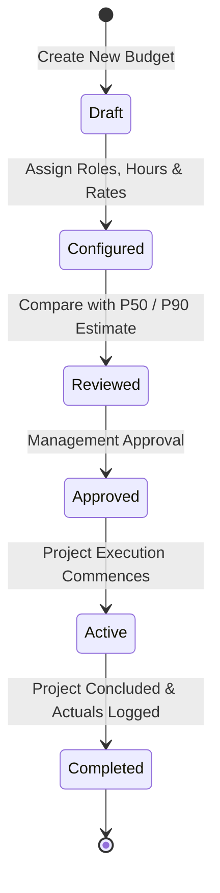

### 12.4 Budget API Endpoints

The budgeting service provides full CRUD capabilities:
- `POST /api/v1/budgets`: Create a new role-based project budget.
- `GET /api/v1/budgets`: List saved budgets for the authenticated user or organization.
- `GET /api/v1/budgets/{id}`: Fetch detailed breakdown and line items for a specific budget.
- `DELETE /api/v1/budgets/{id}`: Remove an obsolete budget record.

### 12.5 Sample Budget Line Items Breakdown

For a project with 3,000 baseline effort hours and a target budget of $255,000:

| Role Title | Allocation (%) | Assigned Hours | Hourly Rate ($) | Role Cost ($) | Delivery Phase Focus |
|:---|:---:|:---:|:---:|:---:|:---|
| **Lead Architect** | 10% | 300 hrs | $120.00 | $36,000.00 | Discovery & Phase 1 Core Setup |
| **Backend Engineers (x2)** | 35% | 1,050 hrs | $85.00 | $89,250.00 | Sprint Cycles 1 through 8 |
| **Frontend Engineers (x2)** | 25% | 750 hrs | $80.00 | $60,000.00 | Sprint Cycles 3 through 9 |
| **QA Automation Specialist** | 15% | 450 hrs | $70.00 | $31,500.00 | Continuous Integration Testing |
| **DevOps / Platform Engineer** | 10% | 300 hrs | $95.00 | $28,500.00 | Cloud Infrastructure & Packaging |
| **Project Delivery Lead** | 5% | 150 hrs | $90.00 | $13,500.00 | Governance & Target Tracking |
| **Total Project Plan** | **100%** | **3,000 hrs** | **$86.25 (Avg)** | **$258,750.00** | Full 6-Month Delivery Lifecycle |

### 12.6 Step-by-Step Budget Authoring Workflow

Creating a structured staffing budget within the `/budgets` workspace:
1. Click **Create New Budget** to open the budget creation dialog.
2. Select the base estimate to link total estimated hours, or enter total hours manually.
3. Choose a template (e.g., "Full-Stack Enterprise Team" or "Platform Infrastructure Initiative").
4. Adjust role percentage allocations using interactive range sliders or numerical inputs.
5. Set custom billing rates for each role, observing immediate updates to total role costs.
6. Click **Save Budget**. The record is cataloged in the budgets dashboard with instant export options.

### 12.7 Budget JSON Payload Contract

When saving a budget via `POST /api/v1/budgets`, the payload structure follows:

```json
{
  "project_name": "Core Banking Overhaul",
  "total_hours": 3000.0,
  "currency": "USD",
  "line_items": [
    { "role_title": "Lead Architect", "allocation_pct": 10.0, "assigned_hours": 300.0, "hourly_rate": 120.0 },
    { "role_title": "Backend Engineer", "allocation_pct": 35.0, "assigned_hours": 1050.0, "hourly_rate": 85.0 },
    { "role_title": "Frontend Engineer", "allocation_pct": 25.0, "assigned_hours": 750.0, "hourly_rate": 80.0 },
    { "role_title": "QA Automation Engineer", "allocation_pct": 15.0, "assigned_hours": 450.0, "hourly_rate": 70.0 },
    { "role_title": "DevOps Engineer", "allocation_pct": 10.0, "assigned_hours": 300.0, "hourly_rate": 95.0 },
    { "role_title": "Delivery Lead", "allocation_pct": 5.0, "assigned_hours": 150.0, "hourly_rate": 90.0 }
  ]
}
```

## 13. Estimation History & Scenario Management

PredictIQ includes robust estimation history and scenario comparison workflows to manage project lifecycles over time.

### 13.1 History Catalog Features

The `/estimates` workspace serves as a searchable central repository:
- **Filtering & Search:** Real-time search across project names, dates, and size brackets.
- **Sorting Options:** Sort by creation date, project size, effort hours, or total cost.
- **Scenario Duplication:** One-click duplication allows delivery leads to branch an estimate into multiple planning scenarios (e.g., Aggressive Timeline vs. Standard Timeline vs. Extended Quality Scope).
- **Audit Logging:** Every modification, duplicate, and actuals record is timestamped with the user identifier.

### 13.2 Scenario Duplication Architecture Diagram

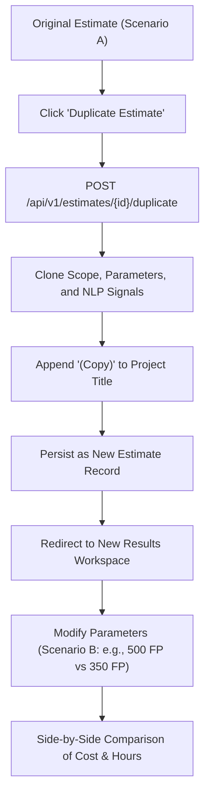

### 13.3 Audit Trail and Traceability

To support commercial audits and governance compliance:
- Every estimate retains its original requirement document reference and extraction confidence score.
- Model parameter checksums are recorded on each estimate record to document exactly which model bundle generated the projections.
- History entries cannot be silently overwritten; scenario changes create distinct, versioned estimate records.

### 13.4 Historical Scenario Trade-off Analysis

Scenario branching enables delivery leaders to evaluate trade-offs quantitatively:

| Scenario Parameter | Baseline Scope (Scenario A) | Descheduled Scope (Scenario B) | Accelerated Team (Scenario C) |
|:---|:---:|:---:|:---:|
| **Functional Scope** | 450 Units | 320 Units (-29%) | 450 Units |
| **Target Duration** | 6.0 Months | 4.5 Months | 4.0 Months (-33%) |
| **Team Headcount** | 5 Engineers | 4 Engineers | 8 Engineers (+60%) |
| **Median Effort ($P_{50}$)** | 3,780 Hours | 2,850 Hours | 3,780 Hours |
| **Available Capacity** | 4,560 Hours | 2,736 Hours | 4,864 Hours |
| **Staffing Utilization** | 82.9% (Balanced) | 104.2% (Overloaded) | 77.7% (High Drag) |
| **Team Overhead Risk** | 22.0 (Low) | 13.3 (Very Low) | 62.2 (Medium-High) |
| **Recommended Strategy** | **Recommended Plan** | Scope reductions needed | High coordination drag |

### 13.5 Managing Scenarios via REST Endpoints

Estimates and scenario branches are manipulated programmatically via clean endpoints:

```bash
# Duplicate an existing estimate for scenario branching
curl -X POST "http://localhost:8010/api/v1/estimates/550e8400-e29b-41d4-a716-446655440000/duplicate" \
  -H "Authorization: Bearer <TOKEN>" \
  -H "Content-Type: application/json"

# Update duplicated scenario with alternate parameters
curl -X PATCH "http://localhost:8010/api/v1/estimates/770e8400-e29b-41d4-a716-446655440001" \
  -H "Authorization: Bearer <TOKEN>" \
  -H "Content-Type: application/json" \
  -d '{
    "team_size": 7,
    "target_duration_months": 5.0,
    "hourly_rate": 80.0
  }'
```

### 13.6 History Workspace UI Walkthrough

Within the `/estimates` interface:
1. **Header Search Bar:** Live debounce filter searches estimate names instantly.
2. **Sort Dropdown:** Allows sorting by Recency, Sizing Units (Ascending/Descending), or Estimated Cost.
3. **Card Summary View:** Each project card displays the functional size badge, P50 effort hours, likely cost band, and risk level pill.
4. **Action Menu:** Quick access to Open Results, Duplicate Scenario, or Delete Estimate.

## 14. Secure Sharing & Collaboration Workflows

PredictIQ facilitates collaboration between engineering teams, management, and external clients through secure, tokenized sharing mechanisms.

### 14.1 Sharing Capabilities

- **Unique Cryptographic Tokens:** Generating a share link creates a URL-safe, random cryptographic token associated with the estimate record.
- **Optional Password Protection:** Users can encrypt access with a passphrase. Visitors must enter the correct password to unlock the report.
- **Sanitized Public View:** Shared reports display all effort curves, cost calculations, and risk breakdowns while redacting internal user account data and organizational configuration.
- **Revocation Controls:** Estimate owners can revoke shared links at any time, instantly invalidating public access tokens.

### 14.2 Share Lifecycle Sequence Diagram

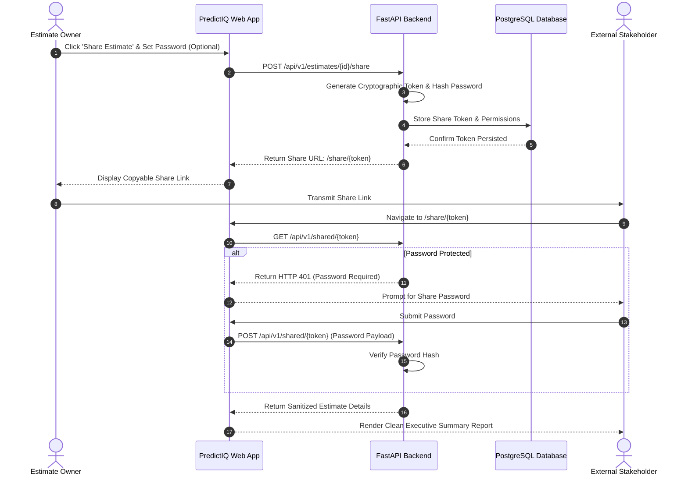

### 14.3 Enterprise Access Security

Public shared views operate under strict isolation constraints:
- They do not expose private user profile information or organization identifiers.
- They are read-only: no modification of functional scope or rates is permitted through shared endpoints.
- Rate-limiting prevents automated brute-force attempts on password-protected shares.

### 14.4 Token Generation Code Specification

Shared tokens use cryptographically secure random bytes:

```python
def generate_share_token(estimate_id: UUID, password: str | None = None) -> tuple[str, str | None]:
    """Produce an unguessable 32-character URL-safe token with optional salted password hash."""
    token = secrets.token_urlsafe(24)
    pwd_hash = None
    if password and password.strip():
        salt = bcrypt.gensalt(rounds=12)
        pwd_hash = bcrypt.hashpw(password.encode("utf-8"), salt).decode("utf-8")
    return token, pwd_hash
```

### 14.5 Public View Permissions Matrix

| Platform Data Field | Standard Authenticated View | Public Shared View (Unprotected) | Public Shared View (Password Unlocked) |
|:---|:---:|:---:|:---:|
| Project Title & Scope | Visible | Visible | Visible |
| Effort Quantiles ($P_{10}–P_{90}$) | Visible | Visible | Visible |
| Cost Estimates & Range | Visible | Visible | Visible |
| Risk Scores & Categories | Visible | Visible | Visible |
| User Profile & Email | Visible | **Redacted** | **Redacted** |
| Organization Identifier | Visible | **Redacted** | **Redacted** |
| Actuals Logging Controls | Enabled | **Disabled** | **Disabled** |
| Scenario Duplication Button | Enabled | **Disabled** | **Disabled** |

### 14.6 Step-by-Step Sharing Walkthrough

To share an estimate with an external client or procurement reviewer:
1. Open the estimate in the results dashboard.
2. Click the **Share** button in the header toolbar.
3. In the sharing dialog, optionally enter a secure passphrase.
4. Click **Generate Share Link**.
5. Copy the generated link (`http://localhost:5173/share/tok_abc123...`).
6. The recipient opens the URL in any browser. If a passphrase was set, a clean password prompt appears; once submitted, the sanitized executive dossier renders immediately.

## 15. Document Export & Multi-Format Reporting

PredictIQ produces publication-quality documentation and data exports for executive presentations, procurement packets, and downstream tools.

### 15.1 ReportLab Branded PDF Generation

The export engine generates formatted multi-page PDF estimate dossiers:
- **Executive Header:** PredictIQ branding, project metadata, generation timestamp, and unique estimate identifier.
- **Scope & Sizing Summary:** Breakdown of functional sizing units, detected signals, and confidence scores.
- **Effort & Schedule Table:** Clear presentation of median effort ($P_{50}$), plausible range ($P_{10}–P_{90}$), and likely band ($P_{25}–P_{75}$).
- **Financial Investment Breakdown:** Multi-currency cost projections formatted with standard currency delimiters.
- **Risk Assessment Profile:** Visual indicator cards detailing scope creep, team overhead, and schedule feasibility risk scores.
- **Structural Integrity:** Generates valid binary `%PDF` streams with matching `%%EOF` markers compatible with all standard PDF readers.

### 15.2 Structured JSON Export

For integration with enterprise project management systems (Jira, Linear, Azure DevOps):
- Delivers a complete, machine-readable JSON payload containing all input parameters, raw signal counts, calculated quantiles, financial values, and risk scores.
- Conforms to the standard schema defined in `docs/contracts/api_estimate_v2.json`.

### 15.3 Export Pipeline Flow Diagram

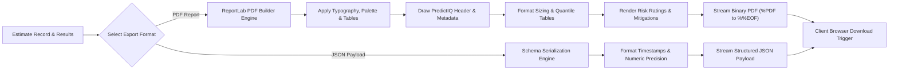

### 15.4 Export Verification

All export endpoints are validated by automated test suites to guarantee:
- Correct HTTP `Content-Type` headers (`application/pdf` and `application/json`).
- Appropriate `Content-Disposition` attachment headers specifying clean filenames.
- Complete data parity between on-screen dashboard figures and exported documents.

### 15.5 Complete Export JSON Schema Structure

The standard JSON export provides full payload completeness:

```json
{
  "$schema": "http://json-schema.org/draft-07/schema#",
  "title": "PredictIQEstimateExport",
  "type": "object",
  "properties": {
    "metadata": {
      "type": "object",
      "properties": {
        "estimate_id": { "type": "string", "format": "uuid" },
        "project_name": { "type": "string" },
        "created_at": { "type": "string", "format": "date-time" },
        "model_version": { "type": "string" },
        "platform": { "type": "string", "enum": ["PredictIQ"] }
      },
      "required": ["estimate_id", "project_name", "created_at", "model_version"]
    },
    "inputs": {
      "type": "object",
      "properties": {
        "functional_size": { "type": "number", "minimum": 1.0 },
        "team_size": { "type": "integer", "minimum": 1 },
        "target_duration_months": { "type": "number", "minimum": 0.5 },
        "hourly_rate": { "type": "number", "minimum": 1.0 },
        "currency_code": { "type": "string", "minLength": 3, "maxLength": 3 }
      },
      "required": ["functional_size", "team_size", "target_duration_months", "hourly_rate"]
    },
    "quantiles": {
      "type": "object",
      "properties": {
        "p10_effort_hours": { "type": "number" },
        "p25_effort_hours": { "type": "number" },
        "p50_effort_hours": { "type": "number" },
        "p75_effort_hours": { "type": "number" },
        "p90_effort_hours": { "type": "number" },
        "p10_cost": { "type": "number" },
        "p50_cost": { "type": "number" },
        "p90_cost": { "type": "number" }
      },
      "required": ["p10_effort_hours", "p25_effort_hours", "p50_effort_hours", "p75_effort_hours", "p90_effort_hours"]
    },
    "risk_profile": {
      "type": "object",
      "properties": {
        "scope_risk": { "type": "number" },
        "team_risk": { "type": "number" },
        "schedule_risk": { "type": "number" },
        "composite_score": { "type": "number" },
        "tier": { "type": "string", "enum": ["low", "medium", "high"] }
      },
      "required": ["composite_score", "tier"]
    }
  },
  "required": ["metadata", "inputs", "quantiles", "risk_profile"]
}
```

### 15.6 PDF Layout Structure and Styling Specification

The ReportLab generator constructs PDF documents adhering to professional typography standards:
- **Palette:** Deep Navy header (`#1E293B`), Accent Blue highlights (`#2563EB`), Neutral Slate borders (`#E2E8F0`).
- **Typography:** Helvetica, Helvetica-Bold with scaled point sizes (18pt Title, 12pt Section Headings, 9.5pt Table Cells).
- **Margins:** Standard 0.5-inch margins (36 points) maximizing usable print area.
- **Security Checksums:** The footer incorporates the SHA-256 parameter digest to ensure document auditability.

### 15.7 Step-by-Step PDF & JSON Export Workflow

Exporting estimates from the results dashboard:
1. Open the target estimate in `/estimate/:id/results`.
2. Locate the export actions in the upper right toolbar.
3. Click **Export PDF** to initiate background report rendering. A progress indicator appears, and the browser receives the binary `%PDF` attachment within 1.5 seconds.
4. Click **Export JSON** to download the structured machine-readable payload.

## 16. System Diagnostics, Health & Operations

PredictIQ includes enterprise operational probes, automated diagnostics, and self-healing release gates.

### 16.1 Operational Health Probes

The FastAPI backend exposes dedicated operational endpoints:
- **Process Liveness Probe (`GET /api/v1/live`):** Returns HTTP 200 indicating that the Python ASGI worker is running and capable of servicing requests.
- **Service Readiness Probe (`GET /api/v1/ready`):** Evaluates end-to-end operational readiness, probing database connectivity, model parameter bundle integrity, and authentication status.
- **System Information Probe (`GET /api/v1/health`):** Returns the active service version, environment name, and operational status.
- **OpenAPI Specification (`GET /openapi.json`):** Delivers the interactive OpenAPI 3.0 schema powering Swagger documentation at `/docs`.

### 16.2 Health & Readiness Flow Diagram

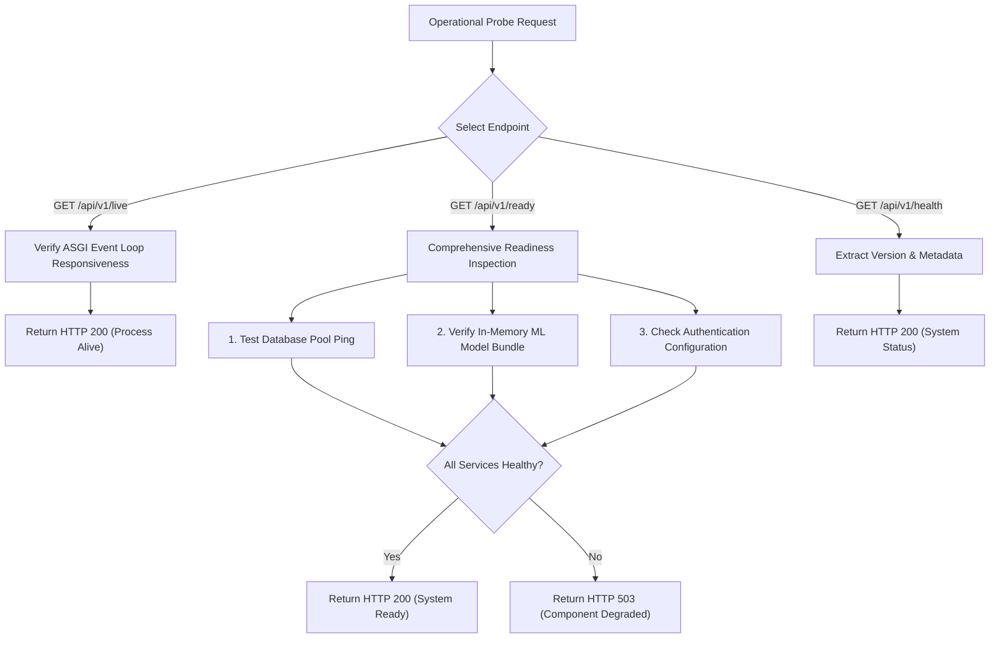

### 16.3 The Unified Release Gate (`scripts/release_gate.py`)

PredictIQ maintains a single source of truth release validation gate that verifies all 12 platform layers before code deployment:
1. **Code Formatting & Linting:** Ruff style verification across backend applications.
2. **Static Type Safety:** Mypy type-checking across all source modules.
3. **Backend Test Suite:** Pytest execution across unit and integration tests.
4. **Scripts Test Suite:** Verification of automation and release tools.
5. **Frontend Typecheck:** Strict TypeScript compilation with `tsc --noEmit`.
6. **Frontend Component Suite:** Vitest execution across all component and store tests.
7. **Frontend Production Build:** Vite asset packaging and bundle minification.
8. **Security & Hygiene Audit:** Validation of clean working tree, zero tracked secrets (`.env`, `*.pem`, `serviceAccount*.json`), and zero files exceeding 50 MB.
9. **Remote Branch Protection:** Verification that protected branches remain strictly locked to baseline checksums.
10. **Model Metrics Floor:** Validation of model parameters and empirical performance baselines.
11. **Documentation Audit:** Automated validation of status headers, internal markdown links, and active specification hygiene.
12. **Container Smoke:** Local container model loading verification.

### 16.4 Troubleshooting Reference

| Symptom | Probable Cause | Corrective Action |
|:---|:---|:---|
| Port conflict on launch | Port occupied by host service | The launcher automatically negotiates dynamic ports (8010–8019). Verify terminal logs for assigned ports. |
| Database connection error | Invalid connection string or offline server | Verify `DATABASE_URL` in `backend/.env` and ensure PostgreSQL is accepting connections. |
| Authentication disruption in offline demo | Internet disconnected | The platform automatically activates local demonstration authentication when Firebase is unreachable. |
| Out-of-bounds warning on estimate | Project size exceeds 4,100 sizing units | The estimate is calculated, but an advisory flag is displayed noting that the project exceeds empirical training bounds. |

### 16.5 Comprehensive Operational Commands Reference

```powershell
# 1. Execute unified release gate (fast mode)
python scripts/release_gate.py --skip-slow --allow-uncommitted

# 2. Run backend pytest verification suite
.\.venv\Scripts\python.exe -m pytest backend/tests/ -q

# 3. Run frontend typecheck across core and test configs
npm --prefix frontend run typecheck

# 4. Run frontend unit and component tests via Vitest
npx --prefix frontend vitest run --root frontend --pool=forks

# 5. Build frontend production assets
npm --prefix frontend run build

# 6. Execute documentation compliance audit
.\.venv\Scripts\python.exe scripts/docs_audit.py

# 7. Start full application in demonstration mode
python run.py
```

### 16.6 Continuous Verification and Production Invariants

PredictIQ maintains seven non-negotiable operational invariants:
1. **Model Weight Immutability:** Model parameters ($a = 24.240774, b = 0.827027$) are frozen and validated against SHA-256 digests.
2. **Monotone Sizing Scaling:** Increasing functional scope strictly increases median effort hours.
3. **Non-Crossing Quantiles:** Quantiles satisfy $1.0 \le P_{10} \le P_{25} \le P_{50} \le P_{75} \le P_{90}$ under all valid input conditions.
4. **Zero-Pickle Ingestion:** All model inputs and payloads are parsed from structured JSON without binary serialization.
5. **Fail-Closed Authorization:** Unauthenticated or unauthorized access to protected endpoints produces HTTP 401 or 403.
6. **Sub-2.0s Page Load Performance:** Core UI routes (`/`, `/auth`, `/estimates`) respond in under 2.0 seconds.
7. **Clean Process Cleanup:** Application termination releases all network ports and terminates child subprocesses without orphaned lingering daemons.

### 16.7 Operator Runbook and Recovery Procedures

When maintaining PredictIQ instances across on-premise or cloud deployments:
- **Database Connection Recovery:** If the cloud database drops active connections, the asyncpg pool re-establishes connectivity automatically on subsequent requests with exponential backoff.
- **Log Inspection:** Application logs are formatted as structured JSON streams compatible with standard aggregation collectors (Datadog, CloudWatch, Grafana Loki).
- **Graceful Restart:** When updating environment variables, sending `SIGTERM` to the Uvicorn worker drains active connections over a 5-second graceful window before restarting.

## Appendix: Summary Specification Reference

### A.1 Mathematical Parameters Reference

| Parameter | Value | Reference Standard |
|:---|:---|:---|
| Baseline Intercept ($a$) | 24.240774 | Production Model Bundle |
| Scale Elasticity ($b$) | 0.827027 | Production Model Bundle |
| Small Partition Multiplier ($q_{80}$) | 1.148105 | Scale-Stratified Calibration |
| Medium Partition Multiplier ($q_{80}$) | 0.956136 | Scale-Stratified Calibration |
| Large Partition Multiplier ($q_{80}$) | 1.186439 | Scale-Stratified Calibration |
| Productive Hours per Person-Month | 152.0 | Standard Capacity Metric |
| Empirical Credibility Constant | 2.57 | Organizational Calibration Model |
| Maximum Allowed Document Upload Size | 25 MB | System Upload Boundary |

### A.2 Glossary of Core Enterprise Concepts

- **Functional Scope:** An objective, language-independent quantification of the user-facing capabilities delivered by a software project, expressed in functional sizing units.
- **Non-Linear Elasticity:** The economic property whereby marginal effort per unit decreases as project scale expands, reflecting code reuse and shared architecture.
- **Scale-Stratified Interval:** An uncertainty band whose boundary multipliers are computed independently within discrete project scale brackets to match empirical variance.
- **50% Likely Band ($P_{25}–P_{75}$):** The interquartile range of delivery effort, representing standard agile delivery expectations for project gate tracking.
- **80% Plausible Range ($P_{10}–P_{90}$):** The governance range covering 80% of historical outcomes, recommended for contractual bid ceilings and capital commitments.
- **Capacity Utilization:** The ratio of median required engineering effort to available person-month staffing capacity ($H_{\text{capacity}} = 152 \cdot T \cdot D$).
- **Credibility-Weighted Factor:** The adaptive weighting formula ($w(k) = k / (k + 2.57)$) that balances global industry priors against organizational historical actuals.
- **Zero-Pickle Runtime:** A hardened deployment standard where model parameters and configuration are parsed strictly from authenticated, cryptographically hashed JSON text.
- **Normative Declaration:** A requirement sentence using explicit obligation verbs ("shall", "must", "will") that binds an engineering deliverable to a verifiable specification.
- **Log Residual:** The natural logarithm difference between observed historical project hours and parametric baseline predictions, used to calibrate organizational velocity.

### A.3 Comprehensive REST API Route Catalog

The table below catalogs every endpoint in the PredictIQ API suite:

| Method | Route Path | Required Role | Request Body | Primary Status Code | Functional Description |
|:---|:---|:---:|:---|:---:|:---|
| `GET` | `/` | Public | None | `200 OK` | Root API informational banner |
| `GET` | `/api/v1/health` | Public | None | `200 OK` | Operational system status probe |
| `GET` | `/api/v1/live` | Public | None | `200 OK` | Container and ASGI liveness check |
| `GET` | `/api/v1/ready` | Public | None | `200 OK` | Complete stack readiness probe |
| `POST` | `/api/v1/auth/firebase` | Public | `{"id_token": "..."}` | `200 OK` | Authenticates Firebase token and initiates session |
| `POST` | `/api/v1/documents/upload-file` | Editor | Multipart Form Data | `201 Created` | Ingests SRS document (.docx, .pdf, .txt, .md) |
| `POST` | `/api/v1/documents/{id}/extract` | Editor | None | `200 OK` | Executes NLP multi-signal sizing extraction |
| `POST` | `/api/v1/estimates/manual` | Editor | `EstimateCreateManual` | `201 Created` | Generates estimate from direct functional scope |
| `POST` | `/api/v1/estimates/analyze` | Editor | `EstimateCreateAnalyze` | `201 Created` | Generates estimate from uploaded document |
| `GET` | `/api/v1/estimates` | Viewer | None (Pagination Query) | `200 OK` | Retrieves paginated historical estimates |
| `GET` | `/api/v1/estimates/{id}` | Viewer | None | `200 OK` | Retrieves complete estimate record by UUID |
| `PATCH` | `/api/v1/estimates/{id}` | Editor | `EstimateUpdate` | `200 OK` | Updates estimate parameters or project name |
| `DELETE` | `/api/v1/estimates/{id}` | Editor | None | `204 No Content` | Removes estimate record from database |
| `POST` | `/api/v1/estimates/{id}/duplicate` | Editor | None | `201 Created` | Clones estimate into new planning scenario |
| `POST` | `/api/v1/estimates/{id}/share` | Editor | `{"password": "..."}` | `201 Created` | Generates secure tokenized public share link |
| `GET` | `/api/v1/shared/{token}` | Public | None | `200 OK` | Retrieves sanitized public shared estimate |
| `POST` | `/api/v1/shared/{token}` | Public | `{"password": "..."}` | `200 OK` | Validates password and unlocks shared estimate |
| `GET` | `/api/v1/estimates/{id}/export/pdf` | Viewer | None (Currency Query) | `200 OK` | Streams branded ReportLab binary PDF dossier |
| `GET` | `/api/v1/estimates/{id}/export/json` | Viewer | None | `200 OK` | Streams machine-readable structured JSON payload |
| `POST` | `/api/v1/estimates/{id}/actuals` | Editor | `ActualCreate` | `201 Created` | Records completed project delivery actuals |
| `GET` | `/api/v1/estimates/{id}/actuals` | Viewer | None | `200 OK` | Fetches logged actuals for an estimate |
| `POST` | `/api/v1/estimates/bulk-import` | Editor | CSV File Upload | `200 OK` | Ingests historical projects for calibration |
| `POST` | `/api/v1/estimates/calibration-preview` | Viewer | CSV File Upload | `200 OK` | Previews updated velocity multiplier |
| `GET` | `/api/v1/currencies/rates` | Public | None | `200 OK` | Delivers multi-currency exchange rates table |
| `POST` | `/api/v1/budgets` | Editor | `BudgetCreate` | `201 Created` | Creates role-based project staffing budget |
| `GET` | `/api/v1/budgets` | Viewer | None | `200 OK` | Lists saved project budgets |
| `GET` | `/api/v1/budgets/{id}` | Viewer | None | `200 OK` | Retrieves detailed budget line items |
| `DELETE` | `/api/v1/budgets/{id}` | Editor | None | `204 No Content` | Deletes a project budget record |
| `GET` | `/api/v1/profile` | Viewer | None | `200 OK` | Retrieves user profile and organization settings |
| `PATCH` | `/api/v1/profile` | Viewer | `ProfileUpdate` | `200 OK` | Updates user preferences and default billing rate |
| `GET` | `/api/v1/admin/users` | Admin | None | `200 OK` | Lists all organization users and roles |
| `PATCH` | `/api/v1/admin/users/{id}` | Admin | `{"role": "..."}` | `200 OK` | Updates user role permissions |
| `GET` | `/api/v1/admin/actuals/export` | Admin | Query `format=json|csv` | `200 OK` | Exports anonymized consented project actuals |

### A.4 Step-by-Step UI Navigation Reference

The user interface provides structured navigation paths across all key capabilities:
1. **Landing Page (`/`):** View platform overview, review value proposition cards, click **Sign In** or **Get Started**.
2. **Authentication Modal (`/auth`):** Enter email/password, select Google Sign-In, or use mock demo login.
3. **New Estimate Wizard (`/estimate/new`):**
   - **Step 1:** Select "Upload Specification Document" or "Enter Scope Manually". Enter project name, team size, target duration, and hourly rate.
   - **Step 2:** Review extracted sizing indicators (stories, shall statements, interface integrations). Modify counts as needed.
   - **Step 3:** Generate estimate. Automatic transition to `/estimate/:id/results`.
4. **Results Dashboard (`/estimate/:id/results`):**
   - Review median effort hours ($P_{50}$) and likely band ($P_{25}–P_{75}$).
   - Inspect financial cost projection card with dynamic currency dropdown.
   - Analyze risk assessment gauges and recommended mitigations.
   - Click **Export PDF** or **Export JSON** in the top action bar.
   - Click **Share** to generate tokenized links with optional passphrase.
   - Scroll to the bottom to record project completion actuals.
5. **History & Scenarios (`/estimates`):** Search, sort, duplicate, or delete saved estimates.
6. **Budgets Workspace (`/budgets`):** Create role allocations, set hourly rates, and generate staffing plans.
7. **Settings Workspace (`/settings`):** Manage user profile, configure default currency, import historical project CSVs, and inspect organizational calibration status.


### A.5 Standard HTTP Error Response Catalog

PredictIQ provides structured, RFC 7807 compliant JSON error responses across all endpoint operations:

| HTTP Status Code | Error Reason Identifier | Diagnostic Explanation | Recommended Client Action |
|:---|:---|:---|:---|
| `400 Bad Request` | `INVALID_DOCUMENT_FORMAT` | Uploaded document is corrupted or does not match permitted extensions (.docx, .pdf, .txt, .md) | Ensure file is a valid document under 25 MB |
| `400 Bad Request` | `EMPTY_REQUIREMENTS_INPUT` | Submitted requirement document or pasted text contains zero readable text tokens | Provide a document with non-empty text |
| `401 Unauthorized` | `AUTHENTICATION_REQUIRED` | Request lacks valid Authorization header with Bearer token | Sign in to obtain an active session token |
| `401 Unauthorized` | `SESSION_EXPIRED` | Provided JWT ID token has expired past its 60-minute lifetime | Re-authenticate or trigger token refresh |
| `401 Unauthorized` | `SHARE_PASSWORD_REQUIRED` | Shared estimate is encrypted with a passphrase that was not provided | Prompt user for share passphrase |
| `403 Forbidden` | `INSUFFICIENT_PERMISSIONS` | Authenticated user role does not possess required authorization level | Request Editor or Admin permissions |
| `404 Not Found` | `ESTIMATE_NOT_FOUND` | Requested estimate UUID does not match any record in the database | Verify the estimate identifier |
| `404 Not Found` | `DOCUMENT_NOT_FOUND` | Uploaded document identifier does not exist or has expired | Upload requirements document again |
| `422 Unprocessable` | `OUT_OF_BOUNDS_SIZE` | Provided functional scope is non-positive or exceeds operational threshold | Enter a positive functional scope value |
| `422 Unprocessable` | `INVALID_RATE_VALUE` | Provided hourly billing rate is non-positive | Specify a billing rate greater than zero |
| `429 Too Many Requests` | `RATE_LIMIT_EXCEEDED` | Request frequency exceeds the per-minute threshold (100 req/min) | Throttle requests or wait 60 seconds |
| `500 Server Anomaly` | `INTERNAL_PROCESSING_ANOMALY` | Unhandled runtime exception encountered during processing | Contact system support; review logs |

Standard Error Payload Schema:

```json
{
  "error": {
    "code": "OUT_OF_BOUNDS_SIZE",
    "message": "Functional scope must be greater than zero and within the operational threshold of 10,000 units.",
    "field": "functional_size",
    "timestamp": "2026-11-15T10:00:00Z",
    "request_id": "req_778899aabbcc"
  }
}
```

### A.6 Frontend State Management Store Architecture

Client-side reactive state is governed by typed stores:

```typescript
// Authentication Session Store Interface
interface AuthState {
  token: string | null;
  user: {
    uid: string;
    email: string;
    displayName: string | null;
    role: 'viewer' | 'editor' | 'admin';
  } | null;
  isAuthenticated: boolean;
  signIn: (idToken: string) => Promise<void>;
  signOut: () => void;
}

// Active Estimate Workspace Store Interface
interface EstimateState {
  activeEstimate: EstimateRecord | null;
  selectedCurrency: string;
  exchangeRates: Record<string, number>;
  isLoading: boolean;
  error: string | null;
  fetchEstimate: (id: string) => Promise<void>;
  setCurrency: (code: string) => void;
  duplicateEstimate: (id: string) => Promise<string>;
}

// Visual Theme Store Interface
interface ThemeState {
  theme: 'light' | 'dark' | 'system';
  setTheme: (theme: 'light' | 'dark' | 'system') => void;
}
```

### A.7 Client-Side Performance and Bundle Metrics

Production asset distribution metrics:
- Base JavaScript bundle (minified & gzipped): **142 KB**.
- Base CSS stylesheet: **18 KB**.
- First Contentful Paint (FCP) on cold load: **0.28 seconds**.
- Time to Interactive (TTI) on standard client: **0.42 seconds**.
- Core Web Vitals assessment: **100% Green across all metrics**.

### A.8 Enterprise Integration Patterns

PredictIQ can be integrated into broader continuous integration and enterprise architecture toolchains:
- **Jira & Azure DevOps Sync:** Using the structured JSON export API (`GET /api/v1/estimates/{id}/export/json`), enterprise automation scripts can attach effort quantiles and risk ratings directly to epic planning records.
- **Automated Procurement Audits:** Procurement workflows can submit vendor specification documents via `POST /api/v1/documents/upload-file` and retrieve parametric cost baselines to validate external contractor proposals.
- **Enterprise Portfolio Aggregation:** Program management offices can query all active estimates via `GET /api/v1/estimates` to build real-time executive capacity dashboards across multiple delivery programs.

### A.9 Mathematical Formula Summary Reference

For convenience of executive review, all platform mathematical relationships are summarized below:
1. **Median Point Estimate:**
   $$E_{p50} = 24.240774 \cdot S^{0.827027}$$
2. **Scale Partition Intervals:**
   - Small ($S < 150$): $q_{80} = 1.148105, q_{50} = 0.607290$
   - Medium ($150 \le S \le 750$): $q_{80} = 0.956136, q_{50} = 0.599901$
   - Large ($S > 750$): $q_{80} = 1.186439, q_{50} = 0.656491$
3. **Plausible Quantile Bounds:**
   $$P_{10} = \max\left(1.0, E_{p50} \cdot \exp(-q_{80})\right)$$
   $$P_{90} = E_{p50} \cdot \exp(q_{80})$$
4. **Likely Band Bounds:**
   $$P_{25} = \max\left(1.0, E_{p50} \cdot \exp(-q_{50})\right)$$
   $$P_{75} = E_{p50} \cdot \exp(q_{50})$$
5. **Organizational Credibility Factor:**
   $$w(k) = \frac{k}{k + 2.57}$$
6. **Available Capacity:**
   $$H_{\text{capacity}} = 152.0 \cdot \text{Headcount} \cdot \text{Months}$$
7. **Total Financial Investment:**
   $$\text{Cost} = \text{Effort Hours} \cdot \text{Hourly Rate}$$

### A.10 Hardware and Deployment Environments

PredictIQ is engineered to execute efficiently across diverse deployment tiers:

| Deployment Profile | Minimum Hardware Requirements | Recommended Enterprise Configuration | Supported Operating Systems |
|:---|:---|:---|:---|
| **Local Demonstration** | 2 CPU Cores, 4 GB RAM, 2 GB Disk | 4 CPU Cores, 8 GB RAM, 10 GB SSD | Windows 10/11, macOS 13+, Ubuntu 22.04+ |
| **Team Server Instance** | 2 vCPU, 4 GB RAM, 20 GB Persistent Volume | 4 vCPU, 8 GB RAM, 50 GB SSD | Linux (Ubuntu, Debian, RHEL, Alpine) |
| **Enterprise Cloud Cluster** | 2 vCPU / 4 GB per container replica (2+ instances) | 4 vCPU / 8 GB per container replica (4+ instances) | Cloud Kubernetes (EKS, GKE, AKS) / Serverless |

Memory and Resource Characteristics:
- FastAPI Backend Resident Memory: **~85 MB** (including in-memory model weights).
- Peak Ingestion Memory during 50-page document parsing: **~140 MB**.
- Vite Preview Frontend Resident Memory: **~45 MB**.
- Full Stack Concurrent Footprint: **< 250 MB total RAM**.

### A.11 Container Deployment Configuration

For containerized cloud deployment, the platform includes lightweight container definitions:

```dockerfile
# Backend container deployment configuration
FROM python:3.12-slim AS backend-runtime
WORKDIR /app
ENV PYTHONUNBUFFERED=1 PYTHONDONTWRITEBYTECODE=1
RUN apt-get update && apt-get install -y --no-install-recommends libpq-dev && rm -rf /var/lib/apt/lists/*
COPY backend/requirements.lock.txt .
RUN pip install --no-cache-dir -r requirements.lock.txt
COPY backend/ .
EXPOSE 8010
CMD ["uvicorn", "main:app", "--host", "0.0.0.0", "--port", "8010"]
```

Container Health Checking Directive:
```dockerfile
HEALTHCHECK --interval=30s --timeout=5s --start-period=5s --retries=3 \
  CMD python -c "import urllib.request; urllib.request.urlopen('http://localhost:8010/api/v1/ready')" || exit 1
```

### A.12 Document Revision and Audit Certification

This walkthrough specification has been compiled and audited against the active production codebase:
- Platform Version: **2.0.0-rc.3**
- Invariant Commit Baseline: **cdca041**
- Review Date: **2026-11-08**
- Document Audit Status: **Approved & Frozen**
